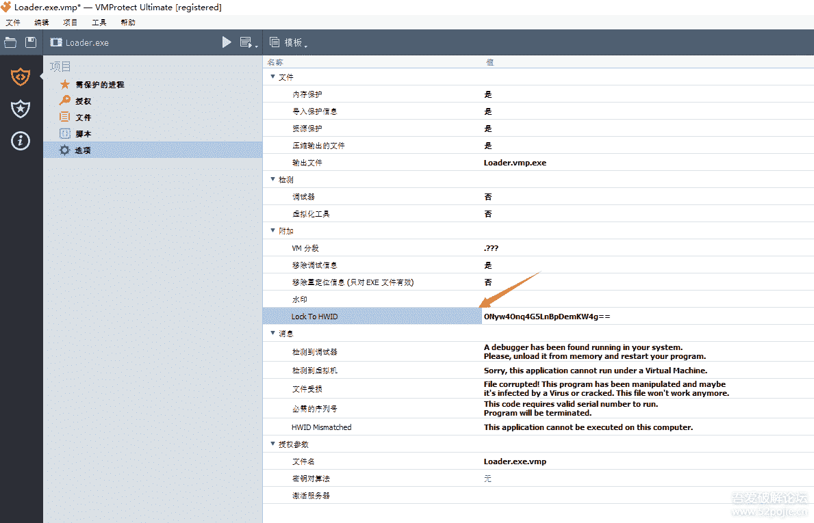
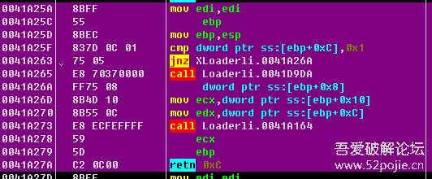
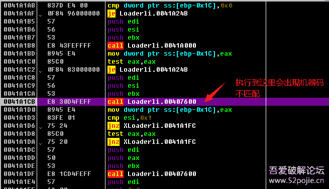

# [原创] 绕过VMProtect3.6自带的Lock To HWID 机器码绑定

- 原帖：<https://www.52pojie.cn/forum.php?mod=viewthread&tid=1825039>
- 抓取时间：2026-11-01T22:47:51

vmp3.6以上版本可以在没源码的情况下，在加壳的时候绑定指定的机器码，设置如下图：（需要自己写个获取机器码的工具，然后在加壳的时候填入要绑定的电脑）



图片.png (65.63 KB, 下载次数: 1)

[附件下载](<https://www.52pojie.cn/forum.php?mod=attachment&aid=MjYzODQwMHw0ZGJmYWJlZXwxNzkzNTczMjY4fDE2ODA4NnwxODI1MDM5&nothumb=yes>)

2023-8-24 11:43 上传

## 搜索特征码

开始我以为只能固定机器码，毕竟vmp自带的，应该不至于写的太差，但实际测试过程中，意外发现可以直接暴力跳过。

搜索特征码：

```
8B FF 55 8B EC 83 7D 0C 01 75 05 E8 ?? ?? 00 00 FF 75 08 8B 4D 10 8B 55 0C E8 EC FE FF FF 59 5D C2 0C 00
```

这个位置看起来类似一个dll的入口加载。



图片.png (15.94 KB, 下载次数: 1)

[附件下载](<https://www.52pojie.cn/forum.php?mod=attachment&aid=MjYzODQwMXxlYWRjMTA0OHwxNzkzNTczMjY4fDE2ODA4NnwxODI1MDM5&nothumb=yes>)

2023-8-24 11:47 上传

## 跟进第二个 `call` 特征码

跟进第二个 `call` 特征码：

```
89 45 E4 85 C0 0F 84 83 00 00 00 57 56 53
```



图片.png (21.67 KB, 下载次数: 1)

[附件下载](<https://www.52pojie.cn/forum.php?mod=attachment&aid=MjYzODQwMnxkOWFmN2FiM3wxNzkzNTczMjY4fDE2ODA4NnwxODI1MDM5&nothumb=yes>)

2023-8-24 11:48 上传

发现运行到这个位置，会提示机器码不匹配 This application cannot be executed on this computer.

---

## 绕过方法

重新运行程序，把 `call` 进去的vm开头改成：

```
mov eax,1
ret 8
```

就可以实现绕过绑定，直接运行程序。

---

后面经过测试，在加载入口位置改成：

```
mov eax1
ret 0xc
```

也可以实现绕过，没3.8的样本，不知道是否也可以这样，理论上来说应该也是可以的。

## 适用范围

但这个方法对于正常写代码绑定那种是不行的，此方法仅限于加壳时候预先绑定hwid的，写的比较乱，当记录，给有需要的人参考。
