# [原创] vmp 3.8.1反调试分析与手动绕过

- 原帖: https://www.52pojie.cn/forum.php?mod=viewthread&tid=1825316
- 抓取时间: 2026-11-01T22:47:49

## 环境

vmp版本：3.8.1 professional，为了方便分析，只勾选反调试选项(user-mode+kernel-mode)

待分析样本: x32 编译环境vs2022

系统环境：windows 11，cpu：amd

用到的调试器 [https://www.52pojie.cn/thread-350397-1-1.html](https://www.52pojie.cn/thread-350397-1-1.html), windbg

本人水平有限，如果哪里有不对请指出 :)

## 初始化工作

首先vmp会调用`RtlAllocateHeap`

然后通过`peb`取到`ldr`链来获取`ntdll`的模块基址(图中高亮行)，接着使用二分查找通过解析导出表获取`ZwQueryInformationProcess`的地址，然后调用他

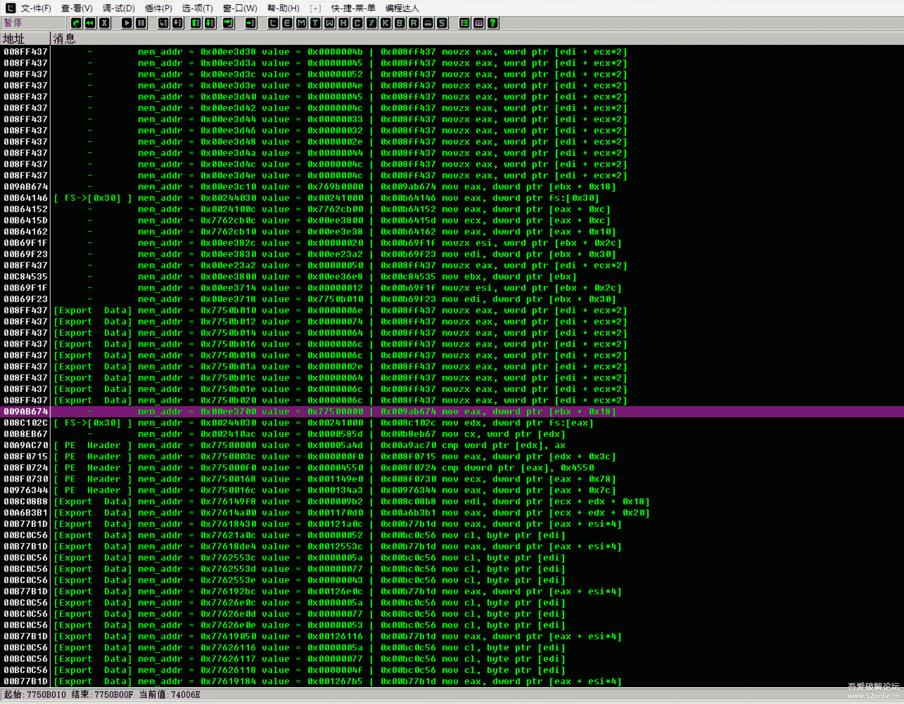

vmp会判断`0xcc`断点，不要在函数头下断，可以用硬件断点

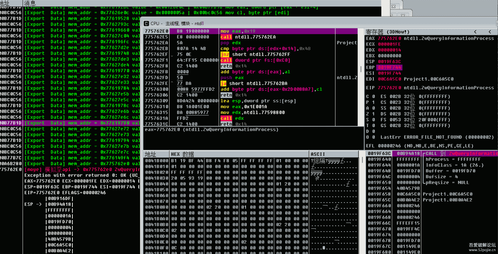

参数`0x1a`（`ProcessWow64Information`）表示查询进程是否运行在`wow64`下（影响后续反调试流程，本文仅分析当前流程下vmp走的反调试流程）

接着通过遍历`ntdll`的资源信息来判断电脑系统版本

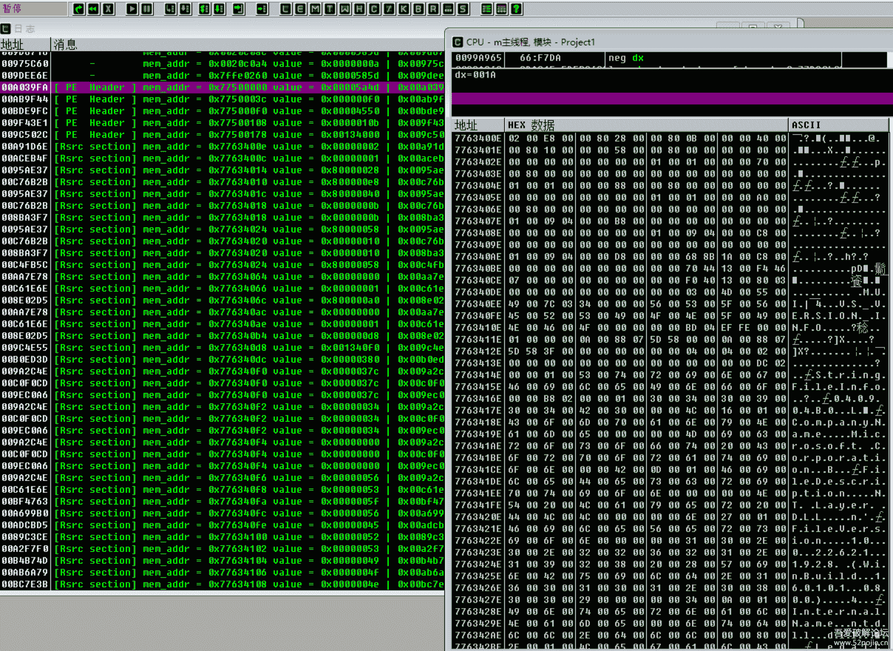

然后调用`ZwOpenSection`、`ZwMapViewOfSection` copy 一份 `ntdll`，通过特征码`0xb8`获取函数的服务号

完成之后接着调用`ZwUnmapViewOfSection`和`ZwClose`

在`OD`中观察程序刚加载时的`esp`的上方可以发现一些数据（标红即被修改的）

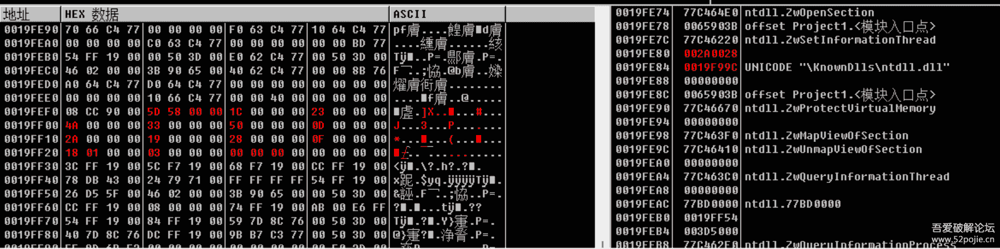

左边不难猜测是vmp用来进行直接系统调用的服务号，`0xD` `ZwSetInformationThread`印象深刻...右边则有一些有趣的函数的地址

分析到这忽然想起前段时间vmp源码（据说是3.5版本?）泄露了部分，我对照着看了一下，目前的流程不能说是相似，简直一模一样

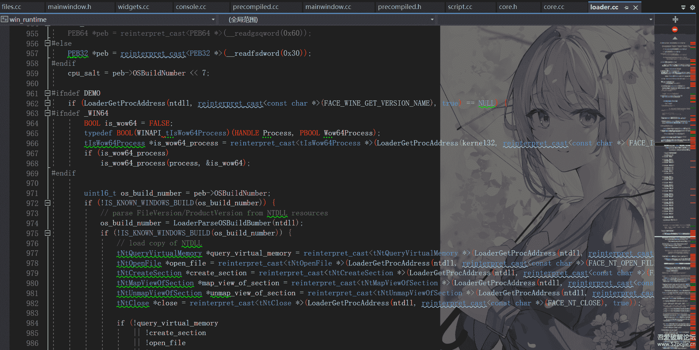

## 开始进行反调试

紧接着，根据以下条件进行不同的反调试。

1. 是否是`wow64`环境（前面有提到）
2. 系统的版本（`fs:[0x30]`+`0x0a4` `OSMajorVersion` : `Uint4B`）下图高亮行
3. 处理器类型（`KUSER_SHARED_DATA` + `0x26a` `NativeProcessorArchitecture` : `Uint2B`）下图高亮行的下一行

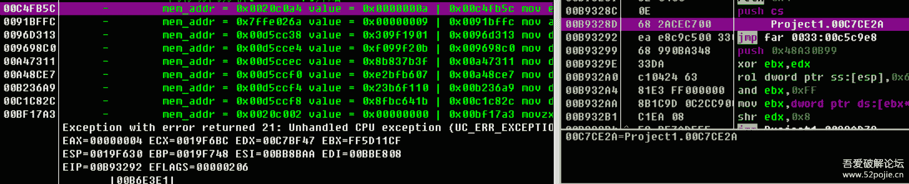

如图，在当前环境下，vmp用“天堂之门”将代码切换到`x64`执行。然后我就干瞪眼了半天，`OD`没法调试`x64`的代码

与此同时我注意到切换到`x64`之后的代码似乎仍然是在[https://www.52pojie.cn/thread-661779-1-1.html](https://www.52pojie.cn/thread-661779-1-1.html)里执行的，所以我选择先对程序进行了一些黑盒测试

在我的系统是win11，程序运行在`wow64`的前提下，似乎只有`NativeProcessorArchitecture`为`amd`时vmp才会用“天堂之门”将代码切换至`x64`继续执行。尝试修改读取到的`NativeProcessorArchitecture`， 其余都是直接走`x32`的，我也不是很清楚具体原因

除此之外我在`jmp far` 和返回地址`00C7CE2A`处分别下硬件执行断点，然后`F9`运行几次，发现经过两次`x32`到`x64`切换之后，vmp似乎已经检测出调试器，使用`NtRaiseHardError`来弹窗提示然后退出。然后我通过观察堆栈，发现有一处红色变动的值`0xFFFFFFFF`，我尝试将其置0，发现流程继续下去到了第三个`jmp far`，之后再弹窗退出。此时很明显已经干预了一处反调试的结果。

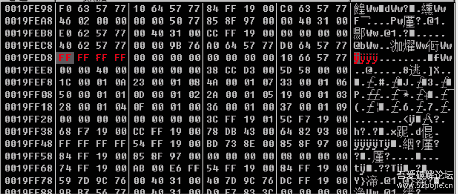

因为`od`、`x32dbg`、`x64dbg`都没办法在切换成`x64`后调试，所以我就用`unicorn`模拟执行和`windbg`来继续分析`x64`代码（吐槽一下，切换`x64`之后还是在虚拟机里执行代码，好恶心啊）

可以发现在切换到`x64`代码后，vmp进行直接系统调用（`rax=0x1c` `ZwSetInformationProcess`）来disable `InstrumentationCallback`

参数`ProcessInformationClass` = `0x28`

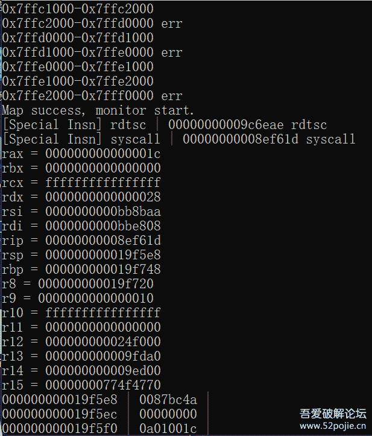

然后我尝试对`syscall`下断，发现程序直接异常退出或者断不下来

这是有两个原因，第一个原因是vmp检测了`0xCC`断点

另一个原因是：vmp通过指令`rdtsc`的返回值，从多个不同但结果相同的路径中随机选择一个路径执行，尝试修改`rdtsc`返回值，会发现模拟到不同的路径。这也就是为什么实际执行和模拟的结果不同（可以通过patch `rdtsc`返回值让他实际走的流程跟模拟流程一致）

既然在切换到`x64`之后仍然是进行直接系统调用，并且他没有访问一些其他内存（或者做其他一些操作），而且我发现他前2次`x32`切换到`x64`都是走这个`jmp far`，我就有了个大胆的想法。它应该是有个类似的封装好的函数可以走`x64`系统调用，想象中的几句伪代码如下

```asm
x64_code:

    （可能是一些准备工作）

    syscall

    （将结果保存等等）

    retf

function MakeX64DirectSystemCall (服务号，参数1，参数2，...，返回值):

    push cs
    push ret_addr
    jmp far 0x33: x64_code

    ret_addr:
    nop
    mov cx,ss
    mov ss,cx

    （不太清楚后续代码）

end

push &返回值
push 参数
push 服务号
call MakeX64DirectSystemCall
```

于是我尝试了几次，最后发现在数据窗口中跟随`ebp`，修改这里附近的值，模拟时发现调用号被修改成功，再试试参数是否能修改，发现也可以。这下可以操作的空间就很多啦。

只不过我还有一个疑惑，就是为什么`x64`返回到`x32`的时候，头3条汇编指令是

```asm
nop
mov cx,ss
mov ss,cx
```

虽然我知道有类似的方法可以反单步跟踪和反虚拟机，但是第四条指令是`pushfd`，这里第四条指令不是

现在我们不跟`x64`代码也知道他要做什么操作了

然后vmp通过直接系统调用（`0x19` `ZwQueryInformationProcess`） 参数`ProcessInformationClass` = `ProcessDebugPort` = `0x7`

查询调试端口号（在返回地址将结果`0x0019fed8`处将`FFFFFFFF`置0即可绕过）

（补充：注意下图标红的地方，从左到右依次是服务号，参数，末尾存放返回值）

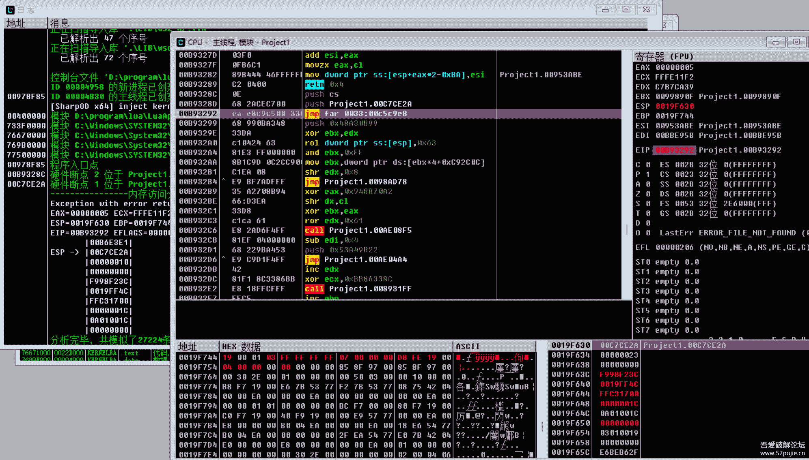

然后到另一处`jmp far` 通过直接系统调用（`0x19` `ZwQueryInformationProcess`） 参数`ProcessInformationClass` = `ProcessDebugObjectHandle` = `0x1E`

查询调试对象句柄

但是这次结果是存放在另一个地方(`r8=0x0019f72c`)

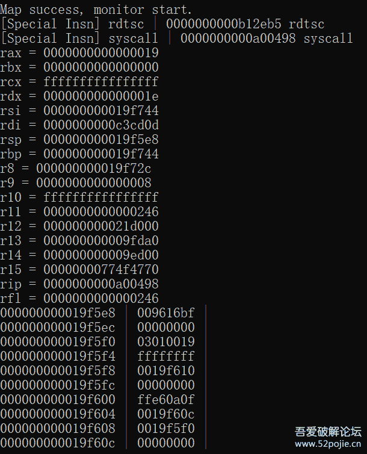

将`0x0019f72c`处查询到的句柄置0，并且返回值（存放在堆栈上）置`0xC0000353`（`STATUS_PORT_NOT_SET`）即可绕过。（实际测试的时候改句柄发现没用，仅需返回值

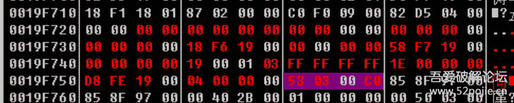

然后调用`ZwSetInformationThread`，参数`0x11` `ThreadHideFromDebugger`，绕过方法：将`0x11`置0即可

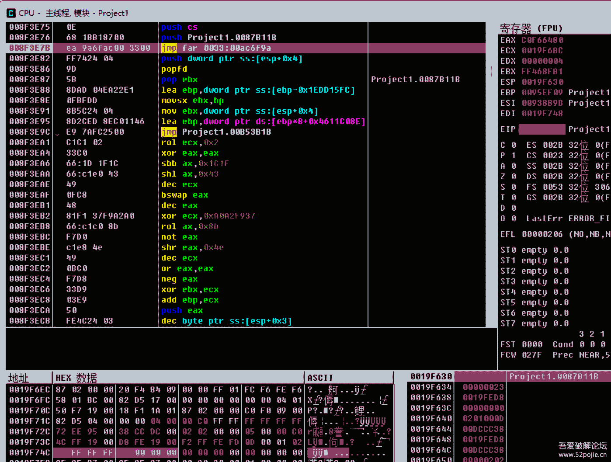


[href="forum.php?mod=attachment&aid=MjYzODUwOXw4ZWY1NDk5OHwxNzkzNTczMjY2fDE2ODA4NnwxODI1MzE2&nothumb=yes" target="_blank"](https://www.52pojie.cn/forum.php?mod=attachment&aid=MjYzODUwOXw4ZWY1NDk5OHwxNzkzNTczMjY2fDE2ODA4NnwxODI1MzE2&nothumb=yes)

2023-8-25 02:27 上传

## kernel-mode 反调试

在上面调用完 `ZwSetInformationThread` 之后，调用 `ZwQuerySystemInformation`（`SystemInformationClass==0x23`）查询系统是否在调试模式下运行。

直接将存放结果的缓冲区置 0 即可。

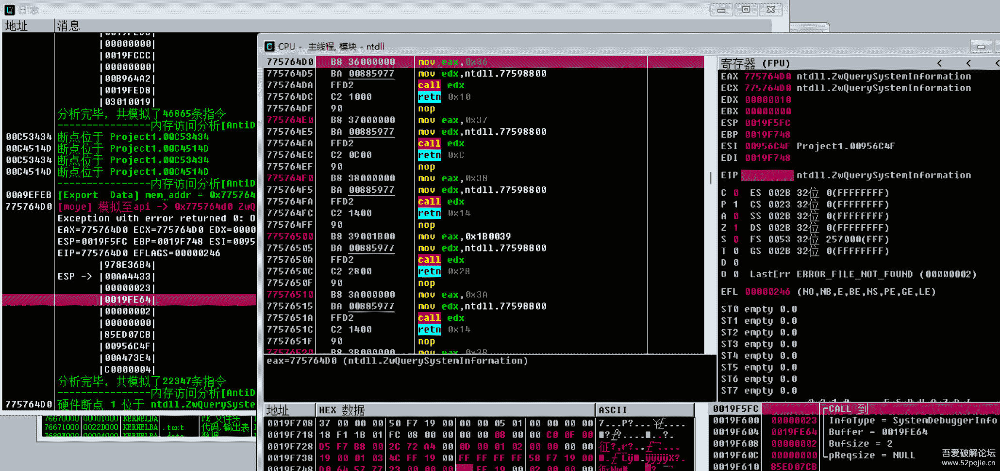

image-13.png (284.62 KB, 下载次数: 3)

[href="forum.php?mod=attachment&aid=MjYzODUxMHxiNzViMzc2ZXwxNzkzNTczMjY2fDE2ODA4NnwxODI1MzE2&nothumb=yes" target="_blank"](https://www.52pojie.cn/forum.php?mod=attachment&aid=MjYzODUxMHxiNzViMzc2ZXwxNzkzNTczMjY2fDE2ODA4NnwxODI1MzE2&nothumb=yes)

2023-8-25 02:28 上传

然后再调用两次该函数，查询内核模块信息（`SystemInformationClass==SystemModuleInformation==0xB`）。

第一次是获取需要的缓冲区长度，第二次是获取真正的信息。直接在第一次将返回的长度置 0 即可。

在此之后，vmp 会对 pe 头、资源等数据进行读取校验。

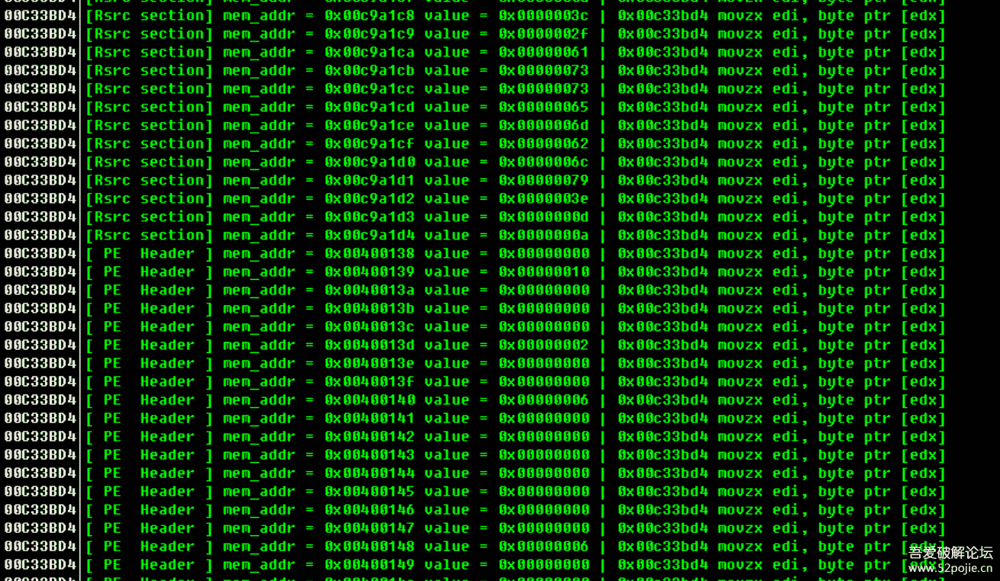

image-14.png (157.74 KB, 下载次数: 1)

[href="forum.php?mod=attachment&aid=MjYzODUxMXxjZDgyNmRmMnwxNzkzNTczMjY2fDE2ODA4NnwxODI1MzE2&nothumb=yes" target="_blank"](https://www.52pojie.cn/forum.php?mod=attachment&aid=MjYzODUxMXxjZDgyNmRmMnwxNzkzNTczMjY2fDE2ODA4NnwxODI1MzE2&nothumb=yes)

2023-8-25 02:31 上传

在这之后再一次调用 `ZwQueryInformationProcess` 查询调试端口和 `ZwSetInformationThread` 进行反调试。绕过方法跟前面操作相似。

然后反调试就成功绕过，程序就跑起来啦 :)

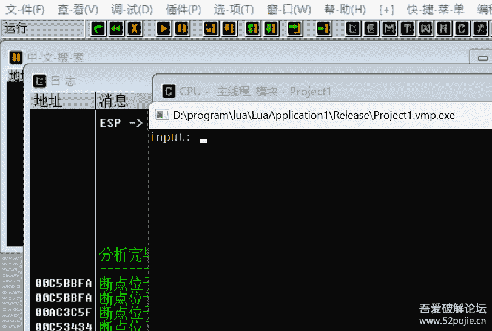

image-15.png (74.35 KB, 下载次数: 1)

[href="forum.php?mod=attachment&aid=MjYzODUxMnw4MjE0NDQzNXwxNzkzNTczMjY2fDE2ODA4NnwxODI1MzE2&nothumb=yes" target="_blank"](https://www.52pojie.cn/forum.php?mod=attachment&aid=MjYzODUxMnw4MjE0NDQzNXwxNzkzNTczMjY2fDE2ODA4NnwxODI1MzE2&nothumb=yes)

2023-8-25 02:31 上传

## 小结

注意对 api 下断时不要在函数头下断，容易被检测。

vmp 反调试全程跑在虚拟机内，可以通过分析他的 api 调用以及访问的内存来推测相关逻辑。

突发奇想的伪代码对 x32->x64 调用逻辑的帮助简化了分析流程，不必每次都模拟切换 x64 代码，让我顺利完成了此次分析。

如果要自动绕过反调试的话，估计要写个驱动？或者如果要手动分析的话直接根据特征码对 vmp 段所有“天堂之门”全部下断，x64 切换和返回的汇编特征还是很明显的（注意别对 `push cs` 或者返回时的 `nop` 下断，会检测 `0xcc`）。

（忘了附代码了，补上模拟 x64 的代码）

\[C++\] 纯文本查看 复制代码


```
#include 
#include 
#include 
#include 
#include 
#include 
#include "unicorn-2.0.1-win32/include/unicorn/unicorn.h"
#include "capstone-5.0/include/capstone/capstone.h"
using namespace std;
uc_engine* uc;
uc_err uc_error;
csh cshandle;
cs_insn* insn;
cs_err cs_error;
size_t count;
BYTE Buffer[5000000];
//jmp far 1
// UINT64 rax = 0x0000000000000004;
// UINT64 rbx = 0x00000000ff5d11cf;
// UINT64 rcx = 0x000000000019f6bc;
// UINT64 rdx = 0x0000000000c7bf47;
// UINT64 rsi = 0x0000000000bb8baa;
// UINT64 rdi = 0x0000000000bbe808;
// UINT64 rsp = 0x000000000019f630;
// UINT64 rbp = 0x000000000019f748;
// UINT64 r8 = 0x000000000000002b;
// UINT64 r9 = 0x000000007757624c;
// UINT64 r10 = 0x0000000000000000;
// UINT64 r11 = 0x0000000000000246;
// UINT64 r12 = 0x000000000024f000;
// UINT64 r13 = 0x000000000009fda0;
// UINT64 r14 = 0x000000000009ed00;
// UINT64 r15 = 0x00000000774f4770;
// UINT64 rip = 0x0000000000c5c9e8;
// UINT64 rfl = 0x0000000000000206;

//jmp far 3
// uint64_t rax = 0x0000000000000032   ;
// uint64_t rbx = 0x000000000087c678   ;
// uint64_t rcx = 0x0000000000000005   ;
// uint64_t rdx = 0x000000000019f6bc   ;
// uint64_t rsi = 0x000000000019f744   ;
// uint64_t rdi = 0x0000000000c3cd0d   ;
// uint64_t rip = 0x0000000000a9040b   ;
// uint64_t rsp = 0x000000000019f630   ;
// uint64_t rbp = 0x0000000000acc57b   ;
// uint64_t r8 =  0x000000000019f5e8   ;
// uint64_t r9 =  0x0000000000000000   ;
// uint64_t r10 = 0x00000000ffffffff   ;
// uint64_t r11 = 0x0000000000000246   ;
// uint64_t r12 = 0x000000000021d000   ;
// uint64_t r13 = 0x000000000009fda0   ;
// uint64_t r14 = 0x000000000009ed00   ;
// uint64_t r15 = 0x00000000774f4770   ;
// uint64_t rfl = 0x0000000000000206   ;

//jmp far 4
uint64_t rax = 0x0019F6BC;
uint64_t rbx = 0x00811B46;
uint64_t rcx = 0x00000005;
uint64_t rdx = 0x001401A8;
uint64_t rsi = 0x0019F744;
uint64_t rdi = 0x00A022B8;
uint64_t rip = 0x00c6dab8;
uint64_t rsp = 0x0019F630;
uint64_t rbp = 0x00A2E676;
uint64_t r8 =  0x000000000019f5e8   ;
uint64_t r9 =  0x0000000000000000   ;
uint64_t r10 = 0x00000000ffffffff   ;
uint64_t r11 = 0x0000000000000246   ;
uint64_t r12 = 0x000000000021d000   ;
uint64_t r13 = 0x000000000009fda0   ;
uint64_t r14 = 0x000000000009ed00   ;
uint64_t r15 = 0x00000000774f4770   ;
uint64_t rfl = 0x0000000000000206   ;

HANDLE FindProcessByName(const char* name)
{
    PROCESSENTRY32 pe32;
    pe32.dwSize = sizeof(PROCESSENTRY32);
    HANDLE hProcessSnap = CreateToolhelp32Snapshot(TH32CS_SNAPPROCESS, 0);
    if (hProcessSnap == INVALID_HANDLE_VALUE)
    {
        return NULL;
    }
    if (Process32First(hProcessSnap, &pe32))
    {
        do
        {
            if (strcmp(pe32.szExeFile, name) == 0)
            {
                CloseHandle(hProcessSnap);
                return OpenProcess(PROCESS_ALL_ACCESS, FALSE, pe32.th32ProcessID);
            }
        } while (Process32Next(hProcessSnap, &pe32));
    }
    CloseHandle(hProcessSnap);
    return NULL;
}

/**
 * [url=home.php?mod=space&uid=190858]@brief[/url] 枚举指定进程所有内存块
 * [url=home.php?mod=space&uid=952169]@Param[/url] hProcess [in] 要枚举的进程,至少需拥有PROCESS_QUERY_INFORMATION权限
 * @param memories [out] 返回枚举到的内存块数组
 * [url=home.php?mod=space&uid=155549]@Return[/url] 成功返回true,失败返回false.
 */
int my_EnumAllMemoryBlocks(HANDLE hProcess, vector & memories) {
    if (hProcess == nullptr) return false;
    // 初始化 vector 容量
    memories.clear();
    memories.reserve(200);
    // 获取 PageSize 和地址粒度
    SYSTEM_INFO sysInfo = { 0 };
    GetSystemInfo(&sysInfo);
    //遍历内存的指针p
    const char* p = (const char*)sysInfo.lpMinimumApplicationAddress;
    MEMORY_BASIC_INFORMATION  memInfo = { 0 };
    while (p  0;
}

void PrintRegs()
{
    printf("rax = %016llx\n", rax);
    printf("rbx = %016llx\n", rbx);
    printf("rcx = %016llx\n", rcx);
    printf("rdx = %016llx\n", rdx);
    printf("rsi = %016llx\n", rsi);
    printf("rdi = %016llx\n", rdi);
    printf("rsp = %016llx\n", rsp);
    printf("rbp = %016llx\n", rbp);
    printf("r8 = %016llx\n", r8);
    printf("r9 = %016llx\n", r9);
    printf("r10 = %016llx\n", r10);
    printf("r11 = %016llx\n", r11);
    printf("r12 = %016llx\n", r12);
    printf("r13 = %016llx\n", r13);
    printf("r14 = %016llx\n", r14);
    printf("r15 = %016llx\n", r15);
    printf("rip = %016llx\n", rip);
    printf("rfl = %016llx\n", rfl);

}

void PrintStack()
{
    DWORD stack[10];
    uc_mem_read(uc, rsp, stack, 10 * sizeof(DWORD));
    for (int i = 0; i  memories;
    my_EnumAllMemoryBlocks(hProcess, memories);
    for (int i = 0; i mnemonic, insn->op_str);

        if (insn ->id == X86_INS_CPUID)
        {
            printf("[Special Insn] cpuid | %016llx %s %s\n", rip, insn->mnemonic, insn->op_str);
        }
        else if (insn ->id == X86_INS_RDTSC)
        {
            printf("[Special Insn] rdtsc | %016llx %s %s\n", rip, insn->mnemonic, insn->op_str);
        }
        else if (insn ->id == X86_INS_IN)
        {
            printf("[Special Insn] in | %016llx %s %s\n", rip, insn->mnemonic, insn->op_str);
        }
        else if (insn->id == X86_INS_OUT)
        {
            printf("[Special Insn] out | %016llx %s %s\n", rip, insn->mnemonic, insn->op_str);
        }
        else if (insn->id == X86_INS_SGDT)
        {
            printf("[Special Insn] sgdt | %016llx %s %s\n", rip, insn->mnemonic, insn->op_str);
        }
        else if (insn->id == X86_INS_SLDT)
        {
            printf("[Special Insn] sldt | %016llx %s %s\n", rip, insn->mnemonic, insn->op_str);
        }
        else if (insn->id == X86_INS_INT)
        {
            printf("[Special Insn] int | %016llx %s %s\n", rip, insn->mnemonic, insn->op_str);
        }
        else if (insn->id == X86_INS_SYSENTER)
        {
            printf("[Special Insn] sysenter | %016llx %s %s\n", rip, insn->mnemonic, insn->op_str);
        }
        else if (insn->id == X86_INS_SYSCALL)
        {
            printf("[Special Insn] syscall | %016llx %s %s\n", rip, insn->mnemonic, insn->op_str);
            PrintRegs();
            PrintStack();
        }
        else if (insn->id != X86_INS_LEA)
        {
            for (DWORD i = 0; i detail->x86.op_count; i++)
            {
                if (insn->detail->x86.operands[i].type == X86_OP_MEM)
                {
                    uint64_t mem_addr = GetMemAddr(insn->detail->x86.operands[i].mem);
                    uint64_t value = 0;
                    if (mem_addr >= 0x10000 && mem_addr = 0x873000 && mem_addr detail->x86.operands[i].size, &value);
                    printf("mem_addr = %016llx value = %016llx | %016llx %s %s\n", mem_addr, value, rip, insn->mnemonic, insn->op_str);
                    break;
                }
            }
        }
        cs_free(insn, 1);
        uc_error = uc_emu_start(uc, rip, 0xffffffff, 0, 1);
        if (uc_error) {
            printf("Exception with error returned %u: %s\n",uc_error, uc_strerror(uc_error));
            printf("%016llx %s %s\n", rip, insn->mnemonic, insn->op_str);
            PrintRegs();
            PrintStack();
            break;
        }
        
        run_cnt++;
        ReadRegs();
    }
    printf("run_cnt = %d\n", run_cnt);
    
}
```
