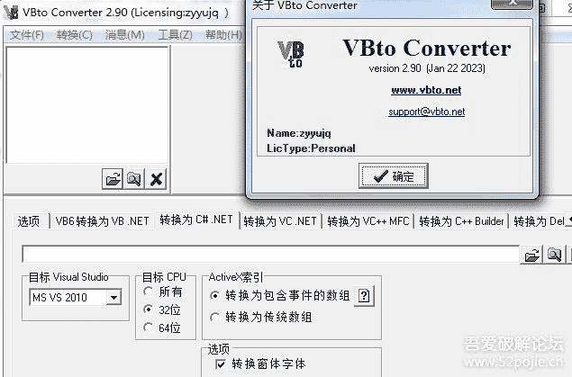

# [原创] VBto Converter V2.90 脱壳逆向分析与调试

- 原帖：[https://www.52pojie.cn/forum.php?mod=viewthread&tid=1825597](https://www.52pojie.cn/forum.php?mod=viewthread&tid=1825597)
- 抓取时间：2026-11-01T22:47:45

## 程序信息

VBto Converter V2.90 程序下载：[http://www.vbto.net/](http://www.vbto.net/)

`VBto Converter`为 `VB6` 代码转换为 `MS VC++ MFC`、`VC++.NET (CLR)`、`VBNET`、`C#`、`J#`、`Borland C++ Builder`、`Borland Delphi`。

原版安装后，`ExeinfoPe` 检测壳为 `Armadillo ver.4.00/8.00`：

[//www.52pojie.cn/forum-5-1.html](https://www.52pojie.cn/forum-5-1.html) 工具采用：`dillodie` V1.6

脱壳完成，`vbto.exe.ddie.exe` 程序可以运行。

## 脱壳与调试

使用 `x64dbg` 调试，寻找注册信息：`LICENSE`。

```
0041477E | 68 96EA7B00 | push vbto.exe.ddie.7BEA96 | 7BEA96:"VBTO_CONVERTER_LICENSE"
00414783 | E8 B4283A00 | call |
00414788 | 85C0 | test eax,eax |
0041478A | 0F84 0B010000 | je vbto.exe.ddie.41489B |使用6个Nop代替此语句
00414790 | 66:C746 10 E000 | mov word ptr ds:[esi+10],E0 |
00414796 | 33D2 | xor edx,edx |
00414798 | 8BC3 | mov eax,ebx |
0041479A | 8955 AC | mov dword ptr ss:[ebp-54],edx | [ebp-54]:RtlEncodeSystemPointer+F9
0041479D | 8D55 AC | lea edx,dword ptr ss:[ebp-54] | [ebp-54]:RtlEncodeSystemPointer+F9
004147A0 | FF46 1C | inc dword ptr ds:[esi+1C] |
004147A3 | E8 34163300 | call vbto.exe.ddie.745DDC |
004147A8 | 8D4D AC | lea ecx,dword ptr ss:[ebp-54] | [ebp-54]:RtlEncodeSystemPointer+F9
004147AB | 51 | push ecx |
004147AC | BA ADEA7B00 | mov edx,vbto.exe.ddie.7BEAAD | 7BEAAD:" (licensing type: \""

.

.

.

00419639 | E8 068FFEFF | call vbto.exe.ddie.402544 |
0041963E | 59 | pop ecx |
0041963F | 8BD8 | mov ebx,eax |
00419641 | 85DB | test ebx,ebx |
00419643 | 0F84 8B000000 | je vbto.exe.ddie.4196D4 |修改JE为无条件跳JMP
00419649 | 8BC6 | mov eax,esi |
0041964B | E8 64593400 | call vbto.exe.ddie.75EFB4 |
00419650 | 50 | push eax |
00419651 | E8 EE8EFEFF | call vbto.exe.ddie.402544 |
00419656 | 80BB 54020000 00 | cmp byte ptr ds:[ebx+254],0 |
0041965D | 59 | pop ecx |
0041965E | 75 1D | jne vbto.exe.ddie.41967D |
00419660 | 80BB 38020000 00 | cmp byte ptr ds:[ebx+238],0 |
00419667 | 74 6B | je vbto.exe.ddie.4196D4 |
00419669 | 68 91F47B00 | push vbto.exe.ddie.7BF491 | 7BF491:"skip object (trial mode)"

.

.

.
```

等等共修改了13处

详见逆向 `x64dbg` 调试补丁 `VBtoConv.1337` 文件内容

## 附件下载

附件下载：包含逆向与汉化后的程序，以及 `x64dbg` 调试补丁 1337 文件，脱壳工具 `dillodie` V1.6，VBto Converter V2.90 安装程序。

下载链接：[https://pan.baidu.com/s/1GGaWgP2ZHDLzOoWtTpcl9A?pwd=ZYYU](https://pan.baidu.com/s/1GGaWgP2ZHDLzOoWtTpcl9A?pwd=ZYYU)



捕获.jpg (54.64 KB, 下载次数: 0)

[附件下载链接](https://www.52pojie.cn/forum.php?mod=attachment&aid=MjYzODY2OXw0NjFmMzcwZHwxNzkzNTczMjYzfDE2ODA4NnwxODI1NTk3&nothumb=yes)

2023-8-25 16:19 上传
