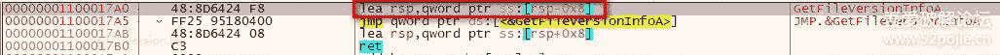
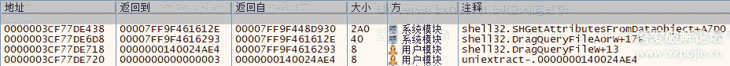
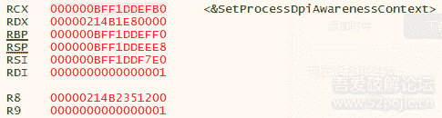
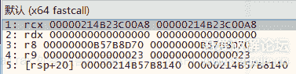

# [原创] Universal Extractor 2 64位闪退分析 (AutoIt)

- 原帖: https://www.52pojie.cn/forum.php?mod=viewthread&tid=1826880
- 抓取时间: 2026-11-01T22:47:35

## 2023-9-1更新：

发现点击某些菜单会闪退，比如“帮助-关于”
最后定位到劫持dll的跳转原函数的过程

2023-09-01_111858.jpg (22.4 KB, 下载次数: 1)
[href="forum.php?mod=attachment&aid=MjY0MDA2MHwwMWZjMzhhZnwxNzkzNTczMjUzfDE2ODA4NnwxODI2ODgw&nothumb=yes" target="_blank"](https://www.52pojie.cn/forum.php?mod=attachment&aid=MjY0MDA2MHwwMWZjMzhhZnwxNzkzNTczMjUzfDE2ODA4NnwxODI2ODgw&nothumb=yes)
2023-9-1 11:34 上传
跳转前改变了堆栈指针，不出问题才怪
源码过程定义加上`nostackframe`修饰就行
请重新下载“`version.dll`”，替换掉原来的
这个dll“`UniExtract64.exe`”和“`UniExtract.exe`”都能正常使用
修复文件：
链接：https://pan.baidu.com/s/14B-RybtQ1ECBxeHm_X7tWQ
提取码：a01y
--------------------------------------------------------------------
## 版本：2.0.0 RC4 2023-07-24

### 问题现象
启动程序，拖入需解压的文件后直接退出
1、`x64dbg`载入主程序，设置异常选项，勾选暂停于第一次机会，`F9`运行，拖入需解压的文件，发生异常并断下，异常指令为
```
00007FF9F448D930        66:8901        mov word ptr ds:[rcx],ax
```
此时`rcx`值为 `0xC67C6060`，系统中并未分配这段内存，因此对其操作必然产生异常。查看调用堆栈如下：

d8556e33-8b0e-4dc5-9ca6-00e505b71aa4.png (45.98 KB, 下载次数: 1)
[href="forum.php?mod=attachment&aid=MjYzOTUwM3xlNDRmNTkyZXwxNzkzNTczMjUzfDE2ODA4NnwxODI2ODgw&nothumb=yes" target="_blank"](https://www.52pojie.cn/forum.php?mod=attachment&aid=MjYzOTUwM3xlNDRmNTkyZXwxNzkzNTczMjUzfDE2ODA4NnwxODI2ODgw&nothumb=yes)
2023-8-29 10:32 上传
可看到异常发生于 `shell32.DragQueryFileW`，点击来到用户模块调用处
```
0000000140024AE2        FFD0        call rax        调用API-DragQueryFileW
```
是个间接调用，应该为不同 API 共用，如果在这里下断点可能会断下很多次
2、来到段首`0x140024970`下断点，重新启动程序，立刻断下了，观察`rcx`、`rdx`、`r8`、`r9`等用于传参的寄存器，发现`rcx`指向 API “`SetProcessDpiAwarenessContext`”的入口，运行到`0x140024AE2` `call rax` 处，发现这就是决定`rax`指向 API 的关键

7fab43e4-d23d-4b5e-ad4c-eb7c834ac218.png (16.68 KB, 下载次数: 0)
[href="forum.php?mod=attachment&aid=MjYzOTUwNXwwZWI2OWE3YXwxNzkzNTczMjUzfDE2ODA4NnwxODI2ODgw&nothumb=yes" target="_blank"](https://www.52pojie.cn/forum.php?mod=attachment&aid=MjYzOTUwNXwwZWI2OWE3YXwxNzkzNTczMjUzfDE2ODA4NnwxODI2ODgw&nothumb=yes)
2023-8-29 10:37 上传
我们现在只需要中断在 `DragQueryFileW`，在“符号”选项卡找到 `DragQueryFileW` 的入口地址为`0x7FF9F4616280`，将段首断点的条件设置为 `qword(rcx)==7FF9F4616280`
3、继续运行，成功断下，发现 `DragQueryFileW` 运行到第三次才出现异常。根据运行到 `call rax` 处参数寄存器的值，参照API文档 ([//learn.microsoft.com/zh-cn/windows/win32/api/shellapi/nf-shellapi-dragqueryfilew?source=recommendations" target="_blank"](https://learn.microsoft.com/zh-cn/windows/win32/api/shellapi/nf-shellapi-dragqueryfilew?source=recommendations:rel="nofollow noopener" href="https))，得知 `DragQueryFileW` 第一次运行返回拖动的文件数，第二次运行返回文件名缓冲区大小，第三次运行应该把返回的文件名放入缓冲区。第三次运行API参数如下：

0744668f-ab81-4dcb-86ce-d0dc7d079899.png (21.17 KB, 下载次数: 2)
[href="forum.php?mod=attachment&aid=MjYzOTUwNHw3OGQwZTVjY3wxNzkzNTczMjUzfDE2ODA4NnwxODI2ODgw&nothumb=yes" target="_blank"](https://www.52pojie.cn/forum.php?mod=attachment&aid=MjYzOTUwNHw3OGQwZTVjY3wxNzkzNTczMjUzfDE2ODA4NnwxODI2ODgw&nothumb=yes)
2023-8-29 10:34 上传
对照API参数
```
UINT DragQueryFileW( [in] HDROP hDrop, [in] UINT iFile, [out] LPWSTR lpszFile, UINT cch );
```
得知`r8`寄存器存放的是缓冲区地址，但现在缓冲区明显不是一个有效地址，为什么会这样呢？`r8`高32位全部为0，猜想是第二次运行后第三次运行前缓冲区的设置出了问题，把64位的缓冲区设置成了32位，还要继续往下分析，找到缓冲区参数设置的地方并拿到正确地址。
4、将所有断点禁用，直接在 `DragQueryFileW` 入口下断点，运行到第二次的时候恢复第2步的段首断点，`F9`后断在段首，`F8`单步往下执行，并观察`r8`的值，来到下面指令`r8`改变了，这就是缓冲区地址
```
0000000140024A4C        4D:8B06        mov r8,qword ptr ds:[r14]        第3个参数
```
查看`r14`指向内存的数据，这里已经是32位了，还得继续向上追溯。
经分析，这一段的作用就是解析 API 的入口及参数后跳转执行，`AutoIt` 的解释器解释到调用 API 的脚本语句时就会进入到这里，载入 API 入口后立即依次解析参数并放入参数寄存器，参数表存放于堆栈的某段地址，每项大小`0x28`, 0-7字节为数据，第8字节为数据长度，第0x10字节为数据类型，代码分析如下：
```


```asm
0000000140024970        55        push rbp        调用API子程序段首
0000000140024971        48:8BEC        mov rbp,rsp        
0000000140024974        48:83EC 40        sub rsp,0x40        
0000000140024978        4C:8965 C0        mov qword ptr ss:[rbp-0x40],r12        
000000014002497C        4C:896D C8        mov qword ptr ss:[rbp-0x38],r13        
0000000140024980        4C:8975 D0        mov qword ptr ss:[rbp-0x30],r14        
0000000140024984        4C:897D D8        mov qword ptr ss:[rbp-0x28],r15        
0000000140024988        48:894D 10        mov qword ptr ss:[rbp+0x10],rcx        API入口
000000014002498C        4C:8B65 10        mov r12,qword ptr ss:[rbp+0x10]        
0000000140024990        4D:8B6C24 18        mov r13,qword ptr ds:[r12+0x18]        参数数量
0000000140024995        49:8BC5        mov rax,r13        
0000000140024998        48:83F8 04        cmp rax,0x4        
000000014002499C        7D 07        jge uniextract-.1400249A5        
000000014002499E        48:C7C0 04000000        mov rax,0x4        
00000001400249A5        48:6BC0 08        imul rax,rax,0x8        
00000001400249A9        48:83C0 08        add rax,0x8        
00000001400249AD        83E0 F0        and eax,0xFFFFFFF0        
00000001400249B0        48:8945 F8        mov qword ptr ss:[rbp-0x8],rax        暂停条件(qword(rcx)==7FF9F4616280)
00000001400249B4        48:2BE0        sub rsp,rax        
00000001400249B7        4D:8D7424 50        lea r14,qword ptr ds:[r12+0x50]        API参数表（每项大小0x28, 0-7字节为数据，第8字节为数据长度，第0x10字节为数据类型）
00000001400249BC        49:83FD 00        cmp r13,0x0        r13存放参数数量
00000001400249C0        0F84 F4000000        je uniextract-.140024ABA        无参数直接跳转执行API，否则开始处理第一个参数
00000001400249C6        49:8B46 10        mov rax,qword ptr ds:[r14+0x10]        读取数据类型
00000001400249CA        48:83F8 01        cmp rax,0x1        
00000001400249CE        74 15        je uniextract-.1400249E5        整数
00000001400249D0        49:8B46 08        mov rax,qword ptr ds:[r14+0x8]        指针
00000001400249D4        48:83F8 09        cmp rax,0x9        9:'\t'
00000001400249D8        74 10        je uniextract-.1400249EA        浮点数float
00000001400249DA        48:83F8 0A        cmp rax,0xA        A:'\n'
00000001400249DE        74 0A        je uniextract-.1400249EA        浮点数double
00000001400249E0        49:8B0E        mov rcx,qword ptr ds:[r14]        
00000001400249E3        EB 0A        jmp uniextract-.1400249EF        
00000001400249E5        49:8D0E        lea rcx,qword ptr ds:[r14]        
00000001400249E8        EB 05        jmp uniextract-.1400249EF        
00000001400249EA        F241:0F1006        movsd xmm0,qword ptr ds:[r14]        
00000001400249EF        49:83C6 28        add r14,0x28        参数表指向下一项
00000001400249F3        49:FFCD        dec r13        
00000001400249F6        0F84 BE000000        je uniextract-.140024ABA        
00000001400249FC        49:8B46 10        mov rax,qword ptr ds:[r14+0x10]        处理第二个参数
0000000140024A00        48:83F8 01        cmp rax,0x1        
0000000140024A04        74 15        je uniextract-.140024A1B        
0000000140024A06        49:8B46 08        mov rax,qword ptr ds:[r14+0x8]        
0000000140024A0A        48:83F8 09        cmp rax,0x9        9:'\t'
0000000140024A0E        74 10        je uniextract-.140024A20        
0000000140024A10        48:83F8 0A        cmp rax,0xA        A:'\n'
0000000140024A14        74 0A        je uniextract-.140024A20        
0000000140024A16        49:8B16        mov rdx,qword ptr ds:[r14]        
0000000140024A19        EB 0A        jmp uniextract-.140024A25        
0000000140024A1B        49:8D16        lea rdx,qword ptr ds:[r14]        
0000000140024A1E        EB 05        jmp uniextract-.140024A25        
0000000140024A20        F241:0F100E        movsd xmm1,qword ptr ds:[r14]        
0000000140024A25        49:83C6 28        add r14,0x28        
0000000140024A29        49:FFCD        dec r13        
0000000140024A2C        0F84 88000000        je uniextract-.140024ABA        
0000000140024A32        49:8B46 10        mov rax,qword ptr ds:[r14+0x10]        处理第三个参数
0000000140024A36        48:83F8 01        cmp rax,0x1        
0000000140024A3A        74 15        je uniextract-.140024A51        
0000000140024A3C        49:8B46 08        mov rax,qword ptr ds:[r14+0x8]        
0000000140024A40        48:83F8 09        cmp rax,0x9        9:'\t'
0000000140024A44        74 10        je uniextract-.140024A56        
0000000140024A46        48:83F8 0A        cmp rax,0xA        A:'\n'
0000000140024A4A        74 0A        je uniextract-.140024A56        
0000000140024A4C        4D:8B06        mov r8,qword ptr ds:[r14]        第3个参数
0000000140024A4F        EB 0A        jmp uniextract-.140024A5B        
0000000140024A51        4D:8D06        lea r8,qword ptr ds:[r14]        
0000000140024A54        EB 05        jmp uniextract-.140024A5B        
0000000140024A56        F241:0F1016        movsd xmm2,qword ptr ds:[r14]        
0000000140024A5B        49:83C6 28        add r14,0x28        
0000000140024A5F        49:FFCD        dec r13        
0000000140024A62        74 56        je uniextract-.140024ABA        
0000000140024A64        49:8B46 10        mov rax,qword ptr ds:[r14+0x10]        处理第四个参数
0000000140024A68        48:83F8 01        cmp rax,0x1        
0000000140024A6C        74 15        je uniextract-.140024A83        
0000000140024A6E        49:8B46 08        mov rax,qword ptr ds:[r14+0x8]        
0000000140024A72        48:83F8 09        cmp rax,0x9        9:'\t'
0000000140024A76        74 10        je uniextract-.140024A88        
0000000140024A78        48:83F8 0A        cmp rax,0xA        A:'\n'
0000000140024A7C        74 0A        je uniextract-.140024A88        
0000000140024A7E        4D:8B0E        mov r9,qword ptr ds:[r14]        
0000000140024A81        EB 0A        jmp uniextract-.140024A8D        
0000000140024A83        4D:8D0E        lea r9,qword ptr ds:[r14]        
0000000140024A86        EB 05        jmp uniextract-.140024A8D        
0000000140024A88        F241:0F101E        movsd xmm3,qword ptr ds:[r14]        
0000000140024A8D        49:83C6 28        add r14,0x28        
0000000140024A91        4C:8D7C24 20        lea r15,qword ptr ss:[rsp+0x20]        
0000000140024A96        49:FFCD        dec r13        
0000000140024A99        74 1F        je uniextract-.140024ABA        
0000000140024A9B        49:8B46 10        mov rax,qword ptr ds:[r14+0x10]        处理第五个及后面的参数
0000000140024A9F        48:83F8 01        cmp rax,0x1        
0000000140024AA3        74 05        je uniextract-.140024AAA        
0000000140024AA5        49:8B06        mov rax,qword ptr ds:[r14]        
0000000140024AA8        EB 03        jmp uniextract-.140024AAD        
0000000140024AAA        49:8D06        lea rax,qword ptr ds:[r14]        
0000000140024AAD        49:8907        mov qword ptr ds:[r15],rax        
0000000140024AB0        49:83C6 28        add r14,0x28        
0000000140024AB4        49:83C7 08        add r15,0x8        
0000000140024AB8        EB DC        jmp uniextract-.140024A96        
0000000140024ABA        49:8B4424 30        mov rax,qword ptr ds:[r12+0x30]        
0000000140024ABF        48:83F8 0A        cmp rax,0xA        A:'\n'
0000000140024AC3        74 06        je uniextract-.140024ACB        
0000000140024AC5        48:83F8 09        cmp rax,0x9        9:'\t'
0000000140024AC9        75 13        jne uniextract-.140024ADE        
0000000140024ACB        49:8B0424        mov rax,qword ptr ds:[r12]        
0000000140024ACF        FFD0        call rax        
0000000140024AD1        4C:8B65 10        mov r12,qword ptr ss:[rbp+0x10]        
0000000140024AD5        F241:0F114424 28        movsd qword ptr ds:[r12+0x28],xmm0        
0000000140024ADC        EB 0F        jmp uniextract-.140024AED        
0000000140024ADE        49:8B0424        mov rax,qword ptr ds:[r12]        
0000000140024AE2        FFD0        call rax        调用API
```

来到指令地址`0x140024A4C`，我们看到`[r14 + 8]`记录的数据长度为4，4个字节，不就是32位吗，程序就是把这个缓冲区当32位使用的。

下面看看哪里给数据长度赋值吧，需要对参数表的长度位`[r14 + 8]`下硬件写入断点，但这段堆栈是程序运行时分配的，每次运行可能都不一样，怎么找这个地址呢？

5、第二次运行`DragQueryFileW`同样也需要解析参数表，与第三次运行`DragQueryFileW`的参数表位于同一段，就用它的数据地址作为参照，事实证明这是可行的。

重启程序，第一次断下在`DragQueryFileW`后，`F4`来到`0x140024A4C`，记下这时`r14`的值（第二次运行`DragQueryFileW`的参数3），然后继续运行再次来到到`0x140024A4C`，查看`r14`的值（第三次运行`DragQueryFileW`的参数3），计算出第三次比第二次的地址多`0x360`。

重启程序，第一次断下在`DragQueryFileW`后，`F4`来到`0x140024A4C`，在地址`[r14 + 0x360 + 8]`设置硬件写入断点，并设置断点条件为`byte(98909DE748)==4`（`0x98909DE748`为`[r14 + 0x360 + 8]`实际地址），继续执行，最后一次断下的指令如下：

```asm
```


# DragQueryFileW 参数类型导致的 64 位兼容问题分析

## 汇编层面观察

```
000000014009CC18 48:8946 08 mov qword ptr ds:[rsi+0x8],rax
```
写入参数数据长度

往上看有很多不同的数据类型，经分析，这一段代码的作用就是按参数的数据类型将参数的长度写入参数堆栈中

## 参数类型追踪

现在我们来看看第三次运行 `DragQueryFileW` 的参数3类型是什么，只要在本段段首 `0x14009C370` 下断点，看看寄存器的值就知道了

重启程序，第二次断下在 `DragQueryFileW` 后，指令地址 `0x14009C370` 下断点，继续运行，我们看到 `rdx` 里面是数据类型，共运行了5次，数据分别是 `int`、`hwnd`、`int`、`int`、`int`，第一次是 `API` 返回数据类型，后面四次分别为第1-4个参数类型，可以看到第3个参数定义成了 `int`，在第三个参数数据类型赋值时我们在指令地址 `0x14009CC18` 处将 `rax` 值改为 `8`，第三次断下在 `DragQueryFileW` 后，看到 `r8` 已经传过来64位的地址，继续执行也不闪退了，编辑框中显示出来正确的文件路径，继续执行能够正确解压。

## 问题根源

至此，问题已经很明显了，本该是64位的 `API` 参数定义成了32位而导致高32地址位丢失，从而导致异常闪退，上面5次参数类型赋值里面的4个 `int` 类型按理说应该都设置为 `int64`，只有第3个参数发生异常是因为其他参数的数值较小，都没有超过32位的数值范围所以没有出错。

然后我到 Universal Extractor 的 `github`（`https://github.com/Bioruebe/UniExtract2`）去下载老版本的源码（我分析的这个版本是第三方修改的，没有源码），找到了文件拖动的函数，验证了我的分析是正确的：

[Visual Basic] 纯文本查看 复制代码

```
; Drag and drop handler for multiple file support
; http://www.autoitscript.com/forum/topic/28062-drop-multiple-files-on-any-control/page__view__findpost__p__635231
Func WM_DROPFILES_UNICODE_FUNC($hWnd, $msgID, $wParam, $lParam)
    #forceref $hWnd, $msgID, $wParam, $lParam
    Local $nSize, $pFileName
    Local $nAmt = DllCall("shell32.dll", "int", "DragQueryFileW", "hwnd", $wParam, "int", 0xFFFFFFFF, "ptr", 0, "int", 255)
    For $i = 0 To $nAmt[0] - 1
        $nSize = DllCall("shell32.dll", "int", "DragQueryFileW", "hwnd", $wParam, "int", $i, "ptr", 0, "int", 0)
        $nSize = $nSize[0] + 1
        $pFileName = DllStructCreate("wchar[" & $nSize & "]")
        DllCall("shell32.dll", "int", "DragQueryFileW", "hwnd", $wParam, "int", $i, "int", DllStructGetPtr($pFileName), "int", $nSize)
        ReDim $gaDropFiles[$i + 1]
        $gaDropFiles[$i] = DllStructGetData($pFileName, 1)
        $pFileName = 0
    Next
;~     _ArrayDisplay($gaDropFiles)
EndFunc
```

注意第三次调用到 `DragQueryFileW` 这一句：

[Visual Basic] 纯文本查看 复制代码

```
DllCall("shell32.dll", "int", "DragQueryFileW", "hwnd", $wParam, "int", $i, "int", DllStructGetPtr($pFileName), "int", $nSize)
```

这个写法在32位下是没有问题的，原作者也只提供了32位的编译版本，看来原来是没有考虑64位兼容的，第三方修改这个版本编译了64位的版本却没有赋予正确的参数类型，原版的用64位编译也是一样的错误，改成如下后正常：

[Visual Basic] 纯文本查看 复制代码

```
DllCall("shell32.dll", "int", "DragQueryFileW", "hwnd", $wParam, "int", $i, "int64", DllStructGetPtr($pFileName), "int", $nSize)
```

`AutoIt` 的可执行文件由解释器加上加密脚本组成，运行时再解密脚本解释执行，因此无法直接修改二进制文件。

## 解决方案

### 解决方案一

用“乾坤镜”反编译，将从 `opt("GUIOnEventMode", 1)` 开始到结束的代码复制覆盖旧版本的相应代码，并按上述方案修改代码后重新编译

### 解决方案二

`Hook` 函数 `DragQueryFileW`，判断参数3不为0时，赋值如下：

参数3 = 参数1 && 0xffffffff00000000 + 参数3

代码如下：

[Delphi] 纯文本查看 复制代码

```
library version;

//==============================================================================

// DllHijacker for Lazarus By lies

//==============================================================================

{$mode objfpc}{$H+}

uses

  Windows, Classes, jwaWinnt, jwaWinBase;

type

  P_Context = ^T_Context;

  EXCEPTION_POINTERS = record

    ExceptionRecord: ^_EXCEPTION_RECORD64;

    ContextRecord: P_Context;

  end;

  PEXCEPTION_POINTERS = ^EXCEPTION_POINTERS;

  M128A = record

    Low : QWord;

    High : Int64;

  end;

T_Context = record

  P1Home : QWord;

  P2Home : QWord;

  P3Home : QWord;

  P4Home : QWord;

  P5Home : QWord;

  P6Home : QWord;

  ContextFlags : DWord;

  MxCsr : DWord;

  SegCs : word;

  SegDs : word;

  SegEs : word;

  SegFs : word;

  SegGs : word;

  SegSs : word;

  EFlags : DWord;

  Dr0 : QWord;

  Dr1 : QWord;

  Dr2 : QWord;

  Dr3 : QWord;

  Dr6 : QWord;

  Dr7 : QWord;

  Rax : QWord;

  Rcx : QWord;

  Rdx : QWord;

  Rbx : QWord;

  Rsp : QWord;

  Rbp : QWord;

  Rsi : QWord;

  Rdi : QWord;

  R8 : QWord;

  R9 : QWord;

  R10 : QWord;

  R11 : QWord;

  R12 : QWord;

  R13 : QWord;

  R14 : QWord;

  R15 : QWord;

  Rip : QWord;

  Header : array[0..1] of M128A;

  Legacy : array[0..7] of M128A;

  Xmm0 : M128A;

  Xmm1 : M128A;

  Xmm2 : M128A;

  Xmm3 : M128A;

  Xmm4 : M128A;

  Xmm5 : M128A;

  Xmm6 : M128A;

  Xmm7 : M128A;

  Xmm8 : M128A;

  Xmm9 : M128A;

  Xmm10 : M128A;

  Xmm11 : M128A;

  Xmm12 : M128A;

  Xmm13 : M128A;

  Xmm14 : M128A;

  Xmm15 : M128A;

  VectorRegister : array[0..25] of M128A;

  VectorControl : QWord;

  DebugControl : QWord;

  LastBranchToRip : QWord;

  LastBranchFromRip : QWord;

  LastExceptionToRip : QWord;

  LastExceptionFromRip : QWord;

end;

const

  EXCEPTION_CONTINUE_EXECUTION = -1;

  EXCEPTION_CONTINUE_SEARCH = 0;

var

  pFunc: ^NativeUInt;

  hModule: NativeUInt;

  ModHandle: NativeUInt;

  POldGetFileVersionInfoA: Pointer;

  POldGetFileVersionInfoByHandle: Pointer;

  POldGetFileVersionInfoExA: Pointer;

  POldGetFileVersionInfoExW: Pointer;

  POldGetFileVersionInfoSizeA: Pointer;

  POldGetFileVersionInfoSizeExA: Pointer;

  POldGetFileVersionInfoSizeExW: Pointer;

  POldGetFileVersionInfoSizeW: Pointer;

  POldGetFileVersionInfoW: Pointer;

  POldVerFindFileA: Pointer;

  POldVerFindFileW: Pointer;

  POldVerInstallFileA: Pointer;

  POldVerInstallFileW: Pointer;

  POldVerLanguageNameA: Pointer;

  POldVerLanguageNameW: Pointer;

  POldVerQueryValueA: Pointer;

  POldVerQueryValueW: Pointer;

procedure GetFileVersionInfoA; assembler; nostackframe; asm jmp [rip + POldGetFileVersionInfoA] end;

procedure GetFileVersionInfoByHandle; assembler; nostackframe; asm jmp [rip + POldGetFileVersionInfoByHandle] end;

procedure GetFileVersionInfoExA; assembler; nostackframe; asm jmp [rip + POldGetFileVersionInfoExA] end;

procedure GetFileVersionInfoExW; assembler; nostackframe; asm jmp [rip + POldGetFileVersionInfoExW] end;

procedure GetFileVersionInfoSizeA; assembler; nostackframe; asm jmp [rip + POldGetFileVersionInfoSizeA] end;

procedure GetFileVersionInfoSizeExA; assembler; nostackframe; asm jmp [rip + POldGetFileVersionInfoSizeExA] end;

procedure GetFileVersionInfoSizeExW; assembler; nostackframe; asm jmp [rip + POldGetFileVersionInfoSizeExW] end;

procedure GetFileVersionInfoSizeW; assembler; nostackframe; asm jmp [rip + POldGetFileVersionInfoSizeW] end;

procedure GetFileVersionInfoW; assembler; nostackframe; asm jmp [rip + POldGetFileVersionInfoW] end;

procedure VerFindFileA; assembler; nostackframe; asm jmp [rip + POldVerFindFileA] end;

procedure VerFindFileW; assembler; nostackframe; asm jmp [rip + POldVerFindFileW] end;

procedure VerInstallFileA; assembler; nostackframe; asm jmp [rip + POldVerInstallFileA] end;

procedure VerInstallFileW; assembler; nostackframe; asm jmp [rip + POldVerInstallFileW] end;

procedure VerLanguageNameA; assembler; nostackframe; asm jmp [rip + POldVerLanguageNameA] end;

procedure VerLanguageNameW; assembler; nostackframe; asm jmp [rip + POldVerLanguageNameW] end;

procedure VerQueryValueA; assembler; nostackframe; asm jmp [rip + POldVerQueryValueA] end;

procedure VerQueryValueW; assembler; nostackframe; asm jmp [rip + POldVerQueryValueW] end;

function VectoredHandler(ExceptionInfo: PEXCEPTION_POINTERS): integer; stdcall;

var

  WrongAddr, RightOffs: NativeUInt;

begin

  case ExceptionInfo^.ExceptionRecord^.ExceptionCode of

    EXCEPTION_SINGLE_STEP:

    begin

      if ExceptionInfo^.ExceptionRecord^.ExceptionAddress = QWord(pFunc) then

      begin

        WrongAddr := ExceptionInfo^.ContextRecord^.R8;

        if (WrongAddr <> 0) and ((WrongAddr and $FFFFFFFF) = WrongAddr) then

        begin

          RightOffs := ExceptionInfo^.ContextRecord^.Rcx;

          ExceptionInfo^.ContextRecord^.R8 := RightOffs And $FFFFFFFF00000000 + WrongAddr;

        end;

        ExceptionInfo^.ContextRecord^.Rsp := ExceptionInfo^.ContextRecord^.Rsp - $38;

        ExceptionInfo^.ContextRecord^.Rip := QWord(pFunc) + 4;

        Result := EXCEPTION_CONTINUE_EXECUTION;

        Exit;

      end

      else

      begin

        Result := EXCEPTION_CONTINUE_SEARCH;

        Exit;

      end;

    end

    else

      Result := EXCEPTION_CONTINUE_SEARCH;

  end;

end;

function GetThreadContext64(hThread: HANDLE; var lpContext: T_CONTEXT): BOOL; stdcall;
```


## 代码

```pascal
external 'kernel32' name 'GetThreadContext';

function SetThreadContext64(hThread: HANDLE; var lpContext: T_CONTEXT): BOOL; stdcall;

  external 'kernel32' name 'SetThreadContext';

function sethwpnt(Parameter: pointer ): NativeUInt; stdcall;

type

  PMianConText = ^T_Context;

var

  MianConText: PMianConText;

  MainHnd: THandle;

begin

  MainHnd := OpenThread(THREAD_ALL_ACCESS, false, NativeUInt(Parameter^));

  New(MianConText);

  SuspendThread(MainHnd);

  MianConText^.ContextFlags := CONTEXT_DEBUG_REGISTERS;

  GetThreadContext64(MainHnd, MianConText^);

  hModule := GetModuleHandle('shell32.dll');

  if hModule = 0 then hModule := LoadLibrary('shell32.dll');

  Pointer(pFunc) := GetProcAddress(hModule, 'DragQueryFileW');

  MianConText^.Dr0 := QWord(pFunc);

  MianConText^.Dr1 := $0;

  MianConText^.Dr2 := $0;

  MianConText^.Dr3 := $0;

  MianConText^.Dr7 := $405;

  SetThreadContext64(MainHnd, MianConText^);

  ResumeThread(MainHnd);

  Dispose(MianConText);

end;

function CreateThread64(lpThreadAttributes: LPSECURITY_ATTRIBUTES;

  dwStackSize: QWORD; lpStartAddress: Pointer; lpParameter: Pointer;

  dwCreationFlags: QWORD; lpThreadId: Pointer): NativeUInt; stdcall; external 'kernel32' name 'CreateThread';

procedure main;

type

  TAddVectoredExceptionHandler = procedure(First: NativeUInt; pFunc: Pointer); stdcall;

  pmainid = ^NativeUInt;

var

  pHnd: TAddVectoredExceptionHandler;

  Proc: function(Parameter: pointer ): NativeUInt; stdcall;

  pid: pmainid;

begin

  hModule := GetModuleHandle('kernel32.dll');

  if hModule = 0 then hModule := LoadLibrary('kernel32.dll');

  Pointer(pHnd) := GetProcAddress(hModule, 'AddVectoredExceptionHandler');

  pHnd(1, @VectoredHandler);

  Proc := @sethwpnt;

  New(pid);

  pid^ := GetCurrentThreadID;

  CreateThread64(nil, 0, Proc, pid, 0, nil);

end;

exports

  GetFileVersionInfoA,

  GetFileVersionInfoByHandle,

  GetFileVersionInfoExA,

  GetFileVersionInfoExW,

  GetFileVersionInfoSizeA,

  GetFileVersionInfoSizeExA,

  GetFileVersionInfoSizeExW,

  GetFileVersionInfoSizeW,

  GetFileVersionInfoW,

  VerFindFileA,

  VerFindFileW,

  VerInstallFileA,

  VerInstallFileW,

  VerLanguageNameA,

  VerLanguageNameW,

  VerQueryValueA,

  VerQueryValueW;

begin

  ModHandle:= LoadLibrary('C:\Windows\System32\version.dll');

  if ModHandle > 0 then

  begin

    POldGetFileVersionInfoA := GetProcAddress(ModHandle, 'GetFileVersionInfoA');

    POldGetFileVersionInfoByHandle := GetProcAddress(ModHandle, 'GetFileVersionInfoByHandle');

    POldGetFileVersionInfoExA := GetProcAddress(ModHandle, 'GetFileVersionInfoExA');

    POldGetFileVersionInfoExW := GetProcAddress(ModHandle, 'GetFileVersionInfoExW');

    POldGetFileVersionInfoSizeA := GetProcAddress(ModHandle, 'GetFileVersionInfoSizeA');

    POldGetFileVersionInfoSizeExA := GetProcAddress(ModHandle, 'GetFileVersionInfoSizeExA');

    POldGetFileVersionInfoSizeExW := GetProcAddress(ModHandle, 'GetFileVersionInfoSizeExW');

    POldGetFileVersionInfoSizeW := GetProcAddress(ModHandle, 'GetFileVersionInfoSizeW');

    POldGetFileVersionInfoW := GetProcAddress(ModHandle, 'GetFileVersionInfoW');

    POldVerFindFileA := GetProcAddress(ModHandle, 'VerFindFileA');

    POldVerFindFileW := GetProcAddress(ModHandle, 'VerFindFileW');

    POldVerInstallFileA := GetProcAddress(ModHandle, 'VerInstallFileA');

    POldVerInstallFileW := GetProcAddress(ModHandle, 'VerInstallFileW');

    POldVerLanguageNameA := GetProcAddress(ModHandle, 'VerLanguageNameA');

    POldVerLanguageNameW := GetProcAddress(ModHandle, 'VerLanguageNameW');

    POldVerQueryValueA := GetProcAddress(ModHandle, 'VerQueryValueA');

    POldVerQueryValueW := GetProcAddress(ModHandle, 'VerQueryValueW');

  end;

  main;

end.
```

## 附件说明

附件见后，其中`UniExtract64.exe`是按方案一重新编译的版本，`version.dll`是按方案二编译的dll，`UniExtract.exe`是原版会闪退的文件

附件下载：

链接：`https://pan.baidu.com/s/1WvhB0b078q5OIWEB85PfLg`

提取码：`smsm`
