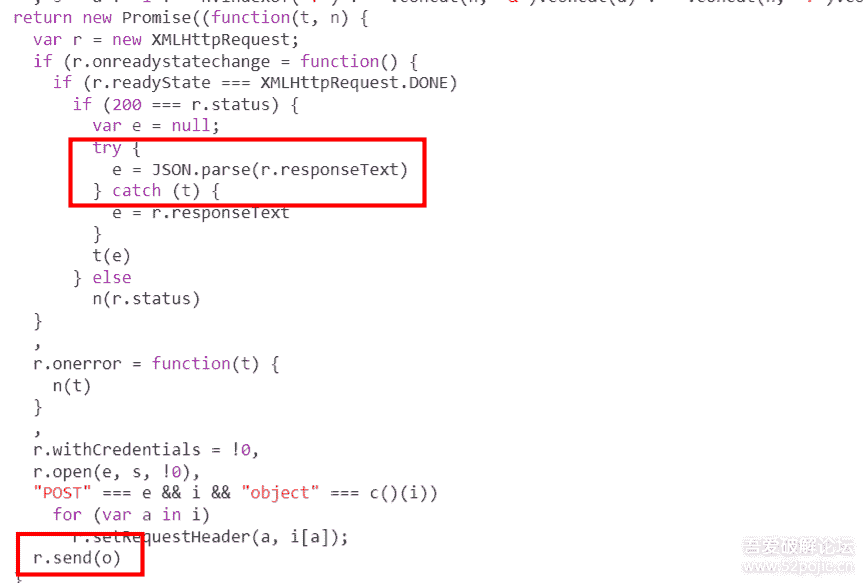

# [Web逆向] B站未登录用户弹窗解决方案

- 原帖：https://www.52pojie.cn/forum.php?mod=viewthread&tid=1827587
- 抓取时间：2026-11-01T22:47:30

## 问题背景

由于一些原因，不方便登录B站，但是又喜欢在B站上听一些音乐合集。B站肯定不愿意让你白嫖，它会定时1分钟弹出一个mini的登录框，同时暂停歌曲，很烦，所以我就编写了一个油猴插件，拦截获取登录状态的接口并修改其响应，从而避免歌曲断断续续的。

## 接口分析

经分析获取登录状态的接口为：`https://api.bilibili.com/x/web-interface/nav`

未登录的响应如下：

```json
{
  "code": -101,
  "message": "账号未登录",
  "ttl": 1,
  "data": {
    "isLogin": false,
    "wbi_img": {
      "img_url": "https://i0.hdslb.com/bfs/wbi/7cd084941338484aae1ad9425b84077c.png",
      "sub_url": "https://i0.hdslb.com/bfs/wbi/4932caff0ff746eab6f01bf08b70ac45.png"
    }
  }
}
```

登录的响应如下：

```
{
  "code": 0,
  "message": "0",
  "ttl": 1,
  "data": {
    "isLogin": true,
    "wbi_img": {
      "img_url": 头像图片地址,
      "sub_url": 头像图片地址
    }
  }
}
```

## 请求方式与实现思路

通过 `XMLHttpRequest` 发送请求：



`2023-08-30-21-48-21-image.png` (89.64 KB, 下载次数: 2)

[href="forum.php?mod=attachment&aid=MjYzOTc2OXxlZmZkZWQ0MnwxNzkzNTczMjQ4fDE2ODA4NnwxODI3NTg3&nothumb=yes" target="_blank"](https://www.52pojie.cn/forum.php?mod=attachment&aid=MjYzOTc2OXxlZmZkZWQ0MnwxNzkzNTczMjQ4fDE2ODA4NnwxODI3NTg3&nothumb=yes)

2023-8-30 21:56 上传

有两种思路，一是拦截 `XMLHttpRequest`，二是拦截 `JSON.parse`。

## 脚本实现

### 拦截 `XMLHttpRequest`

脚本如下：

```javascript
// ==UserScript==
// @name         B站未登录弹窗
// @namespace    http://tampermonkey.net/
// @version      0.1
// @run-at       document-start
// @description  try to take over the world!
// @AuThor       You
// @match        https://www.bilibili.com/*
// @grant        none
// ==/UserScript==

let oldXhrOpen = XMLHttpRequest.prototype.open;
XMLHttpRequest.prototype.open = function() {
    if (arguments[1].indexOf('/web-interface/nav') != -1) {
        let oldGet = Object.getOwnPropertyDescriptor(XMLHttpRequest.prototype, 'responseText').get;
        Object.defineProperty(this, 'responseText', {
            configurable: true,
            enumerable: true,
            get: function get() {
                let res = JSON.parse(oldGet.apply(this, arguments));
                res.code = 0;
                res.message = '0';
                res.data = {
                    isLogin: true,
                    wbi_img: []
                };
                return JSON.stringify(res);
            },
            set: undefined
        });
    }
    return oldXhrOpen.apply(this, arguments);
}
```

### 拦截 `JSON.parse`

```javascript
// ==UserScript==
// @name         B站未登录弹窗
// @namespace    http://tampermonkey.net/
// @version      0.1
// @run-at       document-start
// @description  try to take over the world!
// @author       You
// @match        https://www.bilibili.com/*
// @grant        none
// ==/UserScript==

let oldJsonParse = JSON.parse;

JSON.parse = function() {
    if (arguments[0].indexOf('"isLogin":false') != -1) {
        arguments[0] = arguments[0].replace('"code":-101', '"code":0').replace('"isLogin":false', '"isLogin":true');
    }
    return oldJsonParse.apply(this, arguments);
}
```

### 拦截 `fetch`

当然有些请求使用 `fetch`，这里在给一个拦截 `fetch` 的插件：

```javascript
// ==UserScript==
// @name         拦截fetch
// @namespace    http://tampermonkey.net/
// @version      0.1
// @run-at       document-start
// @description  try to take over the world!
// @author       You
// @match        https://www.bilibili.com/*
// @grant        none
// ==/UserScript==

let oldfetch = fetch;
function fuckfetch() {
    if (arguments[0].indexOf('/web-interface/nav') != -1) {
        debugger;
        return new Promise((resolve, reject) => {
            oldfetch.apply(this, arguments).then(response => {
                const oldJson = response.json;
                response.json = function() {
                    return new Promise((resolve, reject) => {
                        oldJson.apply(this, arguments).then(result => {
                            //修改result
                            resolve(result);
                        });
                    });
                };
                resolve(response);
            });
        });
    } else {
        return oldfetch.apply(this, arguments);
    }
}
window.fetch = fuckfetch;
```
