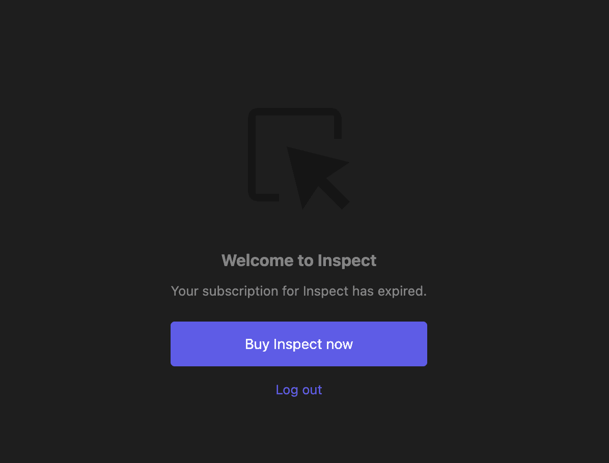
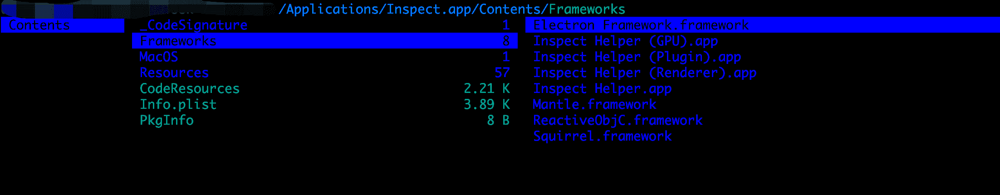
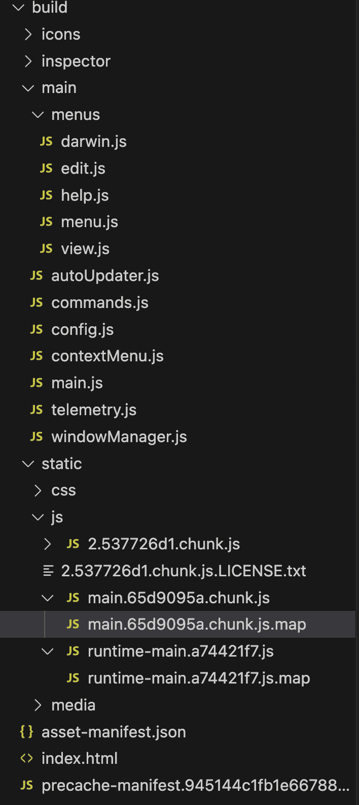
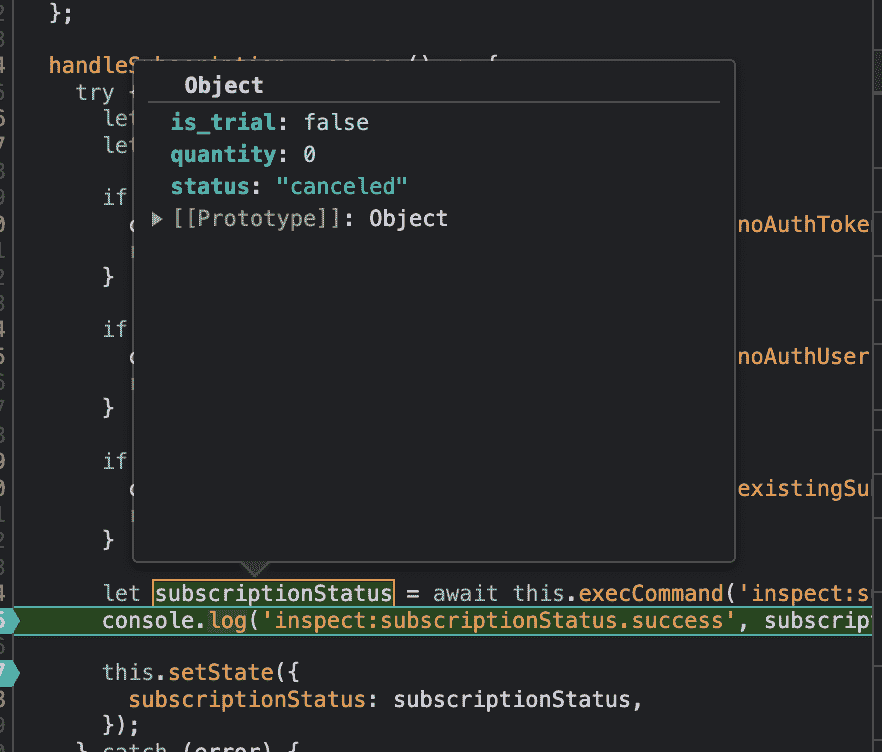
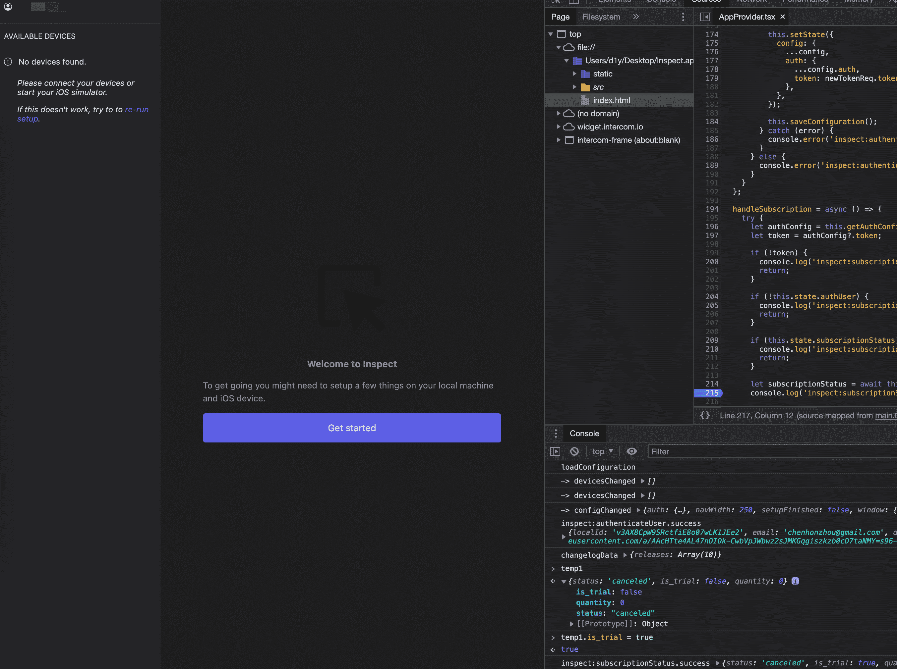
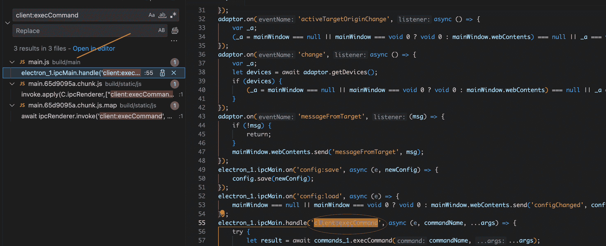

# [原创] inspect 调试工具无限试用

- 原帖: https://www.52pojie.cn/forum.php?mod=viewthread&tid=1829075
- 抓取时间: 2026-11-01T22:47:13

苦逼前端需要再 linux 上调试 iOS safari

发现 [inspect.dev](https://inspect.dev/) 这款应用挺好用的但要收费, 不过可以试用, 但我已经过了白嫖时间了, 所以必须破解



发现是 electron 做的, 那就好办了



直接解包就行了

```
cd /Applications/Inspect.app/Contents/Resources
asar e app.asar ~/tmp/asar/e
```

解包之后惊喜的发现有 sourcemap



那就直接在软件开启 chrome devtools 研究一下, 断点看了一下, 发现 `AppProvider.tsx` 里 `subscriptionStatus` 有个 `is_trial` 比较特别, 尝试直接设置为 `true` 发现是可以触发试用的 ^0^





然后发现这个接口调用的貌似是后端服务

```
let subscriptionStatus = await this.execCommand('inspect:subscriptionStatus', token);
console.log('inspect:subscriptionStatus.success', subscriptionStatus);
this.setState({
    subscriptionStatus: subscriptionStatus,
});
```

在 vscode 中搜索了一下发现出奇的顺利



接下来直接把 `result` 的结果改写一下就可以了

```
if (commandName == 'inspect:subscriptionStatus') {
    result.is_trial = true
}
```

重新打包一下之后就可以用了😍

```
asar p code patch.asar
cp patch.asar ~/Desktop/Inspect.app/Contents/Resources/app.asar
```

## 结束语

这款应用破解的出奇的顺利。。。啥混淆啊的都没加 :)
