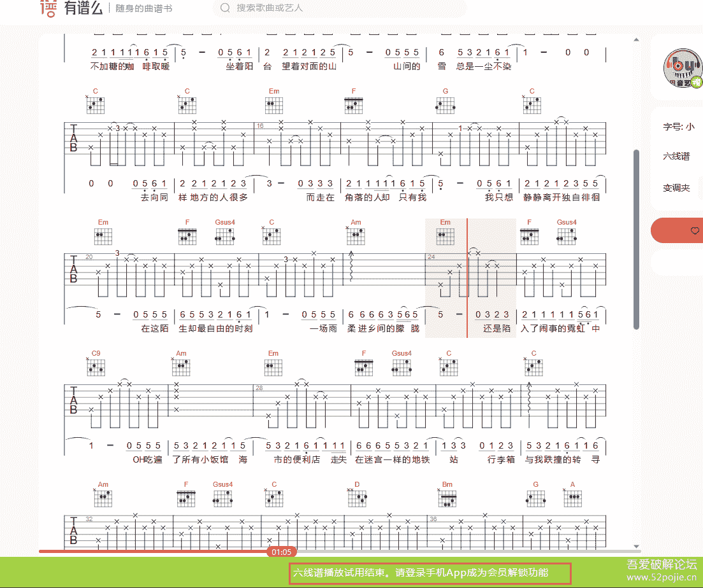
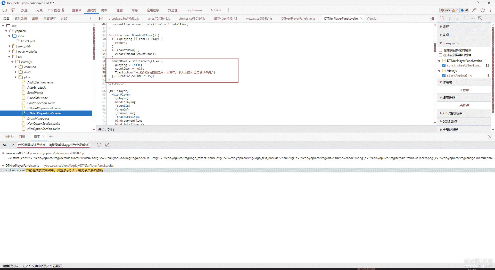
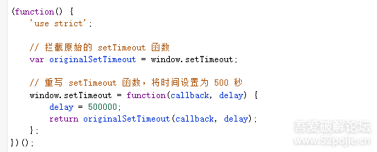

# [Web逆向] 【真菜鸟】突破有谱么15秒播放限制

- 原帖：<https://www.52pojie.cn/forum.php?mod=viewthread&tid=1831687>
- 抓取时间：2026-11-01T22:45:37

昨天看见逛论坛老哥发了篇突破有谱么网站的打印限制，因为我也在学习吉他，觉得这个在线的播放做的特别不错，但是他限制在15秒，15秒之后自动暂定，但是点击播放又可以继续播放15秒，于是我根据提示找到了代码，

`XQ42ZD](U[T53CD6K$QI$QA.png`（172.71 KB，下载次数：2）

[附件下载](https://www.52pojie.cn/forum.php?mod=attachment&aid=MjY0MTczNXw4NTUwNDIyZXwxNzkzNTczMTM0fDE2ODA4NnwxODMxNjg3&nothumb=yes)

2023-9-9 21:52 上传

`ZEOXT_%NH$V]JXL}MRSI.png`（149.99 KB，下载次数：1）

[附件下载](https://www.52pojie.cn/forum.php?mod=attachment&aid=MjY0MTczNnw3ZjQ4NWMxM3wxNzkzNTczMTM0fDE2ODA4NnwxODMxNjg3&nothumb=yes)

2023-9-9 21:52 上传

这里我猜是这个`playing=false`让播放暂定了，这里这里打了段调试，再次点击播放果然在这里停了下来，于是我就想把这个`playing`改为`true`不就可以了，结果修改之后并没有效果，又找到`svelte`编译后的`js`文件，发现这里根本不让修改代码，到这里我基本打算放弃了（因为我真的菜鸟，并没有专门学习过前端，这里有更好的突破方法，请大佬告知）。

后面又想到可以尝试使用油猴脚本来修改时间限制，把时间设置的长一点，结果还真一下就成功了。

。

`image.png`（10.92 KB，下载次数：1）

[附件下载](https://www.52pojie.cn/forum.php?mod=attachment&aid=MjY0MTczN3xjNDgyYmI0NHwxNzkzNTczMTM0fDE2ODA4NnwxODMxNjg3&nothumb=yes)

2023-9-9 21:53 上传
