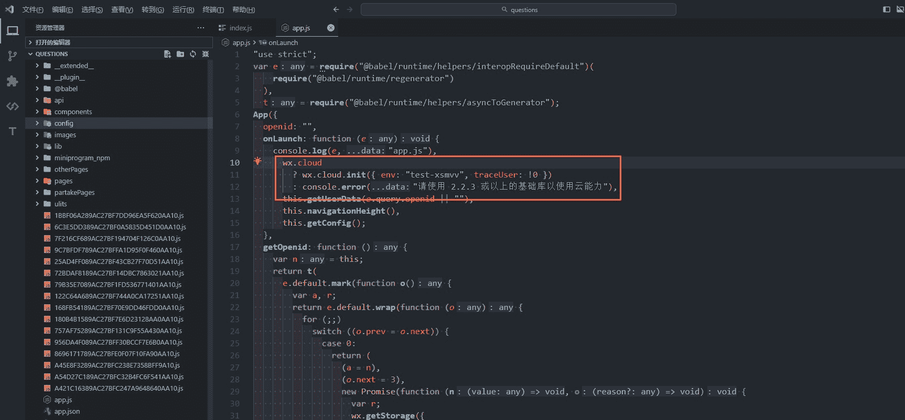
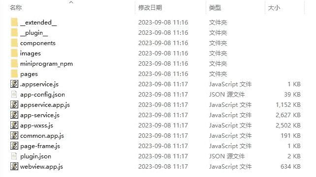
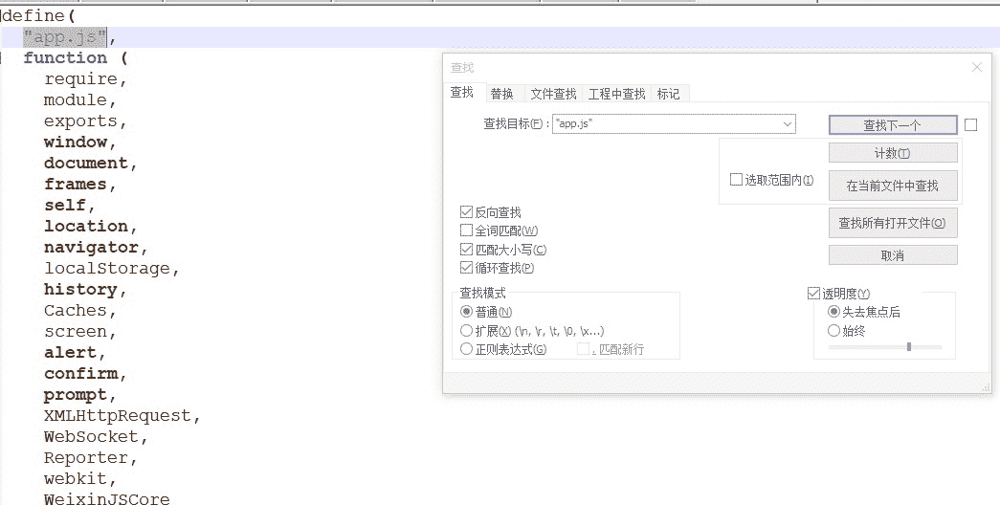
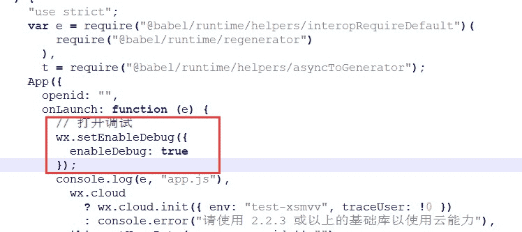
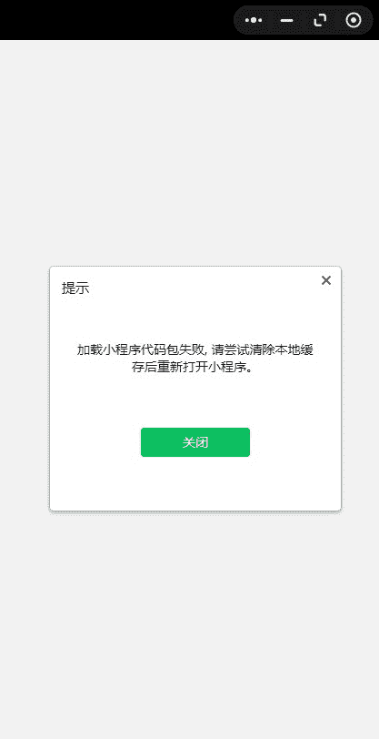
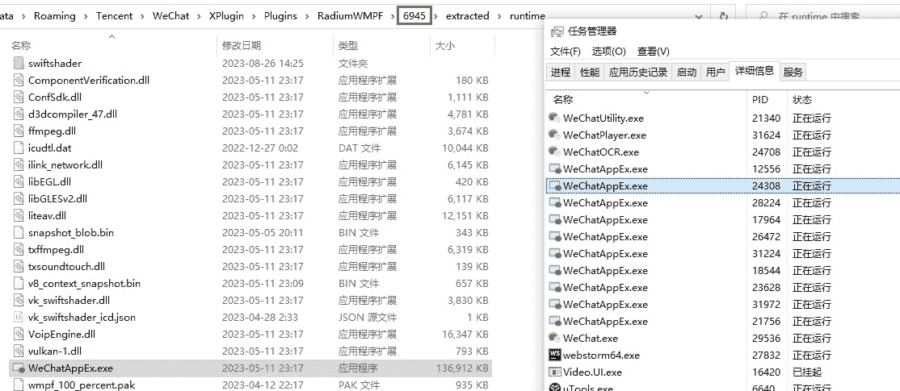
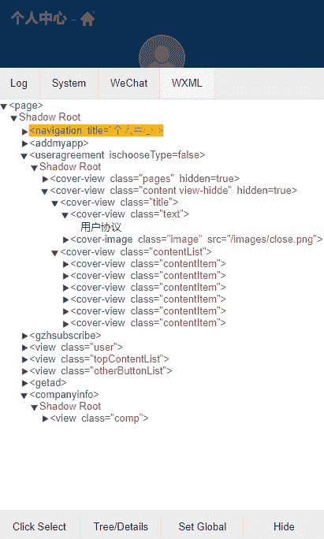
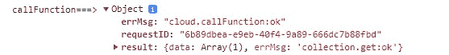

# [Web逆向] windows下通杀wx小程序云函数实战

- 原帖: https://www.52pojie.cn/forum.php?mod=viewthread&tid=1832406
- 抓取时间: 2026-11-01T22:45:30

## 本文章仅用于学习交流，请勿用于非法用途

试过的都知道, 用了云函数的小程序抓包是拿不到结果的

找了个使用云开发做的小程序 《某问卷系统》

### 1. 解包

工具不少
我这里用的是 `unveilr` 最新版 `https://github.com/r3x5ur/unveilr`

```
unveiler wx -sf "D:\WeChat Files\Applet\wx5cxxxxxxxx13347f\77"
```

### 2. 确定是云开发

打开查看 `app.js` 确实是云开发的



这种的想抓数据，只能用远程过程调用了 `https://baike.baidu.com/item/%E8%BF%9C%E7%A8%8B%E8%BF%87%E7%A8%8B%E8%B0%83%E7%94%A8/7854346`

### 3. 修改并重新打包

需要改代码重新打包

我们用 `unveilr` `https://github.com/r3x5ur/unveilr` 重新解包一份不解析出 `wxml` 的

```
unveiler wx --no-parse -f "D:\WeChat Files\Applet\wx5cxxxxxxxx13347f\77\__APP__.wxapkg"
```



先找到入口，一般在 `app-service.js` 这个文件里，搜索 `app.js`



先开启 debug 模式

将以下代码注入到 `onLaunch` 回调中



使用 `unveilr` 进行重打包，这里我还需要频繁改动，所以加上 `w` 参数

```
unveiler wx -wp "D:\WeChat Files\Applet\wx5cxxxxxxxx13347f\77\__APP__"
```

然后重新打开小程序



会发现加载失败，这时候就要用 `frida` 了

这里贴一个我自己用的 `frida` 脚本

```
const arr2str = (bytes) => String.fromCharCode(...new Uint8Array(bytes))

const targetPtr = Module.getBaseAddress('WeChatAppEx.exe').add('0x2C1CBB8')

Interceptor.attach(targetPtr, {
  onEnter(args) {
    void args
    const length = 0x20
    const rdx = this.context.rdx
    const rbp = this.context.rbp
    const p1 = rdx.readPointer()
    const p2 = rbp.readPointer()
    // 将原始 MD5 的数据覆盖到当前 MD5
    const oriMd5 = p1.readByteArray(length)
    const curMd5 = p2.readByteArray(length)
    const m1 = arr2str(curMd5)
    const m2 = arr2str(oriMd5)
    if (!m2 || m1 === m2) return
    p2.writeByteArray(oriMd5)
    console.log(`[+] Replaced: ${m1} -> ${m2}`)
  },
})
```

这个脚本仅用于 `RadiumWMPF` 为 `6945` 的运行环境



开启 `frida` 然后重新打包就可以直接生效了，并且弹出了 `vConsole`



接下来将所有云函数的请求都打印到控制台，或者写一个 `websocket` 服务发出去就行了，请求的话也可以使用 `websocket` 控制

搜了以下 `wx.cloud.callFunction` 发现有一大片

这时候可以注入一点代码到入口处

```
const oldCloud = wx.cloud;
const oriCF = oldCloud.callFunction
oldCloud.callFunction = function (config) {
    const _success = config.success
    config.success = function (res){
      console.log('callFunction===>',res);
      _success(res);
    }
    oriCF(config)
}
```

然后重新打开就可以看到代码已经生效

利用重打包功能，剩下的事情就简单了，直接接个 `websocket` 出去就能实现 `rpc` 了


