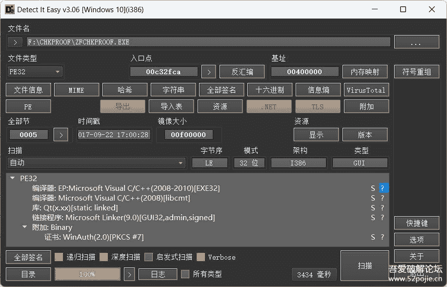
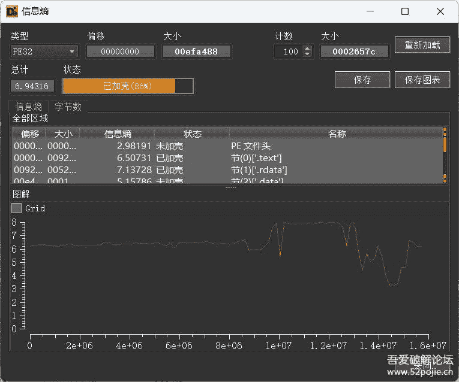
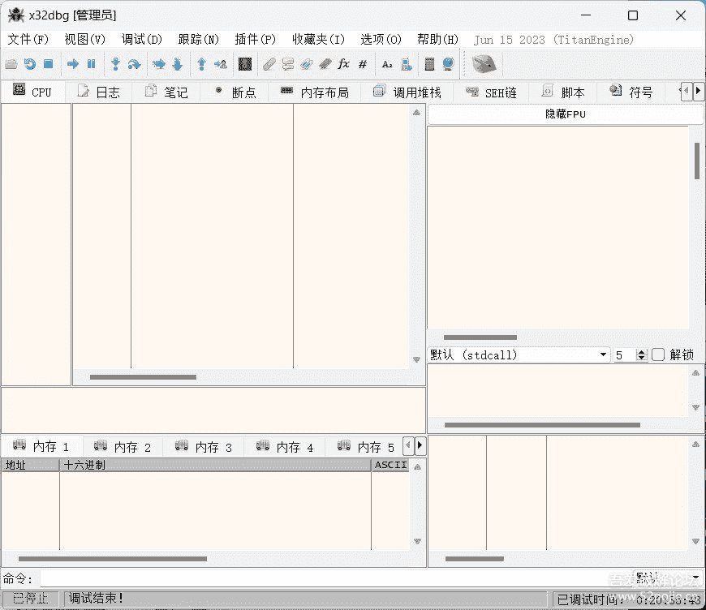
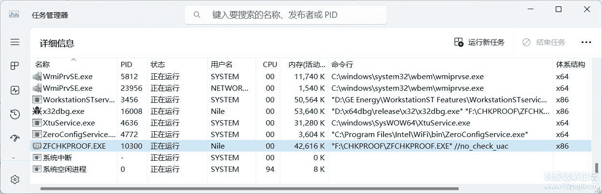
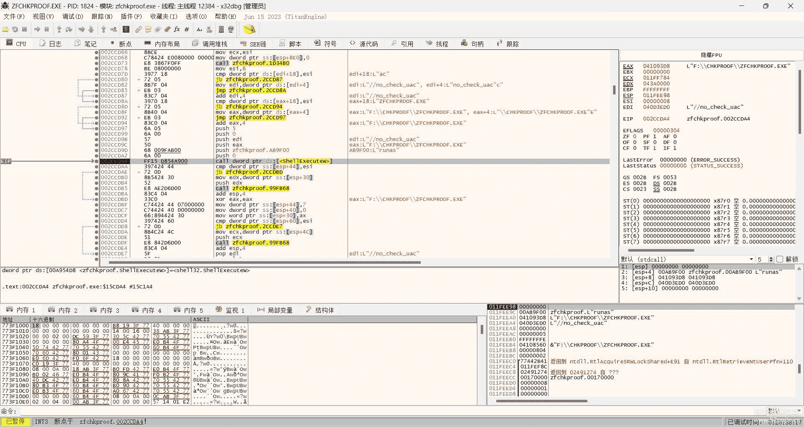
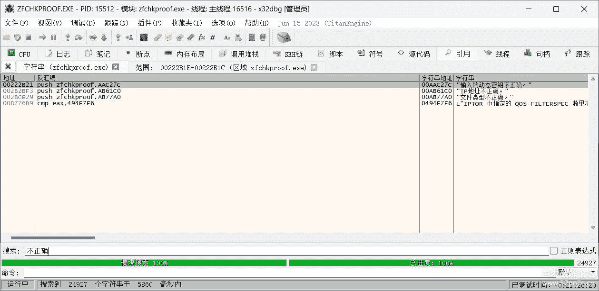
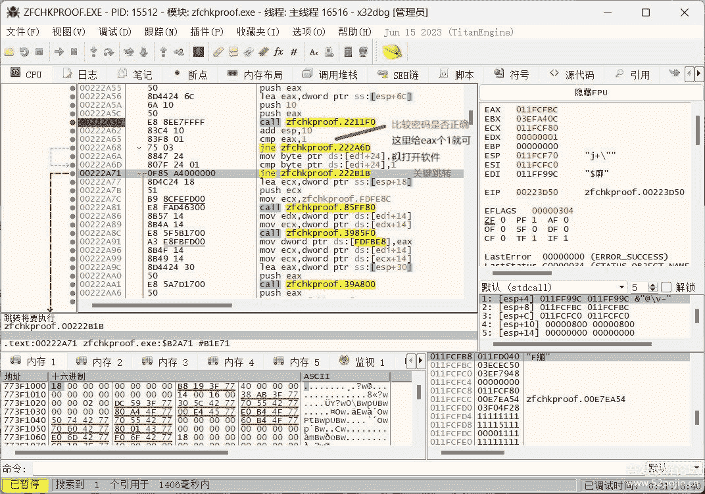
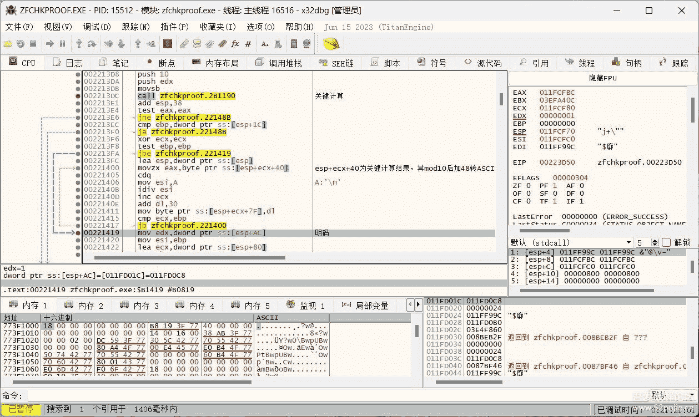
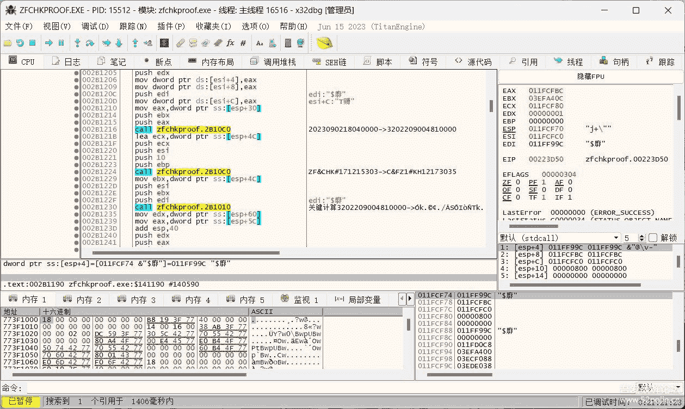
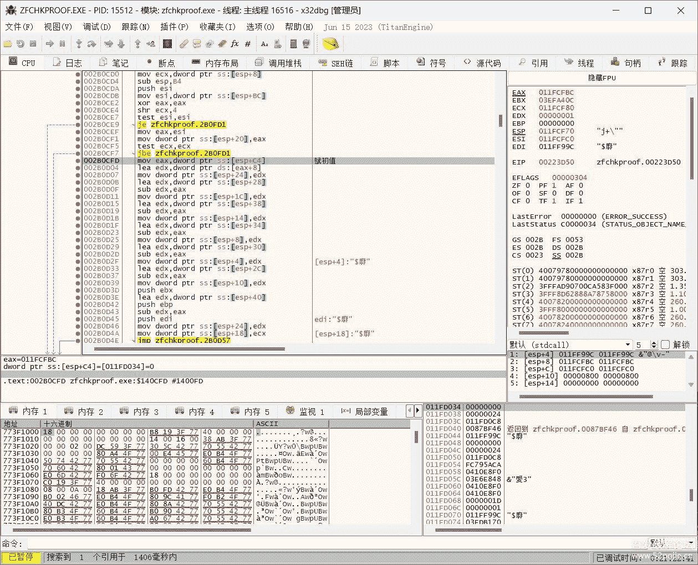

# [原创] 新手向某VC++编译BM检查软件口令分析

- 原帖：https://www.52pojie.cn/forum.php?mod=viewthread&tid=1832981
- 抓取时间：2026-11-01T22:45:29

软件名称：5Lit5a2a6K6h566X5py657uI56uv5L+d5a+G5qOA5p+l57O757uf

注意，软件到底是商用的，为方便学习，这里只提供抠出来的阉割版，仅仅用于分析口令，软件能打开，但功能不保证（当然由于我懒，应该也没把所有功能都割掉）。此外该软件权限及本身信息熵问题，Windows Defender 会强烈的怼他，介意这个的请移步。

下载地址：链接：https://pan.baidu.com/s/1EmdEEwujv5UN3Knu-Jk9SA 提取码：s2o7

或自行搜索软件（发帖前我看到网上有下的）

使用工具：DIE、X32DBG

没写过 VC++ 的新手期是不完整的，虽然这个是个 QT，勉强凑合一个吧。当然这不是我分析的第一个 VC++，只是之前分析的大多太大，不方便放练习，这个大小适中，而且虽然是商业软件，但个人基本没啥需求，用它的基本都是买了的，相对可能合适一点。

依旧，如有违规，直接删。

分析过程按新手套路来。

## 一、查壳





虽然 DIE 判断软件介于有壳没壳之间，实际调试的时候并不影响，这里当做没壳处理。严格说 QT 库和 C++ 还是有点区别的，靠对话框一类的断点不太好使，不过区别也不大，而且 QT 的套路相对少，具体到这个软件分析难度较低，个人判断难度介于过年题目的初级到中级之间（中级题当时我的 X32 开了反反调试，直接过了，没判断出反调难度，所以个人判断也可能不准），适合刚入门的玩家学习与练习。

## 二、阅读帮助文件

帮助文件写的禁止传播，而且有点大，我忘了放练习里了，不过其实也没写啥，口令是通过 UKey 弄的，需要定期对时，提取关键点，口令和时间相关。

## 三、试运行程序

程序全程写着名字，就不放图了，基本情况是输入 6 位口令，输错了弹出个提示信息的对话框，“输入的动态密钥不正确”。

## 四、动态调试

### 1. 大约是反调试

使用管理员权限 X32dbg 调试可执行文件，过了入口断点后，会打开输入口令的界面，同时显示已停止，调试结束。



**A.** 打开任务管理器，确认运行的文件就是可执行文件，但是后面加了命令行 `//no_check_uac`，判断无命令行的程序以命令行方式重新打开了自己，并且关闭没命令行的自己。在 X32dbg 中文件-改变命令行，加上 `//no_check_uac` 就能正常调试了。



这种反调试看起来比较儿戏，但我刚接触时，面对托管一类的方法下断点是会有点懵的，不过这种方式大约只能欺负新手。像本例中的直接任务管理器能解决的属于简单的，大多数情况下遇不到，所以一般会准备 plan B。

**B1.** 从入口开始执行，像这个可以直接运行到跳转或 `call` 处，遇到 `call` 之后打开新窗口的，就跟进去继续跟，直到找到打开新窗口的调用。可以看到是个 `ShellExecuteW` 函数，通过传递的参数（堆栈）也可以看到是加了 `//no_check_uac` 命令行。这是个笨办法，基本等同于单步跟，不过多数情况都是有效的。



**B2.** 从关闭程序的函数倒推，在 `kernel32` 里的 `ExitProcess` 函数下断点，通过堆栈、查找引用等方式倒查，也可以找到 `ShellExecuteW` 函数那。本例中入口找和倒着找工作量差不多，所以说是难度适中，适合新手。

### 2. 找关键跳转

**A.** 查找字符串“输入的动态密钥不正确”，居然直接找到了。



段首查找引用，到下图处，即为关键跳转。要想暴破的话直接把 `cmp eax,1` 到下面 `mov` 那三行改成 `mov byte ptr ds:[edi+24],1` 就行。



也不知为什么，以我的经验来说，直接找到字符串也是小概率事件，所以这里也准备了 plan B。

**B.** 弹出提示信息的对话框后，按暂停，执行到用户代码，然后通过堆栈、查找引用等方式倒查，也可以找到关键跳转这。这种方式适用范围略广，但其实也不保险，真的想防也有办法，不过那基本脱离新手级了。

### 3. 口令算法分析

关键跳转上面的 `call` 跟进去，向下执行。到这我就没啥技巧了，就跟着看，找到下图处，注释明码那，看 `esp+ecx+7A` 附近，就是口令明码了，如果做内存注册机或者注入，这附近都可以试试



从计算那个 `call` 跟进去，盯紧之前找到 `esp+ecx+40` 那个地址，可以找到关键计算的 `call`。这里注意下 `call` 引入的参数，第三个参数，也就是 `esi` 那，是个常量（没有代码给那片区域赋值），那是一片密钥区，可以直接复制下来。另外上面两个是四字节高低位转换的，后面写代码时要特别注意一下。



经过一个强制跳转后，到下图赋初值处，没什么好说的，就是看汇编了。注意后面还有一片密钥区，也直接复制就好。



汇编代码有点长，就不截图了，其实只要看四分之一就好，后面其实循环就行。下面放上我写的参考代码，我写的代码肯定不专业，客观看待。

```csharp
private void calc()
        {
            int i,j;
            uint t1,t2,t3;
            Byte[] temp = new Byte[4];
            DateTime dateTime = DateTime.Now;
            string nowstr = dateTime.ToString("yyyyMMddHHmm0000");
            //string nextstr = dateTime.AddMinutes(1).ToString("yyyyMMddHHmm0000");
            Byte[] nowbyte = Encoding.ASCII.GetBytes(nowstr);
            Byte[] data = new Byte[144];
            for(i = 0; i > 14 | t1 > 22 | t1 > 8 | t1 > 30 | t1 > 24);
                data[17 + i] = (byte)(t3 >> 16);
                data[18 + i] = (byte)(t3 >> 8);
                data[19 + i] = (byte)(t3);
            }
            string str = (data[140] % 10).ToString();
            str += (data[141] % 10).ToString();
            str += (data[142] % 10).ToString();
            str += (data[143] % 10).ToString();
            str += (data[136] % 10).ToString();
            str += (data[137] % 10).ToString();
            textBox1.Text = str;
            textBox1.SelectAll();
            textBox1.Copy();
        }
```

分析完毕，不妥之处请批评指正。

题外，我觉得做这软件的公司还是挺不错的，虽然是有些年头的软件了，但这么适合新手入门的软件我接触的也不多。徒弟说想学我这方面的东西，我也刚好希望找个小白鼠确认下我写的东西别人能看懂，以便以后教女儿，就整理了一下。写这个的时候，我基本应该算度过了新手期，本来想新手期各种主流的语言见一见，后来由于惰性，没实现。由于水平有限，加上只是为了教女儿，以后写的基本也就是新手向的东西，也算是不忘初心吧。
