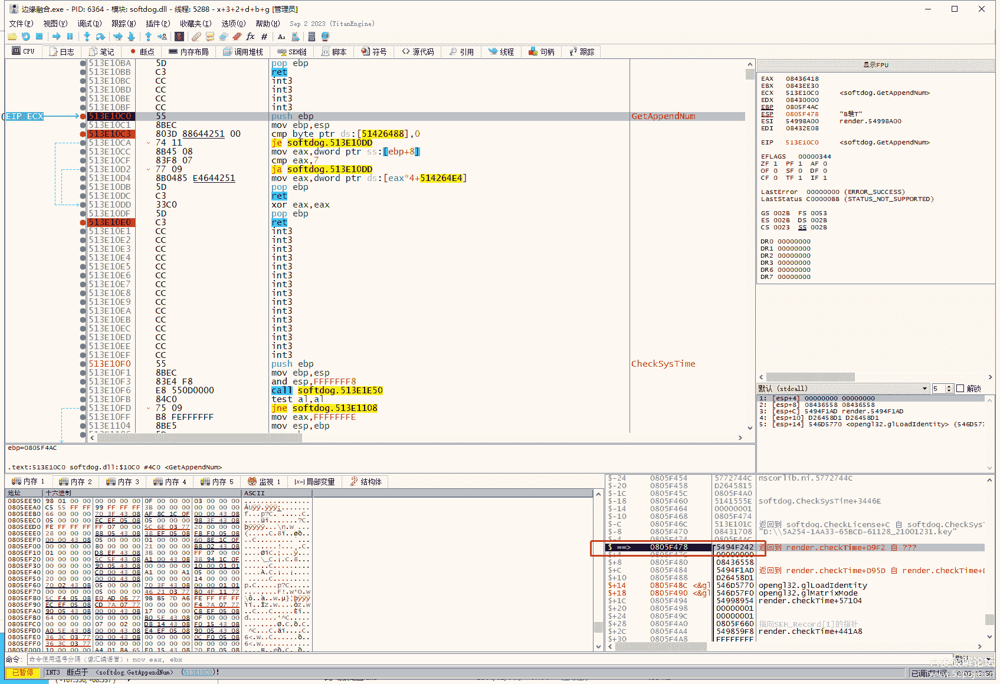
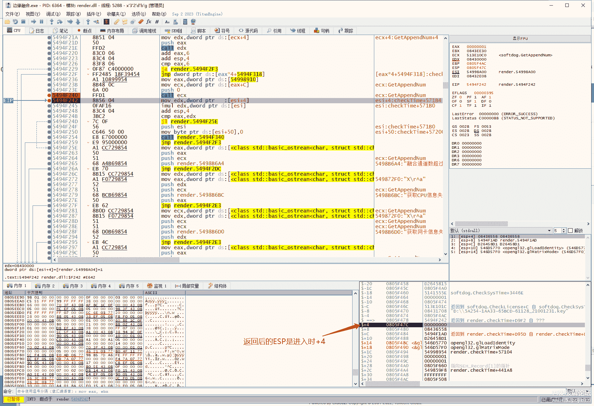
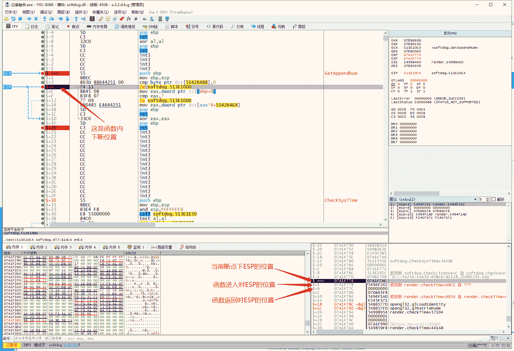
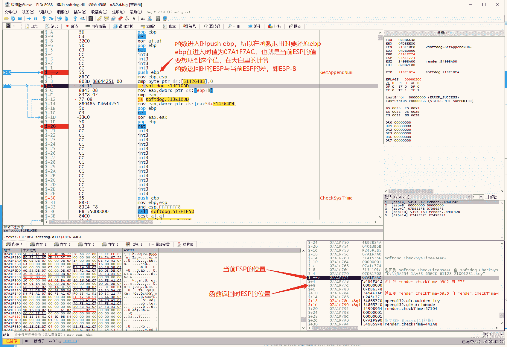
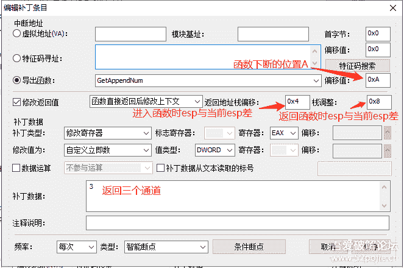
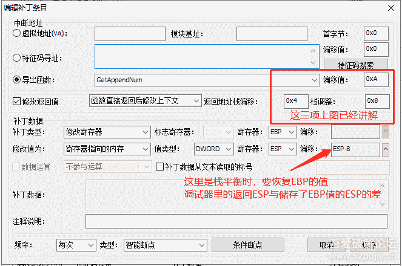
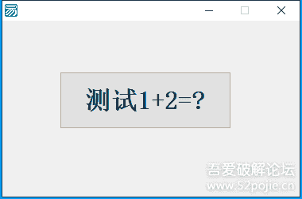

# [原创] Baymax Patch Tools 大白使用案例之 --- 修改函数返回值

- 原帖: https://www.52pojie.cn/forum.php?mod=viewthread&tid=1835402
- 抓取时间: 2026-11-01T22:45:14

## 方法概述
`Baymax Patch Tools` 大白修改函数返回值有三种方法
1、保存当前上下文并在返回时修改
2、函数返回时修改上下文
3、函数直接返回修改上下文

这里只讲第三种，并且在函数内部任意一个位置下断。因为第三种懂了，前两种自然就没问题了。

## 案例介绍
下面使用个软件作为案例。
https://nns.lanzoub.com/iOHLv18ytuad

软件具体分析过程 略……
软件内有一个多通道使用，在压缩包里提供的key中只是单一通道，如果想使用多通道，可以一补丁通杀； 略……
但是这里为了使用大白修改返回值，使用多通道时，只要将`SoftDog.dll`的`GetAppendNum`函数返回值修改为对应的通道数即可，
这里以3通道为例。只需将`GetAppendNum`的返回值修改为3

## 操作步骤
打开`x32dbg.exe`加载程序，并在`GetAppendNum`下断，首先得到`GetAppendNum`的返回`ESP`

函数进入的`ESP`，如下图：

1694574186902.jpg (268.71 KB, 下载次数: 0)
[href="forum.php?mod=attachment&aid=MjY0Mzc4NXwwMWFjYTFkOHwxNzkzNTczMTEyfDE2ODA4NnwxODM1NDAy&nothumb=yes" target="_blank"](https://www.52pojie.cn/forum.php?mod=attachment&aid=MjY0Mzc4NXwwMWFjYTFkOHwxNzkzNTczMTEyfDE2ODA4NnwxODM1NDAy&nothumb=yes)
2023-9-18 18:04 上传

将函数运行到返回，并查看`ESP`位置，返回后的`ESP`是进入时+4，记录下这个位置，后面有用

1694574471534.jpg (349.05 KB, 下载次数: 0)
[href="forum.php?mod=attachment&aid=MjY0Mzc4NnwzYzgxYjAxZXwxNzkzNTczMTEyfDE2ODA4NnwxODM1NDAy&nothumb=yes" target="_blank"](https://www.52pojie.cn/forum.php?mod=attachment&aid=MjY0Mzc4NnwzYzgxYjAxZXwxNzkzNTczMTEyfDE2ODA4NnwxODM1NDAy&nothumb=yes)
2023-9-18 18:04 上传

重新载入程序，并来到`GetAppendNum`断点位置，现在在函数内`A`位置下断进行操作
程序每次载入时，地址会不一样，那个不用管，我们只看`ESP`的位置就行

1694575550361.jpg (275.4 KB, 下载次数: 0)
[href="forum.php?mod=attachment&aid=MjY0Mzc4N3xjYjA0MDg1Y3wxNzkzNTczMTEyfDE2ODA4NnwxODM1NDAy&nothumb=yes" target="_blank"](https://www.52pojie.cn/forum.php?mod=attachment&aid=MjY0Mzc4N3xjYjA0MDg1Y3wxNzkzNTczMTEyfDE2ODA4NnwxODM1NDAy&nothumb=yes)
2023-9-18 18:04 上传

注意这四个值
函数内下断的位置 --> 对应大白偏移值 填`A`
当前断点`ESP`的位置 --> 用这个值计算偏移
函数进入时`ESP`的位置 --> 对应大白返回地址栈偏移 当前的`ESP`+4
函数返回时`ESP`的位置 --> 对应大白栈调整 当前的`ESP`+8

注意：因为在这个位置下断，做修改，破坏了栈平衡，所以要恢复平衡
如下图，恢复栈平衡

1694576881489.jpg (281.5 KB, 下载次数: 0)
[href="forum.php?mod=attachment&aid=MjY0Mzc4OHwyOTgzMmQ5N3wxNzkzNTczMTEyfDE2ODA4NnwxODM1NDAy&nothumb=yes" target="_blank"](https://www.52pojie.cn/forum.php?mod=attachment&aid=MjY0Mzc4OHwyOTgzMmQ5N3wxNzkzNTczMTEyfDE2ODA4NnwxODM1NDAy&nothumb=yes)
2023-9-18 18:04 上传

最后，大白补丁设置如下

1694577477670.jpg (35.56 KB, 下载次数: 1)
[href="forum.php?mod=attachment&aid=MjY0Mzc5MXwyNGNmMzcyZXwxNzkzNTczMTEyfDE2ODA4NnwxODM1NDAy&nothumb=yes" target="_blank"](https://www.52pojie.cn/forum.php?mod=attachment&aid=MjY0Mzc5MXwyNGNmMzcyZXwxNzkzNTczMTEyfDE2ODA4NnwxODM1NDAy&nothumb=yes)
2023-9-18 18:04 上传

1694577802757.jpg (37.05 KB, 下载次数: 0)
[href="forum.php?mod=attachment&aid=MjY0Mzc5MHwyN2Y4MmE4NXwxNzkzNTczMTEyfDE2ODA4NnwxODM1NDAy&nothumb=yes" target="_blank"](https://www.52pojie.cn/forum.php?mod=attachment&aid=MjY0Mzc5MHwyN2Y4MmE4NXwxNzkzNTczMTEyfDE2ODA4NnwxODM1NDAy&nothumb=yes)
2023-9-18 18:04 上传

附上软件成功后三通道的截图！

1.jpg (214.46 KB, 下载次数: 0)
[href="forum.php?mod=attachment&aid=MjY0Mzc4OXwxMjRmNTFhZHwxNzkzNTczMTEyfDE2ODA4NnwxODM1NDAy&nothumb=yes" target="_blank"](https://www.52pojie.cn/forum.php?mod=attachment&aid=MjY0Mzc4OXwxMjRmNTFhZHwxNzkzNTczMTEyfDE2ODA4NnwxODM1NDAy&nothumb=yes)
2023-9-18 18:04 上传

## 补充讨论
> 
Nisy：
这个玩法在于 任意地址都属于函数内 并且可以返回堆栈的某个地址（直接返回或在返回地址设置中断），可以返回到调用方的调用方，堆栈中有返回地址 就可以指定返回到那，当然堆栈要自己去平衡！

测试返回值案例：[//nns.lanzoub.com/ikbZQ199py2b" target="_blank"](https://nns.lanzoub.com/ikbZQ199py2b:rel="nofollow noopener" href="https)

1695262068139.jpg (10.69 KB, 下载次数: 0)
[href="forum.php?mod=attachment&aid=MjY0NDQ2MXw2NzZjZWQ1OHwxNzkzNTczMTEyfDE2ODA4NnwxODM1NDAy&nothumb=yes" target="_blank"](https://www.52pojie.cn/forum.php?mod=attachment&aid=MjY0NDQ2MXw2NzZjZWQ1OHwxNzkzNTczMTEyfDE2ODA4NnwxODM1NDAy&nothumb=yes)
2023-9-21 10:11 上传
