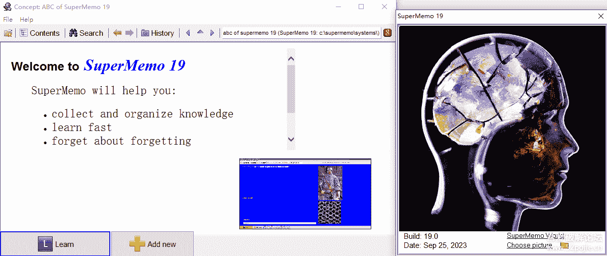

# [分享] 浅尝逆向supermemo19

- 原帖：<https://www.52pojie.cn/forum.php?mod=viewthread&tid=1839215>
- 抓取时间：2026-11-01T22:44:58

本文仅提供思路，不提供任何成品软件。

supermemo系列软件是一个很不错的记忆软件，群里有大佬买了最新的supermemo19，70刀，于是跟大佬要了安装包，浅尝一下supermemo19的逆向。

首先查壳，delphi写的，这时候想到了`idr`，一个delphi的逆向工具，拖进去，等待加载。然后又拖入到`od`里面，搜索了一下关键词`" is unlocked"`，找到一个地方，查看上下文，定位到了一处变量。再拖入`ida`，`G`跳转到这个变量定义的位置，`x`查找引用，发现有几处读写的地方，然后经过判断，发现这里的这个变量是`0`的时候，就是未注册，是`2`的时候就是已经注册，然后再根据`ida`查找到的引用，到`od`立马`patch`相关的代码，修改了三四处地方，然后这个时候`idr`加载完成，但是我们发现我们根本就不需要使用`idr`了。

最终，软件修改后打开，界面如下：

`image.png`（324.51 KB，下载次数：5）

[附件链接](https://www.52pojie.cn/forum.php?mod=attachment&aid=MjY0NjAxNXxhN2NjZTFjYXwxNzkzNTczMDk1fDE2ODA4NnwxODM5MjE1&nothumb=yes)

2023-9-28 11:10 上传

测试一下功能，好吧，我根本不会用这个软件，接下来要跟着大佬们学一学了，至此，本帖结束。

看到这么多人要安装包，分享一个原版的安装包：

[附件链接](https://www.52pojie.cn/forum.php?mod=attachment&aid=MjY0NzExNHxhOGM3Yjc1NnwxNzkzNTczMDk1fDE2ODA4NnwxODM5MjE1)（499.31 KB，下载次数：909）

2023-10-6 13:18 上传

点击文件名下载附件  
下载积分：吾爱币 -1 CB
