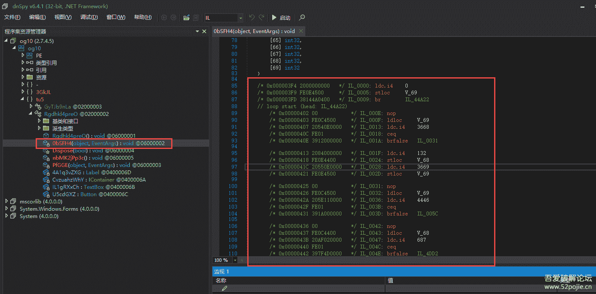
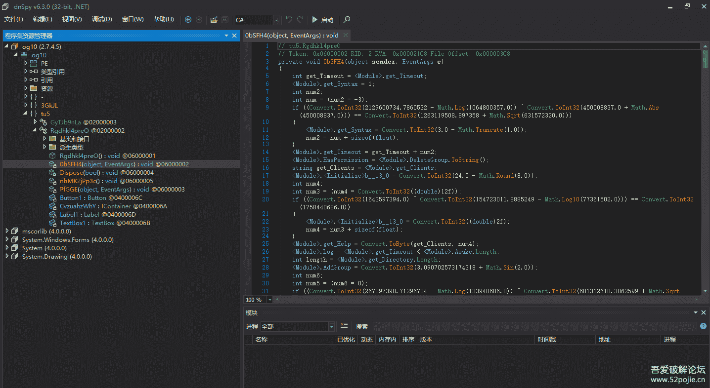

# [.NET逆向] 一个CM的去混淆

- 原帖：<https://www.52pojie.cn/forum.php?mod=viewthread&tid=1840543>
- 抓取时间：`2026-11-01T22:44:52`

原帖：<https://www.52pojie.cn/thread-1839007-1-1.html> 非常有意思的 cm，入手后部分函数反编译失败，无奈只能进入 IL 模式，观察后发现，函数内使用了大量重复混淆代码基本一致，如：



`QQ截图20231004160716.png`（92.12 KB，下载次数：0）

[附件下载](https://www.52pojie.cn/forum.php?mod=attachment&aid=MjY0Njg1NXw0MWJjN2MwN3wxNzkzNTczMDkwfDE2ODA4NnwxODQwNTQz&nothumb=yes)

2023-10-4 17:19 上传

IL 代码：

```il
/* 0x00000402 00 */ IL_000E: nop
/* 0x00000403 FE0C4500 */ IL_000F: ldloc V_69
/* 0x00000407 20540E0000 */ IL_0013: ldc.i4 3668
/* 0x0000040C FE01 */ IL_0018: ceq
/* 0x0000040E 3912000000 */ IL_001A: brfalse IL_0031

/* 0x00000413 2084000000 */ IL_001F: ldc.i4 132
/* 0x00000418 FE0E4400 */ IL_0024: stloc V_68
/* 0x0000041C 20550E0000 */ IL_0028: ldc.i4 3669
/* 0x00000421 FE0E4500 */ IL_002D: stloc V_69
```

直接特征码进行全部替换：

- 特征1：`00 FE 0C ?? 00 20 ?? ?? 00 00 FE 01 39 ?? ?? ?? ??`
- 特征2：`20 ?? ?? 00 00 FE 0E ?? 00 20 ?? ?? 00 00 FE 0E ?? 00`
- 特征3：`20 ?? ?? 00 00 FE 0E ?? 00`
- 特征4：`FE0C??0020????0000`

将特征全部替换成 `00` 之后可以正常反编译了。



`QQ截图20231004172028.png`（103.49 KB，下载次数：2）

[附件下载](https://www.52pojie.cn/forum.php?mod=attachment&aid=MjY0Njg1N3w3MjBjMTBiNXwxNzkzNTczMDkwfDE2ODA4NnwxODQwNTQz&nothumb=yes)

2023-10-4 17:20 上传
