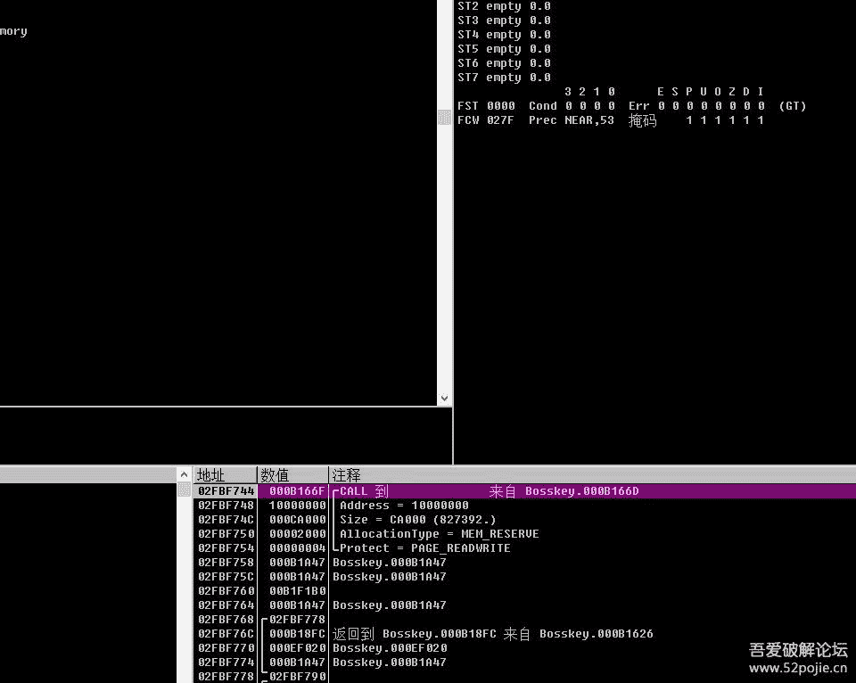
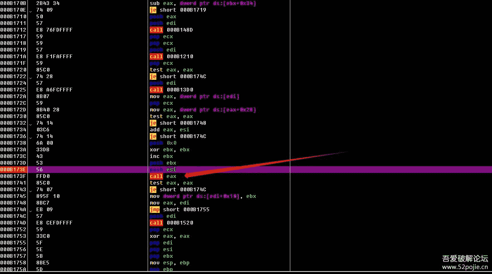
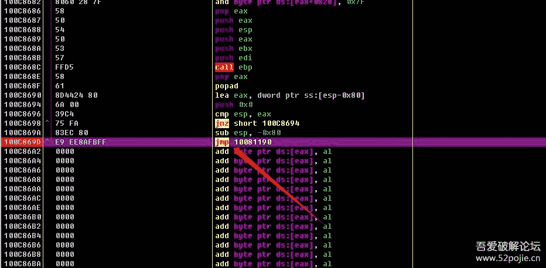
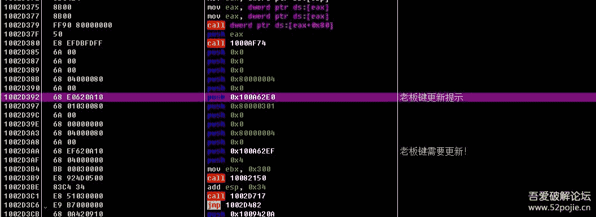
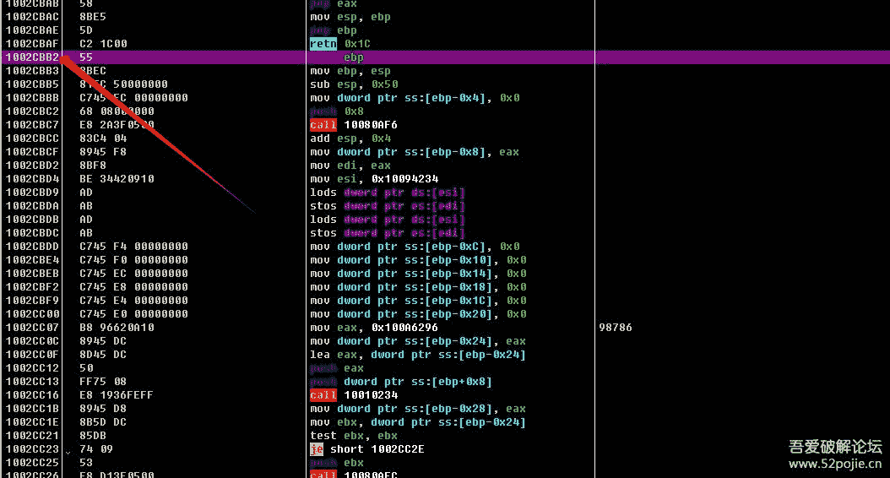
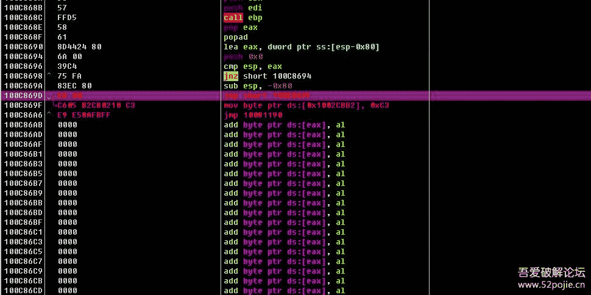
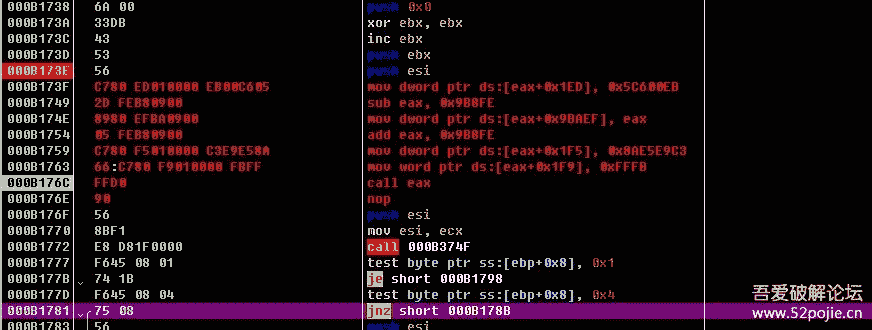

# [原创] 对于某老板键软件的思考

- 原帖：[https://www.52pojie.cn/forum.php?mod=viewthread&tid=1840912](https://www.52pojie.cn/forum.php?mod=viewthread&tid=1840912)
- 抓取时间：2026-11-01T22:44:50

## DLL 不落地技术

这是我第一次见到 DLL 不落地的程式，所以我对这个有点懵。我以为它藏了一个 EXE 在资源里面，实际上我一开始想到的也是对其进行提取，但是经过 PE 扫描以后，发现它并不在资源里面。根据大佬的提示，它是在一个 `DATA` 节之中，而且进行了加密。后面我想在内存当中对其进行 `dump`，但是我每次 `dump` 的时候，我发现我的 `loadpe` 总是报错，应该是我的工具不大行。我不了解大佬是怎么 `dump` 的，然后在我的认知当中，这似乎需要修复重定位跟对齐（文件对齐），所以我考虑使用 SMC 对其进行去更新，它比 `dump` 简单一些，且无须留下任何文件。

## SMC 技术

关于 SMC，其实它的应用范围还算比较广的，但是对程式有一定的要求，程式本身必须无任何的检测，例如加了 VMP 壳则不行，因为它对程式有内存校验。然后还需要代码段具有内存可读写权限，这个对本程式来说是必然的，因为 DLL 不落地技术使用了 `VirtualAlloc` 申请内存，该内存肯定是可读写的。另外该程式并无加壳，所以十分适合 SMC。所谓 SMC 没有那么神秘，其实就是利用 `mov` 指令对内存地址进行写入操作，仅此而已。

## 技术难点

我认为该技术最麻烦的地方是计算偏移，是的，你没有看错，就是偏移稍微有点麻烦，因为这涉及寄存器的计算，剩下的极其简单。接下来我会演示用 7 行汇编代码来解决该程式的更新问题。

### 第一步：流程解析

启动器 ---> `virtualAlloc` 申请内存 ---> `call eax`（申请的内存地址） ---> `upx OEP` ---> `DLL Main`

### 第二步：猜想合适的 SMC 位置

首先在申请内存时进行 `patch` 的话，它会存在一个问题，就是 UPX 并没有把 `text` 段解密，所以无法进行修改。然后只可能在 UPX 代码解压完毕时，在进入 OEP 之前，对其进行 SMC 会有一个比较好的效果。因为 UPX 独有的特点，它在解压完毕以后会有一个 `jmp` 指向 OEP 地址，所以我们需要把这个 `jmp` 指向我们的去更新代码，最后等我们的代码执行完毕以后，我们自己再构造一个 `jmp` 指向 OEP 即可。

### 第三步：书写修改 SMC 的位置

因为它申请内存时，它申请的内存并无任何代码，所以我们需要它在填入代码完毕时，对 SMC 代码的位置进行修改，所以我们需要在 `call eax` 前进行 `Patch` 即可。

### 第四部：寻找 `call eax`

对其下 `VirtualAlloc` 断点，从堆栈返回。



`1.png`（79.57 KB，下载次数：0）

2023-10-6 01:21 上传

附件：[下载](https://www.52pojie.cn/forum.php?mod=attachment&aid=MjY0NzAyM3wyZWYyYjIyM3wxNzkzNTczMDg4fDE2ODA4NnwxODQwOTEy&nothumb=yes)

然后往下拉，找到该位置。



`2.png`（100.21 KB，下载次数：0）

2023-10-6 01:21 上传

附件：[下载](https://www.52pojie.cn/forum.php?mod=attachment&aid=MjY0NzAyNHw4ZWIzOGU2MXwxNzkzNTczMDg4fDE2ODA4NnwxODQwOTEy&nothumb=yes)

当代码执行到 `call eax` 时，会进入 UPX 的 OEP，所以我们直接对这个进行修改。那么问题来了，SMC 的代码该如何书写呢？

那就先得找更新的代码的位置，我们直接在这个 UPX 代码尾部，进入 `DLL MAIN` 时下断，然后搜索 `"更新"` 关键字。



`3.png`（78.1 KB，下载次数：0）

2023-10-6 01:21 上传

附件：[下载](https://www.52pojie.cn/forum.php?mod=attachment&aid=MjY0NzAyNXwwOWFlNTQ3N3wxNzkzNTczMDg4fDE2ODA4NnwxODQwOTEy&nothumb=yes)



`4.png`（71.05 KB，下载次数：0）

2023-10-6 01:21 上传

附件：[下载](https://www.52pojie.cn/forum.php?mod=attachment&aid=MjY0NzAyNnxmM2YyNWNiMXwxNzkzNTczMDg4fDE2ODA4NnwxODQwOTEy&nothumb=yes)

然后往上拉到段首，记下位置 `1002CBB2`，记得，这是一个动态申请的位置，这个位置是会变的。所以，我们需要利用 `upx OEP` 进行偏移计算，最后对 `1002CBB2` 进行 `0xC3 retn` 操作。



`5.png`（112.18 KB，下载次数：0）

2023-10-6 01:21 上传

附件：[下载](https://www.52pojie.cn/forum.php?mod=attachment&aid=MjY0NzAyN3w5MmQyYmM0OHwxNzkzNTczMDg4fDE2ODA4NnwxODQwOTEy&nothumb=yes)

那么首先 `upx OEP` 的地址 = `call eax` 中的 `eax`，所以直接在 `call eax` 这里下断，把程序运行起来，得到 `eax` 的值为 `100C84B0`。

其次，更新代码的段首地址为 `1002CBB2`，它们直接的距离差值为 `100C84B0-1002CBB2=0x9B8FE`。那么为什么做减法呢？其实是因为便于计算，哪个位置的内存地址大，我就用谁做被减数。

接下来，我们书写 SMC 代码，从图 3 所示，`100C869D jmp 10081190`，我们对其进行修改，让它指向我们的 SMC 代码，得到：

```
100C869D   /EB 00                               jmp short 100C869F //修改了原来的jmp 10081190指向下面这句代码
100C869F   \C605 B2CB0210 C3                    mov byte ptr ds:[0x1002CBB2], 0xC3 //对其进行retn操作
100C86A6  ^ E9 E58AFBFF                         jmp 10081190 //手动指向原来的DLL MAIN,也就是对上面第一句代码进行复原,否则往下执行就报错啦
```

效果图如下：



`6.png`（88.63 KB，下载次数：0）

2023-10-6 01:21 上传

附件：[下载](https://www.52pojie.cn/forum.php?mod=attachment&aid=MjY0NzAyOHxiMjUyMmZkMnwxNzkzNTczMDg4fDE2ODA4NnwxODQwOTEy&nothumb=yes)

### 6> 难点

正常来说我们直接保存这块代码即可，但是要知道，这块内存是由程式申请而来的动态内存，我们无法保存，所以还是得去程式 `call eax` 那块地方，把这块 SMC 的代码填充上。是不是有点迷糊？其实简单理解就是，这块内存代码是程式动态申请的，我们的代码没办法保存在文件当中，因为它在文件当中不存在，我们得自己手动填充这块代码，然后保存在文件当中。

所以来到我们最初始的地方，`call eax`，然后又要计算偏移，计算 `upx OEP` 到 `jmp 10081190` 所处行的距离。

那么 `upx OEP` 已经知道为 `100C84B0`，`jmp 10081190` 所在行的地址为 `100C869D`，得到 `100C869D-100C84B0=0x1ED`。

对 `000B173F` 的 `call eax` 进行修改，然后有了如下代码：

```
000B173F    C780 ED010000 EB00C605              mov dword ptr ds:[eax+0x1ED], 0x5C600EB //这句代码相当于改写jmp 10081190指向smc代码,详细看上面的SMC代码

000B1749    2D FEB80900                         sub eax, 0x9B8FE //对eax进行减操作,计算更新代码的段首位置

000B174E    8980 EFBA0900                       mov dword ptr ds:[eax+0x9BAEF], eax //实际等于mov dword ptr ds:[eax+0x1F1+9B8FE], eax

000B1754    05 FEB80900                         add eax, 0x9B8FE //减了就得加回来

000B1759    C780 F5010000 C3E9E58A              mov dword ptr ds:[eax+0x1F5], 0x8AE5E9C3 

000B1763    66:C780 F9010000 FBFF               mov word ptr ds:[eax+0x1F9], 0xFFFB

000B176C    FFD0                                call eax

000B176E    90                                  nop
```

很多人有疑问，`[eax+0x1F9]` 这里面的是啥？其实是这样子的，首先 `eax` 的值为 `upx oep` 地址，然后我们需要对 `jmp` 代码每次进行 4 字节的 `patch`，所以就有了计算内存地址的偏移。当然这样做其实是复杂的，其实你也可以利用循环，将字节码放在一个固定中，进行逐字节修改。但是我不想利用太多的寄存器，因为使用了寄存器需要对寄存器进行还原，如 `pushad` `popad`，所以我仅仅使用 `eax` 进行计算，仅此而已。

3>



`7.png`（63.14 KB，下载次数：1）

2023-10-6 01:21 上传

附件：[下载](https://www.52pojie.cn/forum.php?mod=attachment&aid=MjY0NzAyOXw5MTllYjlkNXwxNzkzNTczMDg4fDE2ODA4NnwxODQwOTEy&nothumb=yes)

因为计算的都是偏移，所以无论内存地址如何变动，都会自动计算代码的，所以去更新，仅仅需要 7 行左右。

如果还是不理解，请自己跑一遍代码，就知道是什么操作了，光看我说，是看不明白的。

最后，可能还有人疑问，为什么你直接改写了 `call eax`，没有进行 `jmp` 到空白代码区进行补码操作。实际上我这样是为了省事，正常来说的确是需要进行 `jmp` 补码，但是它这个程式是这样，进入 `call eax` 以后，它下面的代码是不会执行的，所以我填充范围不大的话，是不会导致错误的。仅仅针对于该程式，也是我个人偷懒，严谨做法的话还是使用 `jmp` 补码。

## 5> 总结

我认为 SMC 是比 `dump` 要来得简单，这只是个取巧的办法。如果大家以后写 DLL 不落地的程式，请一定记得保护启动器。

作者主页：[https://www.52pojie.cn/home.php?mod=space&uid=133466](https://www.52pojie.cn/home.php?mod=space&uid=133466)
