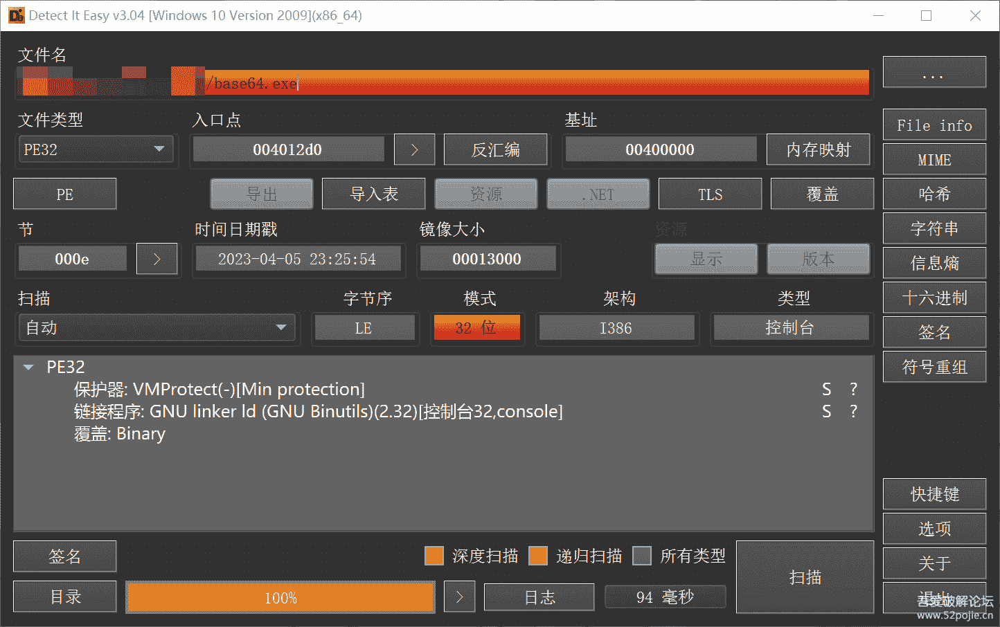
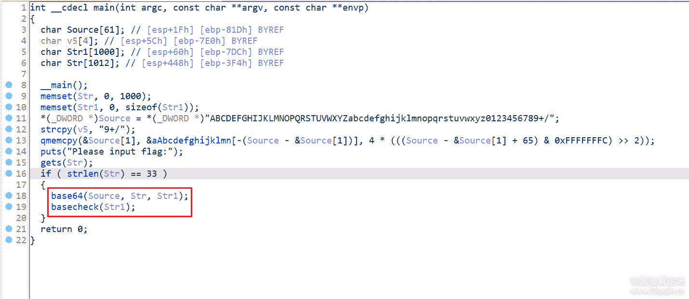
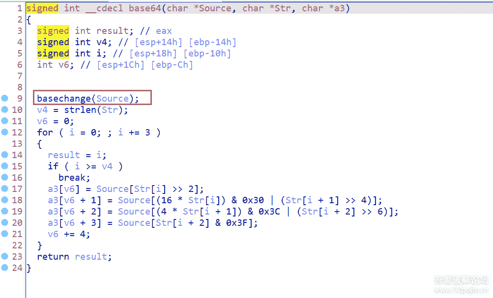
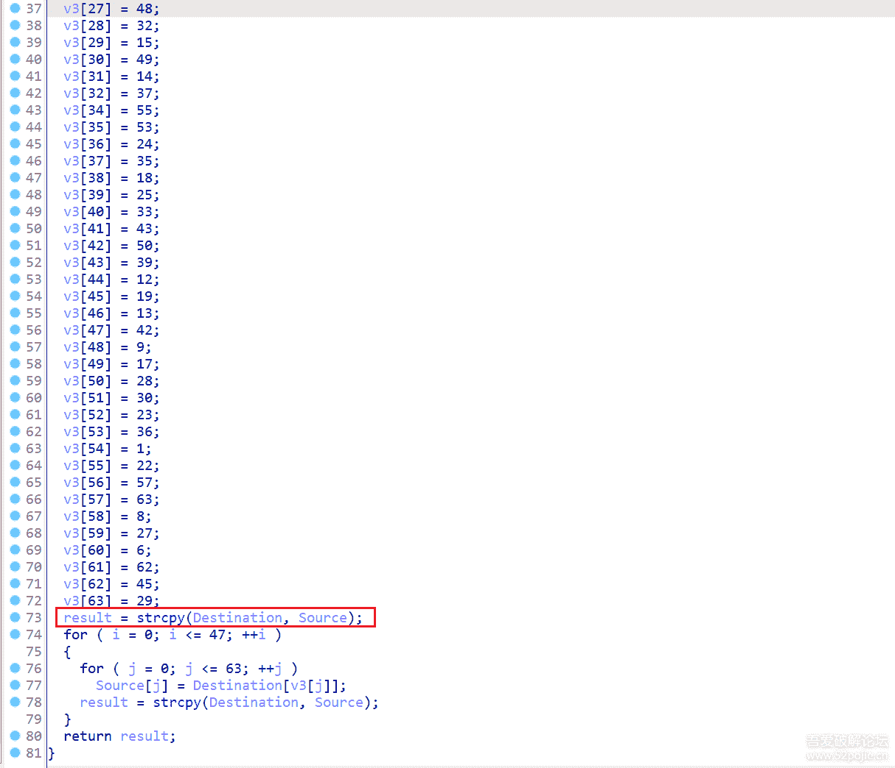
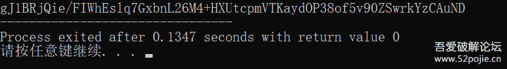
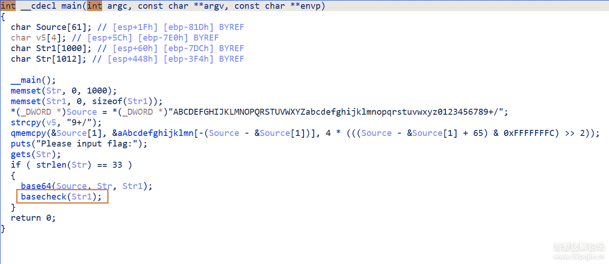
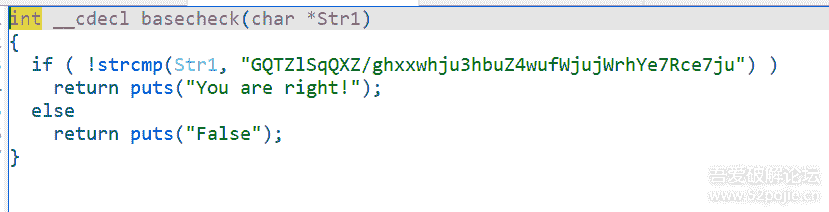
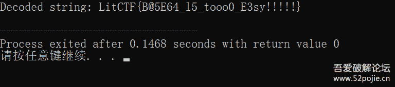

# [CTF] [LitCTF 2023]enbase64

- 原帖：<https://www.52pojie.cn/forum.php?mod=viewthread&tid=1843760>
- 抓取时间：2026-11-01T22:44:41

这是一个将`flag`换`base64`表之后加密的代码

## 附件下载

[附件下载](https://wwvc.lanzouj.com/iwZuF1bmzehg)

## 查壳

无壳，32位



image.png（109.59 KB，下载次数：2）

[图片附件](https://www.52pojie.cn/forum.php?mod=attachment&aid=MjY0ODcxN3w3MTBjNDBhNXwxNzkzNTczMDc5fDE2ODA4NnwxODQzNzYw&nothumb=yes)

2023-10-12 22:53 上传

## 分析

丢入`ida32`，找到`main()`函数`F5`

```c
int __cdecl main(int argc, const char **argv, const char **envp)
{
    char Source[61]; // [esp+1Fh] [ebp-81Dh] BYREF
    char v5[4]; // [esp+5Ch] [ebp-7E0h] BYREF
    char Str1[1000]; // [esp+60h] [ebp-7DCh] BYREF
    char Str[1012]; // [esp+448h] [ebp-3F4h] BYREF

    __main();
    memset(Str, 0, 1000);
    memset(Str1, 0, sizeof(Str1));
    *(_DWORD *)Source = *(_DWORD *)"ABCDEFGHIJKLMNOPQRSTUVWXYZabcdefghijklmnopqrstuvwxyz0123456789+/";
    strcpy(v5, "9+/");
    qmemcpy(&Source[1], &aAbcdefghijklmn[-(Source - &Source[1])], 4 * (((Source - &Source[1] + 65) & 0xFFFFFFFC) >> 2));
    puts("Please input flag:");
    gets(Str);
    if ( strlen(Str) == 33 )
{
    base64(Source, Str, Str1);
    basecheck(Str1);
}
    return 0;
}
```

第12和第13没有用，`Source`是`base64`表，也就是`ABCDEFGHIJKLMNOPQRSTUVWXYZabcdefghijklmnopqrstuvwxyz0123456789+/`，`Str`是输入的`flag`，先经过`base64()`这个函数加密，我们先点入`base64()`函数里面看看



image (1).png（72.04 KB，下载次数：2）

[图片附件](https://www.52pojie.cn/forum.php?mod=attachment&aid=MjY0ODcxMHwxOTVhN2YwNXwxNzkzNTczMDc5fDE2ODA4NnwxODQzNzYw&nothumb=yes)

2023-10-12 22:53 上传

发现`basechange(Source)`，怀疑将`base64`表换了，我们继续跟进`basechange()`函数



image (2).png（59.52 KB，下载次数：2）

[图片附件](https://www.52pojie.cn/forum.php?mod=attachment&aid=MjY0ODcxMXw5NWU3NzQ4NHwxNzkzNTczMDc5fDE2ODA4NnwxODQzNzYw&nothumb=yes)

2023-10-12 22:53 上传

将`Source`的表换成`Destination`，可以直接跑出来换后的表，即`Destination`值



image (3).png（101.45 KB，下载次数：1）

[图片附件](https://www.52pojie.cn/forum.php?mod=attachment&aid=MjY0ODcxMnwzNTg1ZTc1NXwxNzkzNTczMDc5fDE2ODA4NnwxODQzNzYw&nothumb=yes)

2023-10-12 22:53 上传

## 脚本

```c
#include
#include

int main()
{
  char *result; // eax
  char Destination[65]; // [esp+13h] [ebp-155h] BYREF
  int v3[65]; // [esp+54h] [ebp-114h] BYREF
  int j; // [esp+158h] [ebp-10h]
  int i; // [esp+15Ch] [ebp-Ch]
  char Source[] = "ABCDEFGHIJKLMNOPQRSTUVWXYZabcdefghijklmnopqrstuvwxyz0123456789+/";

  memset(v3, 0, sizeof(v3));
  v3[0] = 16;
  v3[1] = 34;
  v3[2] = 56;
  v3[3] = 7;
  v3[4] = 46;
  v3[5] = 2;
  v3[6] = 10;
  v3[7] = 44;
  v3[8] = 20;
  v3[9] = 41;
  v3[10] = 59;
  v3[11] = 31;
  v3[12] = 51;
  v3[13] = 60;
  v3[14] = 61;
  v3[15] = 26;
  v3[16] = 5;
  v3[17] = 40;
  v3[18] = 21;
  v3[19] = 38;
  v3[20] = 4;
  v3[21] = 54;
  v3[22] = 52;
  v3[23] = 47;
  v3[24] = 3;
  v3[25] = 11;
  v3[26] = 58;
  v3[27] = 48;
  v3[28] = 32;
  v3[29] = 15;
  v3[30] = 49;
  v3[31] = 14;
  v3[32] = 37;
  v3[34] = 55;
  v3[35] = 53;
  v3[36] = 24;
  v3[37] = 35;
  v3[38] = 18;
  v3[39] = 25;
  v3[40] = 33;
  v3[41] = 43;
  v3[42] = 50;
  v3[43] = 39;
  v3[44] = 12;
  v3[45] = 19;
  v3[46] = 13;
  v3[47] = 42;
  v3[48] = 9;
  v3[49] = 17;
  v3[50] = 28;
  v3[51] = 30;
  v3[52] = 23;
  v3[53] = 36;
  v3[54] = 1;
  v3[55] = 22;
  v3[56] = 57;
  v3[57] = 63;
  v3[58] = 8;
  v3[59] = 27;
  v3[60] = 6;
  v3[61] = 62;
  v3[62] = 45;
  v3[63] = 29;
  result = strcpy(Destination, Source);
  for ( i = 0; i 
```

### 换后的表



image (4).png（19.12 KB，下载次数：0）

[图片附件](https://www.52pojie.cn/forum.php?mod=attachment&aid=MjY0ODcxM3wzMTMyMjBmOXwxNzkzNTczMDc5fDE2ODA4NnwxODQzNzYw&nothumb=yes)

2023-10-12 22:53 上传

```text
gJ1BRjQie/FIWhEslq7GxbnL26M4+HXUtcpmVTKaydOP38of5v90ZSwrkYzCAuND
```

接下来就好办了，把之前写过的`base64`解密代码的`base64`表替换一下，找到加密后的值

也就是`basecheck()`函数



image (5).png（59.26 KB，下载次数：1）

[图片附件](https://www.52pojie.cn/forum.php?mod=attachment&aid=MjY0ODcxNHxiODdiMGJjMXwxNzkzNTczMDc5fDE2ODA4NnwxODQzNzYw&nothumb=yes)

2023-10-12 22:53 上传

双击跟进，找到加密后的值



image (6).png（21.26 KB，下载次数：1）

[图片附件](https://www.52pojie.cn/forum.php?mod=attachment&aid=MjY0ODcxNXwxNDcyM2EwYXwxNzkzNTczMDc5fDE2ODA4NnwxODQzNzYw&nothumb=yes)

2023-10-12 22:53 上传

```text
GQTZlSqQXZ/ghxxwhju3hbuZ4wufWjujWrhYe7Rce7ju
```

现在换的表和加密后的值都找到了，可以得到`flag`值了，直接上脚本

```c
#include 
#include 
#include 

char base64CharsArr[] = "gJ1BRjQie/FIWhEslq7GxbnL26M4+HXUtcpmVTKaydOP38of5v90ZSwrkYzCAuND";

void base64decode(char str[]) {
    int length = strlen(str);
    int padding = 0;

    // 计算填充字符数量
    if (str[length - 1] == '=') {
        padding++;
        if (str[length - 2] == '=')
            padding++;
    }

    // 计算解码后的字符数量
    int decodedLength = (length * 3) / 4 - padding;

    // 分配存储解码结果的内存
    char* decodedStr = (char*)malloc(decodedLength + 1);

    int outIndex = 0;
    for (int i = 0; i > 4);
        if (char3 != -1)
            decodedStr[outIndex++] = ((char2 & 0xf) > 2);
        if (char4 != -1)
            decodedStr[outIndex++] = ((char3 & 0x3) 
```

运行即得`flag`：`LitCTF{B@5E64_l5_tooo0_E3sy!!!!!}`



image (7).png（16.57 KB，下载次数：0）

[图片附件](https://www.52pojie.cn/forum.php?mod=attachment&aid=MjY0ODcxNnwwYTFhMWNmZXwxNzkzNTczMDc5fDE2ODA4NnwxODQzNzYw&nothumb=yes)

2023-10-12 22:53 上传
