# [CTF] [HUBUCTF 2022 新生赛]help（ida动调+迷宫
- 原帖: https://www.52pojie.cn/forum.php?mod=viewthread&tid=1844731
- 抓取时间: 2026-11-01T22:44:35

### 重点：ida动调找到地图

## 附件下载
[//wwvc.lanzouj.com/i1vh91bvxtwd" target="_blank" rel="noopener noreferrer nofollow"](https://wwvc.lanzouj.com/i1vh91bvxtwd:rel="nofollow noopener" href="https)

## 查壳
64位，无壳
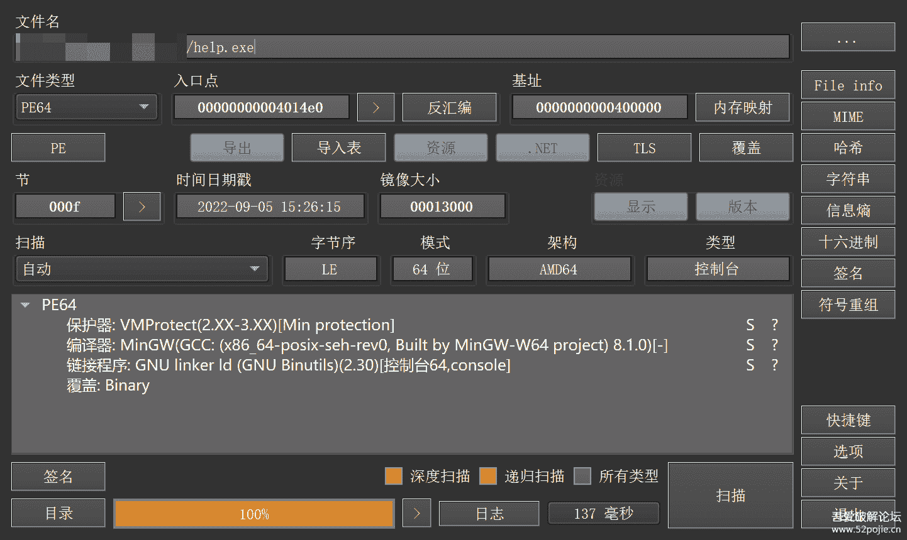
image.png (107.35 KB, 下载次数: 1)
[href="forum.php?mod=attachment&aid=MjY0OTM5MHw5YmVjNDU0MXwxNzkzNTczMDcyfDE2ODA4NnwxODQ0NzMx&nothumb=yes" target="_blank"](https://www.52pojie.cn/forum.php?mod=attachment&aid=MjY0OTM5MHw5YmVjNDU0MXwxNzkzNTczMDcyfDE2ODA4NnwxODQ0NzMx&nothumb=yes)
2023-10-15 21:35 上传

## 分析
丢入`ida64`，找到`main()`函数，`F5`查看伪代码
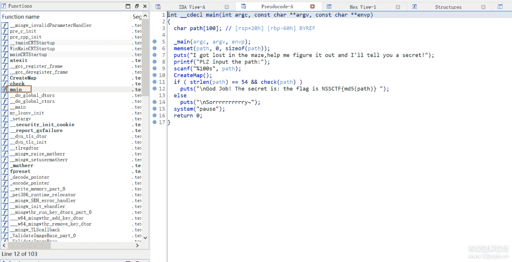
image (1).png (264.56 KB, 下载次数: 1)
[href="forum.php?mod=attachment&aid=MjY0OTM3M3w5MGU1NGE2OHwxNzkzNTczMDcyfDE2ODA4NnwxODQ0NzMx&nothumb=yes" target="_blank"](https://www.52pojie.cn/forum.php?mod=attachment&aid=MjY0OTM3M3w5MGU1NGE2OHwxNzkzNTczMDcyfDE2ODA4NnwxODQ0NzMx&nothumb=yes)
2023-10-15 21:34 上传
可以看到输入`path`之后，有一个`CreateMap()`函数，看着函数名就知道是在这创建地图，所以我们在这里下一个断点，进行动态调试

## ida动态调试
点这个蓝色的圆圈下断点，变红就证明下断点成功
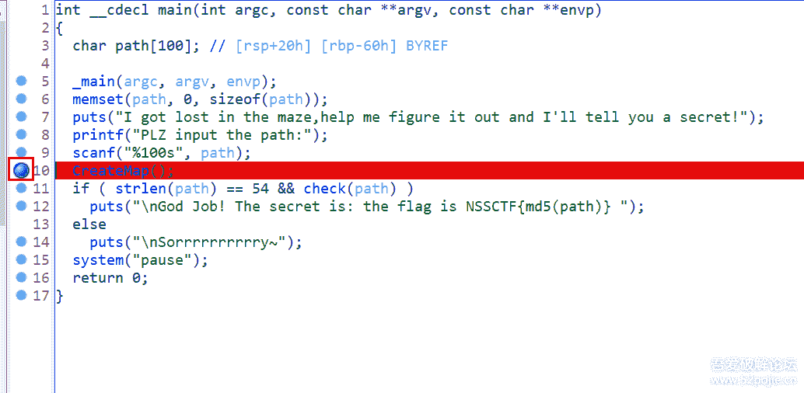
image (2).png (53.07 KB, 下载次数: 1)
[href="forum.php?mod=attachment&aid=MjY0OTM3NHwyMTkxYWI4ZXwxNzkzNTczMDcyfDE2ODA4NnwxODQ0NzMx&nothumb=yes" target="_blank"](https://www.52pojie.cn/forum.php?mod=attachment&aid=MjY0OTM3NHwyMTkxYWI4ZXwxNzkzNTczMDcyfDE2ODA4NnwxODQ0NzMx&nothumb=yes)
2023-10-15 21:34 上传
选`Local Windows debugger`调试器
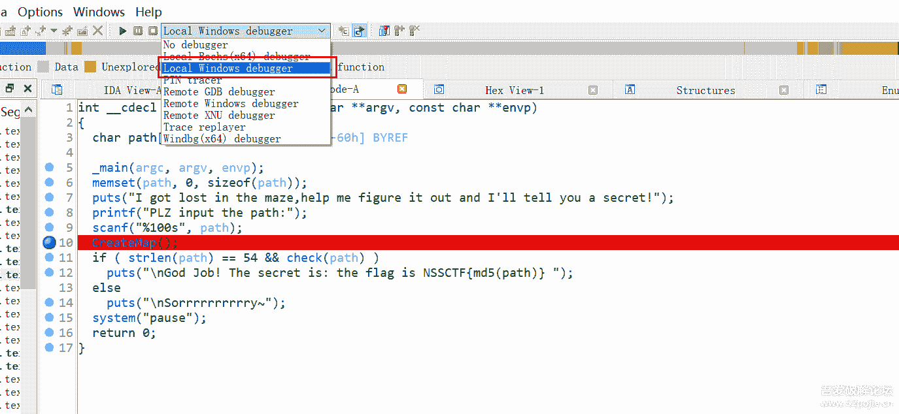
image (3).png (96.19 KB, 下载次数: 2)
[href="forum.php?mod=attachment&aid=MjY0OTM3NXxmZWQ4ZjI1NnwxNzkzNTczMDcyfDE2ODA4NnwxODQ0NzMx&nothumb=yes" target="_blank"](https://www.52pojie.cn/forum.php?mod=attachment&aid=MjY0OTM3NXxmZWQ4ZjI1NnwxNzkzNTczMDcyfDE2ODA4NnwxODQ0NzMx&nothumb=yes)
2023-10-15 21:34 上传
点击左边的绿色三角形运行，先随便输入
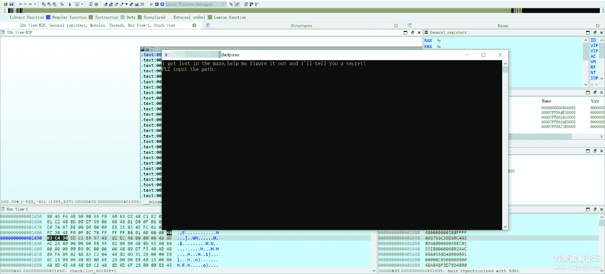
image (4).png (242.54 KB, 下载次数: 1)
[href="forum.php?mod=attachment&aid=MjY0OTM3NnwzNzVjOTYyMHwxNzkzNTczMDcyfDE2ODA4NnwxODQ0NzMx&nothumb=yes" target="_blank"](https://www.52pojie.cn/forum.php?mod=attachment&aid=MjY0OTM3NnwzNzVjOTYyMHwxNzkzNTczMDcyfDE2ODA4NnwxODQ0NzMx&nothumb=yes)
2023-10-15 21:34 上传
回车之后，按`Tab`，跳到C伪代码页面
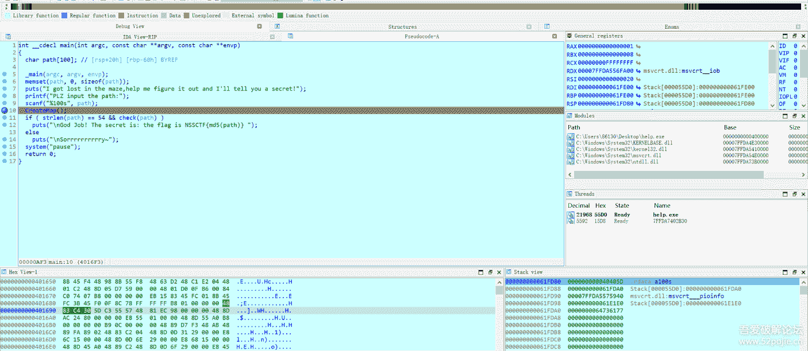
image (5).png (321.98 KB, 下载次数: 2)
[href="forum.php?mod=attachment&aid=MjY0OTM3N3w4MmE3ZDg2NHwxNzkzNTczMDcyfDE2ODA4NnwxODQ0NzMx&nothumb=yes" target="_blank"](https://www.52pojie.cn/forum.php?mod=attachment&aid=MjY0OTM3N3w4MmE3ZDg2NHwxNzkzNTczMDcyfDE2ODA4NnwxODQ0NzMx&nothumb=yes)
2023-10-15 21:34 上传
`F7`单步调试，进入`CreateMap()`函数
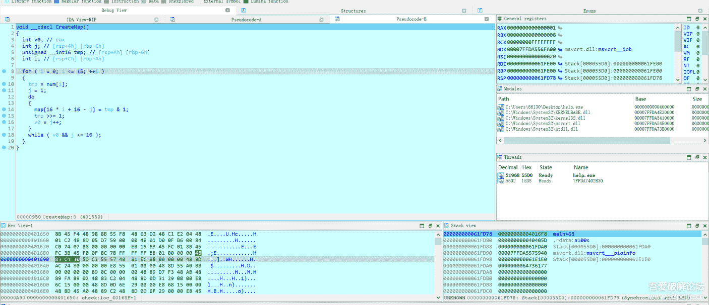
image (6).png (312.27 KB, 下载次数: 2)
[href="forum.php?mod=attachment&aid=MjY0OTM3OHxiMmFmN2MyOXwxNzkzNTczMDcyfDE2ODA4NnwxODQ0NzMx&nothumb=yes" target="_blank"](https://www.52pojie.cn/forum.php?mod=attachment&aid=MjY0OTM3OHxiMmFmN2MyOXwxNzkzNTczMDcyfDE2ODA4NnwxODQ0NzMx&nothumb=yes)
2023-10-15 21:34 上传
再一直按`F7`单步调试，直到地图全部出现，自动跳到最开始的`main()`函数页面，点`OK`
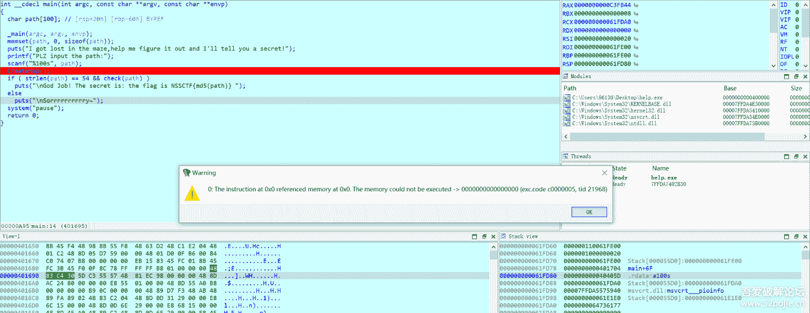
image (7).png (297.02 KB, 下载次数: 2)
[href="forum.php?mod=attachment&aid=MjY0OTM3OXxkMmZkOWFmN3wxNzkzNTczMDcyfDE2ODA4NnwxODQ0NzMx&nothumb=yes" target="_blank"](https://www.52pojie.cn/forum.php?mod=attachment&aid=MjY0OTM3OXxkMmZkOWFmN3wxNzkzNTczMDcyfDE2ODA4NnwxODQ0NzMx&nothumb=yes)
2023-10-15 21:34 上传
双击进入`CreateMap()`函数
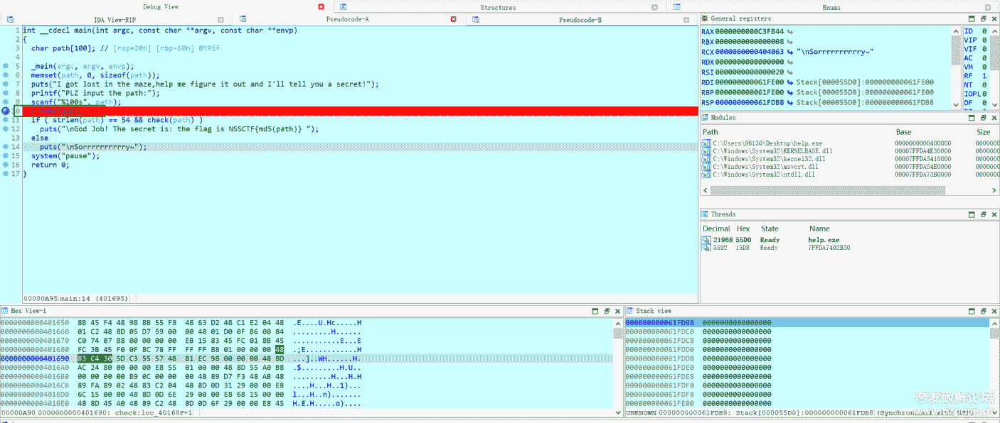
image (8).png (316.48 KB, 下载次数: 2)
[href="forum.php?mod=attachment&aid=MjY0OTM4MHw5ZWU2MjVjYnwxNzkzNTczMDcyfDE2ODA4NnwxODQ0NzMx&nothumb=yes" target="_blank"](https://www.52pojie.cn/forum.php?mod=attachment&aid=MjY0OTM4MHw5ZWU2MjVjYnwxNzkzNTczMDcyfDE2ODA4NnwxODQ0NzMx&nothumb=yes)
2023-10-15 21:34 上传
再双击`map`
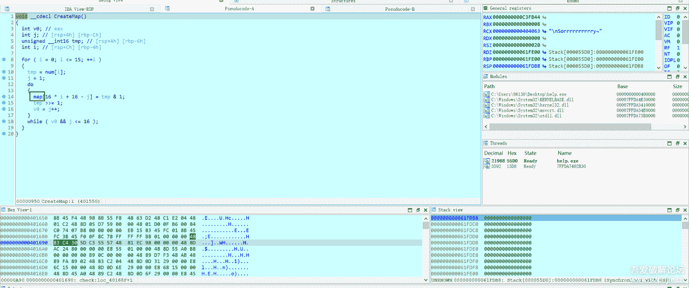
image (9).png (291.72 KB, 下载次数: 1)
[href="forum.php?mod=attachment&aid=MjY0OTM4MXwxMjhkODk0NnwxNzkzNTczMDcyfDE2ODA4NnwxODQ0NzMx&nothumb=yes" target="_blank"](https://www.52pojie.cn/forum.php?mod=attachment&aid=MjY0OTM4MXwxMjhkODk0NnwxNzkzNTczMDcyfDE2ODA4NnwxODQ0NzMx&nothumb=yes)
2023-10-15 21:35 上传
找到地图
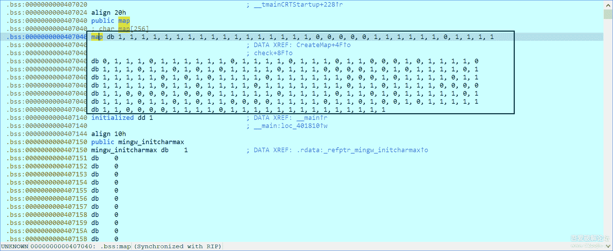
image (10).png (97.09 KB, 下载次数: 1)
[href="forum.php?mod=attachment&aid=MjY0OTM4MnxjYzQ5NzM5MnwxNzkzNTczMDcyfDE2ODA4NnwxODQ0NzMx&nothumb=yes" target="_blank"](https://www.52pojie.cn/forum.php?mod=attachment&aid=MjY0OTM4MnxjYzQ5NzM5MnwxNzkzNTczMDcyfDE2ODA4NnwxODQ0NzMx&nothumb=yes)
2023-10-15 21:35 上传
```
1, 1, 1, 1, 1, 1, 1, 1, 1, 1, 1, 1, 1, 1, 1, 1, 1, 0, 0, 0, 0, 0, 1, 1, 1, 1, 1, 1, 0, 1, 1, 1, 1
0, 1, 1, 1, 0, 1, 1, 1, 1, 1, 1, 0, 1, 1, 1, 1, 0, 1, 1, 1, 0, 1, 1, 0, 0, 0, 1, 0, 1, 1, 1, 1, 0
1, 1, 1, 0, 1, 1, 0, 1, 0, 1, 0, 1, 1, 1, 1, 0, 1, 1, 1, 0, 0, 0, 0, 1, 0, 1, 0, 1, 1, 1, 1, 0, 1
1, 1, 1, 1, 1, 0, 1, 0, 1, 0, 1, 1, 1, 1, 0, 1, 1, 1, 1, 1, 1, 0, 0, 0, 1, 0, 1, 1, 1, 1, 0, 1, 1
1, 1, 1, 1, 1, 0, 1, 1, 0, 1, 1, 1, 1, 0, 1, 1, 1, 1, 1, 1, 1, 0, 1, 1, 0, 1, 1, 1, 1, 0, 0, 0, 0
1, 1, 0, 0, 0, 0, 1, 0, 0, 0, 1, 1, 1, 1, 1, 0, 1, 1, 1, 1, 0, 1, 1, 0, 1, 0, 1, 1, 1, 1, 1, 0, 1
1, 1, 1, 0, 1, 1, 0, 1, 0, 1, 1, 0, 0, 0, 0, 1, 1, 1, 1, 0, 1, 1, 0, 1, 0, 0, 1, 0, 1, 1, 1, 1, 1
1, 1, 0, 0, 0, 0, 1, 1, 1, 1, 0, 1, 1, 1, 1, 1, 1, 1, 1, 1, 1, 1, 1, 1, 1
```

## 再次分析
分析`CreateMap()`函数，很明显，地图需要以16个为一组
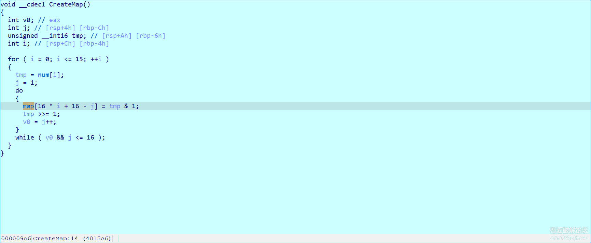
image (11).png (39.53 KB, 下载次数: 1)
[href="forum.php?mod=attachment&aid=MjY0OTM4M3xkOTliYzA4NHwxNzkzNTczMDcyfDE2ODA4NnwxODQ0NzMx&nothumb=yes" target="_blank"](https://www.52pojie.cn/forum.php?mod=attachment&aid=MjY0OTM4M3xkOTliYzA4NHwxNzkzNTczMDcyfDE2ODA4NnwxODQ0NzMx&nothumb=yes)
2023-10-15 21:35 上传
修改之后
```
[1,1,1,1,1,1,1,1,1,1,1,1,1,1,1,1],
[1,0,0,0,0,0,1,1,1,1,1,1,0,1,1,1],
[1,0,1,1,1,0,1,1,1,1,1,1,0,1,1,1],
[1,0,1,1,1,0,1,1,0,0,0,1,0,1,1,1],
[1,0,1,1,1,0,1,1,0,1,0,1,0,1,1,1],
[1,0,1,1,1,0,0,0,0,1,0,1,0,1,1,1],
[1,0,1,1,1,1,1,1,0,1,0,1,0,1,1,1],
[1,0,1,1,1,1,1,1,0,0,0,1,0,1,1,1],
[1,0,1,1,1,1,1,1,1,0,1,1,0,1,1,1],
[1,0,1,1,1,1,1,1,1,0,1,1,0,1,1,1],
[1,0,0,0,0,1,1,0,0,0,0,1,0,0,0,1],
[1,1,1,1,0,1,1,1,1,0,1,1,0,1,0,1],
[1,1,1,1,0,1,1,1,1,0,1,1,0,1,0,1],
[1,0,0,0,0,1,1,1,1,0,1,1,0,1,0,0],
[1,0,1,1,1,1,1,1,1,0,0,0,0,1,1,1],
[1,0,1,1,1,1,1,1,1,1,1,1,1,1,1,1]
```
`main()`函数限定了`path`长度为54
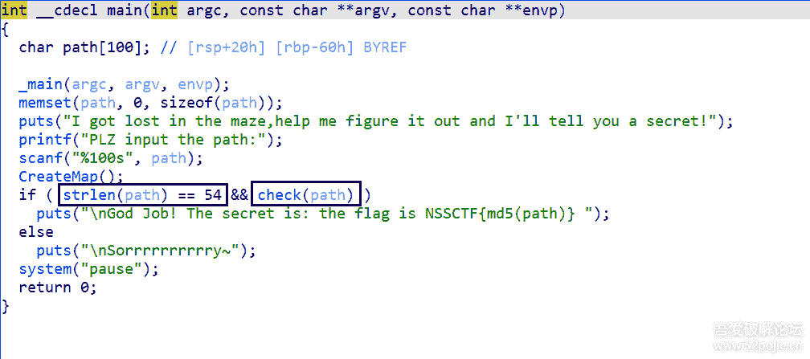
image (12).png (41.46 KB, 下载次数: 2)
[href="forum.php?mod=attachment&aid=MjY0OTM4NHw5M2VkZjI0NnwxNzkzNTczMDcyfDE2ODA4NnwxODQ0NzMx&nothumb=yes" target="_blank"](https://www.52pojie.cn/forum.php?mod=attachment&aid=MjY0OTM4NHw5M2VkZjI0NnwxNzkzNTczMDcyfDE2ODA4NnwxODQ0NzMx&nothumb=yes)
2023-10-15 21:35 上传
再看`check()`函数，`s`就是`path`，`x`=15，`y`=1，分析代码，可以确定，迷宫的初始位置是（15，1），且`x`,`y`都是从0开始数的，所以我们可以找到迷宫初始位置

image (13).png (52.86 KB, 下载次数: 1)
[href="forum.php?mod=attachment&aid=MjY0OTM4NXwwZDBlMzkzYXwxNzkzNTczMDcyfDE2ODA4NnwxODQ0NzMx&nothumb=yes" target="_blank"](https://www.52pojie.cn/forum.php?mod=attachment&aid=MjY0OTM4NXwwZDBlMzkzYXwxNzkzNTczMDcyfDE2ODA4NnwxODQ0NzMx&nothumb=yes)
2023-10-15 21:35 上传
初始位置，走出迷宫，且`path`的长度必须是54
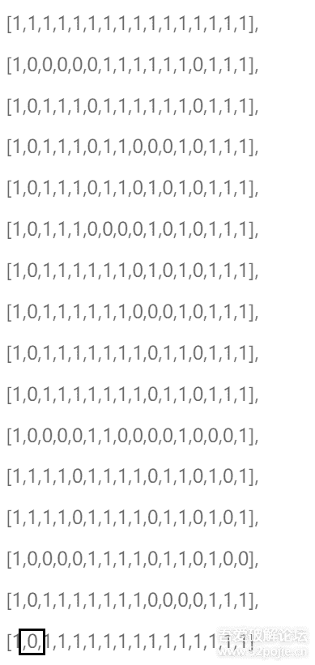
image (14).png (52.95 KB, 下载次数: 1)
[href="forum.php?mod=attachment&aid=MjY0OTM4NnxiNzZlZTdjNnwxNzkzNTczMDcyfDE2ODA4NnwxODQ0NzMx&nothumb=yes" target="_blank"](https://www.52pojie.cn/forum.php?mod=attachment&aid=MjY0OTM4NnxiNzZlZTdjNnwxNzkzNTczMDcyfDE2ODA4NnwxODQ0NzMx&nothumb=yes)
2023-10-15 21:35 上传
使用word文档，帮忙高光一下0，这样就好看多了
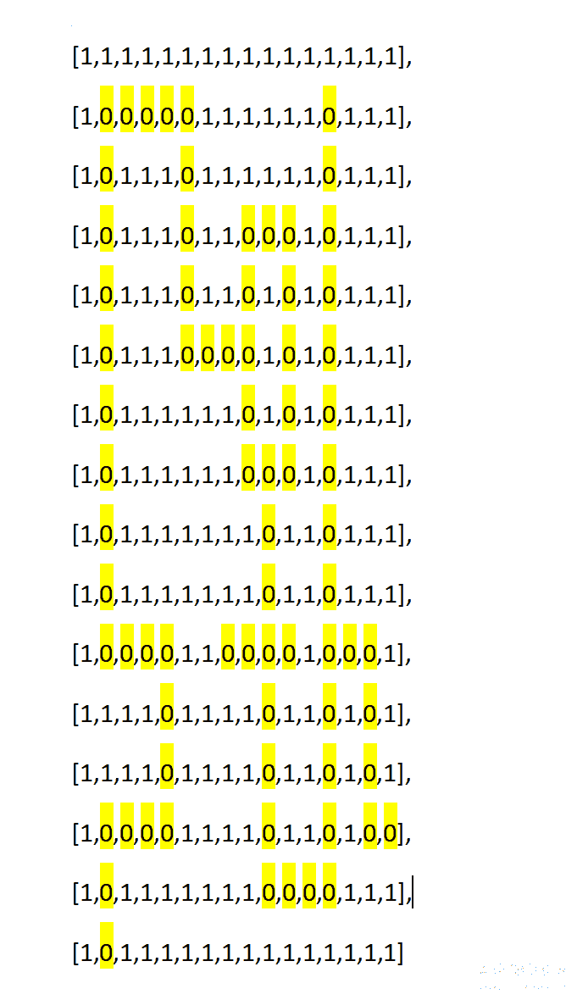
image (15).png (29.51 KB, 下载次数: 2)


[href="forum.php?mod=attachment&aid=MjY0OTM4N3wxNjdkMTdmYXwxNzkzNTczMDcyfDE2ODA4NnwxODQ0NzMx&nothumb=yes" target="_blank"](https://www.52pojie.cn/forum.php?mod=attachment&aid=MjY0OTM4N3wxNjdkMTdmYXwxNzkzNTczMDcyfDE2ODA4NnwxODQ0NzMx&nothumb=yes)

2023-10-15 21:35 上传

`path`：`wwdddwwwaaawwwwwwwwwddddssssdddssdsssssssdddwwwwddsssd`

`main`函数提到了，`flag`是`path`进行`md5`之后，加个`NSSCTF{}`就可以了

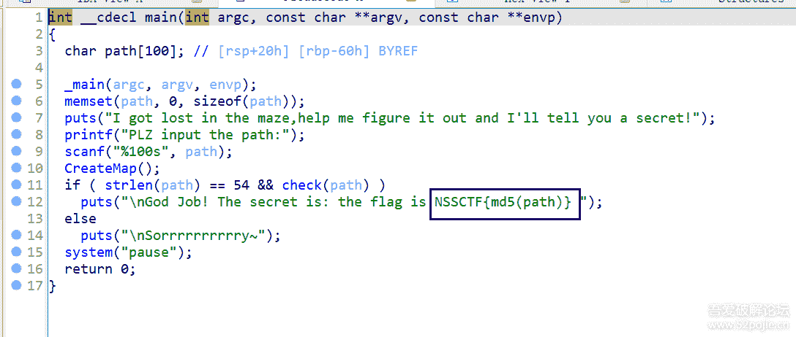

`image (16).png` (53.81 KB, 下载次数: 1)

[href="forum.php?mod=attachment&aid=MjY0OTM4OHw5ZjZkMWFlZHwxNzkzNTczMDcyfDE2ODA4NnwxODQ0NzMx&nothumb=yes" target="_blank"](https://www.52pojie.cn/forum.php?mod=attachment&aid=MjY0OTM4OHw5ZjZkMWFlZHwxNzkzNTczMDcyfDE2ODA4NnwxODQ0NzMx&nothumb=yes)

2023-10-15 21:35 上传

`md5`加密，取32位小写


`image (17).png` (70.45 KB, 下载次数: 1)

[href="forum.php?mod=attachment&aid=MjY0OTM4OXwzM2I1MTZmY3wxNzkzNTczMDcyfDE2ODA4NnwxODQ0NzMx&nothumb=yes" target="_blank"](https://www.52pojie.cn/forum.php?mod=attachment&aid=MjY0OTM4OXwzM2I1MTZmY3wxNzkzNTczMDcyfDE2ODA4NnwxODQ0NzMx&nothumb=yes)

2023-10-15 21:35 上传

`flag`：`NSSCTF{a8622109e2fb1296e06d5eed6f78f954}`
