# [Web逆向] 人均瑞数系列，瑞数 6 代 JS 逆向分析

- 原帖: https://www.52pojie.cn/forum.php?mod=viewthread&tid=1846988
- 抓取时间: 2026-11-01T22:44:24


## 声明

本文章中所有内容仅供学习交流使用，不用于其他任何目的，不提供完整代码，抓包内容、敏感网址、数据接口等均已做脱敏处理，严禁用于商业用途和非法用途，否则由此产生的一切后果均与作者无关！

本文章未经许可禁止转载，禁止任何修改后二次传播，擅自使用本文讲解的技术而导致的任何意外，作者均不负责，若有侵权，请联系作者立即删除！

## 前言

K哥往期瑞数相关文章中，详细介绍了瑞数的特征、如何区分不同版本、瑞数的代码结构以及各自的作用，本文就不再赘述了，不了解的同志可以先去看看之前的文章。

## Cookie 入口定位

与以往的四代、五代一样，定位 Cookie，首选 Hook，通过 Fiddler 插件、油猴脚本、浏览器插件等方式注入以下 Hook 代码：

```javascript
(function() {
    var cookieTemp = "";
    Object.defineProperty(document, 'cookie', {
        set: function(val) {
            console.log('Hook捕获到cookie设置->', val);
            debugger;
            cookieTemp = val;
            return val;
        },
        get: function() {
            return cookieTemp;
        }
    });
})();
```

### VM 代码以及 `$_ts` 变量获取

参考K哥往期瑞数五代文章。

### 流程分析

与五代一致，用本地替换固定一套代码。通过 `(947, 1)` 定位到加密流程入口，开始进行流程分析，从现在开始只需要 F9 操作，并且做好记录，其中大部分流程与 5 代一致，可以参考之前的文章。下文中不会对流程中的每一步进行讲解，只会记录对结果有影响的关键步骤。

#### 步骤1

这一步调用了一个方法，得到了一个类似时间戳的值，进入方法内部：

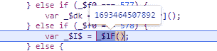

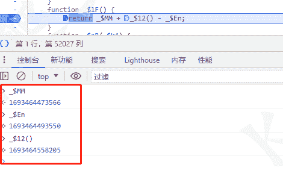

对两个时间戳以及当前时间戳做了计算，记录 `_$MM`，`_$En` 的值，后续还会用到。

#### 步骤2

这里对两个数组进行了拼接操作，`_$4y` 为 16 位数组，`_$bx` 为 4 位数组：

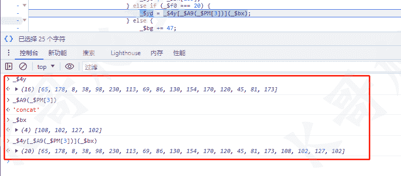

先来看 16 位数组 `_$4y` 的生成，搜索 `_$4y =`，可以定位到一处：

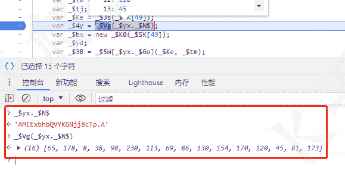

先看参数 `_$yx._$N$` 的值，`AMEExbhbQVYKGNjj8cTp.A`，通过全局搜索可以发现这个值是在 JS 文件中：

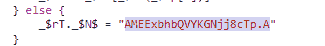

再看 `_$yx`，观察它的值，可以发现与 `$_ts` 一致，后续还会有多处会用到 `_$yx`：

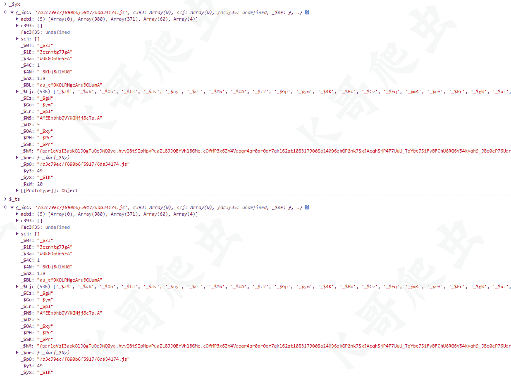

参数值找到了，还剩方法 `_$Vg`。进入方法内部，可以看到它进行了很多运算，这里直接扣下来就行：

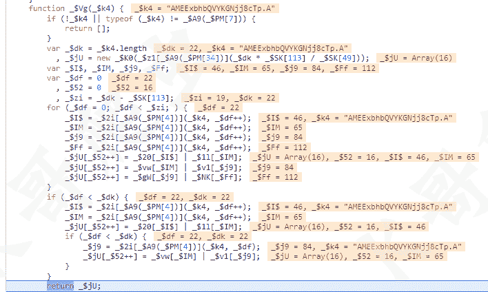

16 位数组搞定了，还有 4 位数组 `_$bx`，同样进行搜索，一共有 6 处，其中 5 处能够比较明显的看出是 `_$bx` 的生成流程，全部打下断点，首选创建了一个 4 位数组：

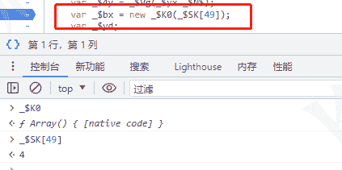

下面就是对数组的每一位进行了赋值，这段逻辑很简单，但是实现却比较复杂：

```javascript
var _$3B = _$5W[_$yx._$Go](_$Ke, _$tm);

_$bx[1] = _$3B;  // 102

============================================

var _$I$ = _$5W[_$yx._$OA](_$dk);

_$bx[3] = _$I$;  // 102

============================================

var _$dk = _$5W[_$yx._$Lr]();

_$bx[2] = _$dk;  // 127

============================================

var _$j9 = _$5W[_$yx._$0f](_$jU, _$I$);

_$bx[0] = _$j9;  // 108
```

首先 `_$yx._$xx` 返回一个变量名，上文中讲到了 `_$yx` 就是 `$_ts`。然后 `_$5W` 是一个对象，里面存放着多个方法，根据 `_$yx._$xx` 返回的变量名来调用对应的方法。`_$5W` 中的方法都有一个特点，就是结构相同，如下：

```javascript
function _$Vk() {
    var _$pn = [249];
    Array.prototype.push.apply(_$pn, arguments);
    return _$2W.apply(this, _$pn);
}
```

这里其实不用在意方法内部做了什么，经测试可以发现，方法中的数组如 `[249]` 与方法最终结果值存在对应关系，我们只需要找到调用的方法中数组值就可以知道方法的返回值，这里直接将关系给出：

```javascript
valueMap = {
    194: 103,
    274: 103,
    306: 100,
    251: 203,
    247: 0,
    272: 126,
    240: 103,
    290: 225,
    285: 203,
    249: 102,
    283: 102,
    298: 181,
    281: 11,
    256: 224,
    264: 181,
    266: 108,
    268: 240,
    302: 208,
    304: 180,
    308: 127,
    270: 101,
}
```

如 `_$5W[_$yx._$Go](_$Ke, _$tm)`，这个方法中数组为 `[249]`，而 249 对应的值为 102，那么 `_$5W[_$yx._$Go](_$Ke, _$tm)` 的返回值就是 102。

到这里就是 16 位数组和 4 位数组的生成，将它们拼接后得到一个 20 位数组。

#### 步骤3

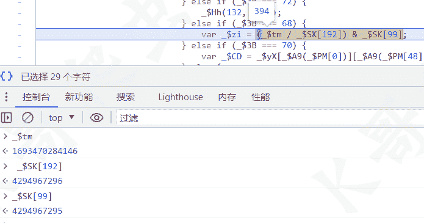

这里对时间戳进行了运算，`_$tm` 的值为步骤1中时间戳计算的结果 `_$I$`。

#### 步骤4

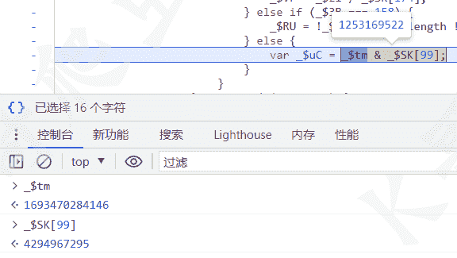

#### 步骤5

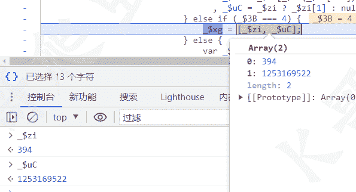

这里将步骤3、4中的结果存入数组赋值给了 `_$xg`。

#### 步骤6

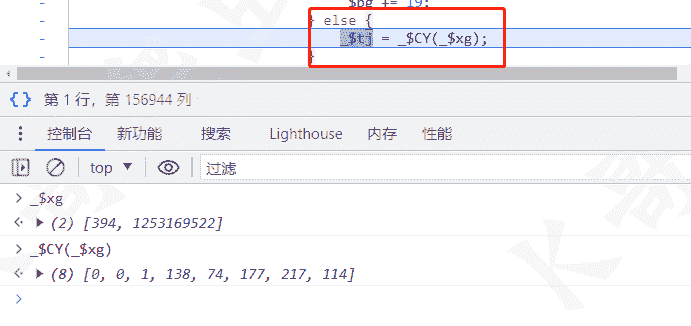

这里将两位数组转为了八位数组，进入 `_$CY` 方法内部看看，也是一些朴实无华的操作，扣下来即可：

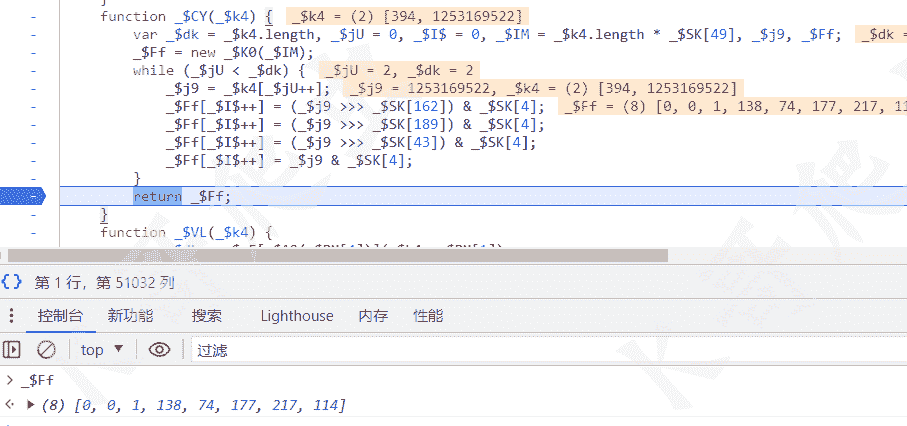

#### 步骤7

下面有一段较长的流程，都是在对一些自动化特征进行检测，可以直接跳过：

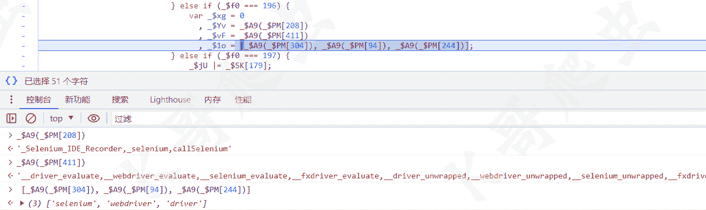

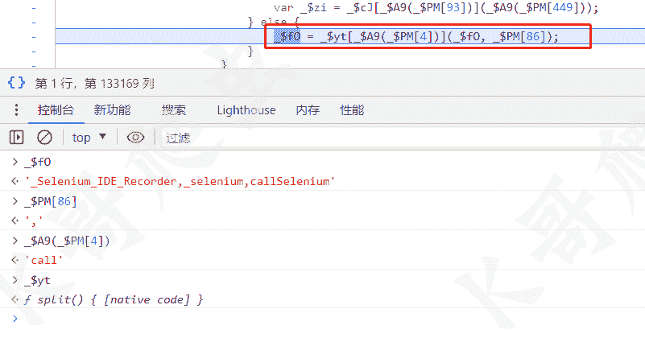

#### 步骤8

生成了一个 128 位数组，最终 cookie 也是由这个数组转化得来：

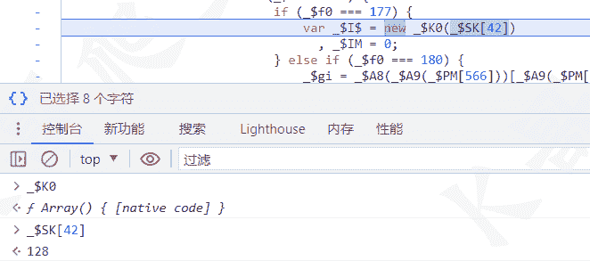

#### 步骤9

首先将步骤2中生成的 20 位数组存入 128 位数组：

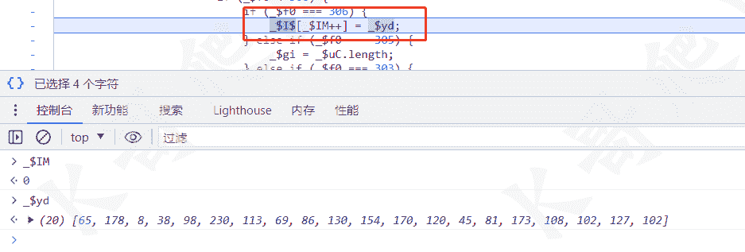

#### 步骤10

这四处值可以固定：

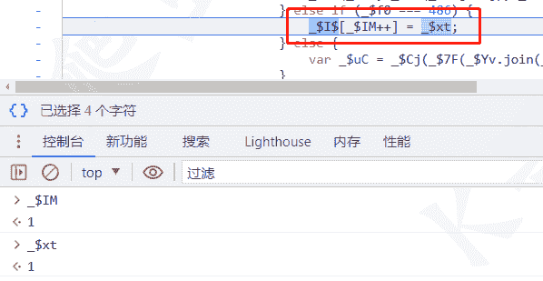

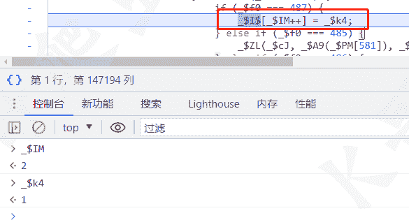

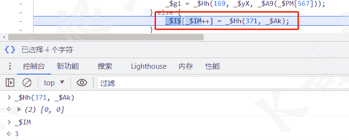

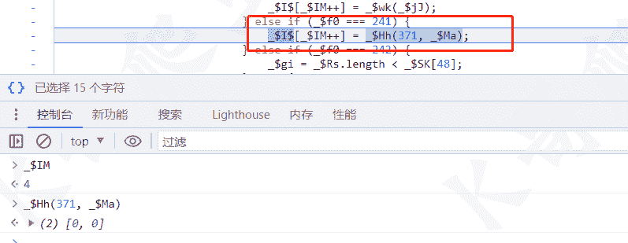

#### 步骤11

这里 `_$Ke` 值为 4 位数组：

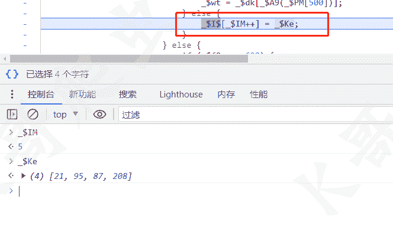

搜索 `_$Ke` 可以定位到生成点，由方法 `_$Js` 生成：

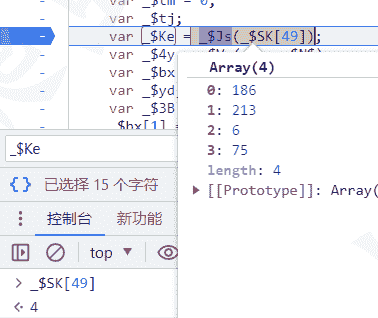

进入 `_$Js` 内部，发现值的生成由 `_$Zb` 实现：

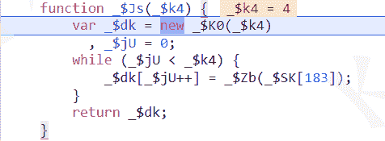

进入 `_$Zb`，可以发现这行是用于生成 0 - 255 的随机数：

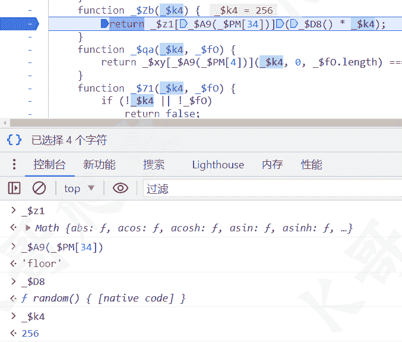

那么 4 位数组的生成就解决了，由四个 0 - 255 间的随机数组成。

#### 步骤12

`_$g5` 为 8 位数组，这个数组的由来比较棘手，先搜索 `_$g5`，一共有四处结果，全部断下：

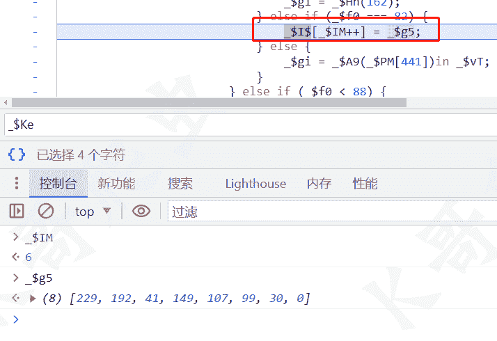

这里可以看到要找的值是 `_$zi`，但是 `_$zi` 出现的地方很多，通过搜索定位不到 8 位数组的生成位置，这里只能追栈，回到上一个栈：

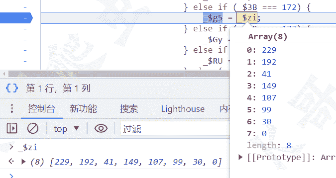

可以看到 `_$pn` 中包含了一个字符串 `zbOdssUZRkdTixew3tpf4WGN.rNLK_jWMTTqMIafmZV`，这个字符串就是八位数组生成的关键值，经测试，这个字符串可以固定。那么 F9 继续往下走：

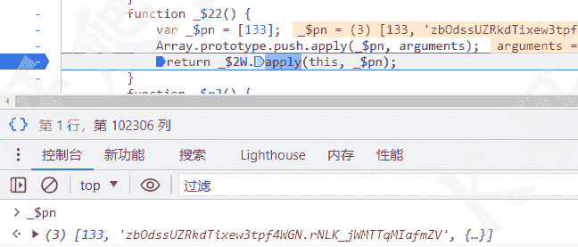

这里会进入一个新分支，而生成的值就是我们要找的八位数组，跟进去：

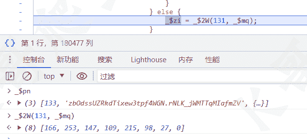

到这里就找到了八位数组的生成点，`_$mq` 为上文中的字符串，`_$gr` 会生成随机的 21 位数组，`_$zW` 生成最终八位数组：

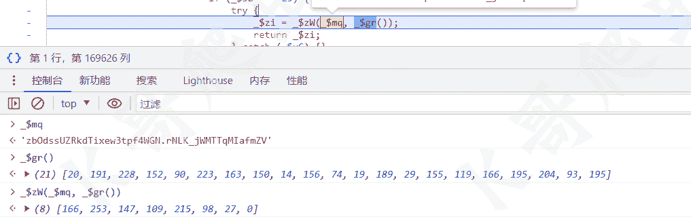

先看 `_$gr`，进入该方法，代码如下。

```javascript
var _$dk = _$Vg(_$2s(_$SK[46]) + _$yx._$1E);
return _$Gi(_$dk);
```

`_$Vg` 方法前文中已经讲到了，扣下来即可。前文讲到了，`_$yx` 就是 `$_ts`，因此 `_$yx._$1E` 的值在网页返回的代码中，需要动态匹配。再看 `_$2s`，进入该方法：

```javascript
var _$zi = _$mq % _$SK[83];
var _$uC = _$mq - _$zi;
_$zi = _$cl(_$zi);
_$zi ^= _$yx._$y3;
_$uC += _$zi;
return _$Yv[_$uC];
```

首先看方法 `_$cl`，需要关注的值是 `_$yx._$O2`，动态匹配即可。

```javascript
var _$dk = [0, 1, _$SK[113], _$SK[11], _$SK[124], _$SK[41]];
return (_$k4 >> _$yx._$O2) | ((_$k4 & _$dk[_$yx._$O2]) 
```

然后是 `_$yx._$y3`，同样需要动态匹配。最后是 `_$Yv`，这是一个 64 位数组，通过搜索 `_$Yv[` 可以定位到它的生成点。

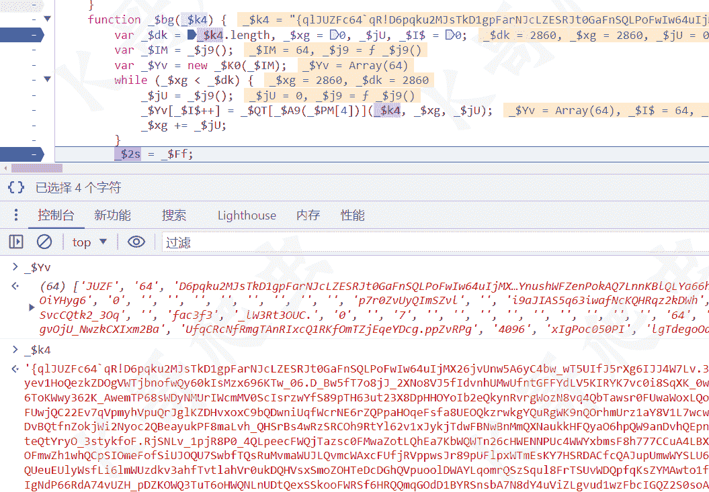

`_$k4` 的值也是网页返回的 JS 代码中的，需动态匹配，`_$j9` 方法直接扣下来即可。

到这里 `_$dk` 的值就能拿到了，得到的是一个 16 位数组。还剩 `_$Gi`，这个方法主要是对数组值进行了一些逻辑操作，缺啥补啥即可。

到这里 21 位数组也得到了，离最终的八位数组还剩 `_$zW` 方法，代码如下：

```javascript
var _$dk = _$Vg(_$k4);
var _$jU = new _$35(_$fO);
return _$jU._$ZL(_$dk, true);
```

`_$Vg` 讲过了，`_$35` 中内容比较多，这里不做讲解，缺啥补啥即可。

那么八位数组的生成就结束了。

#### 步骤13

以下四处值可以固定：

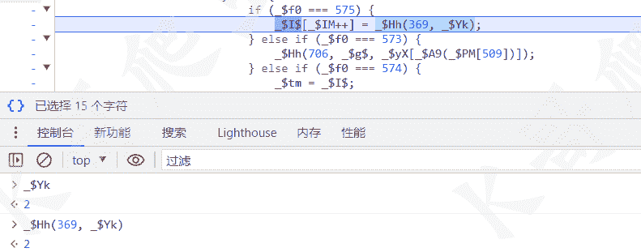

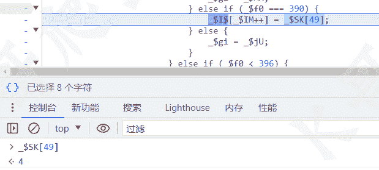

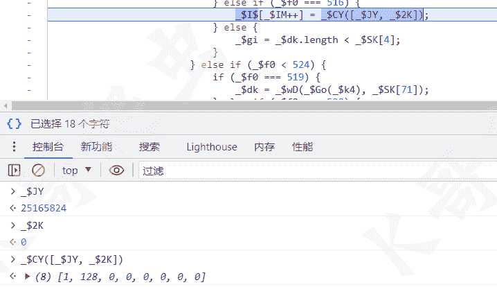

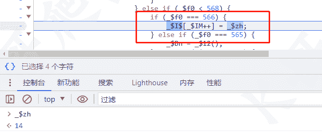

#### 步骤14

这里将一个八位数组 `_$tj` 的值添加到了数组中，而这个八位数组就是步骤6中生成的八位数组：

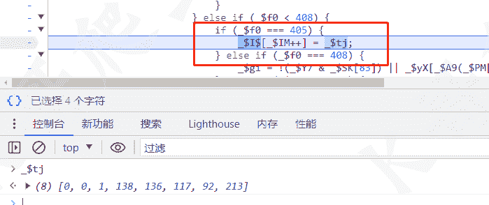

#### 步骤15

这里将下标 12 的位置空了出来，其余各处值均可固定：

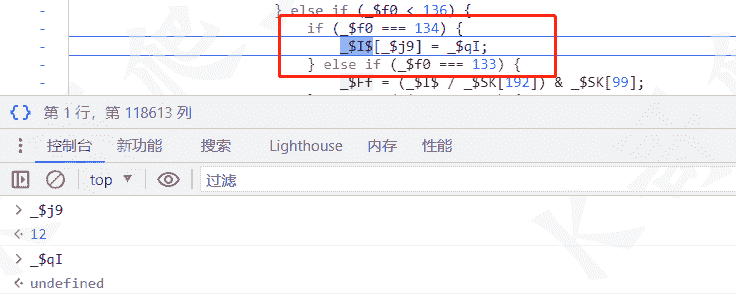

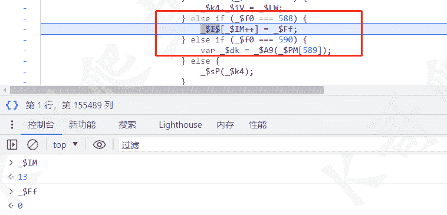

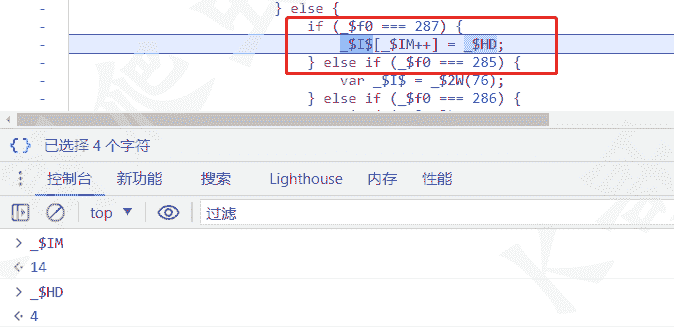

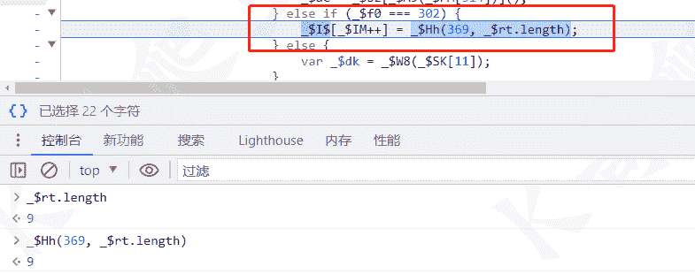

在该步骤中，也是对一些环境进行了检测，流程较长，慢慢跟即可。

#### 步骤16

其中 `_$rt` 固定为 `https:443`，`_$wk` 方法将字符串转数组，该方法可以直接扣下来：

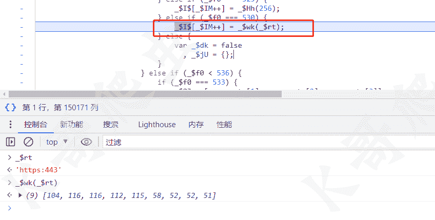

#### 步骤17

这里会进入一个新分支，得到一个固定值，感兴趣的可以跟进去看一下，流程比较长，主要是对 UA 等环境值进行了处理：

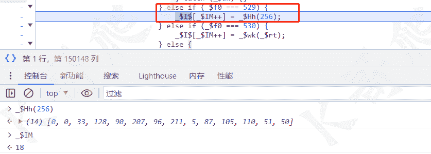

#### 步骤18

这里对 128 位数组下标 12 的位置做了重新赋值，`_$jU` 的值为固定值，细心的朋友在前面几个步骤的调试过程中会发现一些 `|` 运算，如 `_$jU |= _$SK[189];`，这些就是在计算 `_$jU` 的值：

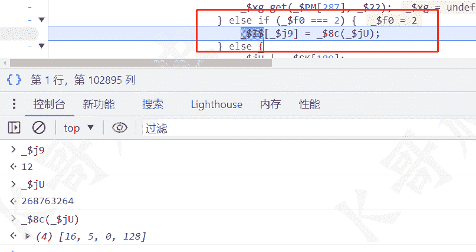

进入 `_$8c` 方法中，代码如下：

```javascript
[(_$k4 >>> _$SK[162]) & _$SK[4], (_$k4 >>> _$SK[189]) & _$SK[4], (_$k4 >>> _$SK[43]) & _$SK[4], _$k4 & _$SK[4]];
```

也是在进行一些逻辑运行，这里直接扣下来即可。

#### 步骤19

这里对 128 位数组进行了切割，保留了有值的部分，得到一个 18 位数组：

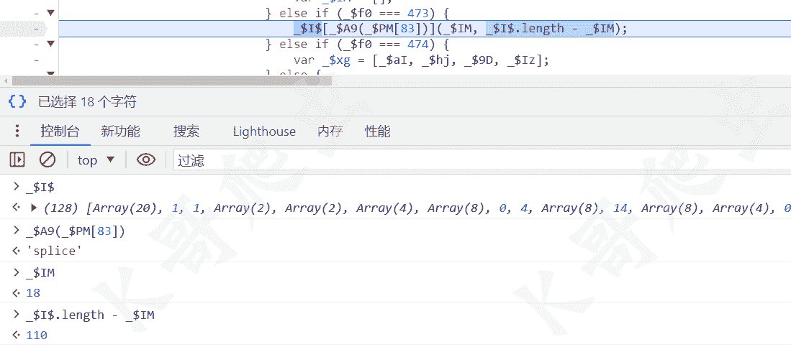

#### 步骤20

这行代码利用了 `concat` 与 `apply` 方法将 18 位数组转为了一个一维的大数组：

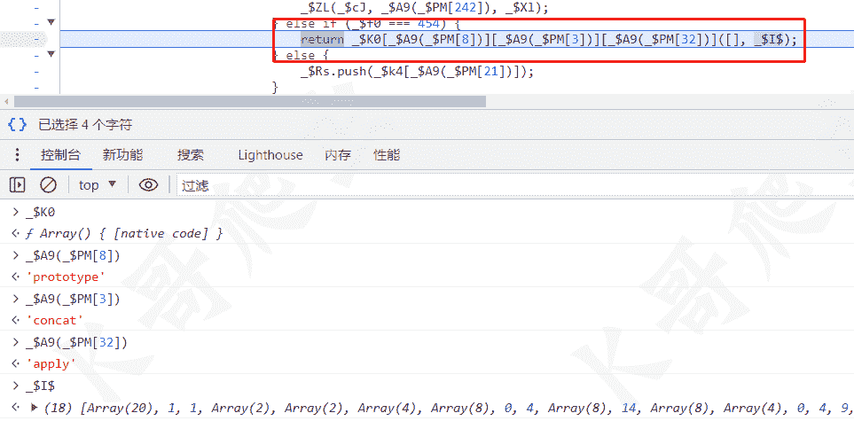

#### 步骤21

这一步会进入一个新分支，得到一个 32 位的数组，跟进去：

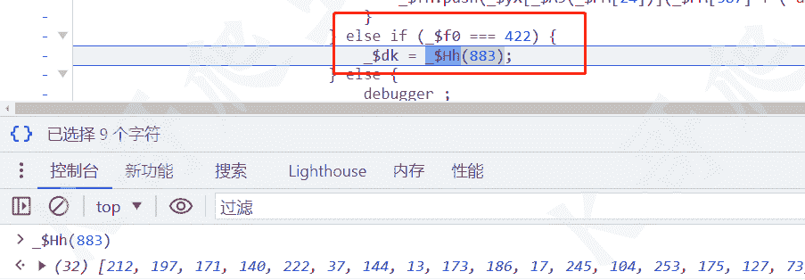

两个方法 `_$BW` 与 `_$o9`，`_$o9` 生成一个随机的 37 位数组，`_$BW` 生成 32 位数组，先看 `_$o9`：

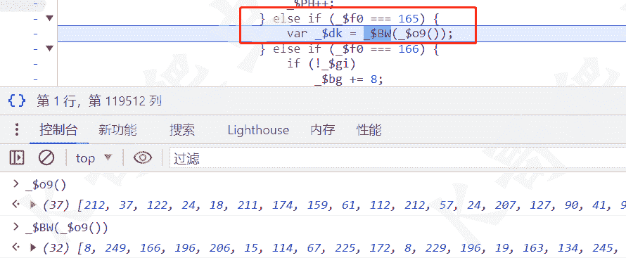

`_$o9` 与步骤12中的 `_$gr` 方法相似，区别在于 `_$2s` 的参数值以及 `_$yx._$BL`：

```javascript
var _$dk = _$Vg(_$2s(_$SK[66]) + _$yx._$BL);
_$sP(_$SK[152], _$dk.length !== _$SK[173]);
return _$Gi(_$dk);
```

然后看 `_$BW`，在步骤12中提到了一个方法 `_$35`，在扣 `_$35` 时也会遇到 `_$BW`，这里就单独的讲一下 `_$BW`：

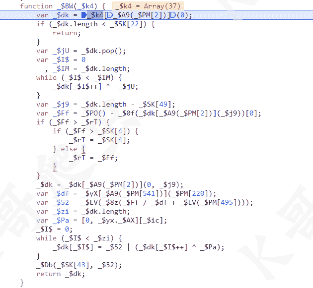

将代码整理一下，如下：


```
function _$BW(_$k4) {
    var _$dk = _$k4.slice(0);
    if (_$dk.length  _$rT) {
        if (_$Ff > 255) {
            _$rT = 255;
        } else {
            _$rT = _$Ff;
        }
    }
    _$dk = _$dk.slice(0, _$j9);
    var _$df = parseFloat("11.678");
    var _$52 = Math.floor(Math.log(_$Ff / _$df + Math.floor("1.234")));
    var _$zi = _$dk.length;
    var _$Pa = _$yx._$AX[_$ic];
    _$I$ = 0;
    while (_$I$ 
```

可以发现关键点有三处，`_$PO`、`_$0f` 与 `_$yx._$AX`。

`_$PO` 返回当前时间戳（秒）的四舍五入整数值。`_$0f` 方法则是数组进行转换，其中涉及到一些逻辑运算，可以直接扣下来。`_$yx._$AX` 不用多说，需动态匹配。

这里就得到了一个 32 位数组，但是该分支还没有结束，继续往下走。

下面又对生成的 32 位数组进行了处理，得到一个 16 位数组，两个方法 `_$aT` 与 `_$9J`：

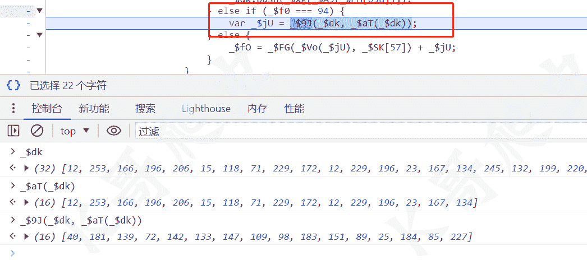

`_$aT` 代码整理后如下，直接用即可：

```
function _$aT(_$k4) {

    var _$dk = _$k4.slice(0, 16);

    var _$jU, _$I$ = 0, _$IM;

    _$IM = _$dk.length;

    while (_$I$  256 ? 256 : _$jU;

    }

    return _$dk;

}
```

`_$9J` 代码整理后如下，有一个 `_$4c` 方法需注意，也是缺少补啥：

```
function _$9J() {
    var _$dk = new _$4c();
    for (var _$jU = 0; _$jU 
```

16 位数组跟完后继续往下走，会生成另一个 16 位数组，不过这个就比较简单了，`_$9J`、`_$BW`、`_$gr` 在前文都已经提到了：

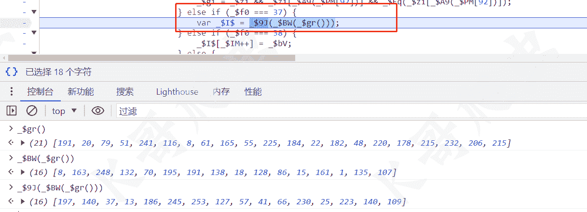

继续往下走，会到一个 for 循环里面，这里对上面生成的 32 位数组以及 16 位数组进行处理，生成一个 32 位数组：


到这里该分支就结束了，最终得到了 32 位数组。

## 步骤22

下面主要是对时间戳进行了一些处理，涉及到的时间戳都来自于步骤 1 中：


这里通过时间戳计算得到了四个值，`[1695610803, 1695611070, 394, -901278768]`，下面又将这四个值转成了一个 16 位的数组，`_$CY` 方法在上文中也提到了：


## 步骤23

这里对上一步中生成的数组进行了位异或操作：


在这里就生成了最终 cookie 的一部分，`_$52` 是上面处理后的 16 位数组，方法 `_$Cj` 前面没有遇到，这里直接扣下来即可：


这里也是将瑞数的标识加上了，那么到这里 173 位 cookie 的第一部分就出来了：


## 步骤24

这里又进到了一个新分支：


首先取了一个值，也是需要动态匹配的：


然后将该值拼接到了一个数组 `_$r3` 后面，`_$r3` 的值就是步骤 20 中 18 位数组合并成的新数组：


这里将数组转成了一串数字：


进入方法 `_$hM` 内部，主要涉及到了一个 256 位数组 `_$yx._$4y`，这个值可以直接固定，整理代码如下：

```
function _$hM(_$k4) {

    if (typeof _$k4 === _$A9(_$PM[7]))

        _$k4 = _$wk(_$k4);

    var _$dk = _$yx._$4y || (_$yx._$4y = _$iV());

    var _$jU = -1

    , _$I$ = _$k4.length;

    for (var _$IM = 0; _$IM >> -1) ^ _$dk[(_$jU ^ _$k4[_$IM++]) & 255];

    }

    return (_$jU ^ -1) >>> 0;

}
```

这里对那串数字进行了转换，得到了一个四位数组，`_$8c` 上文已经提到了：


到这里该分支就结束了，得到了四位数组。

## 步骤25

这里将四位数组与 `_$r3` 进行了拼接：


`_$dk` 为步骤 21 中的 32 位数组，`_$Cj` 上文提到了，那么还剩 `_$o$`，也是缺啥补啥即可：


到这里 173 位 cookie 的第二部分就出来了，最后将两部分拼接就得到了最终的 173 位 cookie：


至此，逆向流程结束。

## 3> 动态匹配

六代与五代最大的区别应该就是动态值的匹配方式发生了变化。数据匹配一般有两种方案，正则和 AST，这里推荐正则。

以步骤 2 中的四位数组为例：

```
var _$3B = _$5W[_$yx._$Go](_$Ke, _$tm);
var _$I$ = _$5W[_$yx._$OA](_$dk);
var _$dk = _$5W[_$yx._$Lr]();
var _$j9 = _$5W[_$yx._$0f](_$jU, _$I$);
```

前面已经讲到了 `_$3B` 值与所引用的方法内部的一位数组存在映射关系，想要拿到值就需要找到对应的方法。已知 `_$5W` 是一个对象，里面包含所有方法，`_$yx._$Go` 返回一个字符串，根据返回的字符串来引用方法，得到结果。那么首先要定位 `_$5W`，因为代码是动态的，每一次这个包含方法的对象名都不一样，所以这里就需要找到一个固定的关键字来进行定位。这里可以用 `842` 来找到 `_$5W`。定位到 `_$5W` 后就可以通过 `_$5W[` 来匹配四个索引：


这里 `_$yx._$Go` 的值为 `_$ym`，对应的方法为 `_$3$`。那么就需要找到 `_$ym` 和 `_$3$` 是怎么映射起来的：


通过搜索 `._$ym` 可以定位到，同理 `_$yx._$OA` 的值为 `_$xy`，也可以通过这个方法来定位到方法名：


方法名找到后可以通过 `function 方法名` 来进行定位：


梳理一下流程：

- 通过 `842` 来匹配对象名
- 通过对象名来匹配四个索引名（`_$yx._$Go`）
- 根据 `$_ts` 拿到索引值（`_$ym`）
- 通过 `.索引值`（`._$ym`）来匹配到真实方法名
- 通过 `function 方法名` 匹配一位数组
- 根据数组值拿到方法返回值

通过以上流程就能得到四位数组。

## 3> 结果验证


