# [Web逆向] 【验证码逆向专栏】螺丝帽人机验证逆向分析

- 原帖: https://www.52pojie.cn/forum.php?mod=viewthread&tid=1846991
- 抓取时间: 2026-11-01T22:44:22

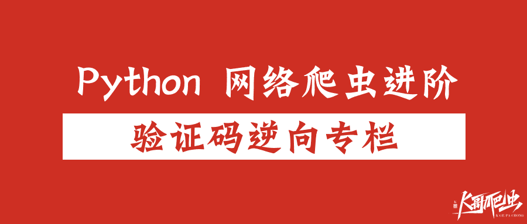

## 声明

本文章中所有内容仅供学习交流使用，不用于其他任何目的，不提供完整代码，抓包内容、敏感网址、数据接口等均已做脱敏处理，严禁用于商业用途和非法用途，否则由此产生的一切后果均与作者无关！

本文章未经许可禁止转载，禁止任何修改后二次传播，擅自使用本文讲解的技术而导致的任何意外，作者均不负责，若有侵权，请联系作者立即删除！

## 目标

目标：Luosimao 螺丝帽人机验证逆向分析

网址：aHR0cHM6Ly9jYXB0Y2hhLmx1b3NpbWFvLmNvbS9kZW1vLw==

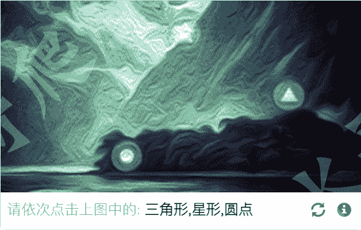

## 抓包分析

进入官网提供的 demo 页面，F12 开启抓包，首先加载 demo 页面，这个页面包含一个 `site-key`，每个网站都不一样，会在后续用到：

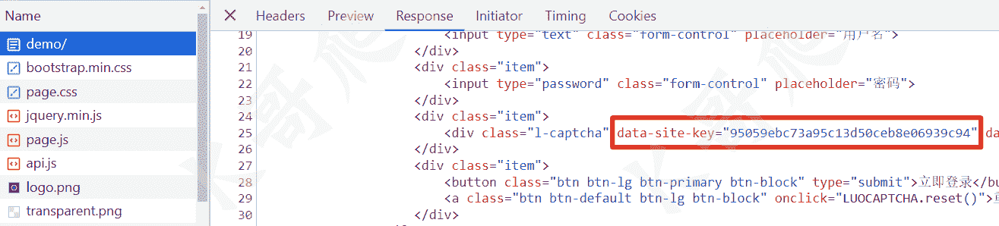

接下来是一个 `captcha.js`，主要用于后续的加密参数生成，乍一看以为是个 OB 混淆，其实只是更换了变量名，然后一些值是从大数组里面取的，没有 OB 混淆里的打乱数组的操作，比 OB 混淆要简单很多，后文会利用 AST 对这三个 JS 进行解混淆，后续类似的还加载了 `widget.js` 和 `frame.js`，也都是和加密参数的生成有关。

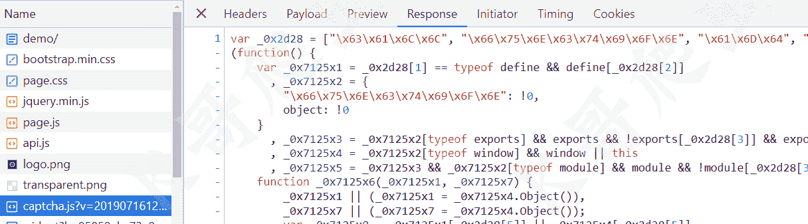

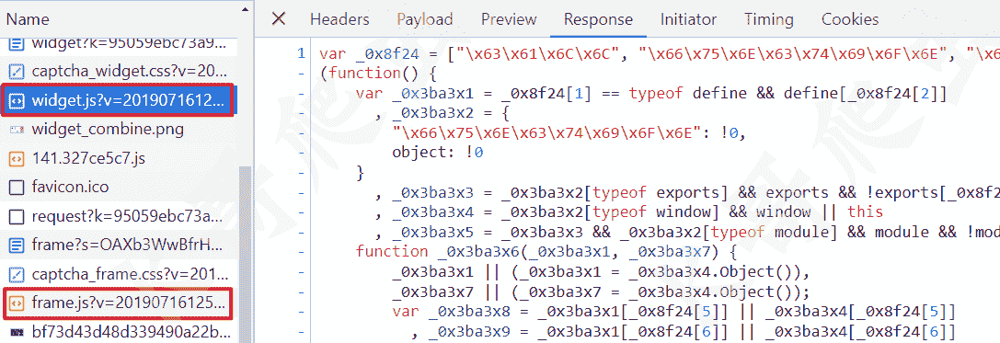

然后是一个 `widget` 的请求，该请求返回的源码里面有个 `data-token`，也是后续要用到的。

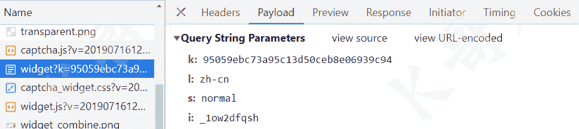

接下来是一个 `request` 的请求，接口返回的一些参数也是后续要用到的，同时返回的 `w` 值，就是要点击的文字提示信息。

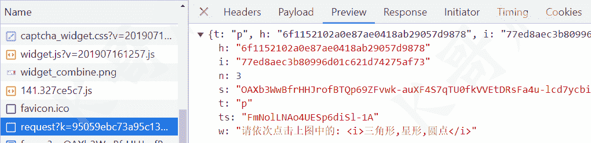

然后是一个 `frame` 请求，请求带了两个加密参数，这个请求返回的源码里面包含了验证码图片信息。

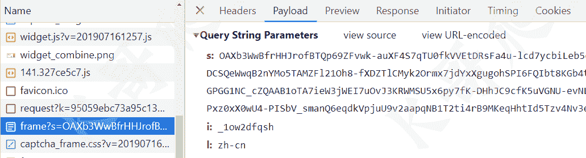

然后就加载了验证码图片，注意这里的图片是被切割之后乱序排列了的，和极验三代的类似，所以后文我们还要对其进行顺序还原。

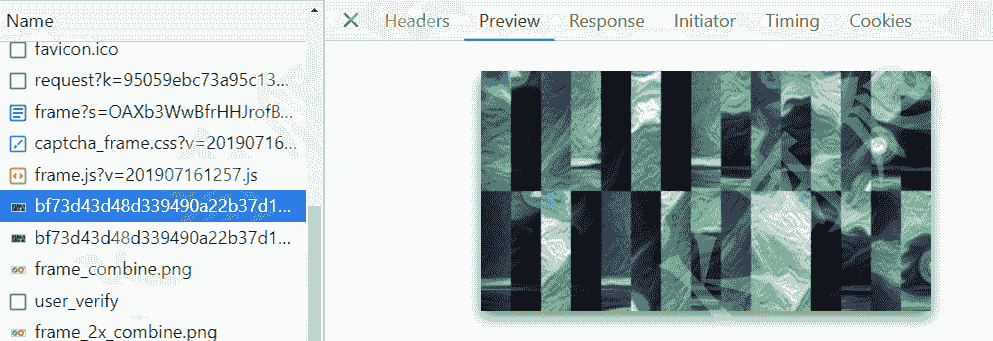

点击图像完成之后，就会发起校验请求 `user_verify`，校验成功的话返回的 `res` 为 `success`，相反校验不成功就是 `failed`。

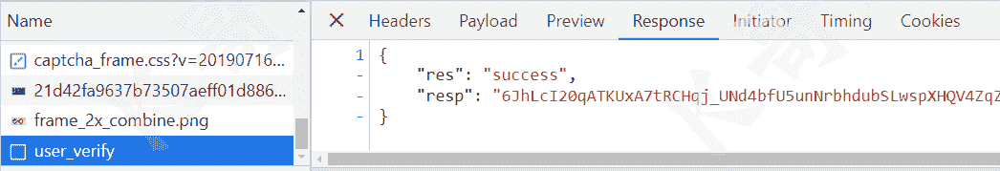

点击立即登录，触发最后一个 `submit` 请求，提交的 `data` 值就是上一步 `user_verify` 验证成功后返回的 `resp` 值。

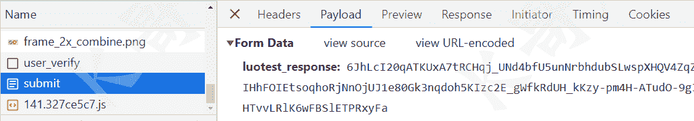

小结一下螺丝帽就可以分为三个比较重要的步骤：`request` 接口请求得到要点击的内容，`frame` 接口请求拿到验证码图片，`user_verify` 接口验证点击是否正确，下文将详细分析这些步骤。

## AST 解混淆

先别着急找加密逻辑，前面抓包的时候说了，一共有三个 JS 参与了加密，分别是 `captcha.js`、`widget.js` 和 `frame.js`，这三个 JS 是被混淆了的，为了后续比较好分析，我们可以先使用 `babel` 将其转换成 AST 语法树后，进行解混淆操作。

以 `widget.js` 为例，观察该 JS，我们可以总结出以下三个问题：

- 开头一个大数组，如 `_0x8f24`，后续变量赋值操作就是从这个大数组里取值，如 `_0x8f24[1]`、`_0x8f24[2]`；
- 所有的字符串都被转换成了十六进制编码的形式，不易阅读；
- 访问对象属性是 `_0x3ba3x1["Number"]`，而不是 `_0x3ba3x1.Number`，不易阅读。

所以我们只需要做三个操作：

- 从数组取值转为直接赋值（`_0x8f24[1] => "\x63\x61\x6C\x6C"`）；
- 十六进制编码的字符串还原（`"\x63\x61\x6C\x6C" => "call"`）；
- 对象属性还原（`_0x3ba3x1["Number"] => _0x3ba3x1.Number`）。

首先是从数组取值转为直接赋值，先将这个 JS 扔到 astexplorer.net 分别看看原始结构（如：`_0x8f24[1]`）和替换后的结构（如：`"\x63\x61\x6C\x6C"`）：

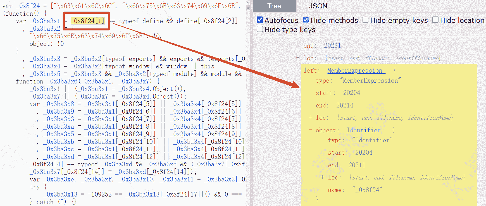

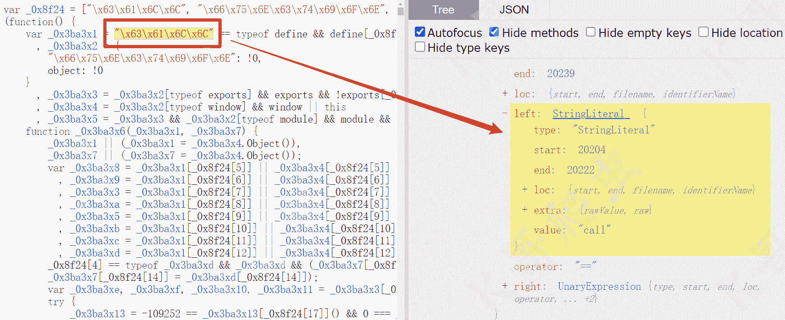

从上图可以看到类似 `_0x8f24[1]` 取值的节点类型为 `MemberExpression`，这个大数组没有像 OB 混淆那样做了乱序操作，可以直接取值，那么如果我们先拿到 `_0x8f24` 这个大数组，然后遍历 `MemberExpression` 节点，再将其替换成 `StringLiteral` 类型的节点就行了。当然遍历的时候也要有限制，必须是 `path.node.object.name` 的值和大数组的名称一样才能替换。然后就是我们怎么拿到 `_0x8f24` 这个大数组呢？这个大数组在 AST 中的位置是 `program.body[0]`，我们可以将其转换成 JS 代码然后 `eval` 执行一下，把大数组加载到内存里，后续就能直接按索引取值了，当然方法不止这一种，可以按照自己的思路来实现，这一部分的 `visitor` 可以这么写：

```
const ast = parse(code);
eval(generate(ast.program.body[0]).code)

const visitor = {
    MemberExpression(path) {
        if (path.node.object.name === "_0x8f24") {
            path.replaceWith(types.stringLiteral(eval(path.toString())));
        }
    }
}
```

然后就是十六进制编码的字符串还原，观察前后的 AST 语法树：

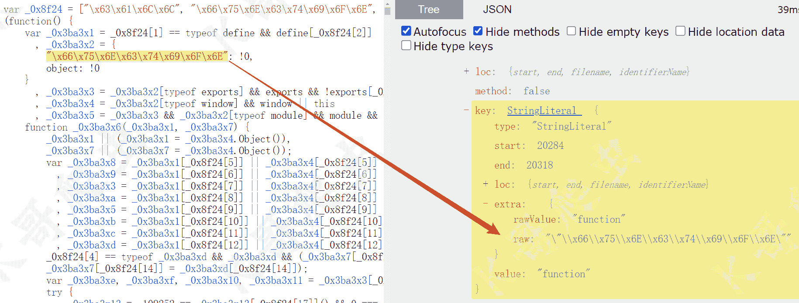

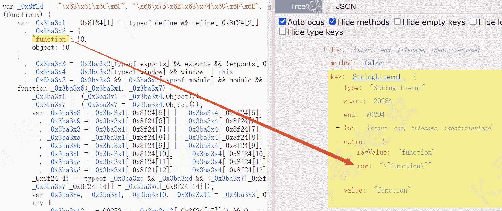

可以发现只要将 `path.node.extra.raw` 的值换为 `path.node.extra.rawValue` 或者 `path.node.value` 即可，当然因为 `NumericLiteral`、`StringLiteral` 类型的 `extra` 节点并非必需，这样在将其删除时，也不会影响原节点，所以还可以直接 `delete path.node.extra` 或者 `delete path.node.extra.raw` 来还原字符串，这一部分的 `visitor` 可以这么写：

```
const visitor2 = {

    StringLiteral(path) {

        if (path.node.extra) {

            // 以下方法均可

            // path.node.extra.raw = '"' + path.node.extra.rawValue + '"'

            // path.node.extra.raw = '"' + path.node.value + '"'

            // delete path.node.extra

            delete path.node.extra.raw

        }

    }

}
```

最后就是对象属性还原，同样的先观察前后的 AST 语法树：

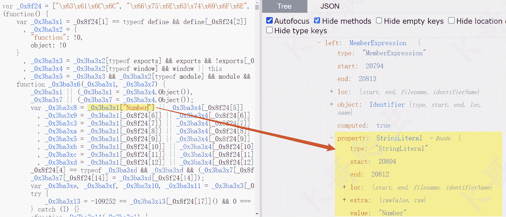

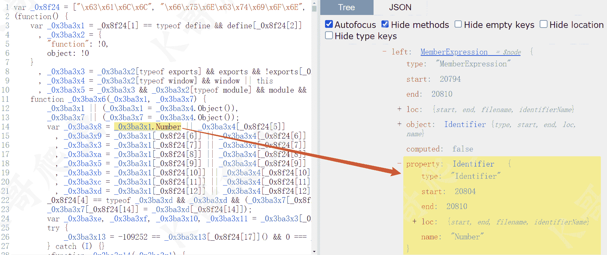

可以看到 `_0x3ba3x1["Number"] => _0x3ba3x1.Number`，是 `MemberExpression` 下的 `property` 节点由 `StringLiteral` 类型的变成了 `Identifier` 类型的，`computed` 值由 `true` 变成了 `false`，这一部分的 `visitor` 可以这么写：

```
const visitor = {
    MemberExpression(path){
        if (path.node.property.type === "StringLiteral" && path.node.property.value !== "") {
            path.node.computed = false
            path.node.property = types.identifier(path.node.property.value)
        }
    }
}
```

前面抓包的时候也说了，一共有三个 JS 参与了加密，分别是 `captcha.js`、`widget.js` 和 `frame.js`，他们的混淆都是一样的，所以综上所述我们的 AST 解混淆代码完整版可以是这样的：

```
const fs = require('fs');

const types = require("@babel/types");

const parse = require("@babel/parser").parse;

const traverse = require("@babel/traverse").default;

const generate = require("@babel/generator").default;

function deconfusion(code, arrName) {

    const ast = parse(code);

    eval(generate(ast.program.body[0]).code)

    const visitor1 = {

        MemberExpression(path) {

            if (path.node.object.name === arrName) {

                path.replaceWith(types.stringLiteral(eval(path.toString())));

            }

        }

    }

    const visitor2 = {

        StringLiteral(path) {

            if (path.node.extra) {

                // 以下方法均可

                // path.node.extra.raw = '"' + path.node.extra.rawValue + '"'

                // path.node.extra.raw = '"' + path.node.value + '"'

                // delete path.node.extra

                delete path.node.extra.raw

            }

        },

        MemberExpression(path){

            if (path.node.property.type === "StringLiteral" && path.node.property.value !== "") {

                path.node.computed = false

                path.node.property = types.identifier(path.node.property.value)

            }

        }

    }

    traverse(ast, visitor1);

    traverse(ast, visitor2);

    delete ast.program.body[0]

    return generate(ast, {jsescOption: {"minimal": true}}).code

}

const widget = fs.readFileSync('widget.js', 'utf-8');

const newWidget = deconfusion(widget, "_0x8f24")

fs.writeFileSync('newWidget.js', newWidget, 'utf-8');

const captcha = fs.readFileSync('captcha.js', 'utf-8');

const newCaptcha = deconfusion(captcha, "_0x2d28")

fs.writeFileSync('newCaptcha.js', newCaptcha, 'utf-8');

const  frame = fs.readFileSync('frame.js', 'utf-8');

const newFrame = deconfusion(frame, "_0x3f7b")

fs.writeFileSync('newFrame.js', newFrame, 'utf-8');
```

解混淆之后，将代码替换掉原始代码，然后就可以愉快的进行分析了。

## 获取验证码信息

首先来看 `request` 接口，POST 请求，`params` 有 `k` 和 `l` 两个参数，`data` 有 `bg` 和 `b` 两个加密参数，如下图所示：

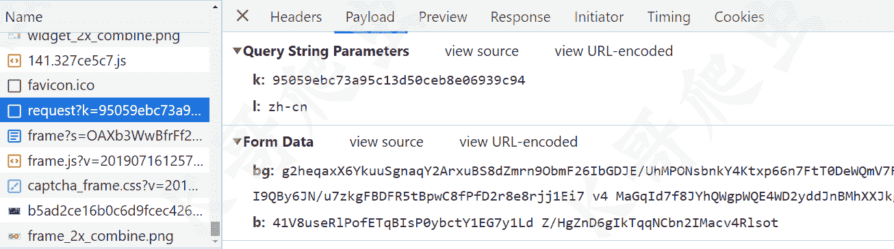

`k` 参数通过直接搜索可以发现就存在于页面的 html 里，如下图所示的 `data-site-key` 就是 `k` 的值，从这个名字也可以看出应该是每个网站分配的一个 `key`。

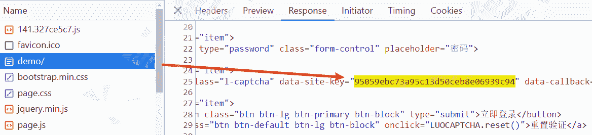

`bg` 和 `b` 参数搜索不到，且每次都是变化的，通过观察可知这是一个 XHR 请求，那么就可以通过 XHR 断点，或者直接跟栈的方式来找加密入口，好在栈也不多，直接跟进去下断点，在 `ajax` 的 `send` 方法这里，就可以看到 `bg` 和 `b` 已经生成。

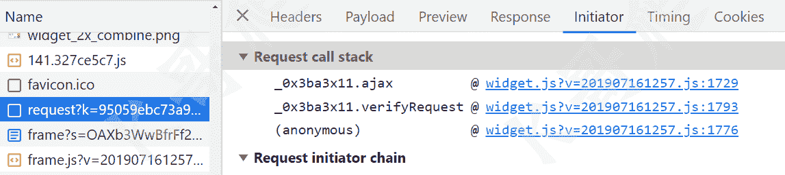

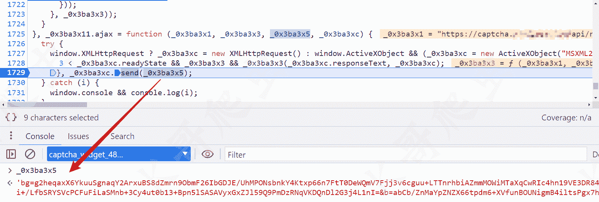

继续往上跟栈，就很容易发现 `bg` 和 `b` 的生成位置，如下图所示：

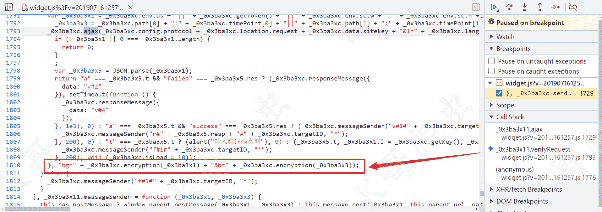

`"bg=" + _0x3ba3xc.encryption(_0x3ba3x1) + "&b=" + _0x3ba3xc.encryption(_0x3ba3x3)`，先来看 `_0x3ba3x1` 和 `_0x3ba3x3` 是怎么生成的：

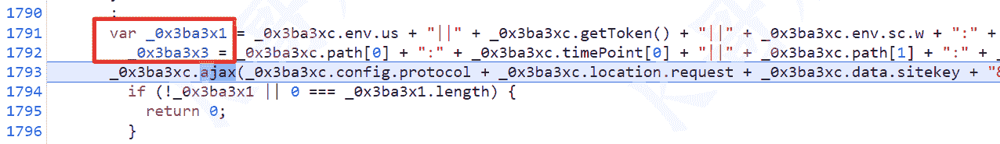


```
var _0x3ba3x1 = _0x3ba3xc.env.us + "||" + _0x3ba3xc.getToken() + "||" + _0x3ba3xc.env.sc.w + ":" + _0x3ba3xc.env.sc.h + "||" + _0x3ba3xc.env.pf.toLowerCase() + "||" + _0x3ba3xc.prefix.toLowerCase(),
_0x3ba3x3 = _0x3ba3xc.path[0] + ":" + _0x3ba3xc.timePoint[0] + "||" + _0x3ba3xc.path[1] + ":" + _0x3ba3xc.timePoint[1];
```

- `_0x3ba3xc.env.us`：User-Agent；
- `_0x3ba3xc.env.sc.w`：屏幕宽度；
- `_0x3ba3xc.env.sc.h`：屏幕高度；
- `_0x3ba3xc.env.pf.toLowerCase()`：platform（如 win32） 小写；
- `_0x3ba3xc.prefix.toLowerCase()`：浏览器引擎（如 webkit）小写。

`_0x3ba3xc.getToken()` 是一个函数，跟进去可以看到是取 widget 请求返回的 html 里面的 data-token 值，如下图所示：

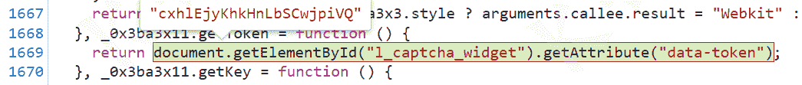

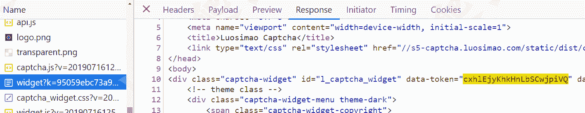

widget 请求还有个 `i` 参数，也是加密生成的，直接全局搜索 `i:`，可以发现在 `captcha.js` 里 `_0x7125x5.id` 就是 `i` 的值，如下图所示：

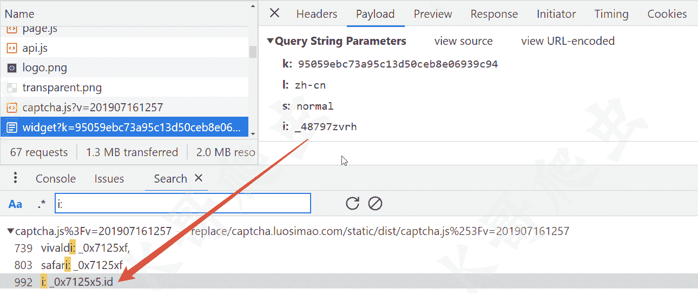

跟进去，`generateID()` 方法 `return "_" + Math.random().toString(36).substr(2, 9);` 就可以生成这个值了。

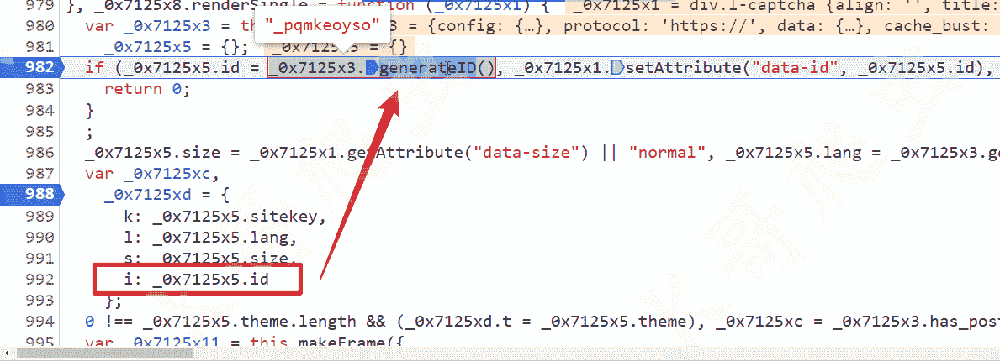

然后是 `_0x3ba3x3`，主要由 `path` 和 `timePoint` 组成，反复对比你会发现，`path = [鼠标第一次进入点击区域的坐标，鼠标点击时的坐标]`，`timePoint = [页面加载完毕的时间，开始点击的时间]`，如下图所示，可以在左上角和右下角都点一下看看这个点击的区域坐标范围是啥，然后随机构建一下就行了。

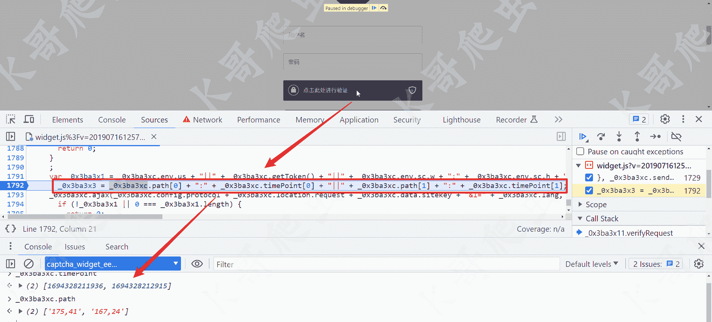

总结下来，`_0x3ba3x1` 和 `_0x3ba3x3` 就可以通过以下代码实现：

```
function randomNum(min, max) {
    return Math.floor(Math.random() * (max - min + 1) + min);
}

const ua = "Mozilla/5.0 (Windows NT 10.0; Win64; x64) AppleWebKit/537.36 (KHTML, like Gecko) Chrome/116.0.0.0 Safari/537.36"
const screen = {width: 1920, height: 1080};
const platform = "Win32";
const prefix = "Webkit";

//[鼠标第一次进入点击区域的坐标，鼠标点击时的坐标]
const path = [
    `${randomNum(60, 200)},${randomNum(0, 3)}`,
    `${randomNum(60, 200)},${randomNum(10, 20)}`
];

// [页面加载完毕的时间，开始点击的时间]
const time = +new Date();
const timePoint = [time, time + randomNum(1000, 6000)];
const _0x3ba3x1 = ua + "||" + token + "||" + screen.width + ":" + screen.height + "||" + platform.toLowerCase() + "||" + prefix.toLowerCase();
const _0x3ba3x3 = path[0] + ":" + timePoint[0] + "||" + path[1] + ":" + timePoint[1];
```

最后一步加密 `"bg=" + _0x3ba3xc.encryption(_0x3ba3x1) + "&b=" + _0x3ba3xc.encryption(_0x3ba3x3);`，跟进 `encryption` 方法熟悉的 `iv`、`mode`、`padding`，但他这里写的却是 `SHA3`，很明显是骗人的，对比测试一下加密结果，发现是 `AES` 加密，直接引库就完事儿了。

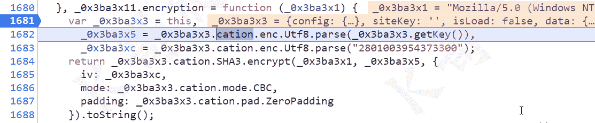

至此 `request` 接口就分析完毕了。

## 获取验证码图片

然后是获取验证码图片，直接搜索图片的名称，可以发现是在 `frame` 请求返回的 html 源码里面，如下图所示：

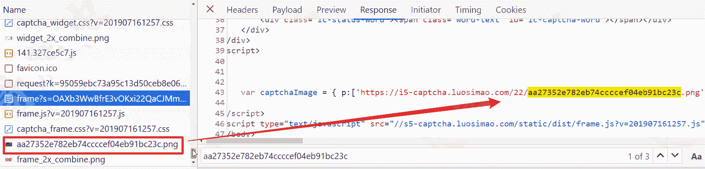

这个 `captchaImage` 对象包含两个值，`p` 是验证码乱序的图片，有三个图片，这个应该是防止宕机，有多个节点，实际三张图都是一样的内容，而 `l` 则是用来还原乱序图片的。

```
var captchaImage = {
    p:['https://i5-captcha.luosimao.com/22/aa27352e782eb74ccccef04eb91bc23c.png',
        'https://i2-captcha.luosimao.com/22/aa27352e782eb74ccccef04eb91bc23c.png',
        'https://i1-captcha.luosimao.com/22/aa27352e782eb74ccccef04eb91bc23c.png'],
    l: [["40","80"],["220","0"],["280","0"],["200","80"],["100","0"],["40","0"],
        ["0","80"],["180","0"],["20","0"],["120","80"],["220","80"],["240","0"],
        ["180","80"],["0","0"],["280","80"],["140","80"],["140","0"],["200","0"],
        ["160","0"],["260","0"],["20","80"],["240","80"],["100","80"],["60","80"],
        ["120","0"],["260","80"],["160","80"],["80","0"],["80","80"],["60","0"]]
};
```

我们查看图片的源码，可以发现这个 `l` 的坐标就是 css `background-position` 属性的值，如下图所示：

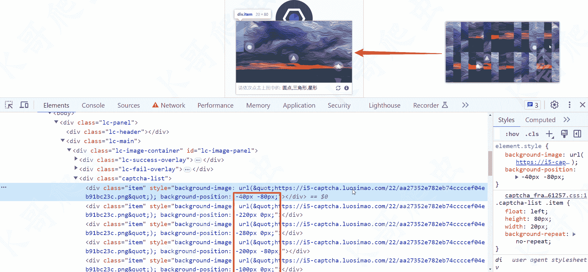

逻辑也很简单，图片尺寸 `300x160 px`，切割的乱序图片，分为上下两部分，每一部分又被分为 15 个小片段，那么上半部分从左至右，每一片段的左上角坐标为：`[0, 0]`、`[20, 0]`、`[40, 0]` ...，以此类推，下半部分则是 `[0, 80]`、`[20, 80]`、`[40, 80]` ...，以此类推，而前面的 `l` 的值，就表示原始图片第 N 个位置，对应乱序图片的某个片段的左上角的坐标，例如 `l` 的第一个值为 `["40","80"]`，则表示原始图片第一个位置是乱序图中坐标为 `[40, 80]` 的片段，换句话说，也就是原始图片第一个位置，应该是乱序图中下半部分从左至右的第三个片段。图片的还原在 Python 中可以用以下代码实现：

```
from PIL import Image

section = [["40","80"],["220","0"],["280","0"],["200","80"], ......]

image = Image.open("乱序图片.png")

canvas = Image.new("RGBA", (300, 160))

for index in range(len(section)):
    x = int(section[index][0])
    y = int(section[index][1])
    slice_ = image.crop(box=(x, y, x + 20, y + 80))
    canvas.paste(slice_, box=(index % 15 * 20, 80 if index > 14 else 0))

canvas.save("正确图片.png")
```

然后就是这个 `frame` 请求，包含了一个 `s` 参数，这个是前面 `request` 请求返回的，如下图所示：

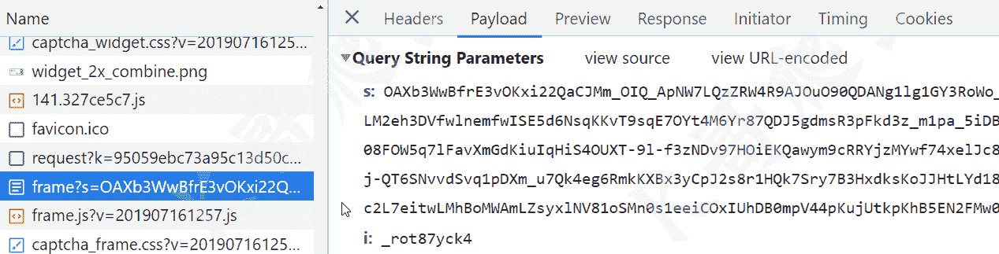

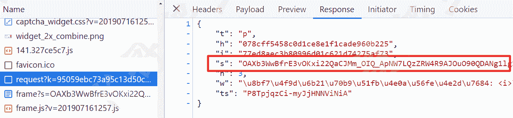

## 发送验证

然后就是点击发送验证请求了，`user_verify` 包含三个参数 `h`、`v` 和 `s`，`h` 是前面 `request` 接口返回的，`v` 和 `s` 是需要我们逆向的，如下图所示：

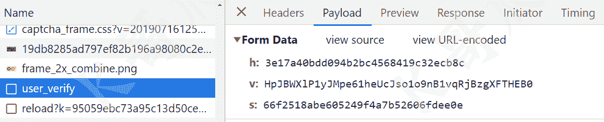

同样也直接跟栈，如下图所示 `_0xaaefx15.toString()` 就是最终的 `s` 值，而 `s` 是最终的 `v` 值：

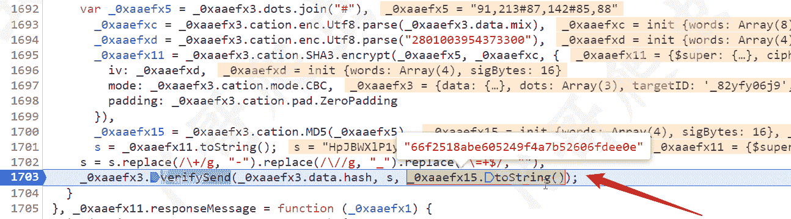

先来看 `s`，`s = _0xaaefx11.toString();`，而 `_0xaaefx11` 和前面一样也是 `AES` 加密，其中 `key` 是前面 `request` 接口返回的 `i` 的值，待加密的值是 `_0xaaefx5`，而 `_0xaaefx5 = _0xaaefx3.dots.join("#")`，`_0xaaefx3.dots` 就是点击的坐标，不过这个坐标要注意，他的 `x` 和 `y` 坐标是反着排列的，整个数组也是倒序的，直观点儿来讲就是 `_0xaaefx3.dots = ["第三次点击的 y，第三次点击的 x", "第二次点击的 y，第二次点击的 x", "第一次点击的 y，第一次点击的 x"]`，如下图所示：

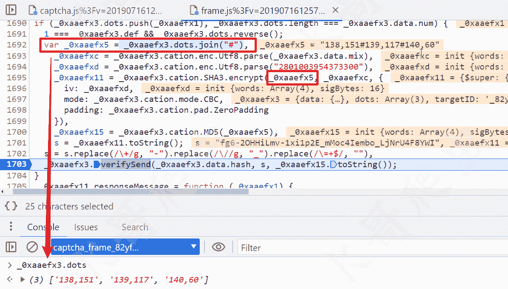

然后就是 `_0xaaefx15`，经过 `MD5` 加密得到最终的值，如下图所示：

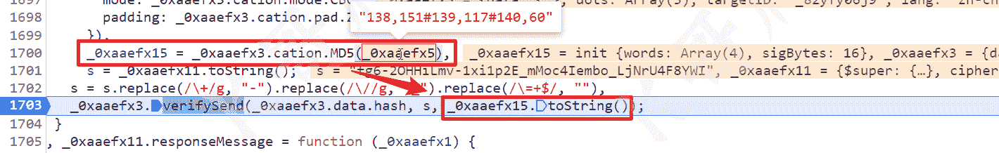

## 注意事项

请求会校验 header 的 `Host` 字段，`frame` 接口和其他接口的 `Host` 是不一样的，注意观察替换，`Host` 不正确会导致请求失败。

至此所有流程就都分析完毕了。

## 结果验证

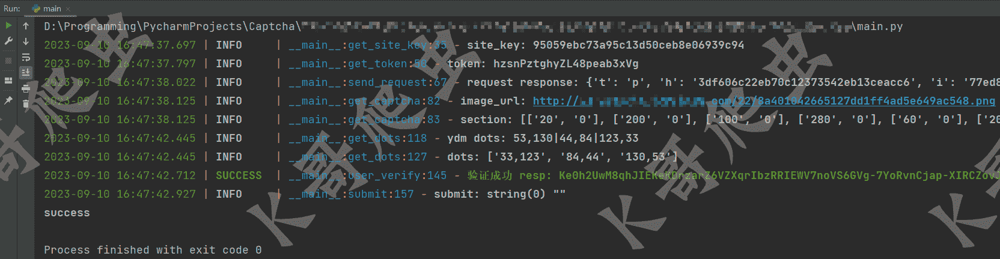
