# [Web逆向] 【验证码逆向专栏】房天下登录滑块逆向分析

- 原帖：https://www.52pojie.cn/forum.php?mod=viewthread&tid=1846995
- 抓取时间：2026-11-01T22:44:20


## 声明

本文章中所有内容仅供学习交流使用，不用于其他任何目的，不提供完整代码，抓包内容、敏感网址、数据接口等均已做脱敏处理，严禁用于商业用途和非法用途，否则由此产生的一切后果均与作者无关！

本文章未经许可禁止转载，禁止任何修改后二次传播，擅自使用本文讲解的技术而导致的任何意外，作者均不负责，若有侵权，请联系作者立即删除！

## 前言

K 哥之前写过一篇房某下登录相关的文章，该站如果通过输入账号和密码的方式进行登录，`POST` 请求参数中，密码 `pwd` 被加密处理了，对其进行了逆向分析。最近在某博客平台上，有粉丝在该篇文章的评论区询问能不能出一期该站的滑块逆向文章，经过研究发现通过手机动态码的方式登录，点击获取短信验证码时，会弹出滑块验证，本文将对另一种登录方式的反爬策略进行研究分析，既是满足粉丝需求，也是对该站登录逆向的补充完善。


## 逆向目标

- 目标：房某下手机动态码登录，滑块验证码逆向分析
- 网站：`aHR0cHM6Ly9wYXNzcG9ydC5mYW5nLmNvbS8=`

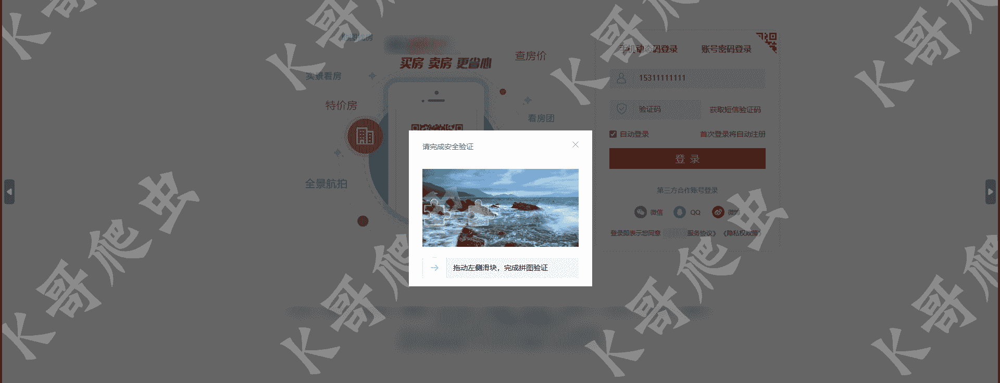

## 抓包分析

随便输入一串手机号码，点击获取短信验证码，即会弹出滑块验证，`getslidecodeinit.api` 接口响应返回 `challenge` 和 `gt` 参数的值，这两个参数在后面校验滑块验证和获取短信验证码的时候会用到：

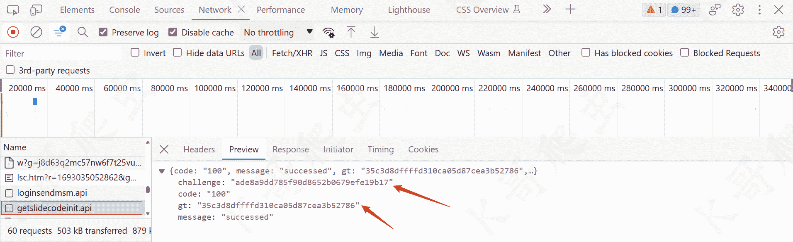

`c=index&a=jigsaw` 接口响应返回的参数中，`surl` 为滑块验证码的背景图片，`url` 为滑块图片，完整的下载地址需要在前面加上 `https://static.soufunimg.com/common_m/m_recaptcha/jigsawimg/`：

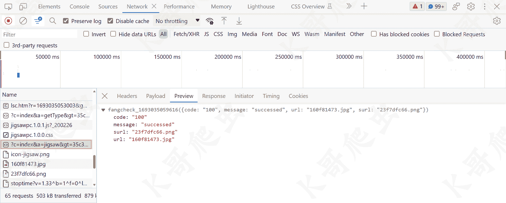

需要注意的是，下载下来的背景图片（`320x160`）以及滑块图片（`60x158`）的长宽与网页上渲染出来的是不一致的：

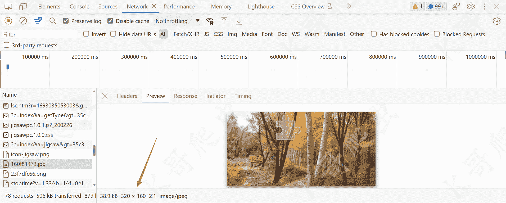

渲染出来的背景图片为 `300x150`，滑块为 `57x150`，需要先对获取到的图片进行缩放处理后，再识别缺口距离：

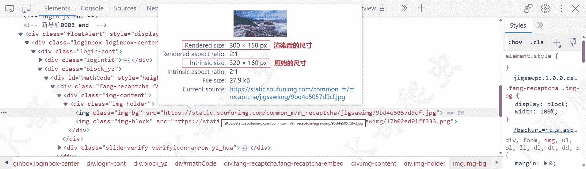

拖动滑块进行验证，`c=index&a=codeDrag` 接口响应返回校验的结果，请求参数中 `i` 和 `t` 经过了加密处理，需要逆向还原出加密算法，后文会进行研究分析，`callback` 生成方式如下：

```
"fangcheck_" + (parseInt(1e4 * Math.random()) + (new Date).valueOf())
```

- `1e4 * Math.random()`：生成一个介于 0 到 10000 之间的随机数；
- `(new Date).valueOf()`：获取当前的时间戳（以毫秒为单位）。

`challenge` 和 `gt` 参数是前面所说的 `getslidecodeinit.api` 接口响应返回，`start` 和 `end` 为滑动轨迹开始及结束的时间戳：

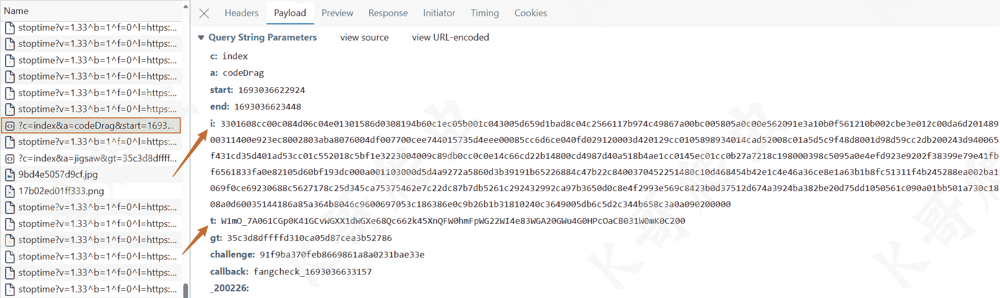

滑块验证失败，`code` 有两种状态码：

`101` ---> 参数校验失败

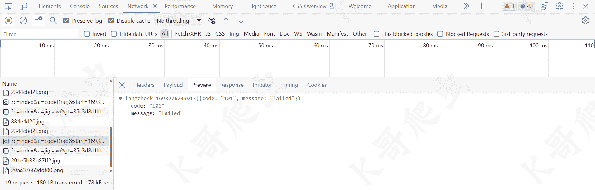

`102` ---> 缺口识别错误

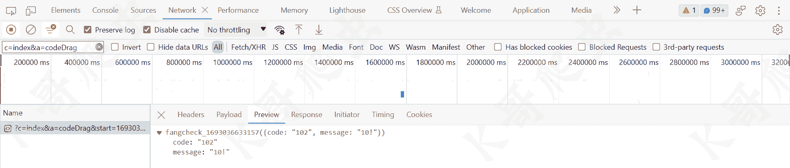

滑块验证成功，`code` 为 `100`：

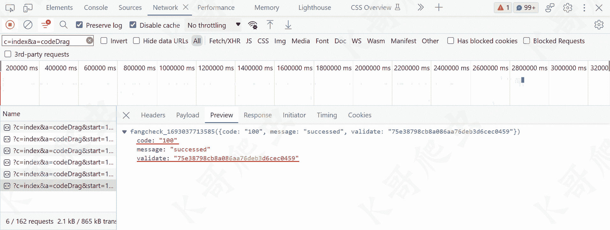

验证成功之后，会响应返回 `validate` 参数，携带该参数请求 `loginsendmsm.api` 接口，即可成功发送短信验证码：

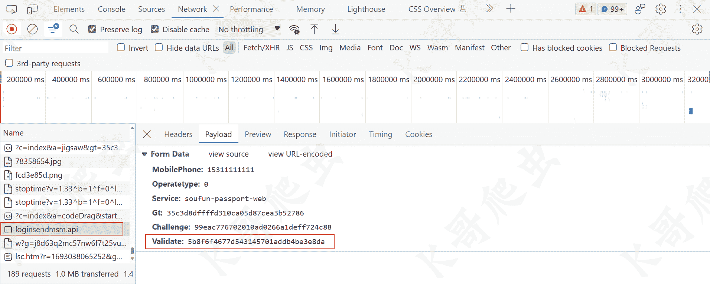

发送成功，响应返回的 `message` 为 `Success`，失败则为 `Error`：

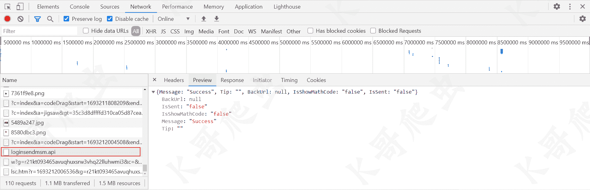

## 逆向分析

### `i` 参数

先来分析下 `i` 参数是如何加密生成的，从验证接口跟栈到 `jigsawpc.1.0.1.js` 文件中：

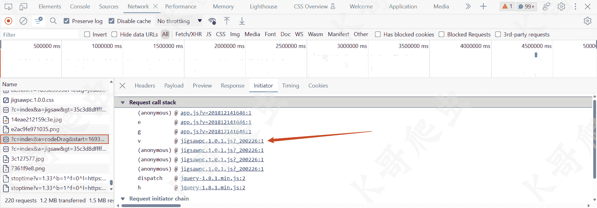

`ctrl + f` 搜索 `i:`，只有一个结果：

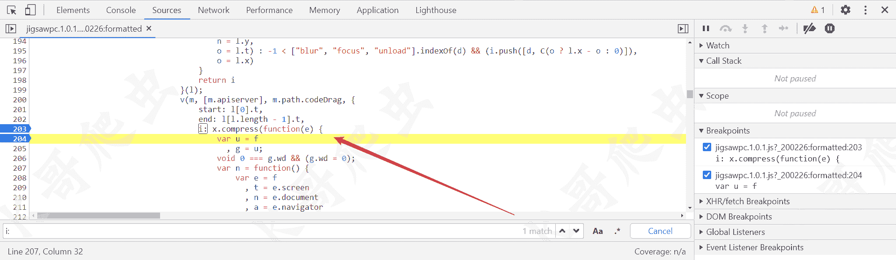

在第 204 行打下断点，滑动滑块即会断住，可以看到，`l` 即滑动轨迹，由 `x` 轴、`y` 轴距离以及时间戳组成，后面再对轨迹进行分析，前文所讲到的 `start`、`end` 在此验证了，为滑动的开始及结束时间：

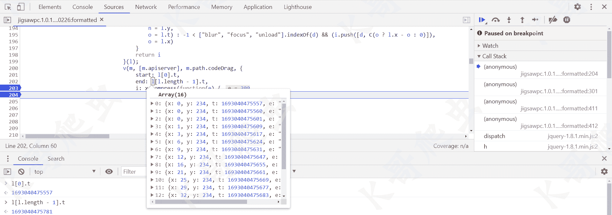

从第 203 行，跟进到 `x.compress` 方法中去：

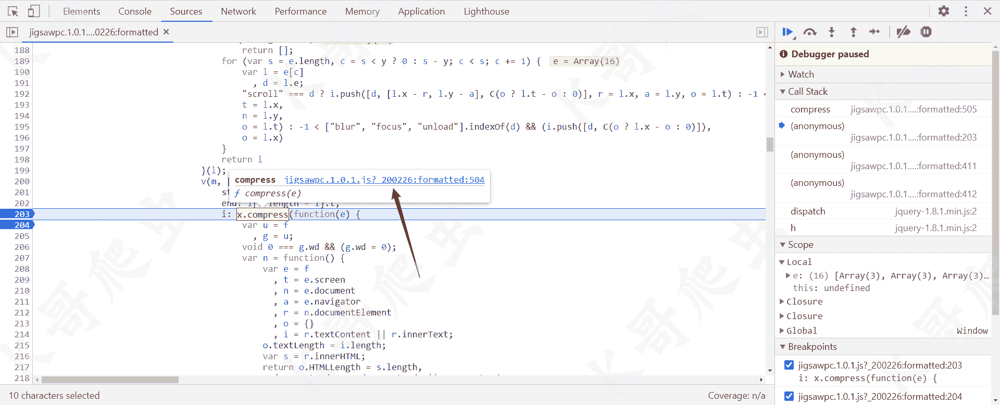

可以看到，`i` 参数的值就是由 `x.baseCompress` 方法生成的，传入的 `e` 参数很像是由一些值拼接而成的：

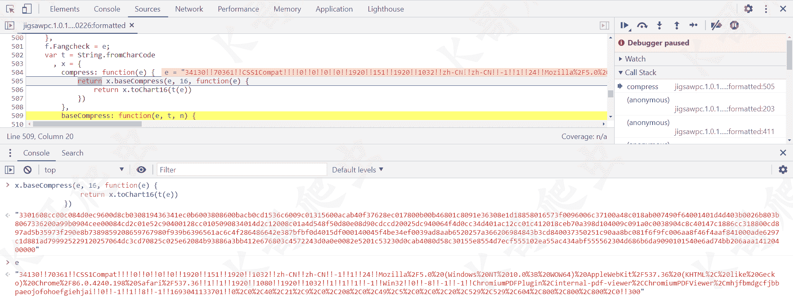

回到第 203 行，`e` 参数是由 `function(e) {...}` 方法生成的，点击前大括号，找到该函数结束的位置，在第 301 行打下断点，断住后会发现，`e` 参数的值是先通过 `join()` 方法将 `r` 数组的所有元素用 `!!` 符分隔后连接成一个字符串，再使用 `encodeURIComponent()` 方法进行编码后得到的：

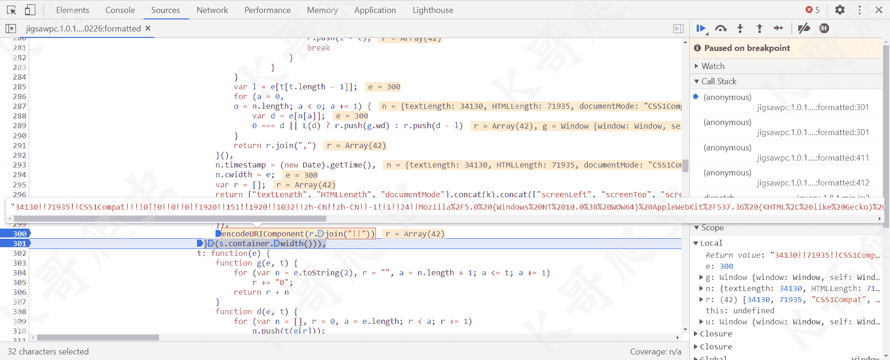

那 `r` 数组是由哪些元素组成的呢？往上跟到第 296 行就会发现，`r` 数组中的元素如下，包括一些浏览器环境，最后确实校验了，但不多：

```json
["textLength", "HTMLLength", "documentMode", "screenLeft", "screenTop", "screenAvailLeft", "screenAvailTop", "innerWidth", "innerHeight", "outerWidth", "outerHeight", "browserLanguage", "browserLanguages", "systemLanguage", "devicePixelRatio", "colorDepth", "userAgent", "cookieEnabled", "netEnabled", "screenWidth", "screenHeight", "screenAvailWidth", "screenAvailHeight", "localStorageEnabled", "sessionStorageEnabled", "indexedDBEnabled", "CPUClass", "platform", "doNotTrack", "timezone", "canvas2DFP", "canvas3DFP", "plugins", "maxTouchPoints", "flashEnabled", "javaEnabled", "hardwareConcurrency", "jsFonts", "timestamp", "performanceTiming", "cwidth"]
```

下面是对数组中各环境属性的简单描述，可供参考：

- `textLength`：用于测量 HTML 元素文本内容的长度；
- `HTMLLength`：获取当前文档中 HTML 根元素的内部 HTML 内容的长度；
- `documentMode`：用于在 Internet Explorer 浏览器中确定文档的呈现模式；
- `screenLeft`，`screenTop`：窗口左上角相对于屏幕左上角的坐标；
- `screenAvailLeft`，`screenAvailTop`：可用屏幕空间左上角相对于屏幕左上角的坐标；
- `innerWidth`，`innerHeight`：浏览器窗口的内部宽度和高度，不包括浏览器工具栏和滚动条；
- `outerWidth`，`outerHeight`：浏览器窗口的外部宽度和高度，包括浏览器边框和工具栏；
- `browserLanguage`，`browserLanguages`：浏览器当前使用的语言或语言列表；
- `systemLanguage`：操作系统的默认语言；
- `devicePixelRatio`：设备像素比，用于在不同分辨率屏幕上进行适配；
- `colorDepth`：屏幕颜色深度；
- `userAgent`：浏览器的用户代{过}{滤}理字符串，通常包含浏览器和操作系统信息；
- `cookieEnabled`：表示浏览器是否启用了 Cookie；
- `screenWidth`，`screenHeight`：屏幕的宽度和高度；
- `screenAvailWidth`，`screenAvailHeight`：可用屏幕的宽度和高度；
- `localStorageEnabled`，`sessionStorageEnabled`：表示浏览器是否启用了本地存储和会话存储；
- `indexedDBEnabled`：表示浏览器是否启用了 IndexedDB；
- `CPUClass`：表示 CPU 的等级或类别；
- `platform`：操作系统平台信息；
- `doNotTrack`：表示用户是否启用了 "不跟踪" 功能；
- `timezone`：用户所在时区；
- `canvas2DFP`，`canvas3DFP`：Canvas 防指纹技术，用于保护用户隐私；
- `plugins`：浏览器安装的插件列表；
- `maxTouchPoints`：设备支持的最大触摸点数；
- `flashEnabled`：表示浏览器中是否启用了 Flash；
- `javaEnabled`：表示浏览器中是否启用了 Java 插件；
- `hardwareConcurrency`：表示设备的逻辑处理器核心数；
- `jsFonts`：浏览器已安装的字体列表；
- `timestamp`：时间戳，通常用于测量性能和时间间隔；
- `performanceTiming`：访问有关页面加载和性能计时的信息。

至此 `e` 参数的构成方法分析完了，再回到 `x.compress` 方法中，也就是第 505 行，前文分析了，`i` 参数由 `x.baseCompress` 方法生成，该方法传入了三个参数，前两个已经分析完了，来看看第三个函数部分：

```javascript
function(e) {
    return x.toChart16(t(e))
}
```

`t` 方法定义在第 502 行，就是 `String.fromCharCode()`，它用于将一组 Unicode 值（UTF-16 编码）转换成对应的字符串，每个参数都是一个表示 Unicode 值的整数。再跟进到 `x.toChart16` 方法中去，定义在第 628 行，直接扣下来就行了：

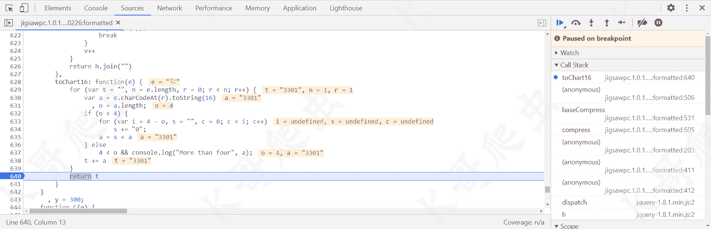

最后直接将 `baseCompress` 方法扣下来即可，`i` 参数就分析完了：

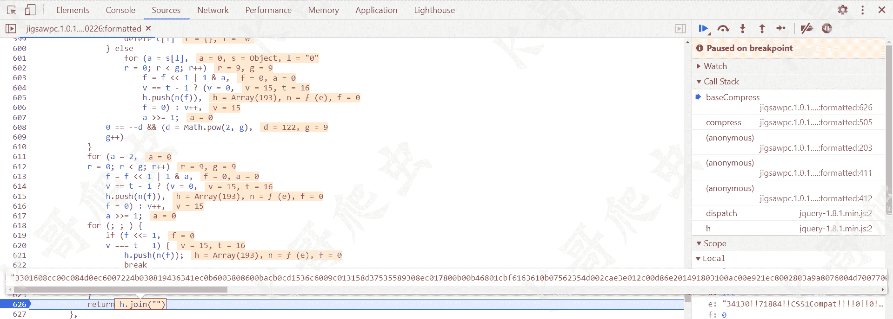

### `t` 参数

生成 `t` 参数的方法定义在第 302 行，同样搜 `t:` 就可以找到，和 `i` 一样，也是几个自执行函数，直接跟到第 392 行，打下断点，断住后验证了，`t` 参数就是在这里生成的：

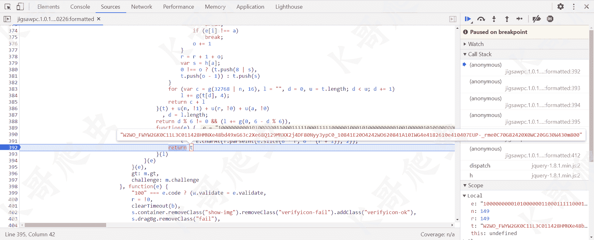

`t` 参数是于一长串二进制字符串 `e` 中从前往后依次截取六位字符，再通过 `parseInt` 方法将截取到的二进制字符串转换为整数，即索引，最后使用 `charAt` 方法根据索引从固定字符串 `E` 中取值，循环 `e.length / 6` 次后拼接而成的：

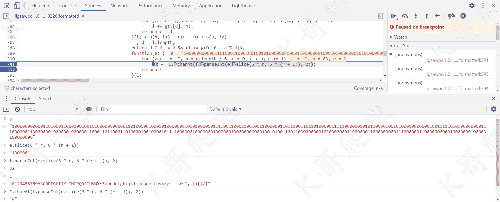

那一长串二进制字符串怎么来的呢？生成 `t` 参数的函数是个自执行函数，传入的参数是 `l`，`l` 定义在第 368 行，生成方法逐个跟，扣下来即可：

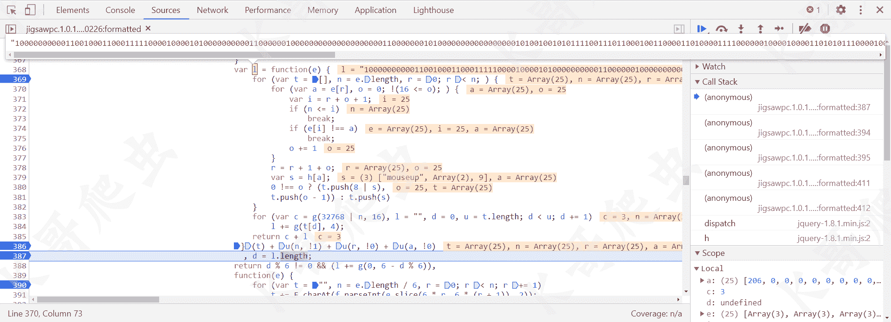

接着往上跟到 `return` 处，即第 360 行，此时传入的 `e` 为鼠标轨迹，很明显，这里对轨迹做了处理，不再是前文所讲的 `x`、`y`、`t` 形式，被转换成了一个大数组：

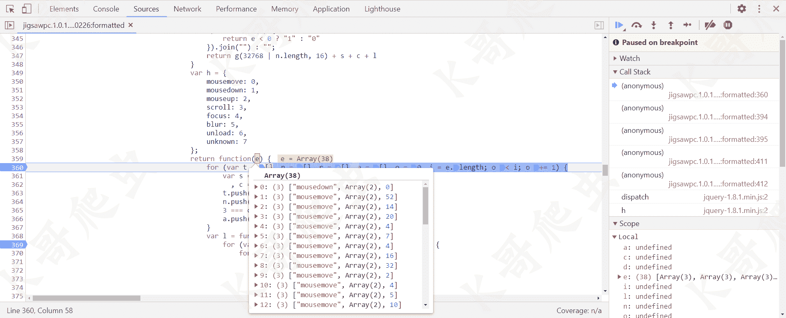

相关转换算法在第 180 行，即 `e` 参数，轨迹校验的不是很严格，模拟构造即可：

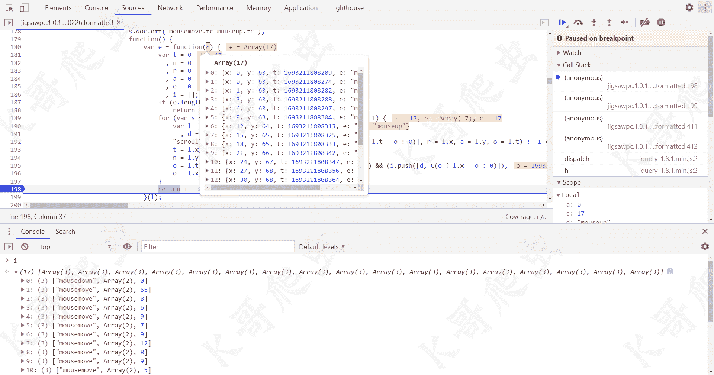

### 结果验证

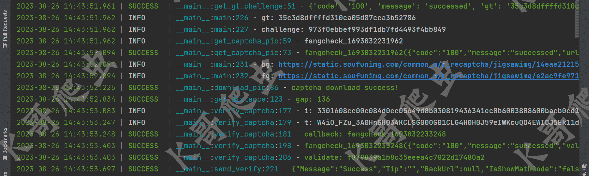
