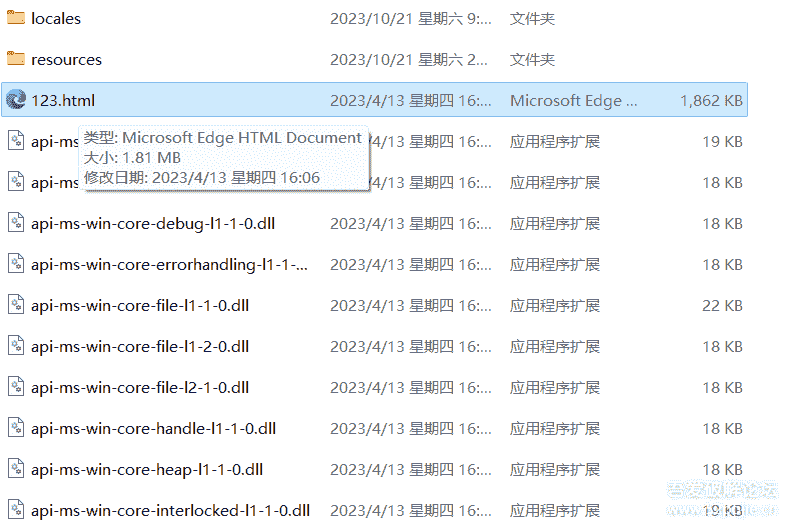

# [原创] 某文件批量重命名工具去除VIP校验

- 原帖：[https://www.52pojie.cn/forum.php?mod=viewthread&tid=1847125](https://www.52pojie.cn/forum.php?mod=viewthread&tid=1847125)
- 抓取时间：2026-11-01T22:44:19

## 背景

临时需求修改文件的创建时间、修改时间。想找个工具省点事，百度搜索前几篇都是推荐某文件批量重命名工具。下载地址：

`aHR0cHM6Ly9kb3dubG9hZC55b3Nvc29mdC5jb20vWVNSZW5hbWUvMi4wLjQvWVNSZW5hbWUuZXhl`

下载安装完成后，需要微信扫描登录。登录后，修改时间这个功能需要VIP！！！宣传里可没说这个。

## 分析过程

打开文件安装目录：



`image.png` (68.76 KB, 下载次数: 0)

[https://www.52pojie.cn/forum.php?mod=attachment&aid=MjY1MDcxN3wwZDMyNDEzZHwxNzkzNTczMDU3fDE2ODA4NnwxODQ3MTI1&nothumb=yes](https://www.52pojie.cn/forum.php?mod=attachment&aid=MjY1MDcxN3wwZDMyNDEzZHwxNzkzNTczMDU3fDE2ODA4NnwxODQ3MTI1&nothumb=yes)

2023-10-21 22:20 上传

可以看出是 electron 生成的文件。

找到 `app.asar`，运行 `asar e` 命令解压。

找到解压后的 `dist\electron\renderer.js`。文件排版格式化后，代码没有加密。

## 修改与验证

通过查找“开始重命名”“开通VIP”等字符，最终发现函数 `getAuthority()`。

调用 `/api/index/get_user_authority` 接口，返回用户的类型及到期时间：

```
e.authority = t.data.data,
(new Date).getTime() / 1e3
e.authority={validity_end_time:2030-12-31,validity_type:2,isAuthority:1};
```

函数中其他内容可以删除。

修改后，保存。

使用 `asar pack` 命令，重新打包 `asar`。登录后，显示是 vip 用户，各项功能也可以正常使用了。

## 附件

附个修改完的 `renderer.js` 文件：


[https://www.52pojie.cn/forum.php?mod=attachment&aid=MjY1MDcxOHxkMjdiYzljNnwxNzkzNTczMDU3fDE2ODA4NnwxODQ3MTI1](https://www.52pojie.cn/forum.php?mod=attachment&aid=MjY1MDcxOHxkMjdiYzljNnwxNzkzNTczMDU3fDE2ODA4NnwxODQ3MTI1)

(169.42 KB, 下载次数: 464)

2023-10-21 22:32 上传

点击文件名下载附件

下载积分: 吾爱币 -1 CB
