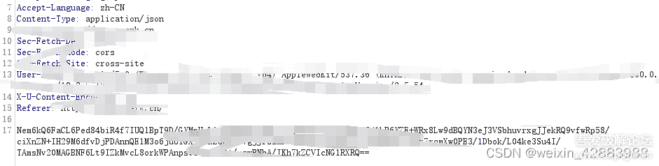
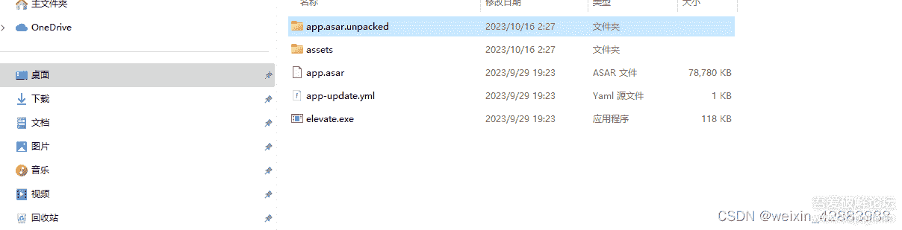
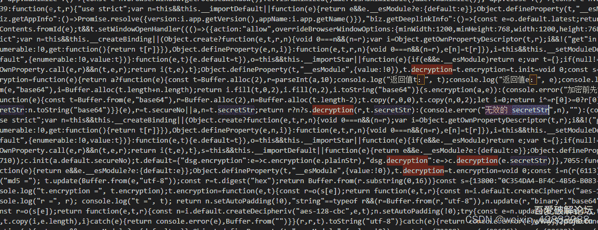
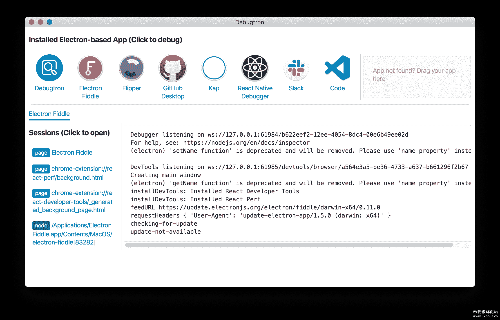
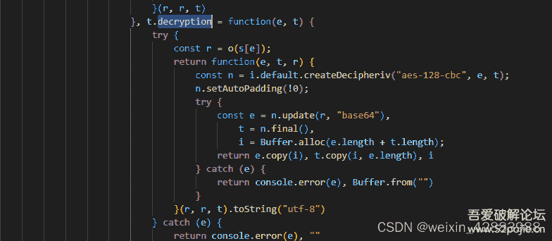
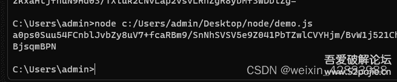
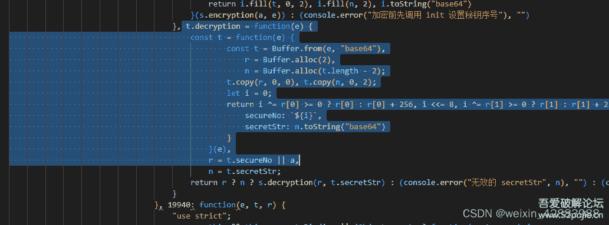
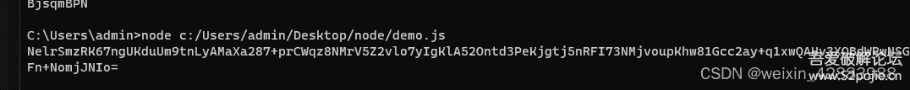

# [原创] Electron 编写的 `exe` 逆向思路

- 原帖：https://www.52pojie.cn/forum.php?mod=viewthread&tid=1847258
- 抓取时间：2026-11-01T22:44:17

## 可以看到 `post` 是加密的

csdn 也是我自己，俺是个新人，欢迎交流。



`d41bf8b1f134480ea3d74127dab97fb7.png`（48.6 KB，下载次数：0）

[附件](https://www.52pojie.cn/forum.php?mod=attachment&aid=MjY1MDgxM3xiMTk4NzYyZXwxNzkzNTczMDU0fDE2ODA4NnwxODQ3MjU4&nothumb=yes) — 2023-10-22 14:03 上传

## 我们看看这个应用的文件夹



`2.png`（38.18 KB，下载次数：0）

[附件](https://www.52pojie.cn/forum.php?mod=attachment&aid=MjY1MDgxNXwzZDM1NTNjYnwxNzkzNTczMDU0fDE2ODA4NnwxODQ3MjU4&nothumb=yes) — 2023-10-22 14:05 上传

看到了 `app.asar`，很明显是 Electron 编写的。

## 一、Electron 是什么？

> Electron 是一个使用 JavaScript、HTML 和 CSS 构建跨平台的桌面应用程序。它基于 Node.js 和 Chromium，被 Atom 编辑器和许多其他应用程序使用。
>
> Electron 兼容 Mac、Windows 和 Linux，可以构建出三个平台的应用程序。

## 二、怎么逆？

Electron 类似小程序，打包之后可以解包，由 `js` 编写。命令如下：

```
npm install asar -g
cd apps
asar extract app.asar app //解压拿到源码
asar pack app app.asar //重新打包
```

解包之后直接搜关键字。

可以看到搜索到很多，但是编译后压缩了。

但是可以通过 [www.sojson.com/jsjiemi.html](https://www.sojson.com/jsjiemi.html) 进行格式化。

但是格式化之后代码红了，这样肯定是重新打包不了。

不过无所谓了，方便看就行。



`3.png`（136.29 KB，下载次数：0）

[附件](https://www.52pojie.cn/forum.php?mod=attachment&aid=MjY1MDgxNnxmNzEyYjU5MXwxNzkzNTczMDU0fDE2ODA4NnwxODQ3MjU4&nothumb=yes) — 2023-10-22 14:06 上传

怎么调试呢？猜肯定不行。有个简单粗暴的办法，把可能出现的地方加上。

```
console.log("1");
console.log("2");
console.log("3");
console.log("4");
```

然后打包替换回去运行就行了。

问题来了，哪里输出打印结果呢？

可以通过 [Debugtron](https://github.com/pd4d10/debugtron)。

Debugtron 是什么？它可以强制打开 Electron 的调试模式，让它像浏览器 F12 一样。



`4.png`（580.51 KB，下载次数：0）

[附件](https://www.52pojie.cn/forum.php?mod=attachment&aid=MjY1MDgxOHwzYjA3YzZjY3wxNzkzNTczMDU0fDE2ODA4NnwxODQ3MjU4&nothumb=yes) — 2023-10-22 14:06 上传

中间有个问题：为什么不直接用 Debugtron 直接像网页一样打断点？

问就是编译之后压缩了调试不方便。

根据打印找到关键的代码。



`5.png`（44.63 KB，下载次数：0）

[附件](https://www.52pojie.cn/forum.php?mod=attachment&aid=MjY1MDgxOXw0MjQzYzJmOXwxNzkzNTczMDU0fDE2ODA4NnwxODQ3MjU4&nothumb=yes) — 2023-10-22 14:06 上传

扣出来试试。



`6.png`（25.59 KB，下载次数：0）

[附件](https://www.52pojie.cn/forum.php?mod=attachment&aid=MjY1MDgyMHw4ZTM2NjNiNHwxNzkzNTczMDU0fDE2ODA4NnwxODQ3MjU4&nothumb=yes) — 2023-10-22 14:06 上传

可以看到不对，这是为什么呢？也确实调用了，莫非调用之后，还执行了别的？

那就继续加 `console.log` 接着找调用。

如下：



`9.png`（58.99 KB，下载次数：0）

[附件](https://www.52pojie.cn/forum.php?mod=attachment&aid=MjY1MDgyM3xmYmNjMTdiZXwxNzkzNTczMDU0fDE2ODA4NnwxODQ3MjU4&nothumb=yes) — 2023-10-22 14:07 上传

可以看到确实又进行了一次 `base64`。

我们抠出代码再试试。



`8.png`（25.41 KB，下载次数：0）

[附件](https://www.52pojie.cn/forum.php?mod=attachment&aid=MjY1MDgyMnw5ODkwNDMzZHwxNzkzNTczMDU0fDE2ODA4NnwxODQ3MjU4&nothumb=yes) — 2023-10-22 14:07 上传

完美！csdn 也是我自己，俺是个新人，欢迎交流。
