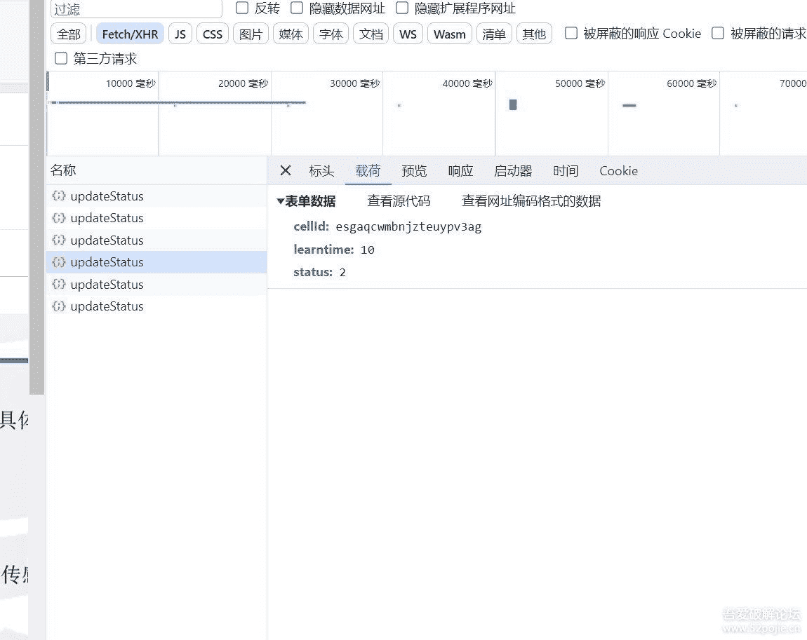
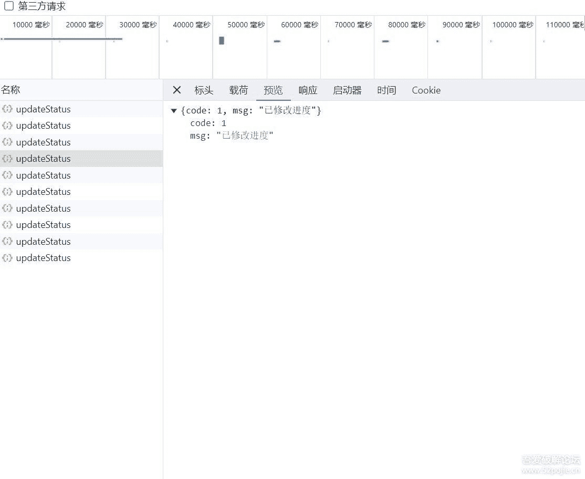
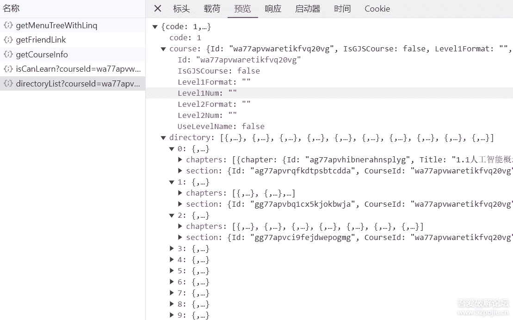
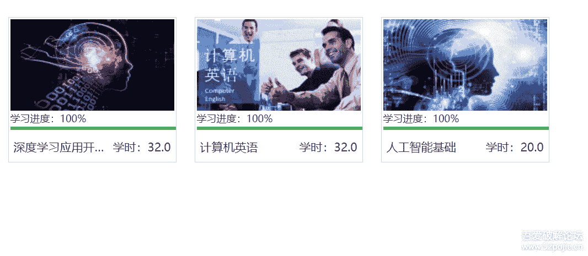
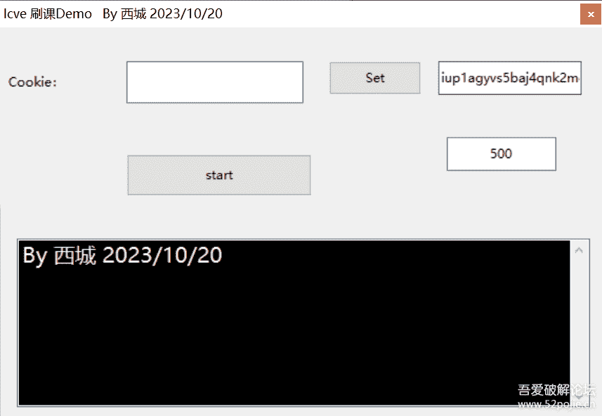

# [Web逆向] 智慧职教 icve 课程接口分析

- 原帖: https://www.52pojie.cn/forum.php?mod=viewthread&tid=1847453
- 抓取时间: 2026-11-01T22:44:13

最近学校要求看智慧职教，课程有60个学时，于是打算写一个小工具过掉他

由于我只是为了功能实现，就不一一获取`Cookie`了，不过他是从登录接口获取一个`TOKen`

有兴趣的可以去抓，我的目的是为了实现功能，能用就可以

## 寻找视频播放接口

首先我先寻找视频播放接口，我发现了这个接口，虽然每隔秒都在发起请求，



屏幕截图 2023-10-23 080134.jpg (83.49 KB, 下载次数: 1)

[附件下载](https://www.52pojie.cn/forum.php?mod=attachment&aid=MjY1MDk1MXxjMmJkNDgyZnwxNzkzNTczMDUwfDE2ODA4NnwxODQ3NDUz&nothumb=yes)

2023-10-23 08:33 上传

## 调试完成视频请求

但是看完视频发送的请求不一样，于是我直接调用他发完请求的参数进行调试

- `cellId`：`id` // `课程Id`
- `learntime`：`"121.8"` // 学习的时间，我这边直接用常量代替
- `status`：`"1"` // `1` 为完成视频状态

经过调试，课程进度成功增加了

## 使用易语言实现 `过课` 子程序

使用易语言编写代码

```
.版本 2

.子程序 过课, 文本型
.参数 id, 文本型
.局部变量 局_网址, 文本型
.局部变量 局_方式, 整数型
.局部变量 ADD_数据包, 类_POST数据类
.局部变量 局_提交数据, 文本型
.局部变量 局_提交cookie, 文本型
.局部变量 ADD_协议头, 类_POST数据类
.局部变量 局_提交协议头, 文本型
.局部变量 局_结果, 字节集
.局部变量 局_返回, 文本型
.局部变量 json, 类_json
id ＝ 文本_取出中间文本 (id, #常量1, #常量2)
局_网址 ＝ “https://www.icve.com.cn/study/directory/updateStatus”
局_方式 ＝ 1
ADD_数据包.添加 (“cellId”, id)
ADD_数据包.添加 (“learntime”, “121.8”)
ADD_数据包.添加 (“status”, “1”)
局_提交数据 ＝ ADD_数据包.获取Post数据 ()
局_提交cookie ＝ Cookie    //全局变量
ADD_协议头.添加 (“Accept”, “*/*”)
ADD_协议头.添加 (“Accept-Language”, “zh-CN,zh;q=0.9”)
ADD_协议头.添加 (“Connection”, “keep-alive”)
ADD_协议头.添加 (“Content-Length”, “50”)
ADD_协议头.添加 (“Content-Type”, “application/x-www-form-urlencoded; charset=UTF-8”)
ADD_协议头.添加 (“Host”, “www.icve.com.cn”)
ADD_协议头.添加 (“Origin”, “https://www.icve.com.cn”)
ADD_协议头.添加 (“Sec-Fetch-Dest”, “empty”)
ADD_协议头.添加 (“Sec-Fetch-Mode”, “cors”)
ADD_协议头.添加 (“Sec-Fetch-Site”, “same-origin”)
ADD_协议头.添加 (“User-Agent”, “Mozilla/5.0 (Windows NT 10.0; Win64; x64) AppleWebKit/537.36 (KHTML, like Gecko) Chrome/118.0.0.0 Safari/537.36”)
ADD_协议头.添加 (“X-Requested-With”, “XMLHttpRequest”)
ADD_协议头.添加 (“sec-ch-ua-mobile”, “?0”)
局_提交协议头 ＝ ADD_协议头.获取协议头数据 ()
局_结果 ＝ 网页_访问_对象 (局_网址, 局_方式, 局_提交数据, 局_提交cookie, , 局_提交协议头, , , , , , , , , , , )
局_返回 ＝ 到文本 (编码_编码转换对象 (局_结果))
返回 (局_返回)
```



屏幕截图 2023-10-23 080155.jpg (62.17 KB, 下载次数: 1)

[附件下载](https://www.52pojie.cn/forum.php?mod=attachment&aid=MjY1MDk1Mnw0OWZhNmZmNnwxNzkzNTczMDUwfDE2ODA4NnwxODQ3NDUz&nothumb=yes)

2023-10-23 08:34 上传

用易语言写了一个子程序，由于后期使用`json`解析获取`课程ID`，在`课程ID`前后有`""`，这会影响我们视频进度的修改，

于是使用`文本_取出中间文本 (id, #常量1, #常量2)`，将`""`去除，只留下课程`id`

功能实现了，又有了一个新问题，一项科目有十几节甚至几十节课，

我们不可能一个个的复制粘贴`id`，于是我们需要写一个子程序获取`课程Id`并且调用`过课`子程序



QQ图片20231023083804.png (91.58 KB, 下载次数: 2)

[附件下载](https://www.52pojie.cn/forum.php?mod=attachment&aid=MjY1MDk1NXxkM2Q2YzM5NnwxNzkzNTczMDUwfDE2ODA4NnwxODQ3NDUz&nothumb=yes)

2023-10-23 08:38 上传

## 获取课程列表

我们在课程页面进行抓包，发现是一个接口返回的`Json`，这就简单了，生成一个`获取Json`子程序

```
.版本 2

.子程序 获取课程, 文本型
.参数 课程id
.局部变量 局_网址, 文本型
.局部变量 局_方式, 整数型
.局部变量 局_提交cookie, 文本型
.局部变量 ADD_协议头, 类_POST数据类
.局部变量 局_提交协议头, 文本型
.局部变量 局_结果, 字节集
.局部变量 局_返回, 文本型
局_网址 ＝ “https://www.icve.com.cn/study/Directory/directoryList?courseId=” ＋ 课程id
局_方式 ＝ 0
局_提交cookie ＝ Cookie
ADD_协议头.添加 (“Accept”, “*/*”)
ADD_协议头.添加 (“Accept-Language”, “zh-CN,zh;q=0.9”)
ADD_协议头.添加 (“Connection”, “keep-alive”)
ADD_协议头.添加 (“Content-Length”, “50”)
ADD_协议头.添加 (“Content-Type”, “application/x-www-form-urlencoded; charset=UTF-8”)
ADD_协议头.添加 (“Host”, “www.icve.com.cn”)
ADD_协议头.添加 (“Origin”, “https://www.icve.com.cn”)
ADD_协议头.添加 (“Referer”, “https://www.icve.com.cn/study/directory/dir_course.html?courseId=wa77apvwaretikfvq20vg&chapterId=ag77apvo65pr3dc7cehq&sort=0.001”)
ADD_协议头.添加 (“Sec-Fetch-Dest”, “empty”)
ADD_协议头.添加 (“Sec-Fetch-Mode”, “cors”)
ADD_协议头.添加 (“Sec-Fetch-Site”, “same-origin”)
ADD_协议头.添加 (“User-Agent”, “Mozilla/5.0 (Windows NT 10.0; Win64; x64) AppleWebKit/537.36 (KHTML, like Gecko) Chrome/118.0.0.0 Safari/537.36”)
ADD_协议头.添加 (“X-Requested-With”, “XMLHttpRequest”)
ADD_协议头.添加 (“sec-ch-ua-mobile”, “?0”)
局_提交协议头 ＝ ADD_协议头.获取协议头数据 ()
局_结果 ＝ 网页_访问_对象 (局_网址, 局_方式, , 局_提交cookie, , 局_提交协议头, , , , , , , , , , , )
局_返回 ＝ 到文本 (编码_编码转换对象 (局_结果))
返回 (局_返回)
```

## 解析 `Json` 并批量过课

使用大课程的`Id`、获取课程里面所有的课程`Json`，随后我们该写一个解析`Json`并且调取`过课`

```
.版本 2
.支持库 spec

.子程序 子程序1
.参数 课程id, 文本型
.局部变量 bool, 逻辑型
.局部变量 json, 类_json
.局部变量 array, 类_json
.局部变量 n, 整数型
.局部变量 i, 整数型
.局部变量 y, 整数型

bool ＝ json.解析 (到文本 (获取课程 (课程id)))
.如果 (bool)

.否则

.如果结束
array ＝ json.取属性 (“directory”)
n ＝ array.成员数 ()
.计次循环首 (n, i)

    .计次循环首 (json.取属性 (“directory[” ＋ 到文本 (i － 1) ＋ “].chapters”).成员数 (), y)
        调试输出 (json.取属性对象 (“directory[” ＋ 到文本 (i － 1) ＋ “].chapters[” ＋ 到文本 (y － 1) ＋ “].cells[0].Title”) ＋ #换行符)
        调试输出(json.取属性对象 (“directory[” ＋ 到文本 (i － 1) ＋ “].chapters[” ＋ 到文本 (y － 1) ＋ “].cells[0].Id”) ＋ #换行符)
        调试输出 (json.取属性对象 (“directory[” ＋ 到文本 (i － 1) ＋ “].chapters[” ＋ 到文本 (y － 1) ＋ “].cells[1].Title”) ＋ #换行符)
        调试输出 (json.取属性对象 (“directory[” ＋ 到文本 (i － 1) ＋ “].chapters[” ＋ 到文本 (y － 1) ＋ “].cells[1].Id”) ＋ #换行符)
        过课 (json.取属性对象 (“directory[” ＋ 到文本 (i － 1) ＋ “].chapters[” ＋ 到文本 (y － 1) ＋ “].cells[0].Id”))
        过课 (json.取属性对象 (“directory[” ＋ 到文本 (i － 1) ＋ “].chapters[” ＋ 到文本 (y － 1) ＋ “].cells[1].Id”))
        延迟 (到整数 (编辑框7.内容))
    .计次循环尾 ()
.计次循环尾 ()
```

由于我的课程只有视频+PPT，我就只循环了`cells[0]`，`cells[1]`的`Id`进行课程，如果有人想完善可以识别一下`Json`

我也没做课程的进度识别，运行就是从0刷到满，因为我只是为了实现功能，不是为了做一个所有人可以用的程序//主要还是懒

## 注意事项

另外请谨慎使用我的方法，由于原本视频是每隔几秒调用一次`Api`，最后再发起一次`API`结束，我这种方法无疑后台肯定能监控到，我甚至将学习的时间设置为常量

仅供参考，我也是为了赶快刷完省事截个图才选择这种方法的，不排除后期对我的进度清零的可能



QQ图片20231023083036.png (275.33 KB, 下载次数: 2)

[附件下载](https://www.52pojie.cn/forum.php?mod=attachment&aid=MjY1MDk1MHw2NTgxOTI2ZHwxNzkzNTczMDUwfDE2ODA4NnwxODQ3NDUz&nothumb=yes)

2023-10-23 08:32 上传

## 程序封装

附上我的程序封装图片,很简单的一个东西，可以参考一下，由于版规限制，就不提供软件了



QQ图片20231023082645.png (37 KB, 下载次数: 3)

[附件下载](https://www.52pojie.cn/forum.php?mod=attachment&aid=MjY1MDk1NHw1Y2ZlNjkyZHwxNzkzNTczMDUwfDE2ODA4NnwxODQ3NDUz&nothumb=yes)

2023-10-23 08:35 上传
