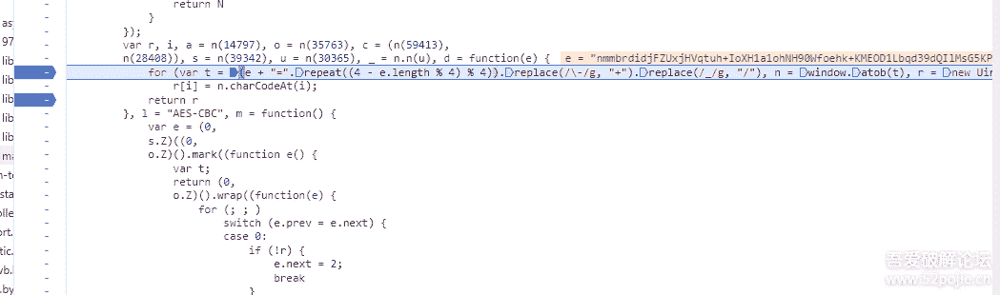

# [Web逆向] 某量算术的传输加密破解

- 原帖：`https://www.52pojie.cn/forum.php?mod=viewthread&tid=1848164`
- 抓取时间：2026-11-01T22:44:10

## 思路

- 通过谷歌浏览器的 `source XHR/fetch breakpoints` 拦截目标请求连接。
- 查看 `Stack` 对应堆栈，找到 `requests` 发送处（一般也会有 `response` 接受处，所以搜索 `response` 打断点）。
- 在一个 `response` 处成功定位到具体解析，刷新界面跟踪堆栈就能找到 `key`、`iv`。



`5242a1f1-8a84-495b-ac15-31c5bcb6ee2b.png` (103.97 KB, 下载次数: 0)

[`forum.php?mod=attachment&aid=MjY1MTM5MXxlMjM0MGFkZXwxNzkzNTczMDQ4fDE2ODA4NnwxODQ4MTY0&nothumb=yes`](https://www.52pojie.cn/forum.php?mod=attachment&aid=MjY1MTM5MXxlMjM0MGFkZXwxNzkzNTczMDQ4fDE2ODA4NnwxODQ4MTY0&nothumb=yes)

2023-10-24 16:46 上传

## 原理

- 从源码可知，此次 `response` 加密本质就是 `base64+Aes_cbc` 加密的。
- `key`、`iv` 是两个 `base64` 字符，先字符串替换 → `base64` 解密 → 转 `unicode` 字节数组。
- `Data` 数据同理，也是先字符替换 → `base64` 解密 → 转 `unicode` 字节数组 → `AES CBC` 模式解密 → `utf-8` 编码。
- 如果是 python 实现，注意去除补位。
- 去除代码：

```
un_pad = lambda s: s[:-ord(s[len(s) - 1:])]
```

## 总结

总体来说是一个很简单的加密。
