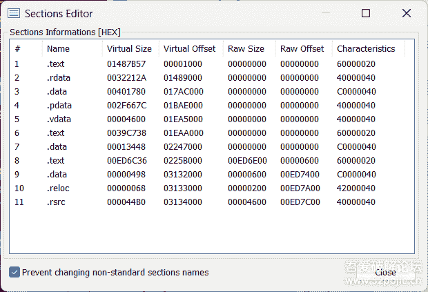
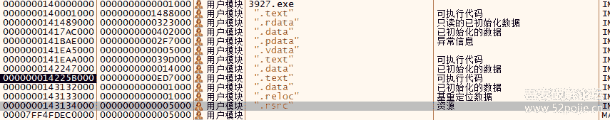
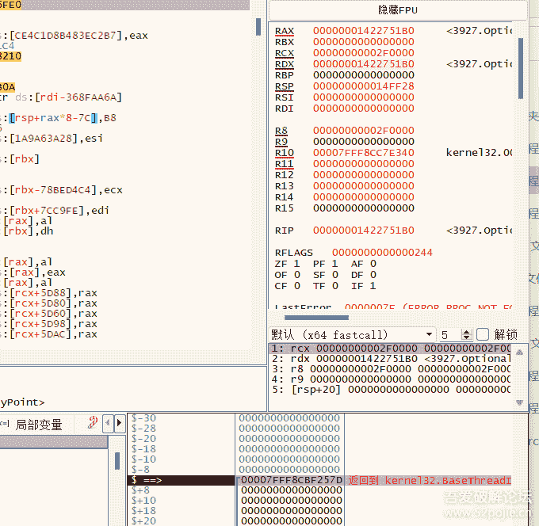
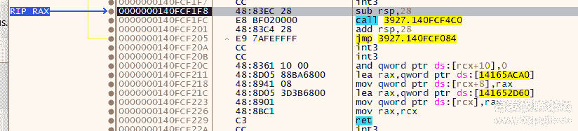
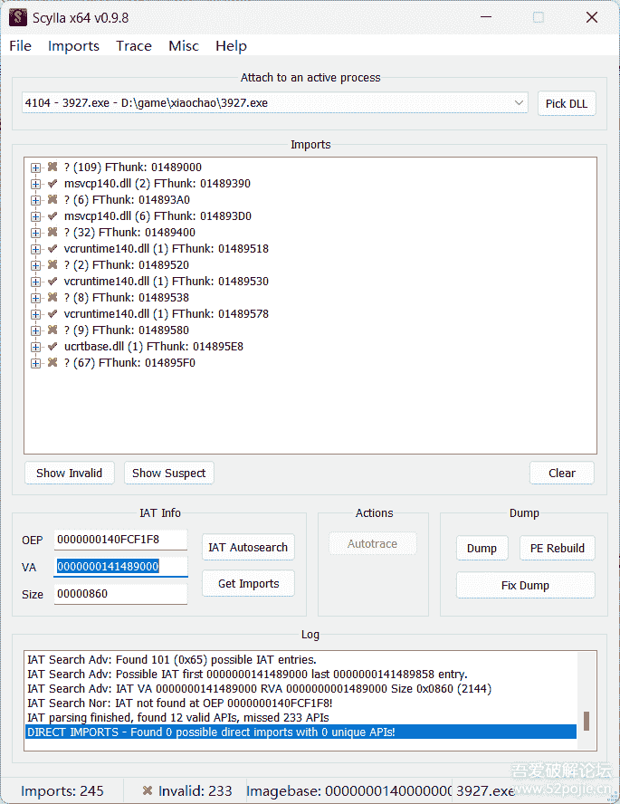
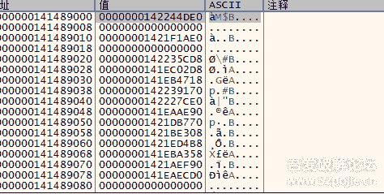
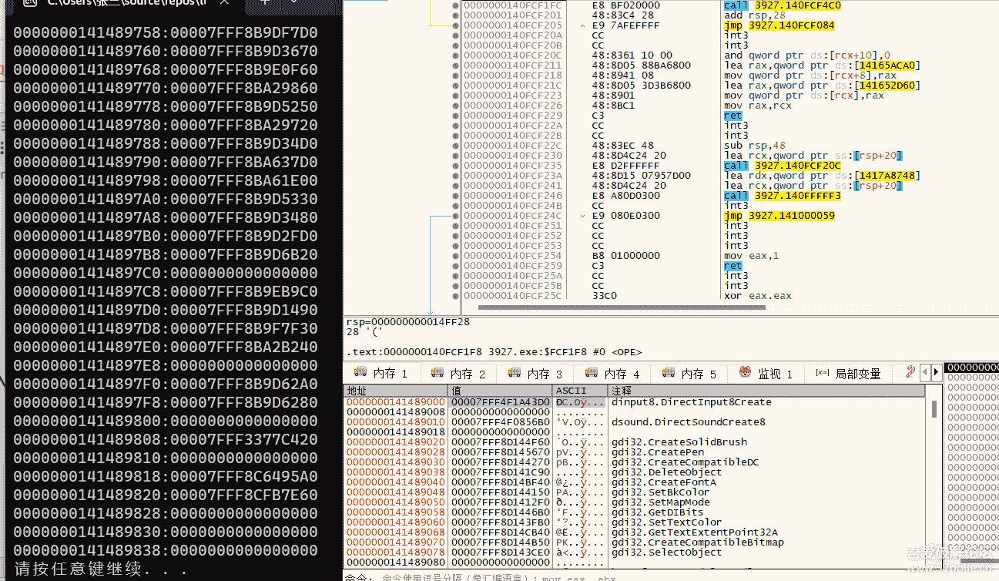
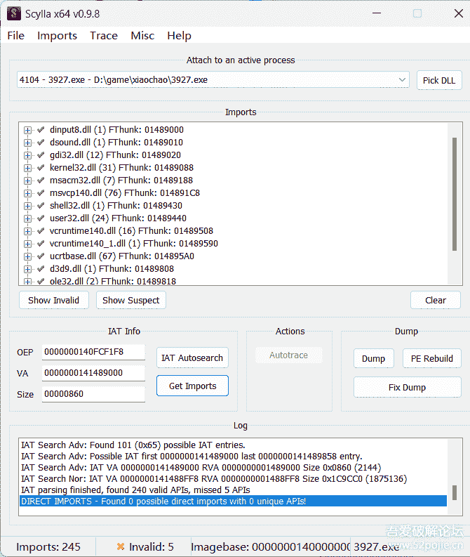

# [原创] 某单机游戏脱壳过程

- 原帖：https://www.52pojie.cn/forum.php?mod=viewthread&tid=1848532
- 抓取时间：2026-11-01T22:44:09

网上看到一款单机游戏，发现加了一个未知壳，拿来练练手。

## 一、简单分析

`PE Tools` 查看 `Sections`，可以看到 3 个 `.text` 代码段，第一个 `.text` 段的 `RawSize` 和 `Offset` 都为 0，代码可能被压缩，后两个段可能为外壳代码，负责解压真实代码。



*2023-10-25 12:53 上传*

`x64 DBG` 打开程序在 `OEP` 断下，`OPE` 位于第三个 `.text` 段，查看第一个 `.text` 段，发现数据已经被写入到 `.text` 段。说明外壳程序在 `TLS` 回调时已经解压了第一个 `.text` 段的数据并写入，`OEP` 位于第三个 `.text` 段，可能后续会对程序进行 `crc` 之类的校验以及反调试。



*2023-10-25 13:44 上传*

## 二、寻找 `OEP`

使用 `ESP` 定律，在 `rsp-8` 的位置下断，一直按 `F9` 运行。



*2023-10-25 13:15 上传*

最后真实 `OEP` 在第一个 `.text` 段位置断下。



*2023-10-25 13:17 上传*

## 三、修复 `IAT` 表

使用 `Scylla` 自动搜索 `IAT`。



*2023-10-25 13:20 上传*



*2023-10-25 13:43 上传*

发现很多无效的地址，并且都位于外壳程序的 `.text` 段，说明外壳程序硬编码了大部分的 `IAT` 地址（使用外壳程序函数地址代替导入函数地址，外壳程序函数内会计算得到导入函数地址进行间接跳转）。

我们已经确定了 `IAT` 的位置，可以尝试使用 `Unicorn` 跑出真实的导入函数地址。

```cpp
DWORD64 runAndGetAddr(uc_engine* uc, DWORD64 beginAddr)
{
    DWORD64 r_rip;
    uc_emu_start(uc, beginAddr, 0, 0, 0);
    uc_reg_read(uc, UC_X86_REG_RIP, &r_rip);
    return r_rip;
}

void dealIat(HANDLE hProc, LPVOID exeMem)
{
    if (g_uc)
    {
        DWORD64 startIatAddr = 0x000000141489000;
        DWORD64 endIatAddr = 0x0000000141489840;

        DWORD64 tempRead;
        while (startIatAddr
```

当从外壳程序执行到导入函数时，因为导入函数没有在 `Unicorn` 中 `map`，所以会异常退出，得到导入函数地址。



*2023-10-25 13:36 上传*

此时再使用 `Scylla` 自动搜索 `IAT`，可以得到完整的 `IAT`。



*2023-10-25 13:37 上传*

## 四、`dump` 镜像

获取 `IAT` 之后，在 `Dump` 和 `Fix Dump` 就可以得到修复后的程序了。
