# [MacOS逆向] 破解 QCAD for Mac

- 原帖：https://www.52pojie.cn/forum.php?mod=viewthread&tid=1849172
- 抓取时间：2026-11-01T22:44:07

## 破解 QCAD for Mac

因为今天要修改一个图，不能有其他公司的名字，光改PDF没用，所以只能从dxf文件下手。搜来搜去又不想装Autodesk CAD，太麻烦了，所以随便找了个QCAD破一下，好像这软件还挺好用。

### 1. 分析

没激活前是这样的

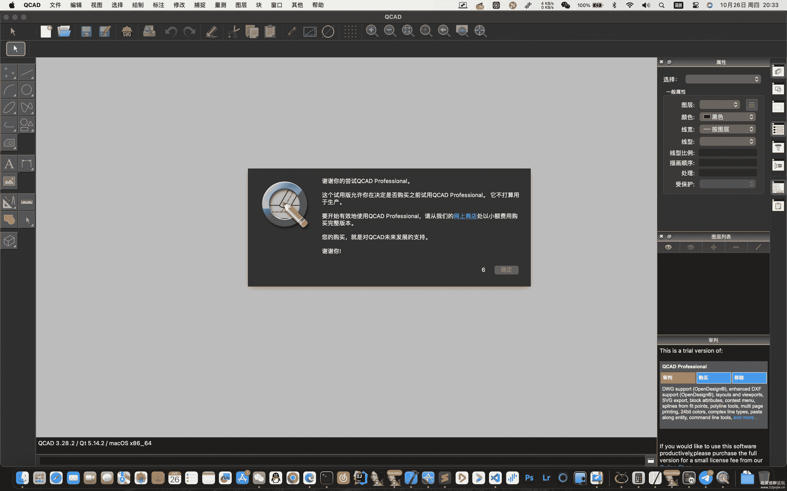

16983236052493.jpg (514.18 KB, 下载次数: 3)

[href="forum.php?mod=attachment&aid=MjY1MTg5NnwyZTFlMTY3NnwxNzkzNTczMDQ1fDE2ODA4NnwxODQ5MTcy&nothumb=yes" target="_blank"](https://www.52pojie.cn/forum.php?mod=attachment&aid=MjY1MTg5NnwyZTFlMTY3NnwxNzkzNTczMDQ1fDE2ODA4NnwxODQ5MTcy&nothumb=yes)

2023-10-26 23:23 上传

充斥着Trial等字样，右下角还有一个审判按钮。

其次，使用大约30-40分钟左右，会有退出弹窗

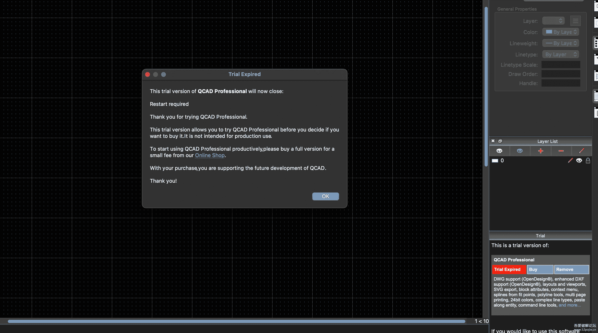

16983233226012.jpg (518.49 KB, 下载次数: 1)

[href="forum.php?mod=attachment&aid=MjY1MTg5NXw0NTM1MThhNXwxNzkzNTczMDQ1fDE2ODA4NnwxODQ5MTcy&nothumb=yes" target="_blank"](https://www.52pojie.cn/forum.php?mod=attachment&aid=MjY1MTg5NXw0NTM1MThhNXwxNzkzNTczMDQ1fDE2ODA4NnwxODQ5MTcy&nothumb=yes)

2023-10-26 23:23 上传

并显示我试用到期。

并且最重要的是，导出图纸到pdf有一很大的水印，如果没有水印我可能就不会破解他了。

我打算以“`This is a trial version of`”为切入点，暴力搜索所有文件试试。

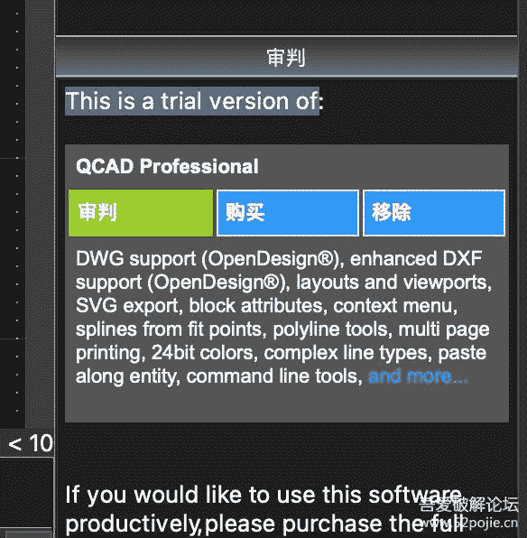

16983242327040.jpg (66.7 KB, 下载次数: 3)

[href="forum.php?mod=attachment&aid=MjY1MTg5N3w0OWY1YmQ5YnwxNzkzNTczMDQ1fDE2ODA4NnwxODQ5MTcy&nothumb=yes" target="_blank"](https://www.52pojie.cn/forum.php?mod=attachment&aid=MjY1MTg5N3w0OWY1YmQ5YnwxNzkzNTczMDQ1fDE2ODA4NnwxODQ5MTcy&nothumb=yes)

2023-10-26 23:23 上传

就让审判来得更猛烈些吧！

### 2. 审判

常规搜索我们是搜索不到的。所以我们需要用一些特别的手段来暴力搜索所有二进制里的文件。

因为我们知道，英文字符串大部分就是原文在二进制中，所以我们暴力搜索一定能搜索到相关的内容。

```bash
find /Applications/QCAD.app/Contents -type f -exec sh -c 'strings "$1" | grep "This is a trial version of" && echo "$1"' sh {} \;
```

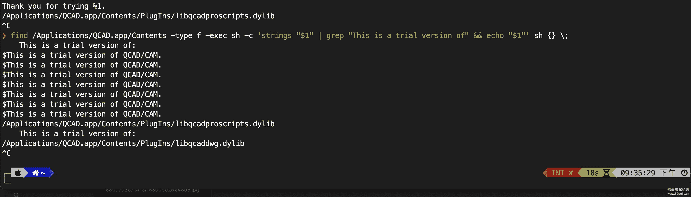

16983273366657.jpg (250.68 KB, 下载次数: 1)

[href="forum.php?mod=attachment&aid=MjY1MTg5OHxjNDkxYTZlZHwxNzkzNTczMDQ1fDE2ODA4NnwxODQ5MTcy&nothumb=yes" target="_blank"](https://www.52pojie.cn/forum.php?mod=attachment&aid=MjY1MTg5OHxjNDkxYTZlZHwxNzkzNTczMDQ1fDE2ODA4NnwxODQ5MTcy&nothumb=yes)

2023-10-26 23:23 上传

差不多也就搜索到这了。

我们发现第一个文件和第二个文件都存在这个字符串，那么我们就着重搞这两个文件。

首先打开第一个：

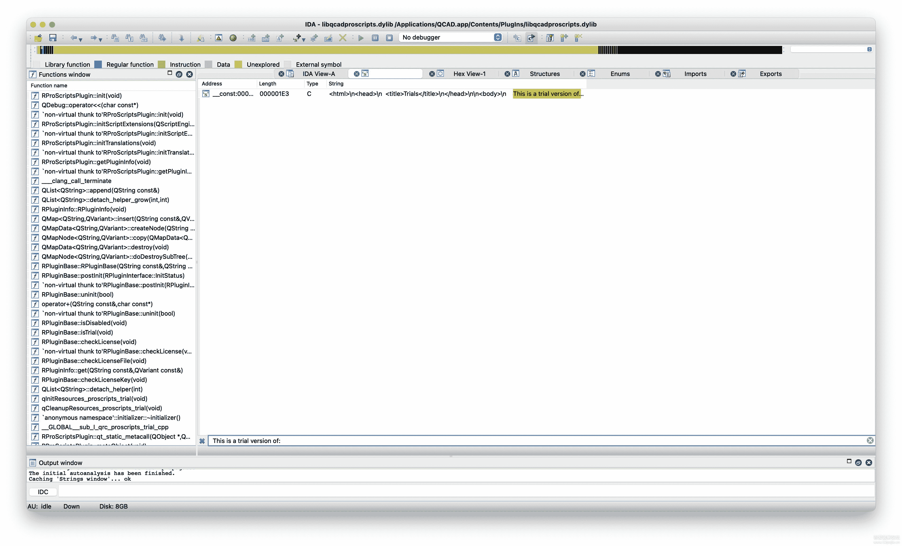

16983274665225.jpg (729.26 KB, 下载次数: 2)

[href="forum.php?mod=attachment&aid=MjY1MTg5OXxmOTMwM2FlOHwxNzkzNTczMDQ1fDE2ODA4NnwxODQ5MTcy&nothumb=yes" target="_blank"](https://www.52pojie.cn/forum.php?mod=attachment&aid=MjY1MTg5OXxmOTMwM2FlOHwxNzkzNTczMDQ1fDE2ODA4NnwxODQ5MTcy&nothumb=yes)

2023-10-26 23:23 上传

因为只有几百K，分析速度很快，我们一搜，还真有。

那这下不得不跳过去看下了：

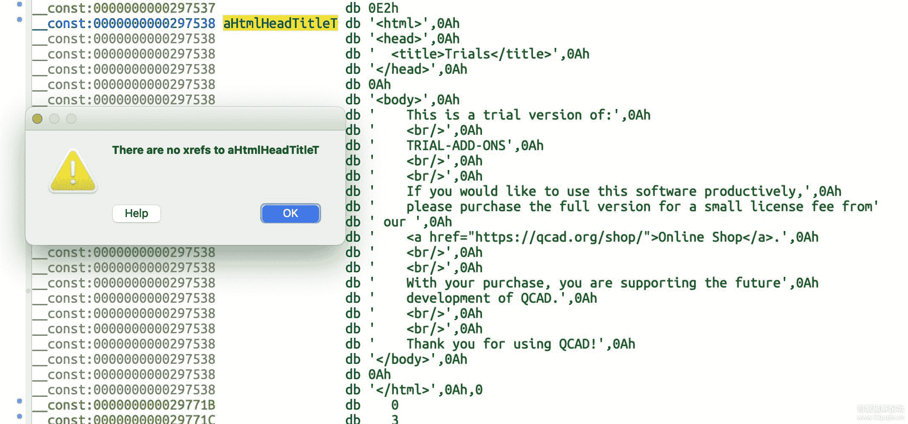

16983275016996.jpg (297.52 KB, 下载次数: 2)

[href="forum.php?mod=attachment&aid=MjY1MTkwMHxjYjk1YTIyNHwxNzkzNTczMDQ1fDE2ODA4NnwxODQ5MTcy&nothumb=yes" target="_blank"](https://www.52pojie.cn/forum.php?mod=attachment&aid=MjY1MTkwMHxjYjk1YTIyNHwxNzkzNTczMDQ1fDE2ODA4NnwxODQ5MTcy&nothumb=yes)

2023-10-26 23:23 上传

糟糕糟糕OMG，魔法怎么施灵辣！

却说这大魔导师落叶不愧是强者，事情发展出乎意料却也不急，冷笑着说道：“尔等不过区区Qt多语言，待我略施小技，必取你首级！”

那QCAD本就是小作坊出产，哪里见过这等阵仗？当下心中狂跳，嘴上却是硬道：“兀那乱臣贼子！休要在此胡言乱语妖言惑众，我等在此会你一二，看你还有什么手段？”

那大魔导师落叶出道以来哪里受到如此挫折？闻得QCAD猖狂挑衅，当下却是道心不稳，怒从心中起，恶言道：“区区蝼蚁也敢在本魔导师面前螳臂当车？死来！”

当下落叶长啸一声，法杖高举，大喝道：“天圆地方乾坤倒转，禁术·Hopper disassembler，启动！”

说时迟那时快，原本万里无云的蓝天诡异的传出一声巨响，那QCAD当即被一个邪异蓝色光罩团团围住，进出不得。QCAD惊怒交加，一时不察竟受制于人，怒不可遏：“贼子敢尔！”

那大魔导师落叶也不说话，匆忙的结印，操作着究极禁术HP疯狂攻击：

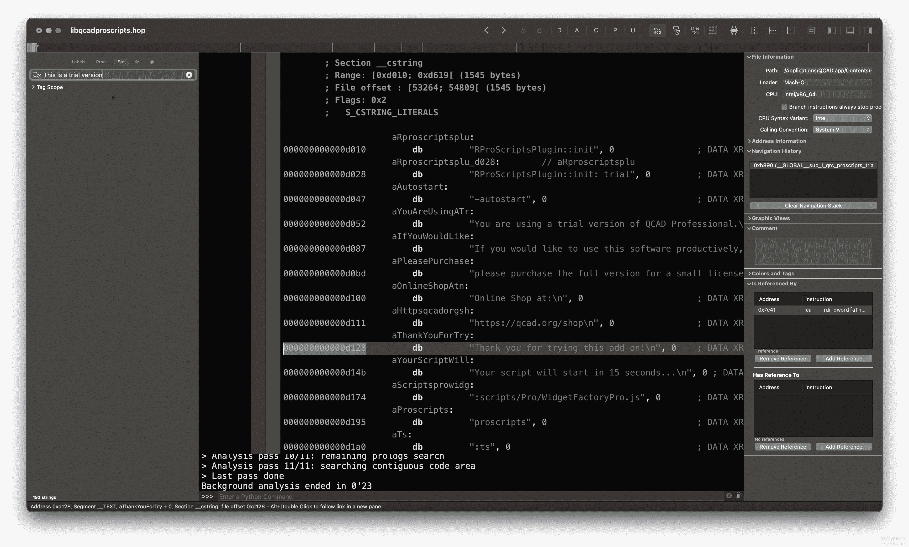

16983283509738.jpg (660.11 KB, 下载次数: 1)

[href="forum.php?mod=attachment&aid=MjY1MTkwMXxjOTFhMDg4ZXwxNzkzNTczMDQ1fDE2ODA4NnwxODQ5MTcy&nothumb=yes" target="_blank"](https://www.52pojie.cn/forum.php?mod=attachment&aid=MjY1MTkwMXxjOTFhMDg4ZXwxNzkzNTczMDQ1fDE2ODA4NnwxODQ5MTcy&nothumb=yes)

2023-10-26 23:23 上传

此时令所有人震惊的一幕出现了，那究极禁术竟然对QCAD毫发无伤！

QCAD原本还略有慌乱，此时发现自己没有受到任何伤害，眼珠一转便哈哈大笑：“黄毛小儿，想害我？再去修炼几年！”

“可恶！”落叶面如金纸，噗的吐出一口黑血，原来这禁术无法施展太久，否则会反噬施术者。一时之间，竟然僵持不下。

远处，迦南世家伯爵迦南二世皱眉道：“此子成长速度太快，区区魔导师境界的魔力就已经能越级施展禁术，之前还得罪了他，如此看来只好斩草除根了！告诉QCAD大师，如果能当场斩杀魔子落叶，我们迦南世家将不遗余力的帮助他成为璃月大陆的风神代言人！”说到最后，竟然已经是咬牙切齿。

两名骑士对视一眼，不敢怠慢，当即领命去设法通知QCAD大师。

那QCAD见这所谓的大魔导师兼魔子对自己毫发无伤，更是轻视三分，又收到迦南二世伯爵送来的密信，当即冷笑一声：“黄口小儿，你的死期到了！”

当即吟唱法术，欲要突破牢笼。

此时落叶本就被反噬遭到重创，哪里敢让QCAD突破？拼了命维护牢笼，一时之间却也想不到别的办法。

此时，落叶突然想到这里：

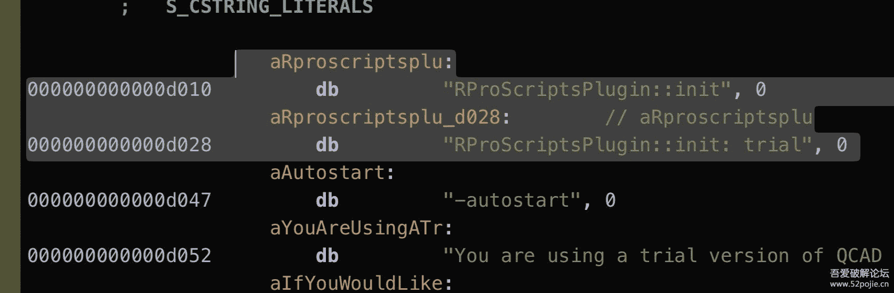

16983291033863.jpg (87.72 KB, 下载次数: 4)

[href="forum.php?mod=attachment&aid=MjY1MTkwMnw5MjkxZTZmMXwxNzkzNTczMDQ1fDE2ODA4NnwxODQ5MTcy&nothumb=yes" target="_blank"](https://www.52pojie.cn/forum.php?mod=attachment&aid=MjY1MTkwMnw5MjkxZTZmMXwxNzkzNTczMDQ1fDE2ODA4NnwxODQ5MTcy&nothumb=yes)

2023-10-26 23:23 上传

这可不就是苦苦寻觅么线索？查不到又如何？还不是漏出了破绽？

当即狂喜，迅速`xref`过去一看：

果然发现这`arg0+0x28`偏移处的地址值若为`0`，则跳转到`7a73`，也就是`trial`模式。

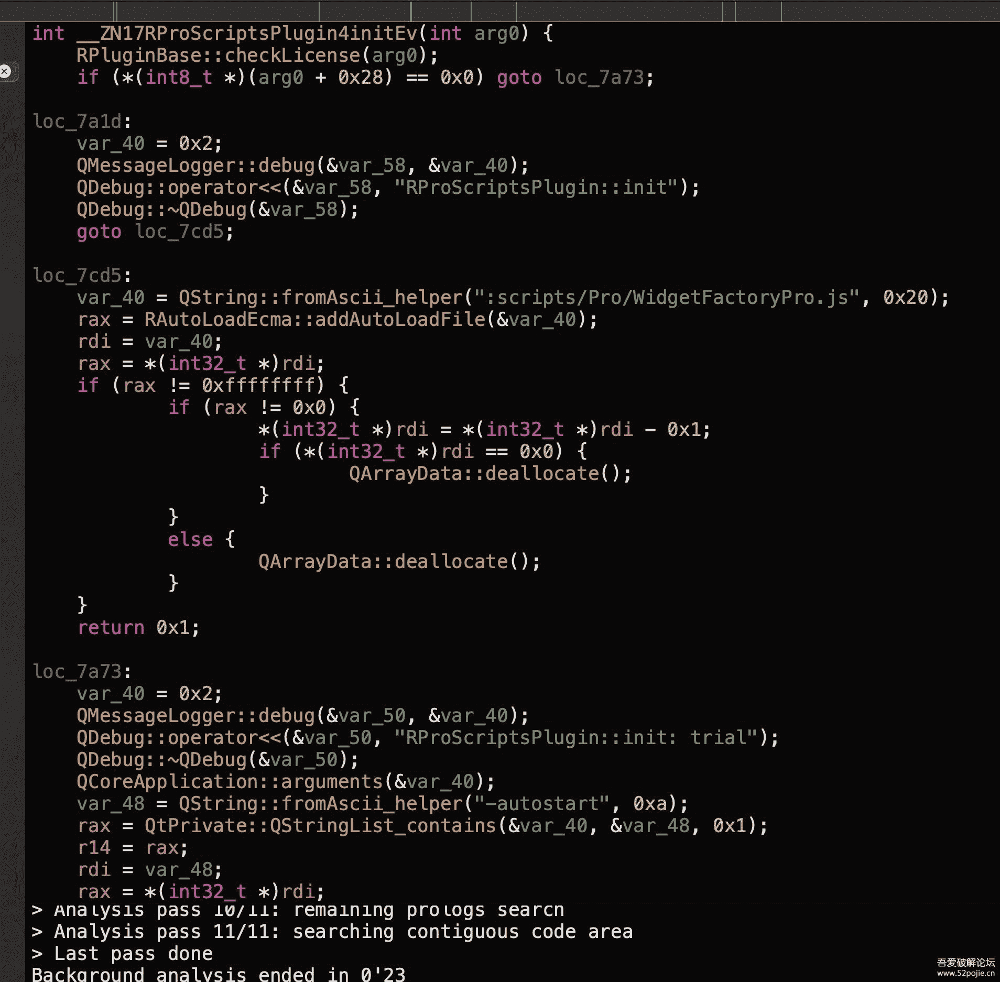

16983291717642.jpg (343.34 KB, 下载次数: 3)

[href="forum.php?mod=attachment&aid=MjY1MTkwM3wyMmY2MzIzZHwxNzkzNTczMDQ1fDE2ODA4NnwxODQ5MTcy&nothumb=yes" target="_blank"](https://www.52pojie.cn/forum.php?mod=attachment&aid=MjY1MTkwM3wyMmY2MzIzZHwxNzkzNTczMDQ1fDE2ODA4NnwxODQ5MTcy&nothumb=yes)

2023-10-26 23:23 上传

那么就让他不跳转吧！

落叶默默想着，迅速回到IDA：

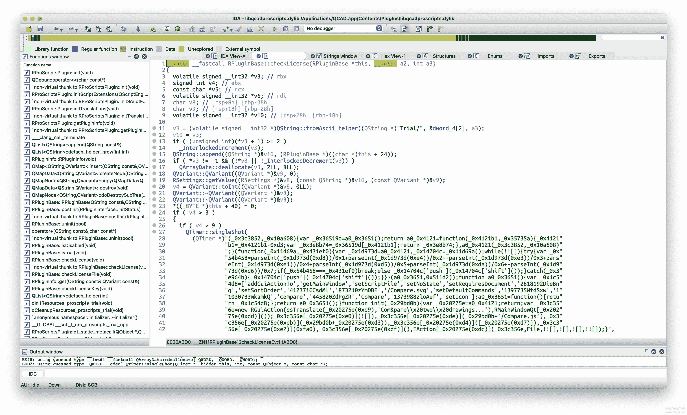

16983292935703.jpg (1.32 MB, 下载次数: 2)

[href="forum.php?mod=attachment&aid=MjY1MTkwNHw2NjNkYmU4NnwxNzkzNTczMDQ1fDE2ODA4NnwxODQ5MTcy&nothumb=yes" target="_blank"](https://www.52pojie.cn/forum.php?mod=attachment&aid=MjY1MTkwNHw2NjNkYmU4NnwxNzkzNTczMDQ1fDE2ODA4NnwxODQ5MTcy&nothumb=yes)

2023-10-26 23:23 上传

找到`checkLicense()`函数，进去发现若`v4 = QVariant::toInt((QVariant )&v8, 0LL);`的值大于9，则走一串神秘的js脚本，并传递了`this`的指针地址，盲猜返回上级函数会让`if ( ((_BYTE *)this + 40) )`判断成立，因为默认`v4`得到的值是`NULL`，也就是`0`，所以这将是我们的突破口！

```cpp
v4 = QVariant::toInt((QVariant *)&v8, 0LL);
QVariant::~QVariant((QVariant *)&v8);
QVariant::~QVariant((QVariant *)&v9);
*((_BYTE *)this + 40) = 0;
if ( v4 > 3 )
{
  if ( v4 > 9 )
    QTimer::singleShot(
      (QTimer *)"(_0x3c3852,_0x10a608){var _0x36519d=a0_0x3651();return a0_0x4121=function(_0x4121b1,_0x35735a){_0x4121"
                "b1=_0x4121b1-0xd3;var _0x3e8b74=_0x36519d[_0x4121b1];return _0x3e8b74;}...............省略",
      (int)this,
      (const QObject *)"1uninitSlot()",
      v5);
```

于是想办法将这`v4 = QVariant::toInt((QVariant *)&v8, 0LL);`改成`v4 = 10`：

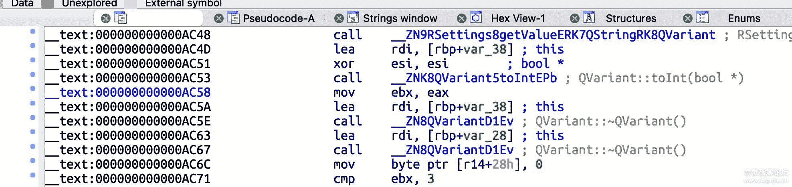

16983296622206.jpg (195.93 KB, 下载次数: 2)

[href="forum.php?mod=attachment&aid=MjY1MTkwNXwwMDUzYTQ3OHwxNzkzNTczMDQ1fDE2ODA4NnwxODQ5MTcy&nothumb=yes" target="_blank"](https://www.52pojie.cn/forum.php?mod=attachment&aid=MjY1MTkwNXwwMDUzYTQ3OHwxNzkzNTczMDQ1fDE2ODA4NnwxODQ5MTcy&nothumb=yes)

2023-10-26 23:23 上传

光标放在这一行，切换到HexView：

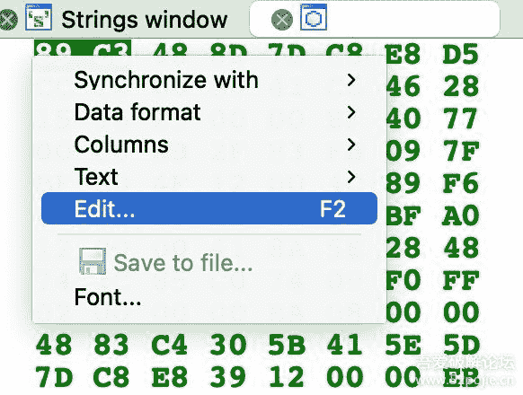

16983296862611.jpg (56.54 KB, 下载次数: 0)

[href="forum.php?mod=attachment&aid=MjY1MTkwNnwwYWI3MGIwM3wxNzkzNTczMDQ1fDE2ODA4NnwxODQ5MTcy&nothumb=yes" target="_blank"](https://www.52pojie.cn/forum.php?mod=attachment&aid=MjY1MTkwNnwwYWI3MGIwM3wxNzkzNTczMDQ1fDE2ODA4NnwxODQ5MTcy&nothumb=yes)

2023-10-26 23:23 上传

自动定位到对应的十六进制地址，右键点击菜单Edit...修改为：

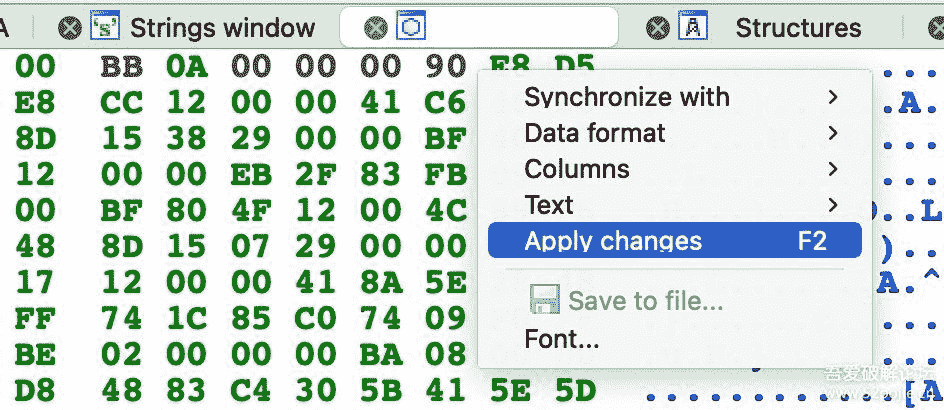

16983297397675.jpg (99.93 KB, 下载次数: 4)

[href="forum.php?mod=attachment&aid=MjY1MTkwN3wxNjdiMzEzYnwxNzkzNTczMDQ1fDE2ODA4NnwxODQ5MTcy&nothumb=yes" target="_blank"](https://www.52pojie.cn/forum.php?mod=attachment&aid=MjY1MTkwN3wxNjdiMzEzYnwxNzkzNTczMDQ1fDE2ODA4NnwxODQ5MTcy&nothumb=yes)

2023-10-26 23:23 上传

最后Apply即可。

返回反汇编即可看到

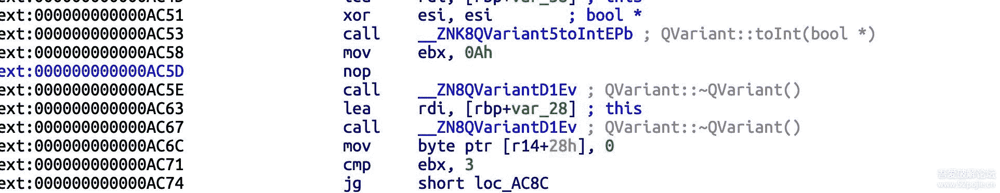

16983297694135.jpg (132.36 KB, 下载次数: 3)

[href="forum.php?mod=attachment&aid=MjY1MTkwOHxjNjVhNTIyOXwxNzkzNTczMDQ1fDE2ODA4NnwxODQ5MTcy&nothumb=yes" target="_blank"](https://www.52pojie.cn/forum.php?mod=attachment&aid=MjY1MTkwOHxjNjVhNTIyOXwxNzkzNTczMDQ1fDE2ODA4NnwxODQ5MTcy&nothumb=yes)

2023-10-26 23:23 上传


被修改成了赋值`0xa`，加一个`NOP`，`nop`是为了对齐指令。否则`ida`分析会出现断层。

最后保存到文件，重启`app`看效果。

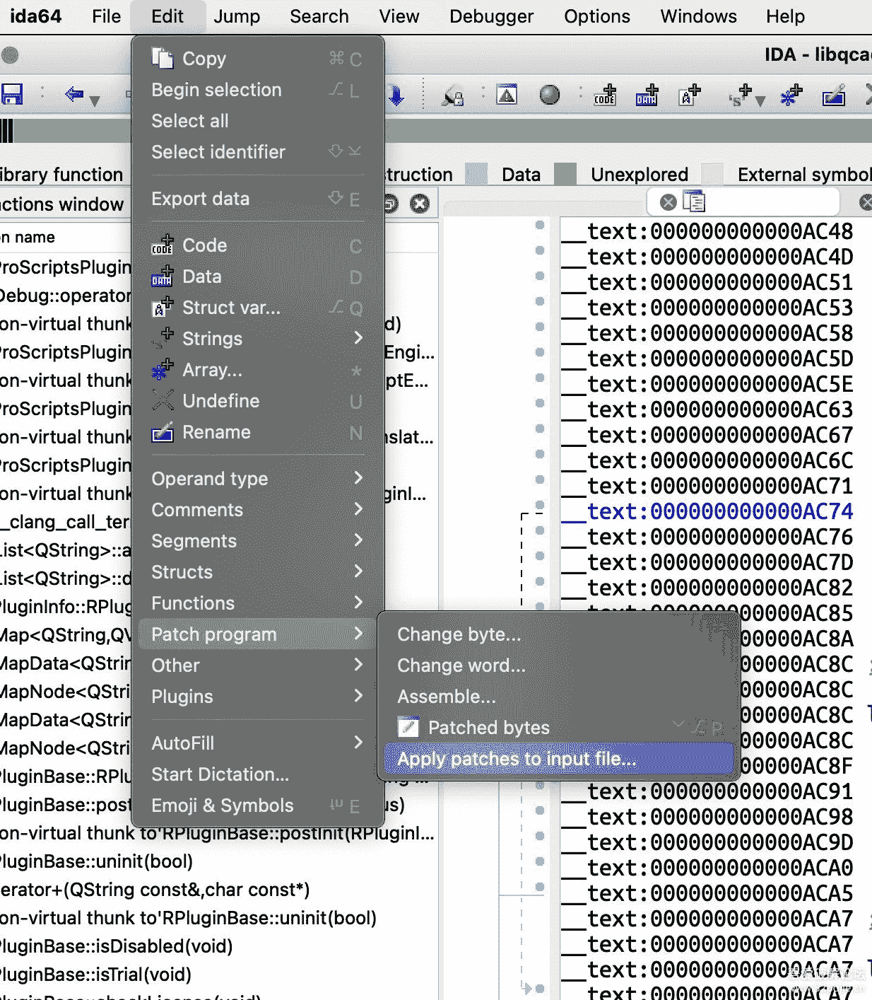

16983299893705.jpg (405.99 KB, 下载次数: 1)

[href="forum.php?mod=attachment&aid=MjY1MTkwOXw2ZjUyMGViNnwxNzkzNTczMDQ1fDE2ODA4NnwxODQ5MTcy&nothumb=yes" target="_blank"](https://www.52pojie.cn/forum.php?mod=attachment&aid=MjY1MTkwOXw2ZjUyMGViNnwxNzkzNTczMDQ1fDE2ODA4NnwxODQ5MTcy&nothumb=yes)

2023-10-26 23:24 上传

却说那落叶狂喜道：“找到你了！”操作法器`ida`狠狠的向`QCAD`攻去！

`QCAD`惨叫一声，怒吼：“你敢伤我！我今日必将你碎尸万段！”

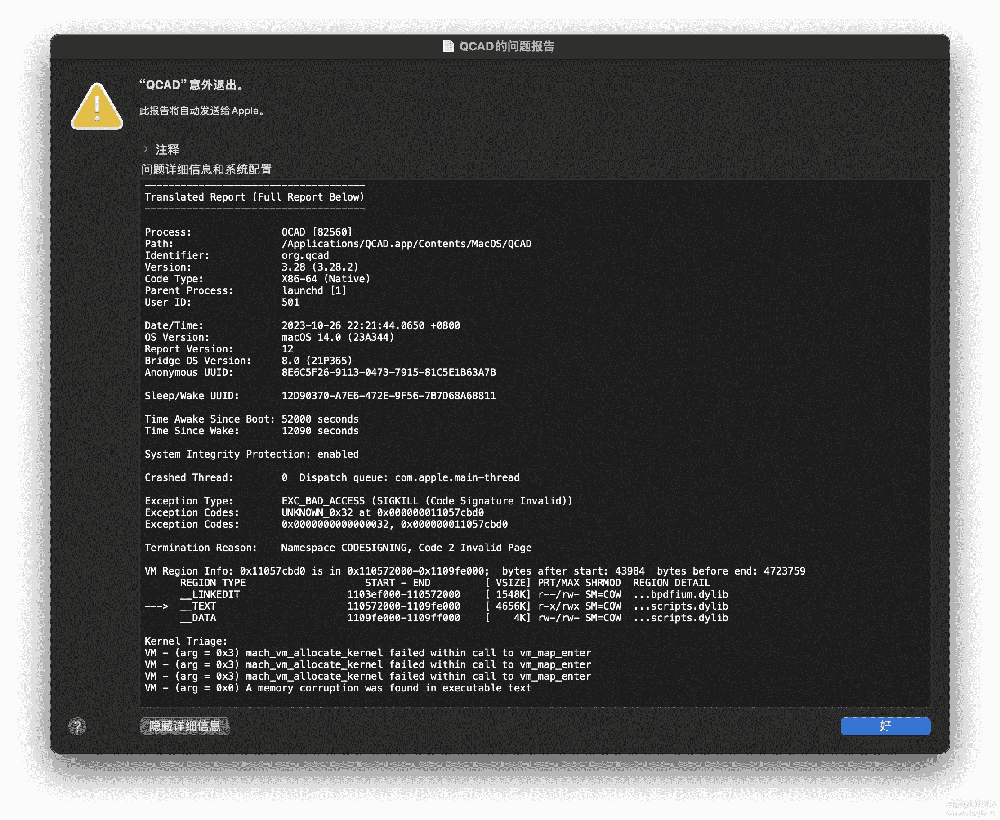

16983301189358.jpg (355.97 KB, 下载次数: 2)

[href="forum.php?mod=attachment&aid=MjY1MTkxMHwwMmViZDgzYnwxNzkzNTczMDQ1fDE2ODA4NnwxODQ5MTcy&nothumb=yes" target="_blank"](https://www.52pojie.cn/forum.php?mod=attachment&aid=MjY1MTkxMHwwMmViZDgzYnwxNzkzNTczMDQ1fDE2ODA4NnwxODQ5MTcy&nothumb=yes)

2023-10-26 23:24 上传

没想到此时又生事端，那签名没有通过，落叶情急之下确实连这等基础操作也忘了，连忙补上：


16983301908011.jpg (67.59 KB, 下载次数: 4)

[href="forum.php?mod=attachment&aid=MjY1MTkxMXw3NzQ5YWE0MnwxNzkzNTczMDQ1fDE2ODA4NnwxODQ5MTcy&nothumb=yes" target="_blank"](https://www.52pojie.cn/forum.php?mod=attachment&aid=MjY1MTkxMXw3NzQ5YWE0MnwxNzkzNTczMDQ1fDE2ODA4NnwxODQ5MTcy&nothumb=yes)

2023-10-26 23:24 上传

重新打开`QCAD`：

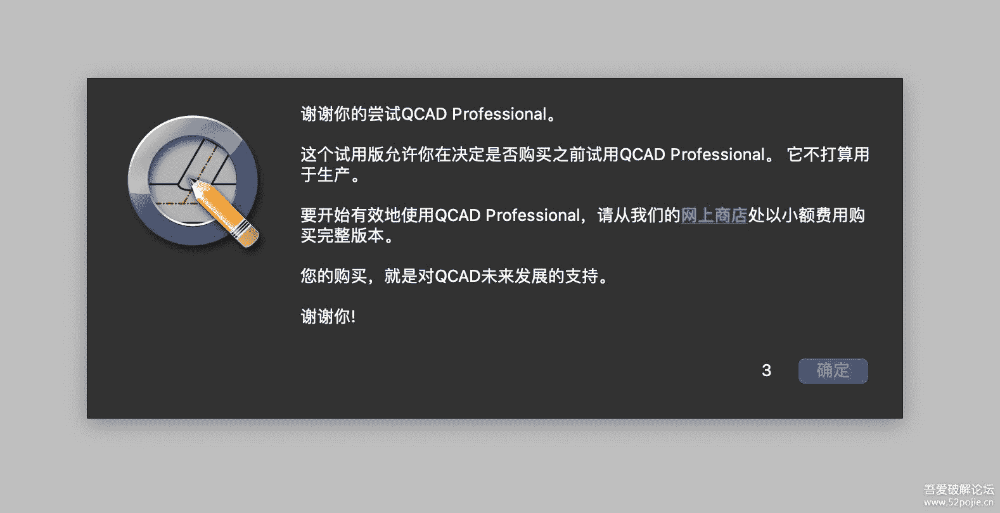

16983302268754.jpg (83.77 KB, 下载次数: 2)

[href="forum.php?mod=attachment&aid=MjY1MTkxMnwxZWE5ZDYxYXwxNzkzNTczMDQ1fDE2ODA4NnwxODQ5MTcy&nothumb=yes" target="_blank"](https://www.52pojie.cn/forum.php?mod=attachment&aid=MjY1MTkxMnwxZWE5ZDYxYXwxNzkzNTczMDQ1fDE2ODA4NnwxODQ5MTcy&nothumb=yes)

2023-10-26 23:24 上传

还是这样，但至少能打开了。

刚才修改的是一个插件，所以我们看下关于：

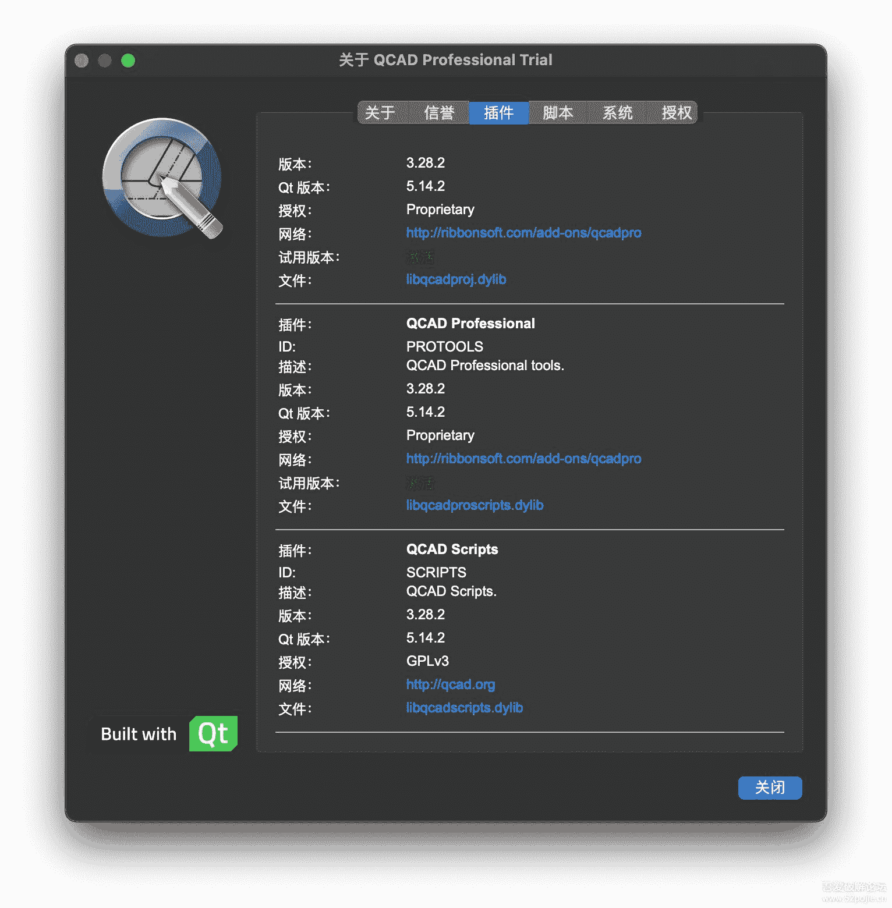

16983304372535.jpg (165.16 KB, 下载次数: 2)

[href="forum.php?mod=attachment&aid=MjY1MTkxM3wxNjhjZDFiY3wxNzkzNTczMDQ1fDE2ODA4NnwxODQ5MTcy&nothumb=yes" target="_blank"](https://www.52pojie.cn/forum.php?mod=attachment&aid=MjY1MTkxM3wxNjhjZDFiY3wxNzkzNTczMDQ1fDE2ODA4NnwxODQ5MTcy&nothumb=yes)

2023-10-26 23:24 上传

可以看到还是试用版本，落叶满脸自信最终被打脸，这让要脸的魔子如何忍受？当即两眼发红，恶声道：“老贼，受死！”

当即也不恋战，看到这里：

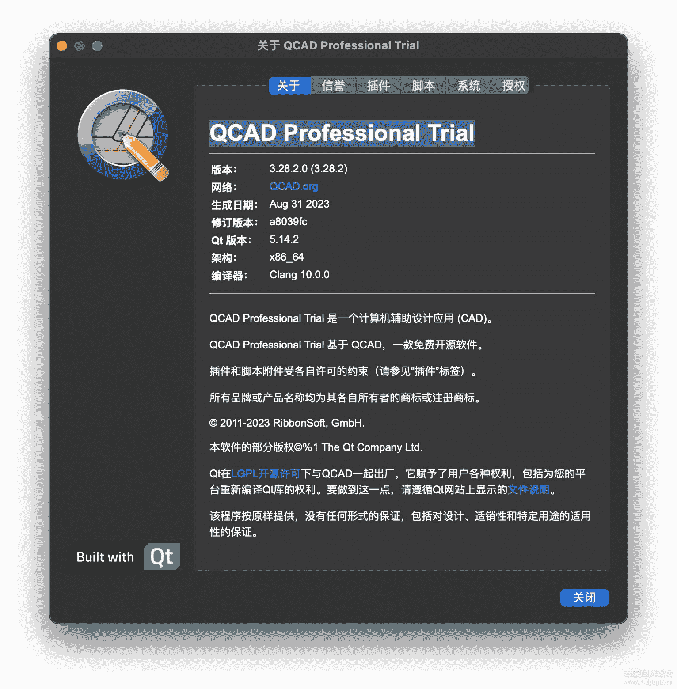

16983305385490.jpg (210.28 KB, 下载次数: 3)

[href="forum.php?mod=attachment&aid=MjY1MTkxNHxjNDRkMDU0YnwxNzkzNTczMDQ1fDE2ODA4NnwxODQ5MTcy&nothumb=yes" target="_blank"](https://www.52pojie.cn/forum.php?mod=attachment&aid=MjY1MTkxNHxjNDRkMDU0YnwxNzkzNTczMDQ1fDE2ODA4NnwxODQ5MTcy&nothumb=yes)

2023-10-26 23:24 上传

大大的`Trial`赫然在目。

这次，我看你怎么躲！落叶默默冷笑。

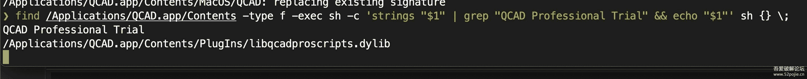

16983305992071.jpg (102.84 KB, 下载次数: 3)

[href="forum.php?mod=attachment&aid=MjY1MTkxNXwzNDJjYWZkMnwxNzkzNTczMDQ1fDE2ODA4NnwxODQ5MTcy&nothumb=yes" target="_blank"](https://www.52pojie.cn/forum.php?mod=attachment&aid=MjY1MTkxNXwzNDJjYWZkMnwxNzkzNTczMDQ1fDE2ODA4NnwxODQ5MTcy&nothumb=yes)

2023-10-26 23:24 上传

重新暴力搜索，发现仍然在这个文件内，当即冷笑道：“老贼，我已找到你的弱点，你乖乖引颈就戮吧！”

说完顾不得`QCAD`的狂骂，回到`IDA`迅速搜索：

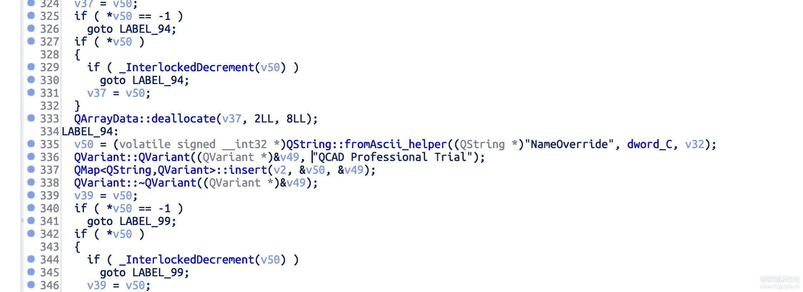

16983307494311.jpg (174.38 KB, 下载次数: 2)

[href="forum.php?mod=attachment&aid=MjY1MTkxNnxmNjQ5ZTc4YXwxNzkzNTczMDQ1fDE2ODA4NnwxODQ5MTcy&nothumb=yes" target="_blank"](https://www.52pojie.cn/forum.php?mod=attachment&aid=MjY1MTkxNnxmNjQ5ZTc4YXwxNzkzNTczMDQ1fDE2ODA4NnwxODQ5MTcy&nothumb=yes)

2023-10-26 23:24 上传

果然搜索到了！

进一步看：

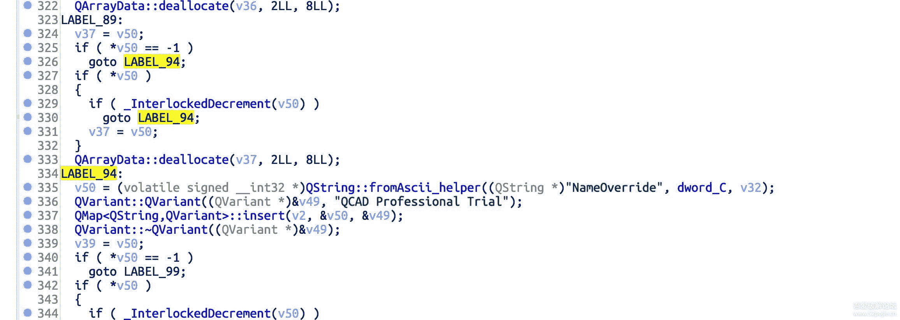

16983308818348.jpg (185.32 KB, 下载次数: 0)

[href="forum.php?mod=attachment&aid=MjY1MTkxN3w0ODRkM2M2NXwxNzkzNTczMDQ1fDE2ODA4NnwxODQ5MTcy&nothumb=yes" target="_blank"](https://www.52pojie.cn/forum.php?mod=attachment&aid=MjY1MTkxN3w0ODRkM2M2NXwxNzkzNTczMDQ1fDE2ODA4NnwxODQ5MTcy&nothumb=yes)

2023-10-26 23:24 上传

`LABEL94`来自`LABLE89`，89来自`LABEL_79`...一路溯源到：`LABEL_56`。

```
LABEL_56:
  if ( !(unsigned __int8)RPluginBase::isTrial((RPluginBase *)a2) )
  {
    v50 = (volatile signed __int32 *)QString::fromAscii_helper((QString *)"NameOverride", dword_C, v25);
    QVariant::QVariant((QVariant *)&v49, "QCAD Professional");
    QMap::insert(v2, &v50, &v49);
    goto LABEL_107;
  }
  v50 = (volatile signed __int32 *)QString::fromAscii_helper((QString *)"TrialExpiredReason", &dword_10[2], v25);
  QVariant::QVariant((QVariant *)&v49, (const QString *)(a2 + 48));
  QMap::insert(v2, &v50, &v49);
  QVariant::~QVariant((QVariant *)&v49);
  v27 = v50;
  if ( *v50 != -1 )
  {
    if ( *v50 )
    {
      if ( _InterlockedDecrement(v50) )
        goto LABEL_62;
      v27 = v50;
    }
    QArrayData::deallocate(v27, 2LL, 8LL);
  }
LABEL_62:
  v50 = (volatile signed __int32 *)QString::fromAscii_helper((QString *)"TrialExpired", dword_C, v26);
  QVariant::QVariant((QVariant *)&v49, a2[41]);
  QMap::insert(v2, &v50, &v49);
  QVariant::~QVariant((QVariant *)&v49);
  v29 = v50;
  if ( *v50 == -1 )
    goto LABEL_67;
。。。省略
LABEL_74:
  v34 = v47;
  if ( *v47 == -1 )
    goto LABEL_79;
  if ( *v47 )
  {
    if ( _InterlockedDecrement(v47) )
      goto LABEL_79;
    v34 = v47;
  }
  QArrayData::deallocate(v34, 2LL, 8LL);
LABEL_79:
  v35 = v45;
  if ( *v45 == -1 )
    goto LABEL_84;
  if ( *v45 )
  {
    if ( _InterlockedDecrement(v45) )
      goto LABEL_84;
    v35 = v45;
  }
  QArrayData::deallocate(v35, 2LL, 8LL);
LABEL_84:
  v36 = v46;
  if ( *v46 == -1 )
    goto LABEL_89;
  if ( *v46 )
  {
    if ( _InterlockedDecrement(v46) )
      goto LABEL_89;
    v36 = v46;
  }
  QArrayData::deallocate(v36, 2LL, 8LL);
LABEL_89:
```

终于找到！

```
if ( !(unsigned __int8)RPluginBase::isTrial((RPluginBase *)a2) )
{
    v50 = (volatile signed __int32 *)QString::fromAscii_helper((QString *)"NameOverride", dword_C, v25);
    QVariant::QVariant((QVariant *)&v49, "QCAD Professional");
    QMap::insert(v2, &v50, &v49);
    goto LABEL_107;
}
```

如果`RPluginBase::isTrial`返回0就是专业版，否则就是试用版。

此番终于找到重点，落叶狂笑道：“老狗，你死期已至也！”

那`QCAD`被人发现要害，终于变了脸色，口气也软了三分：“放过老儿，我可以保你无恙走出这里！”

落叶闻言冷笑道：“三年...你知道这三年我怎么过的吗？走出？我就是来复仇的！”

大魔导师的气势此时终于完全散发出来，强大的威压让璃月大陆上的智慧生灵纷纷跪下祈祷，不知又是哪位法神震怒。

当下落叶也不啰嗦，进入`isTrial`函数，将下面的语句强制返回0:


```
bool __fastcall RPluginBase::isTrial(RPluginBase *this)
{
  return *((_BYTE *)this + 40) == 0;
}
```

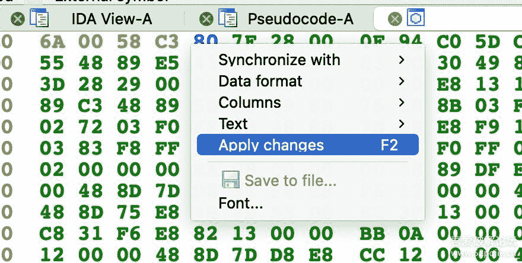
[附件下载](https://www.52pojie.cn/forum.php?mod=attachment&aid=MjY1MTkxOHxjMTE2YzM4OXwxNzkzNTczMDQ1fDE2ODA4NnwxODQ5MTcy&nothumb=yes) `16983314609989.jpg` (106.37 KB, 下载次数: 3) 2023-10-26 23:24 上传

将这个函数头开始直接覆盖为 `6a 00 58 c3`，保存修改到文件，重新运行试试：

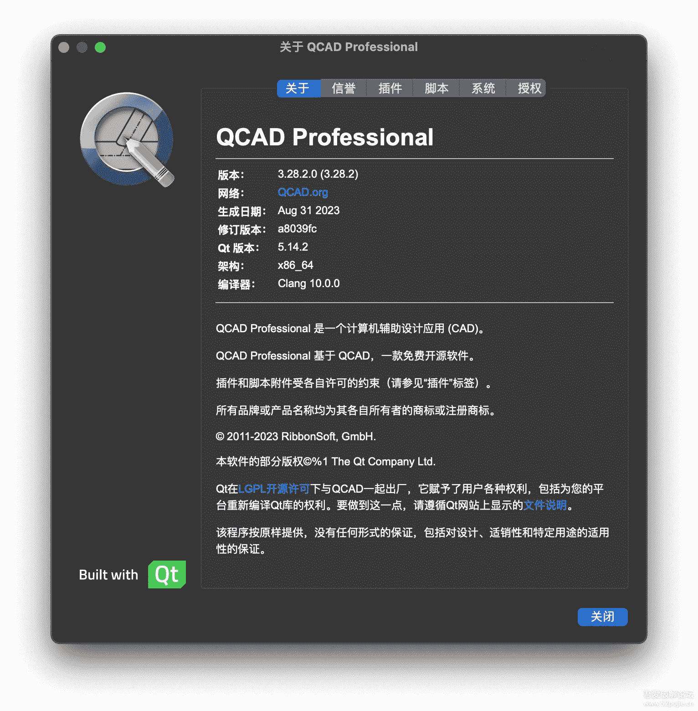
[附件下载](https://www.52pojie.cn/forum.php?mod=attachment&aid=MjY1MTkxOXxjMzM2YzQ0MnwxNzkzNTczMDQ1fDE2ODA4NnwxODQ5MTcy&nothumb=yes) `16983315510926.jpg` (205.27 KB, 下载次数: 1) 2023-10-26 23:24 上传

神奇的一幕出现了，虽然还有激活弹窗，但是这里已经成功授权！

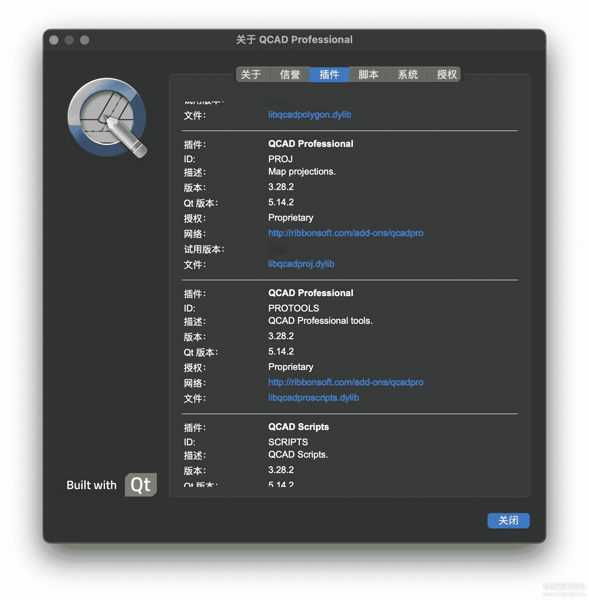
[附件下载](https://www.52pojie.cn/forum.php?mod=attachment&aid=MjY1MTkyMHw3NjY0NGU4YnwxNzkzNTczMDQ1fDE2ODA4NnwxODQ5MTcy&nothumb=yes) `16983315832529.jpg` (165.56 KB, 下载次数: 1) 2023-10-26 23:24 上传

包括这里也变成了授权状态，和上面的试用版本截然不同！

于是，落叶记住了两个函数：`checkLicense` 和 `isTrial`，让其他的文件中的这两个函数也统统消失吧！

对照

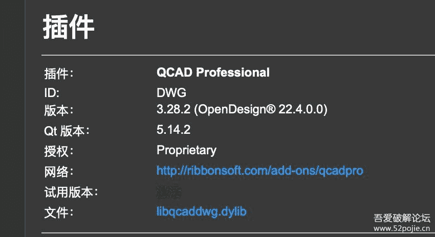
[附件下载](https://www.52pojie.cn/forum.php?mod=attachment&aid=MjY1MTkyMXwxMzNlYzJiYXwxNzkzNTczMDQ1fDE2ODA4NnwxODQ5MTcy&nothumb=yes) `16983316875164.jpg` (39.14 KB, 下载次数: 1) 2023-10-26 23:24 上传

有激活字样的文件名，一一修改这里不再赘述。

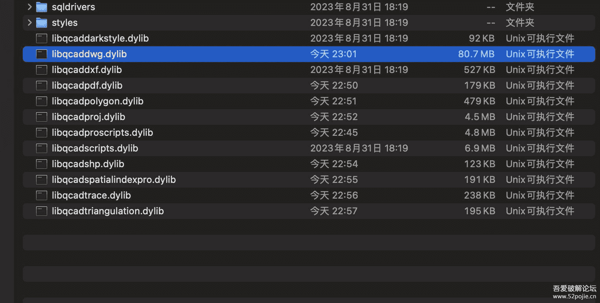
[附件下载](https://www.52pojie.cn/forum.php?mod=attachment&aid=MjY1MTkyMnxjNGY3M2IwYXwxNzkzNTczMDQ1fDE2ODA4NnwxODQ5MTcy&nothumb=yes) `16983325262561.jpg` (148.16 KB, 下载次数: 3) 2023-10-26 23:24 上传

总共需要修改这 9 个文件，同样的 `checkLicense` 强制：

```
mov     ebx, 0Ah
nop
```

`isTrial` 变成 `6a 00 58 c3`。

却说那奄奄一息的 QCAD 看着缓缓走来的魔子落叶，惊恐道：“不...！不能杀我！我背后的迦南世家不会放过你的！”

落叶毫无反应，淡漠的看着挣扎的 QCAD 冷冷道：“三年前，曾经你们迦南家族从我手里抢走的，我要亲手一步步夺回来！”

目光如电，看向迦南二世隐匿的方向，迦南二世心头一惊，连忙低喝道：“发现我们了，快走！此子绝不是区区魔导师实力！暂且避其锋芒！”

临走前仇恨的看着魔子落叶：“早晚要除掉你这个孽障！”，一咬牙，化为一阵青烟遁走。

落叶看着求饶的 QCAD，一脚踏下，只听得喀喳一声，世间一片寂静，再无声响。

重新打开 QCAD 看下：

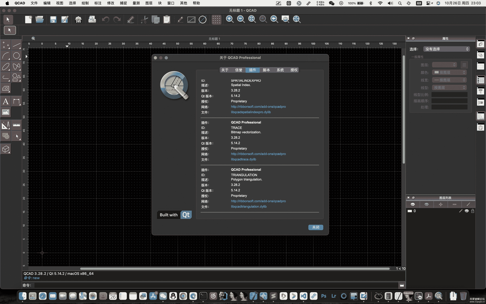
[附件下载](https://www.52pojie.cn/forum.php?mod=attachment&aid=MjY1MTkyM3w4NTE1YmQwY3wxNzkzNTczMDQ1fDE2ODA4NnwxODQ5MTcy&nothumb=yes) `16983326261295.jpg` (783.12 KB, 下载次数: 3) 2023-10-26 23:24 上传

成了激活所有功能，导出 pdf 也没有水印，弹窗也没有了，非常完美。

## 3. 结束

这篇教程不涉及到 `LLDB` / 补丁注入破解，尽管我是 `lldb` + 注入 `hook` 一路调试过来的，本篇教程仅用于给 X1a0He 同学以及其他同学用于入门逆向学习用，所以讲的非常精炼，省略了很多繁杂的步骤。

最后留了一个 30 分钟强制关闭的漏洞，请各位同学根据上面的思路自己处理掉吧！

## 4. `LLDB` 解决破解不完全依然提示弹框

我们 `lldb /Applications/QCAD.app/Contents/MacOS/QCAD` 启动后，可以看到：

```
23:46:18: Debug:    loading plugins...
23:46:19: Debug:    RDwgPlugin::init: trial
23:46:19: Debug:    RProScriptsPlugin::init: trial
23:46:20: Debug:    RTracePlugin::init: trial
23:46:20: Debug:    loading static plugins...
Warning:  Populating font family aliases took 632 ms. Replace uses of missing font family "Sans" with one that exists to avoid this cost.
Warning:  Cannot read file ':/scripts/Pro/Block/CreateLibraryItem/CreateLibraryItem-inverse.svg', because: Expected '?', '!', or '[a-zA-Z]', but got '
```

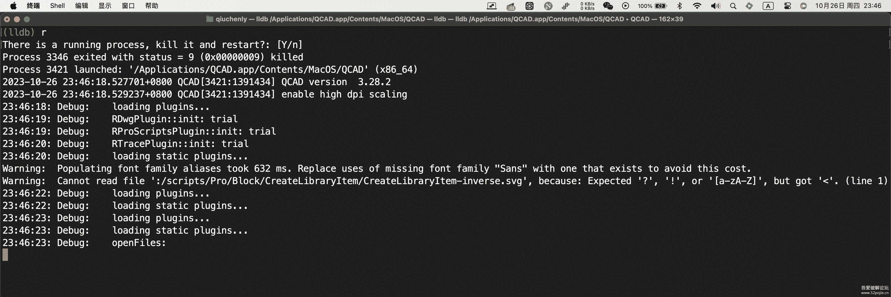
[附件下载](https://www.52pojie.cn/forum.php?mod=attachment&aid=MjY1MTkyNnwxMjNjZDgyMHwxNzkzNTczMDQ1fDE2ODA4NnwxODQ5MTcy&nothumb=yes) `16983352372312.jpg` (392.58 KB, 下载次数: 1) 2023-10-26 23:59 上传

这三个依然是 `trial` 阶段，所以我们要 `patch` 掉：

```
RDwgPlugin::init: trial
RProScriptsPlugin::init: trial
RTracePlugin::init: trial
```

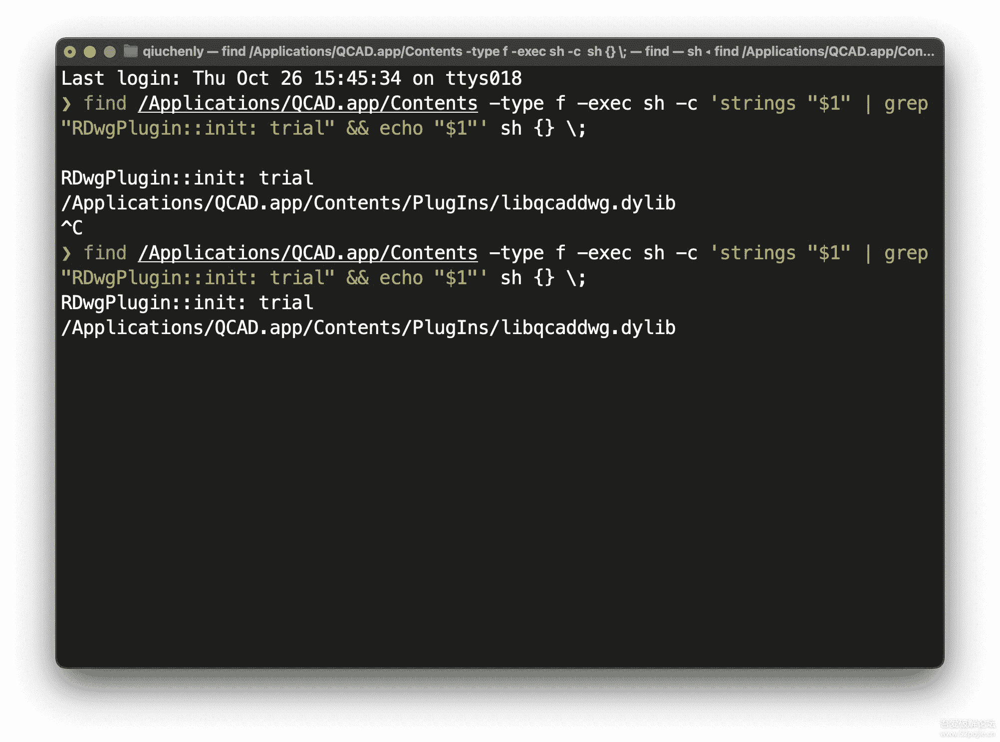
[附件下载](https://www.52pojie.cn/forum.php?mod=attachment&aid=MjY1MTkyN3xiZjA4YzMwZXwxNzkzNTczMDQ1fDE2ODA4NnwxODQ5MTcy&nothumb=yes) `16983354154562.jpg` (222.61 KB, 下载次数: 0) 2023-10-26 23:59 上传

可以看到结果是这样子，所以我们 `ida` 打开这个文件直接搜：

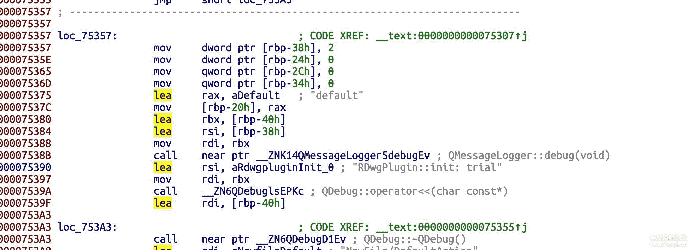
[附件下载](https://www.52pojie.cn/forum.php?mod=attachment&aid=MjY1MTkyOHxjODlhZDk3MXwxNzkzNTczMDQ1fDE2ODA4NnwxODQ5MTcy&nothumb=yes) `16983354801911.jpg` (223.86 KB, 下载次数: 2) 2023-10-26 23:59 上传

可以看到这里存在字符串

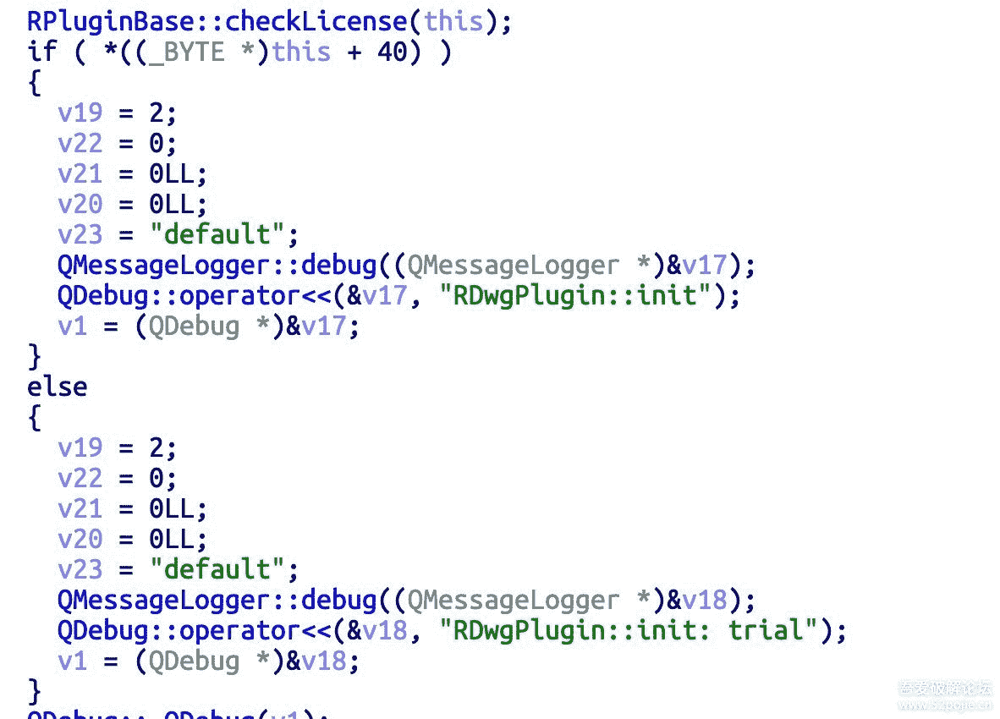
[附件下载](https://www.52pojie.cn/forum.php?mod=attachment&aid=MjY1MTkyOXxkNjFjOGQzZXwxNzkzNTczMDQ1fDE2ODA4NnwxODQ5MTcy&nothumb=yes) `16983356494770.jpg` (113.71 KB, 下载次数: 4) 2023-10-26 23:59 上传

仔细一看，这里 `checkLicense` 里面的修改根本没起作用，那么我们只好暴力点，直接全部强制条转：

我们将其 `jz` 跳转改为 `nop` 即可：

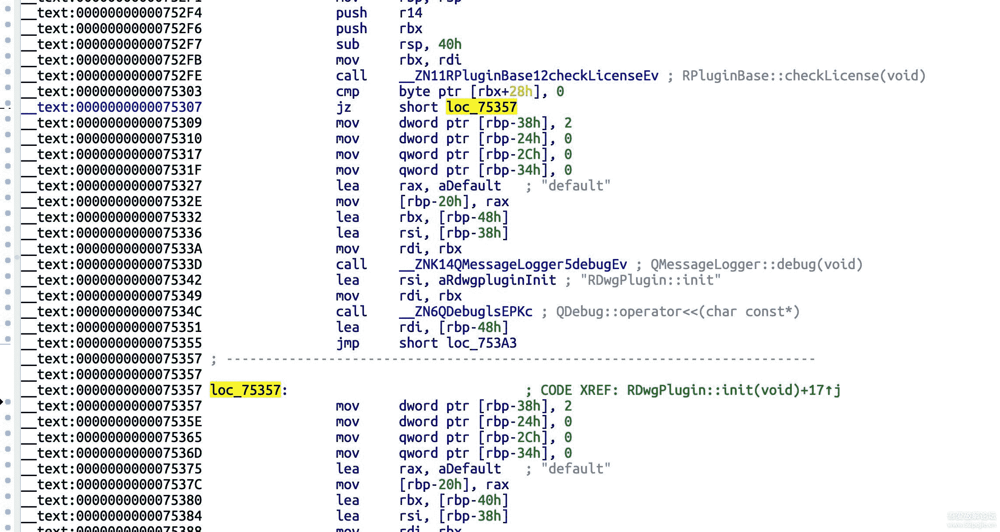
[附件下载](https://www.52pojie.cn/forum.php?mod=attachment&aid=MjY1MTkzMHxkODQ0NTA2M3wxNzkzNTczMDQ1fDE2ODA4NnwxODQ5MTcy&nothumb=yes) `16983357647038.jpg` (450.22 KB, 下载次数: 2) 2023-10-26 23:59 上传

改后：

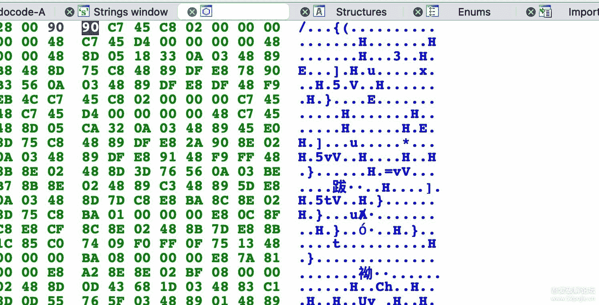
[附件下载](https://www.52pojie.cn/forum.php?mod=attachment&aid=MjY1MTkzMXxmMDFjNzRmZnwxNzkzNTczMDQ1fDE2ODA4NnwxODQ5MTcy&nothumb=yes) `16983358029671.jpg` (258.24 KB, 下载次数: 3) 2023-10-26 23:59 上传

把指令所在位置强制改为 `9090`，即可 `nop`。

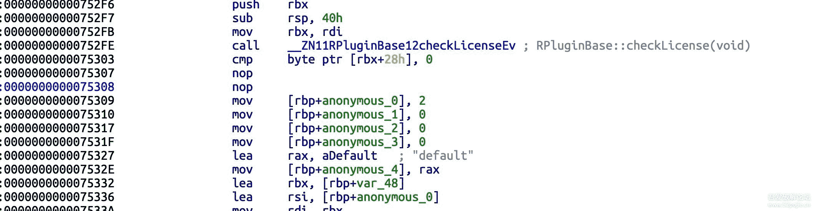
[附件下载](https://www.52pojie.cn/forum.php?mod=attachment&aid=MjY1MTkzMnwwOWU2MDZjMHwxNzkzNTczMDQ1fDE2ODA4NnwxODQ5MTcy&nothumb=yes) `16983358273253.jpg` (174.95 KB, 下载次数: 1) 2023-10-26 23:59 上传

保存到文件，启动：

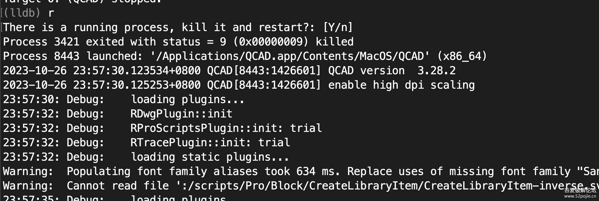
[附件下载](https://www.52pojie.cn/forum.php?mod=attachment&aid=MjY1MTkzM3w5YTI2YWM3YXwxNzkzNTczMDQ1fDE2ODA4NnwxODQ5MTcy&nothumb=yes) `16983358701809.jpg` (233.41 KB, 下载次数: 1) 2023-10-26 23:59 上传

成功解决第一个，那么第二个第三个我就不多说了，大家去试试吧！

注入库补丁开源地址：

[https://github.com/QiuChenlyOpenSource](https://github.com/QiuChenlyOpenSource)

注入补丁参考项目：

[https://github.com/QiuChenlyOpenSource/InjectLib](https://github.com/QiuChenlyOpenSource/InjectLib)
