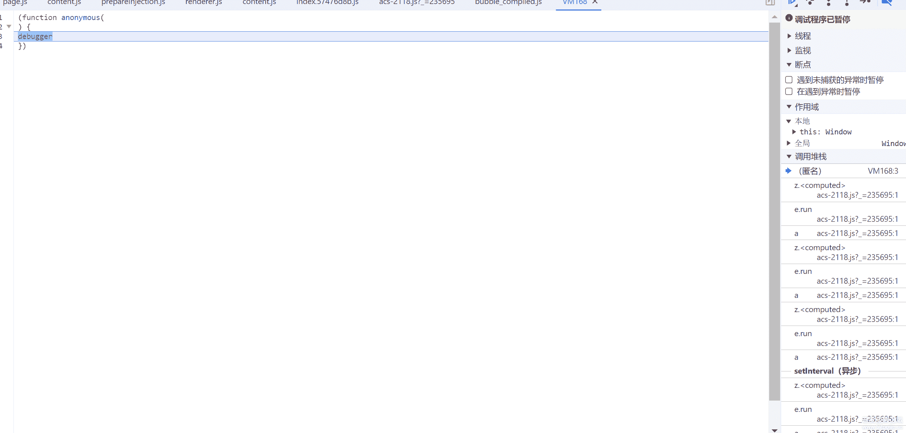
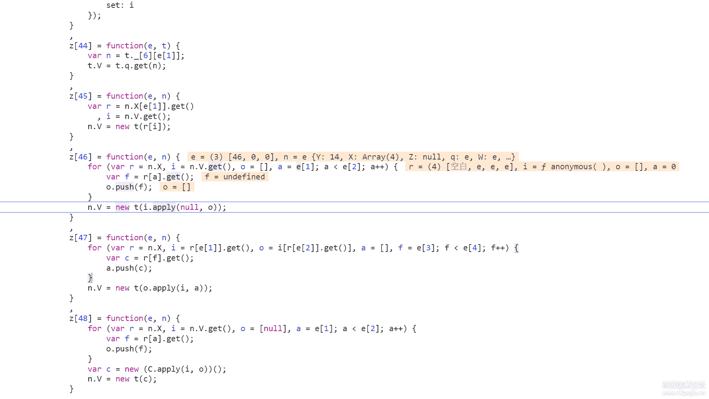
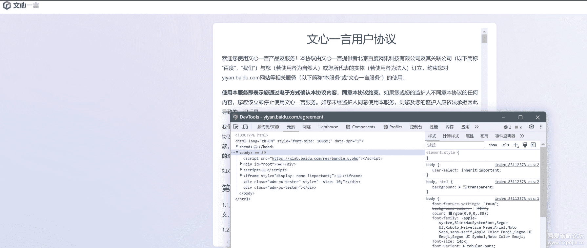

# [Web逆向] 文心一言开发者控制台调试破解

- 原帖：[原帖](https://www.52pojie.cn/forum.php?mod=viewthread&tid=1851890)
- 抓取时间：2026-11-01T22:43:58

## 调试分析

一打开标准的无限 `debugger`。



`144828zqci5av7n9v5f70k.png` (152.2 KB, 下载次数: 4)

[附件](https://www.52pojie.cn/forum.php?mod=attachment&aid=MjY1MzI0MXw3NGY5NDk1MXwxNzkzNTczMDM2fDE2ODA4NnwxODUxODkw&nothumb=yes)

2023-11-2 16:54 上传

往上一层可以发现是 `jsvmp`，这样替换文件相对来说就不太好搞。



`144842p1tp0a4fp4geg1op.png` (141.32 KB, 下载次数: 3)

[附件](https://www.52pojie.cn/forum.php?mod=attachment&aid=MjY1MzI0MnxmYTMzNGU0Y3wxNzkzNTczMDM2fDE2ODA4NnwxODUxODkw&nothumb=yes)

2023-11-2 16:54 上传

根据测试，如果卡在 `debugger` 就会跳转页面；但是放行 `debugger` 就可以正常使用。可以基本确定 `debugger` 前后存在计时程序，这个时候就可以考虑对 `apply` 做 `hook` 劫持无限 `debugger` 的函数，实现正常调试。

## Hook 脚本

JavaScript 代码：

```javascript
// ==UserScript==
// @name         WXYY Crack Debugger
// @namespace    http://tampermonkey.net/
// @version      0.1.0
// @description  try to take over the world!
// @author       You
// @match        https://yiyan.baidu.com/*
// ==/UserScript==
const apply = Function.prototype.apply
Function.prototype.apply = function (thisArg, argsArray=[]) {
    if(this.toString()==='function anonymous(\n) {\ndebugger\n}'){
        return
    }
    return this.call(thisArg, ...argsArray)
}
```



`图片.png` (590.75 KB, 下载次数: 3)

[附件](https://www.52pojie.cn/forum.php?mod=attachment&aid=MjY1MzI1MHwzNGE3OTNhZnwxNzkzNTczMDM2fDE2ODA4NnwxODUxODkw&nothumb=yes)

2023-11-2 17:07 上传
