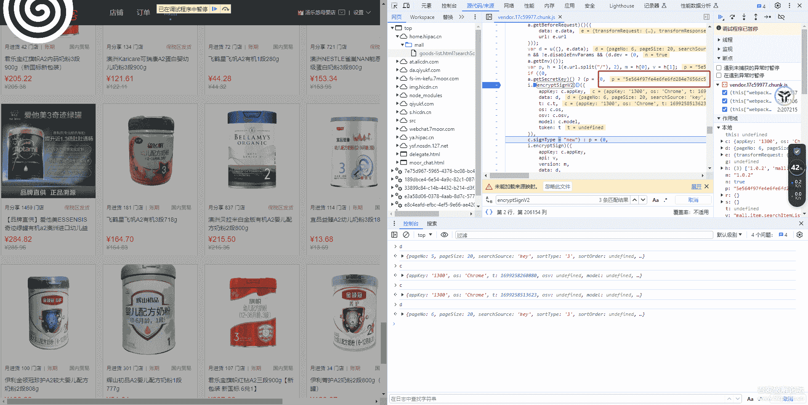
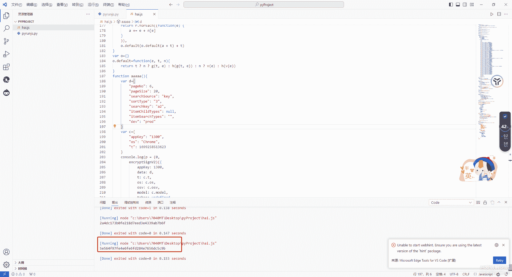

# [Web逆向] 记一次海拍客母婴平台`sign`逆向js分析

- 原帖: https://www.52pojie.cn/forum.php?mod=viewthread&tid=1853640
- 抓取时间: 2026-11-01T22:43:37



微信图片_20231107094935.png (585.05 KB, 下载次数: 1)

[href="forum.php?mod=attachment&aid=MjY1NDE5MnxlMTE4Zjc0MnwxNzkzNTczMDE1fDE2ODA4NnwxODUzNjQw&nothumb=yes" target="_blank"](https://www.52pojie.cn/forum.php?mod=attachment&aid=MjY1NDE5MnxlMTE4Zjc0MnwxNzkzNTczMDE1fDE2ODA4NnwxODUzNjQw&nothumb=yes)

2023-11-7 09:51 上传



微信图片_20231107094945.png (198.61 KB, 下载次数: 0)

[href="forum.php?mod=attachment&aid=MjY1NDE5M3xkNmM5YmMxY3wxNzkzNTczMDE1fDE2ODA4NnwxODUzNjQw&nothumb=yes" target="_blank"](https://www.52pojie.cn/forum.php?mod=attachment&aid=MjY1NDE5M3xkNmM5YmMxY3wxNzkzNTczMDE1fDE2ODA4NnwxODUzNjQw&nothumb=yes)

2023-11-7 09:51 上传

[CSS] 纯文本查看 复制代码

```
function a(e, t) {
    var n = (65535 & e) + (65535 & t);
    return (e >> 16) + (t >> 16) + (n >> 16) >> 32 - c, n);
    var l, c
}
function l(e, t, n, r, o, a, l) {
    return i(t & n | ~t & r, e, t, o, a, l)
}
function c(e, t, n, r, o, a, l) {
    return i(t & r | n & ~r, e, t, o, a, l)
}
function u(e, t, n, r, o, a, l) {
    return i(t ^ n ^ r, e, t, o, a, l)
}
function s(e, t, n, r, o, a, l) {
    return i(n ^ (t | ~r), e, t, o, a, l)
}
function f(e, t) {
    var n, r, o, i, f;
    e[t >> 5] |= 128 >> 9 > 5] >>> t % 32 & 255);
    return n
}
function p(e) {
    var t, n = [];
    for (n[(e.length >> 2) - 1] = void 0,
        t = 0; t > 5] |= (255 & e.charCodeAt(t / 8)) >> 4 & 15) + r.charAt(15 & t);
    return o
}
function m(e) {
    return unescape(encodeURIComponent(e))
}
function v(e) {
    return function (e) {
        return d(f(p(e), 8 * e.length))
    }(m(e))
}
function g(e, t) {
    return function (e, t) {
        var n, r, o = p(e), a = [], i = [];
        for (a[15] = i[15] = void 0,
            o.length > 16 && (o = f(o, 8 * e.length)),
            n = 0; n < 16; n += 1)
            a[n] = 909522486 ^ o[n],
                i[n] = 1549556828 ^ o[n];
        return r = f(a.concat(p(t)), 512 + 8 * t.length),
            d(f(i.concat(r), 640))
    }(m(e), m(t))
}
function y(e, t, n) {
    return t ? n ? g(t, e) : h(g(t, e)) : n ? v(e) : h(v(e))
}
getSecretKey = function () {
    return "e54eecad4b2e7610637fed160679c948"
}
encryptSignV2 = function (e) {
    var t = e.appKey
        , n = e.data
        , r = e.t
        , o = e.os
        , l = e.token
        , c = (0,
            getSecretKey)();
    return (0,
        encrypt)({
            appKey: t,
            data: JSON.stringify(n),
            t: r,
            os: o,
            signType: "new",
            token: l
        }, c)
}
encrypt = function (e, t) {
    var n = JSON.parse(JSON.stringify(e));
    if (!t)
        throw Error("sign:secret \u5fc5\u9009");
    if (!n.t)
        throw Error("params.t \u5fc5\u9009");
    "object" === typeof n.data && (n.data = JSON.stringify(n.data));
    var r = Object.keys(n).sort()
        , a = "";
    return r.forEach((function (e) {
        a += e + n[e]
    }
    )),
        o.default(o.default(a + t) + t)
}
var o = {}
o.default = function (e, t, n) {
    return t ? n ? g(t, e) : h(g(t, e)) : n ? v(e) : h(v(e))
}
function aaaaa() {
    var d = {
        "pageNo": 6,
        "pageSize": 20,
        "searchSource": "key",
        "sortType": "3",
        "searchkey": "a2",
        "itemChildTypes": null,
        "itemSearchTypes": "",
        "dev": "prod"
    }
    var c = {
        "appKey": "1300",
        "os": "Chrome",
        "t": 1699258513623
    }
    console.log(p = (0,
        encryptSignV2)({
            appKey: c.appKey,
            data: d,
            t: c.t,
            os: c.os,
            osv: c.osv,
            model: c.model,
            token: undefined
        }))
}

```
