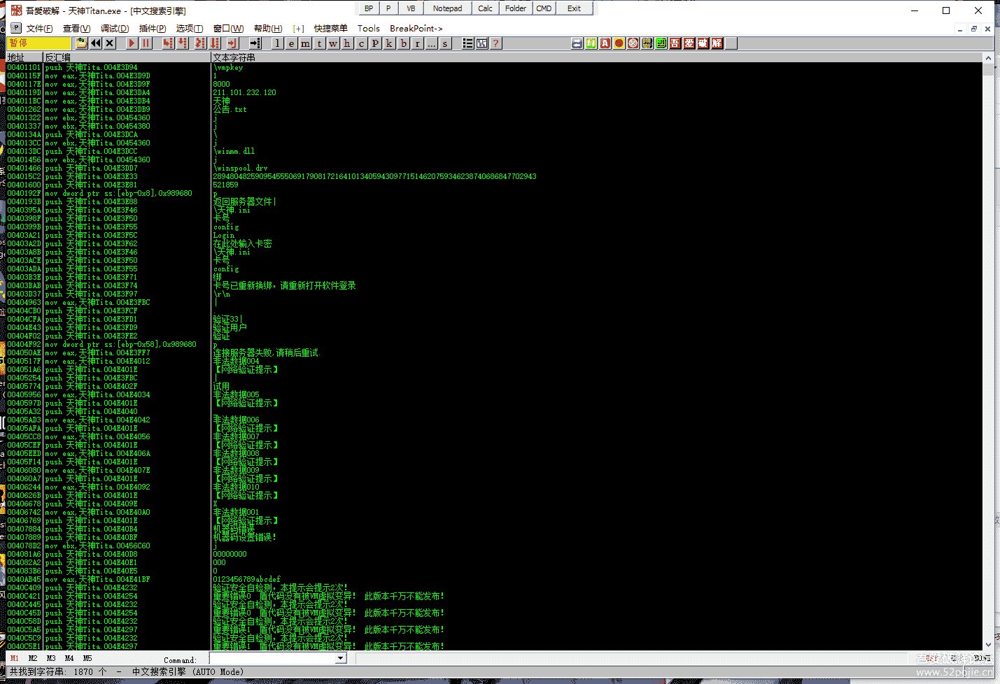
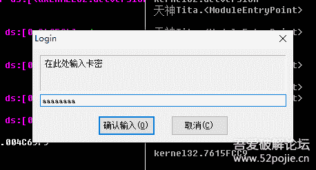
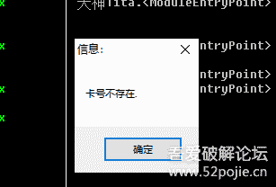
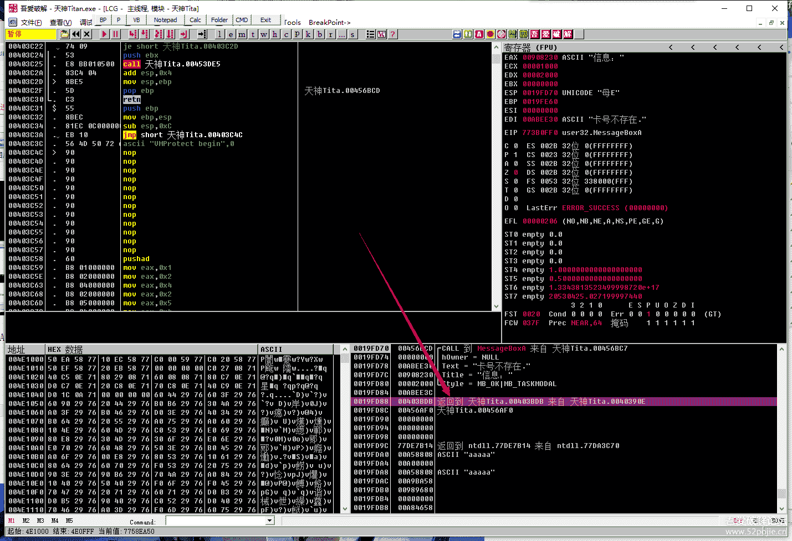
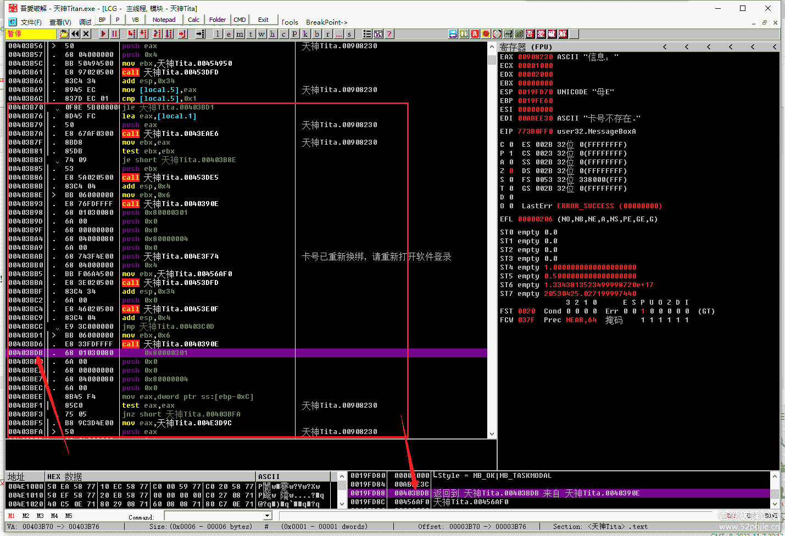
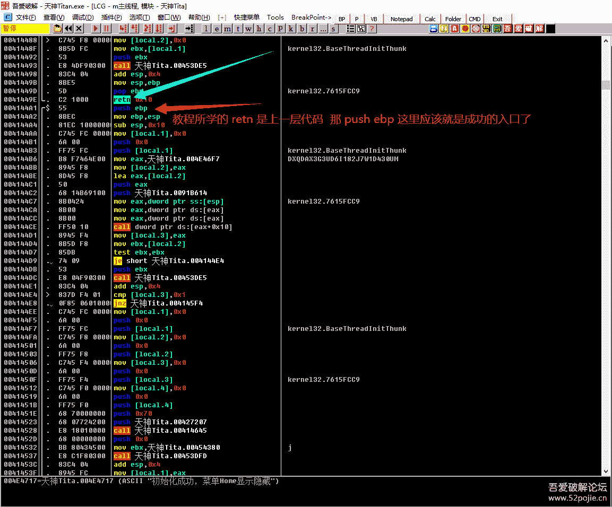
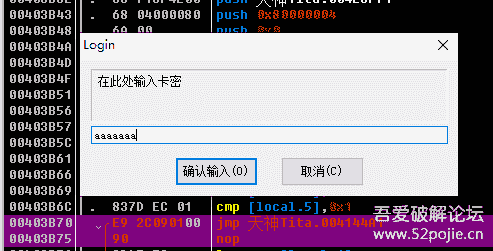
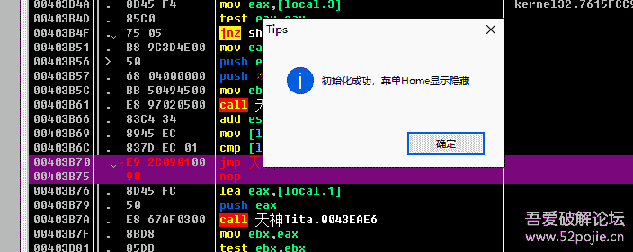
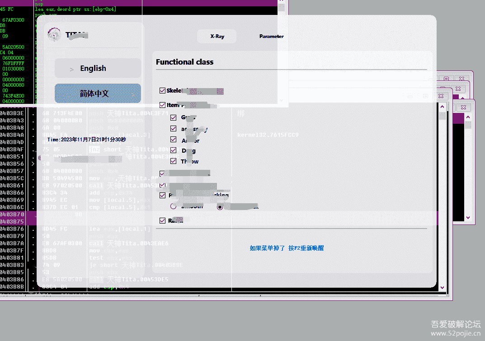

# [原创] 看了两天大佬写的玩玩破解教程破了某辅助！

## 帖子信息

- 原帖：<https://www.52pojie.cn/forum.php?mod=viewthread&tid=1853932>
- 抓取时间：2026-11-01T22:43:36

## 前言

首先还得感谢一下平台大佬！

看了两个天，然后就去某盟，随便下了个来试试。

很开心，有了成功感！！嘿嘿，本人小菜鸟。

学习原贴：<https://www.52pojie.cn/thread-1358649-1-1.html>

## 破解过程

某辅助智能搜索出来：

1.png (122.83 KB, 下载次数: 2)

[附件下载](https://www.52pojie.cn/forum.php?mod=attachment&aid=MjY1NDM3MHxlNzY5MWZiY3wxNzkzNTczMDEzfDE2ODA4NnwxODUzOTMy&nothumb=yes)

2023-11-7 20:21 上传

不知道是什么验证！

随便输入：

2.png (11.66 KB, 下载次数: 1)

[附件下载](https://www.52pojie.cn/forum.php?mod=attachment&aid=MjY1NDM3M3w3NDE3YmJkYnwxNzkzNTczMDEzfDE2ODA4NnwxODUzOTMy&nothumb=yes)

2023-11-7 20:26 上传

之后有一个信息框：

3.png (9.37 KB, 下载次数: 1)

[附件下载](https://www.52pojie.cn/forum.php?mod=attachment&aid=MjY1NDM3NHw4YjUyZGViYnwxNzkzNTczMDEzfDE2ODA4NnwxODUzOTMy&nothumb=yes)

2023-11-7 20:26 上传

智能搜索是查找不出来这个信息框内容！！

然后我就通过原贴大佬教学所学到的！`MessageBoxA` 断点大法！断下来了，可以看到堆载区的返回数据！

4.png (114.43 KB, 下载次数: 2)

[附件下载](https://www.52pojie.cn/forum.php?mod=attachment&aid=MjY1NDM3NXw2ZmM5YTM5MHwxNzkzNTczMDEzfDE2ODA4NnwxODUzOTMy&nothumb=yes)

2023-11-7 20:30 上传

之后返回到反汇编窗口，数据如下：

5.png (93 KB, 下载次数: 0)

[附件下载](https://www.52pojie.cn/forum.php?mod=attachment&aid=MjY1NDM3Nnw0ZmEzNzgyZHwxNzkzNTczMDEzfDE2ODA4NnwxODUzOTMy&nothumb=yes)

2023-11-7 20:34 上传

然后我就按照原贴大佬的教程把 `jle 天神tita.00403BD1` 给 `NOP` 掉，结果提示的是：

6.png (6.21 KB, 下载次数: 1)

[附件下载](https://www.52pojie.cn/forum.php?mod=attachment&aid=MjY1NDM3OHw2YmFlNzcyY3wxNzkzNTczMDEzfDE2ODA4NnwxODUzOTMy&nothumb=yes)

2023-11-7 20:40 上传

这段信息框，然后我就各种尝试，还是一样进不去！

之后我就翻智能搜索，找到了 `初始化成功` 的字符串，之后进入初始化成功的反汇编窗口：

9.png (72.01 KB, 下载次数: 2)

[附件下载](https://www.52pojie.cn/forum.php?mod=attachment&aid=MjY1NDM4MXw4ZDc3MmFhN3wxNzkzNTczMDEzfDE2ODA4NnwxODUzOTMy&nothumb=yes)

2023-11-7 20:47 上传

之后我就想：找到了 `jle 天神tita.00403BD1`，`NOP` 掉也进不去，我直接换了个思路，直接把 `jle 天神tita.00403BD1` 汇编成 `jmp 004144A1`。

`004144A1` 这个地址就是初始化成功的入口点把。之后：

10.png (15.69 KB, 下载次数: 1)

[附件下载](https://www.52pojie.cn/forum.php?mod=attachment&aid=MjY1NDM4MnwyYTU4ZjcyYXwxNzkzNTczMDEzfDE2ODA4NnwxODUzOTMy&nothumb=yes)

2023-11-7 20:55 上传

11.png (21.01 KB, 下载次数: 1)

[附件下载](https://www.52pojie.cn/forum.php?mod=attachment&aid=MjY1NDM4M3wwYjI1MmQwYnwxNzkzNTczMDEzfDE2ODA4NnwxODUzOTMy&nothumb=yes)

2023-11-7 20:55 上传

成了！！！！！！！

不知道这个操作可行不可行！！因为我也没有去测试这个某辅助有没有效果，但是成了后桌面有他的菜单。

12.png (59.34 KB, 下载次数: 2)

[附件下载](https://www.52pojie.cn/forum.php?mod=attachment&aid=MjY1NDM4NHxkMDdjYTc3MHwxNzkzNTczMDEzfDE2ODA4NnwxODUzOTMy&nothumb=yes)

2023-11-7 20:57 上传

## 结果与疑问

额........

我附带了原文件，有更好操作方法吗？这种情况！！！

pubg 天神 辅助
