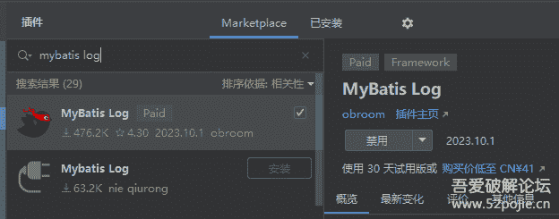
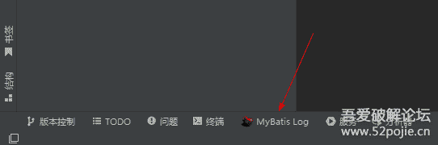
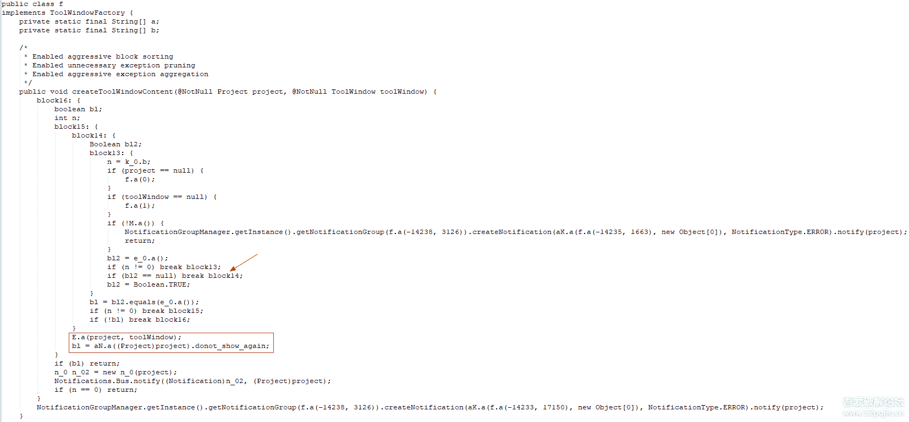
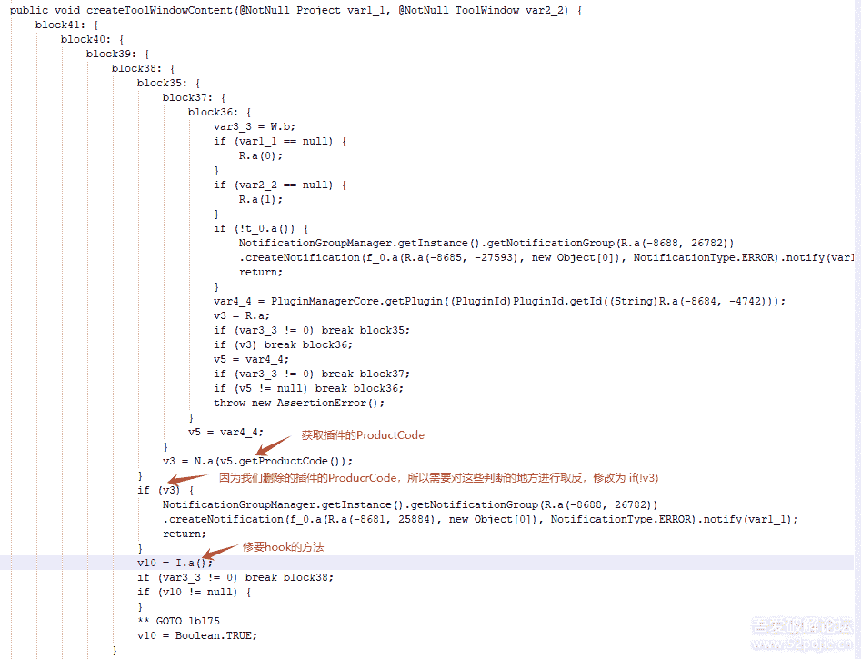
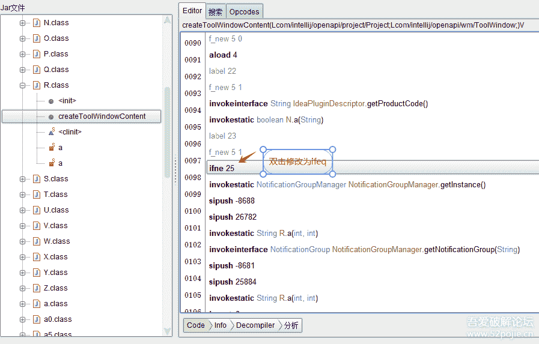
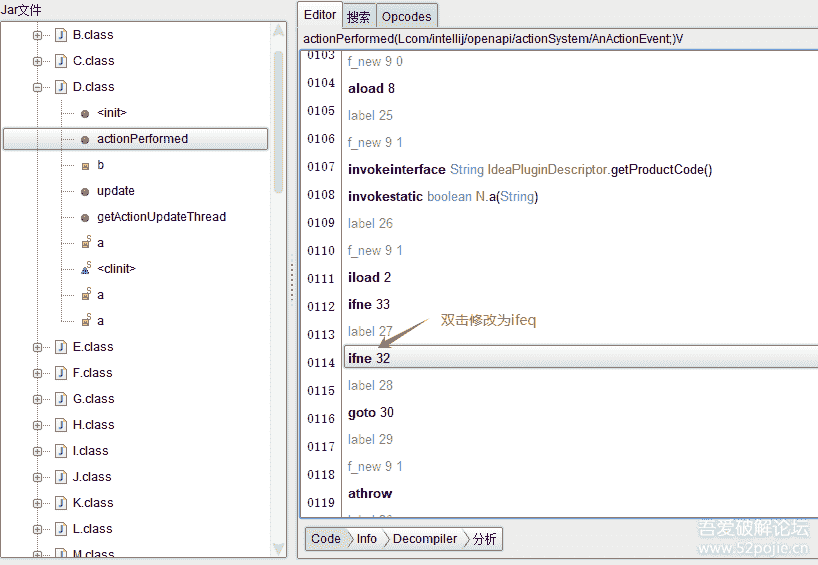
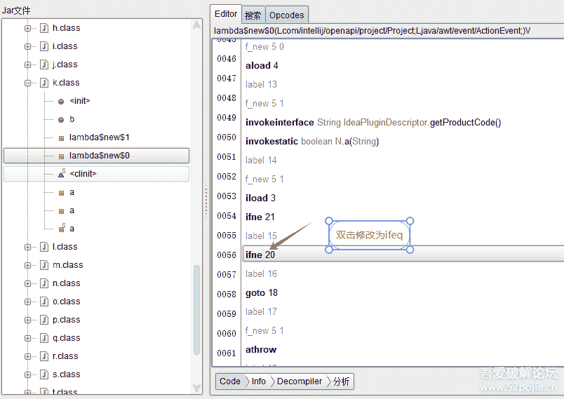

# [原创] Mybatis Log逆向

- 原帖：https://www.52pojie.cn/forum.php?mod=viewthread&tid=1855026
- 抓取时间：2026-11-01T22:43:31

贴一个免费的 Mybatis Log 插件：https://github.com/Link-Kou/intellij-mybaitslog.git

进入正题。

## 下载 Mybatis Log 插件（2023.10.1 版本）



下载 `cfr`：https://github.com/leibnitz27/cfr

反编译 `mybatis-log.jar`：

```bash
java -jar cfr-0.152.jar mybatis-log.jar --renamedupmembers true --hideutf false >> mybatis-log.txt
```

从这个按钮入手：



当我们点击它时，会调用 `createToolWindowContent()` 方法，发现只有当 `bl2 == null` 时才会跳转到 `block14`，然后执行 `E.a(project, toolWindow);`。所以我们只需要让 `e_0.a()` 方法返回 `null` 就行。



然后去分析 `e_0` 这个类，发现如下方法：

```java
// a方法在上面被调用，我们需要返回null
public static boolean a() {...}

// 下面四个方法经过分析我们直接将返回值修改为true就行
public static boolean b() {...}

private static boolean a(String string) {...}

private static boolean b(String string) {...}

private static boolean c(String string) {...}
```

这里借助 `javassist` 生成修改后的 class 文件：

```java
public static void hookMethod() throws Exception {
    ClassPool classPool = ClassPool.getDefault();
    classPool.appendClassPath("D:\\mybatis-log.jar");
    CtClass ctClass = classPool.get("e");
    CtMethod aMethod = ctClass.getDeclaredMethod("a", new CtClass[]{});
    aMethod.setBody("return null;");
    String methodBody = "return true;";
    CtMethod a2Method = ctClass.getDeclaredMethod("a", new CtClass[]{classPool.get("java.lang.String")});
    a2Method.setBody(methodBody);
    CtMethod b2Method = ctClass.getDeclaredMethod("b", new CtClass[]{});
    b2Method.setBody(methodBody);
    CtMethod bMethod = ctClass.getDeclaredMethod("b", new CtClass[]{classPool.get("java.lang.String")});
    bMethod.setBody(methodBody);
    CtMethod cMethod = ctClass.getDeclaredMethod("c", new CtClass[]{classPool.get("java.lang.String")});
    cMethod.setBody(methodBody);
    ctClass.writeFile("writefile");
}
```

使用下面命令将生成好的 `e.class` 文件替换掉 jar 包中的 `e.class`：

```bash
jar uvf mybatis-log.jar e.class
```

最后再移除收费提示，修改 jar 包 `META-INF/plugin.xml`，将下面代码删除即可。

## 下载 Mybatis Log 插件（2024.10.1 版本）

还是使用 `cfr` 反编译 `mybatis-log.jar`，然后搜索 `public void createToolWindowContent(` 定位到需要 hook 的代码：

```bash
java -jar cfr-0.152.jar mybatis-log.jar --renamedupmembers true --hideutf false >> mybatis-log.txt
```

这是反编译出的代码，只截取了部分：



上面的代码和 2023 版的差不多，我们看 `v12 = v10.equals(I.a());`，其实就是之前的 `bl = b12.eqeals(e_0.a());`。那么我们还是让 `v12 == null`，然后将之前 hook 的 `e` 类修改为 `I` 即可。

因为我们将 jar 包 `META-INF/plugin.xml` 里面的 `productCode` 删除了，代码里面有 3 个地方又调用了 `.getProductCode()`，是判断 `ProductCode` 是否存在的，不存在就弹出错误通知，所以只能用 `JByteMod` 汇编修改了。

搜索反编译出来的代码，发现有 3 个地方调用了 `.getProductCode()` 方法，既然我们删除了 `productCode`，那么我们就对每个进行取反就行。

打开 `R` 类，找到 `createToolWindowContent()` 方法，搜索 `getProduct`，修改 `ifne` 为 `ifeq`：



`D` 类 `actionPerformed()` 方法，`ifne` 修改为 `ifeq`：



`k` 类 `lambda$new$0` 方法，`ifne` 修改为 `ifeq`：



再 hook `I` 这个类，下面是新的 hook 代码：

```java
public static void hookMethod() throws Exception {
    ClassPool classPool = ClassPool.getDefault();
    classPool.appendClassPath("D:\\vm\\mybatis-log.jar");
    CtClass ctClass = classPool.get("mybatislog.I");
    CtMethod aMethod = ctClass.getDeclaredMethod("a", new CtClass[]{});
    aMethod.setBody("return null;");
    String methodBody = "return true;";
    CtMethod a2Method = ctClass.getDeclaredMethod("a", new CtClass[]{classPool.get("java.lang.String")});
    a2Method.setBody(methodBody);
    CtMethod b2Method = ctClass.getDeclaredMethod("b", new CtClass[]{});
    b2Method.setBody(methodBody);
    CtMethod bMethod = ctClass.getDeclaredMethod("b", new CtClass[]{classPool.get("java.lang.String")});
    bMethod.setBody(methodBody);
    CtMethod cMethod = ctClass.getDeclaredMethod("c", new CtClass[]{classPool.get("java.lang.String")});
    cMethod.setBody(methodBody);
    ctClass.writeFile("writefile");
}
```
