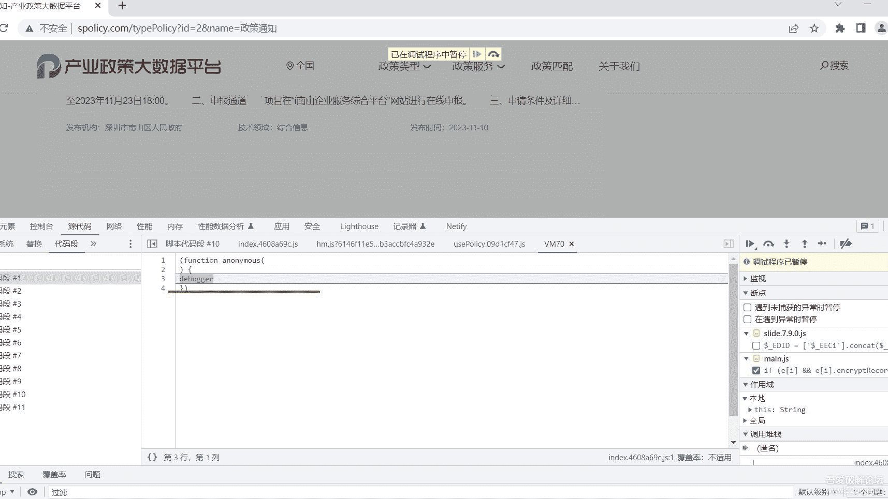
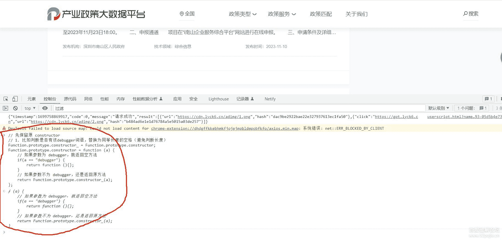
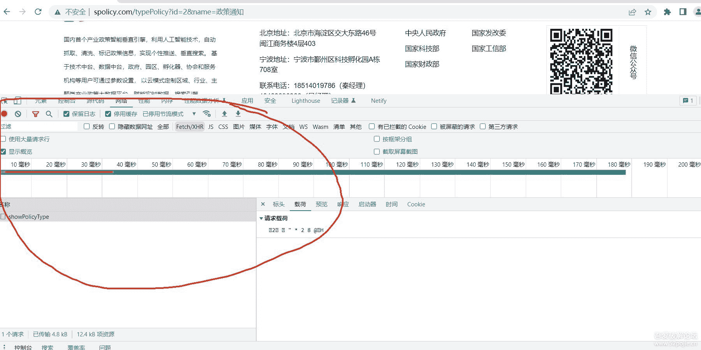
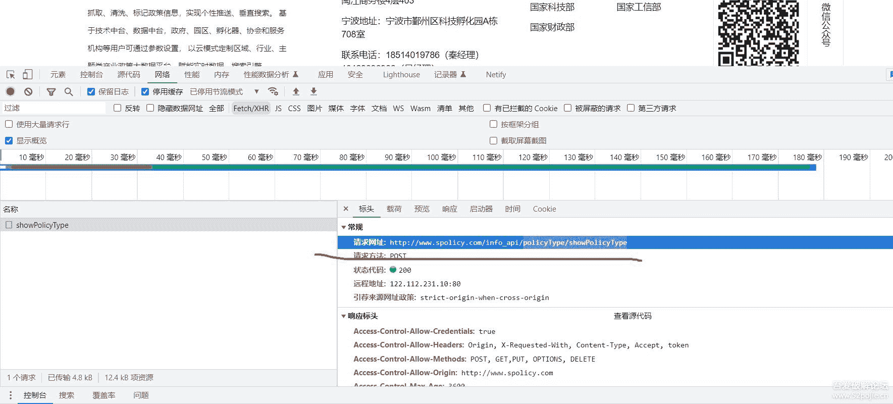
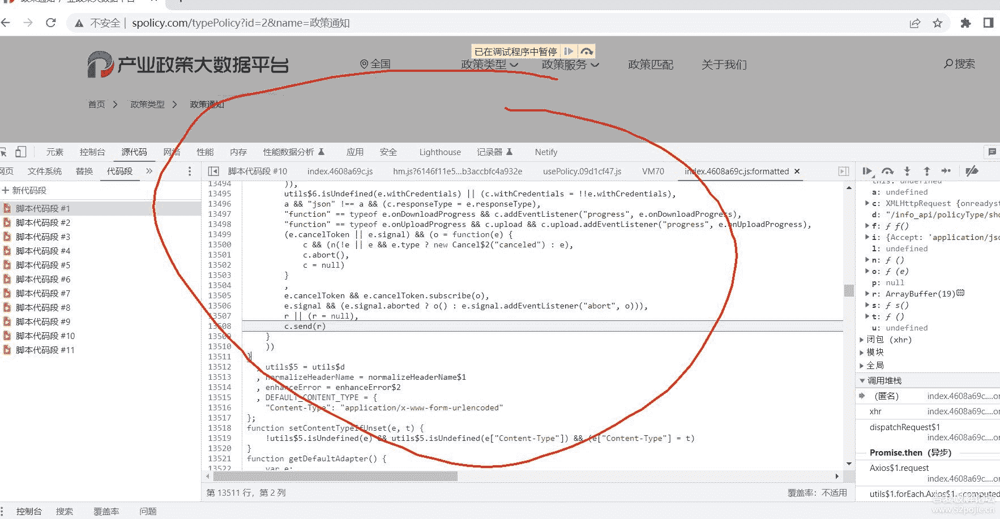
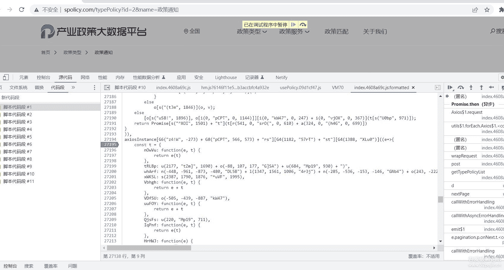
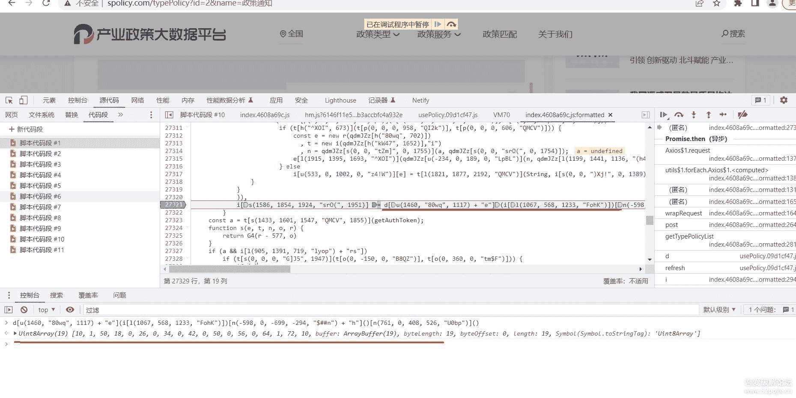

# [Web逆向] web逆向，产业政策大数据

- 原帖: <https://www.52pojie.cn/forum.php?mod=viewthread&tid=1855674>
- 抓取时间: 2026-11-01T22:43:22

## `debugger` 处理

`debugger`，通过hook构造器直接置空。

`20231112111530.jpg` (149.79 KB, 下载次数: 0)

[附件](https://www.52pojie.cn/forum.php?mod=attachment&aid=MjY1NTI1NHxmNzJmYzhmMnwxNzkzNTczMDAwfDE2ODA4NnwxODU1Njc0&nothumb=yes)

2023-11-12 11:37 上传

`微信截图_20231112111555.png` (168.99 KB, 下载次数: 0)

[附件](https://www.52pojie.cn/forum.php?mod=attachment&aid=MjY1NTI1NXxiZDRlODAyMXwxNzkzNTczMDAwfDE2ODA4NnwxODU1Njc0&nothumb=yes)

2023-11-12 11:39 上传

`微信截图_20231112111617.png` (196.89 KB, 下载次数: 0)

[附件](https://www.52pojie.cn/forum.php?mod=attachment&aid=MjY1NTI1NnxlM2YyYTUzN3wxNzkzNTczMDAwfDE2ODA4NnwxODU1Njc0&nothumb=yes)

2023-11-12 11:39 上传

`微信截图_20231112111636.png` (192.4 KB, 下载次数: 0)

[附件](https://www.52pojie.cn/forum.php?mod=attachment&aid=MjY1NTI1N3w4ZmVkNTkwMXwxNzkzNTczMDAwfDE2ODA4NnwxODU1Njc0&nothumb=yes)

2023-11-12 11:39 上传

## `xhr` 断点

找到包复制`url`一部分，在`xhr`断点插入。

`微信截图_20231112111705.png` (248.32 KB, 下载次数: 0)

[附件](https://www.52pojie.cn/forum.php?mod=attachment&aid=MjY1NTI1OHxlNWI1MDYwYXwxNzkzNTczMDAwfDE2ODA4NnwxODU1Njc0&nothumb=yes)

2023-11-12 11:39 上传

## 发包位置断点

断点在发包的位置。

`微信截图_20231112111812.png` (207.35 KB, 下载次数: 0)

[附件](https://www.52pojie.cn/forum.php?mod=attachment&aid=MjY1NTI1OXwwYWE1N2RmMnwxNzkzNTczMDAwfDE2ODA4NnwxODU1Njc0&nothumb=yes)

2023-11-12 11:39 上传

## 请求拦截器

往下跟栈找到请求拦截器。

`微信截图_20231112111914.png` (265.28 KB, 下载次数: 0)

[附件](https://www.52pojie.cn/forum.php?mod=attachment&aid=MjY1NTI2MHw2ZjE4ZGY5NnwxNzkzNTczMDAwfDE2ODA4NnwxODU1Njc0&nothumb=yes)

2023-11-12 11:39 上传

## `data` 加密位置

在往下跟栈，找到`data`加密的位置。
