# [原创] Crackme-《second_crackme》解析 新手向

- 原帖: https://www.52pojie.cn/forum.php?mod=viewthread&tid=1856205
- 抓取时间: 2026-11-01T22:43:18

### second_crackme

这是我在一个国外crackme平台[crackmes.one](https://crackmes.one/crackme/653d600a0f4238b24302b0ac)下载的一个cm。

过程不是很难，简单拿来学习一下。

程序下载下来一共四个东西，`readme`是一个提示。

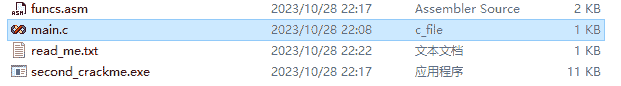

`main.c`是源码。用作提示。

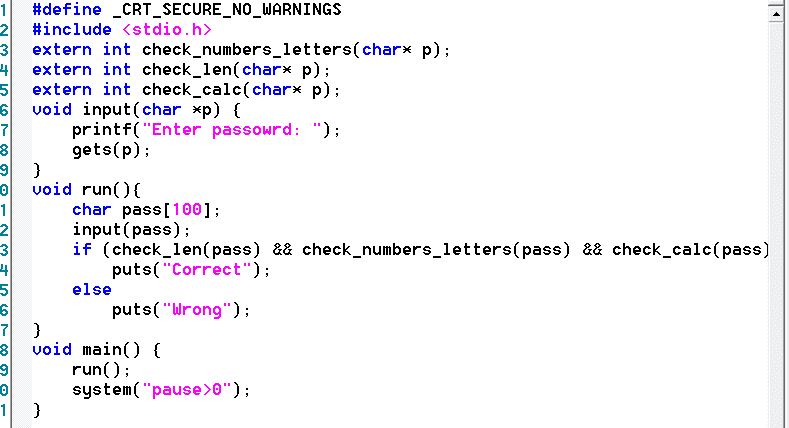

`readme`也是提示

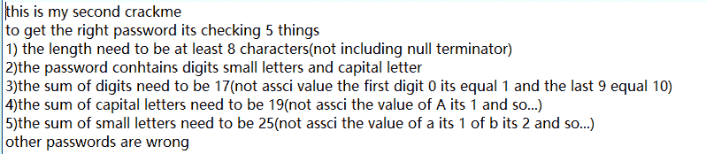

`asm`文件中囊括了带有核心符号的汇编代码

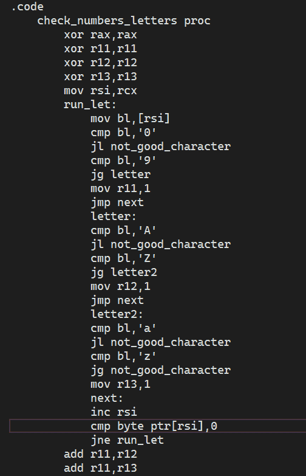

先不管这些，按照常规的破解思路来做吧。

先`exeinfo`，无壳64位exe，拿vc写的

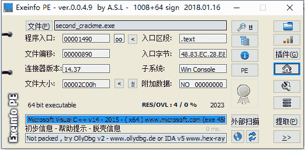

扔进`x64dbg`

一样的查找字符串，看到关键字符串

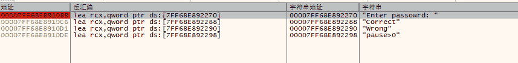

定位到这个地方

第一个断点的地方，把一个字符串的地址给了`rcx`，然后通过`rcx`寄存器传参输出了一个字符串

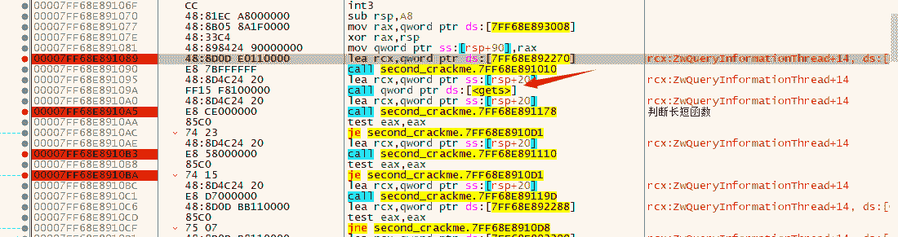

运行一下，如愿输出了字符串

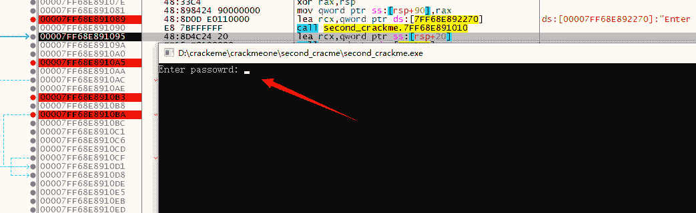

继续往下，调用`gets()`，也是不用看的，因为这玩意获取我们输入，运行并输入一个序列号

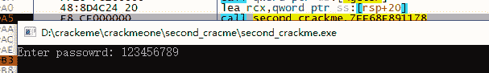

接着往下运行那个“判断长短函数，步入。来到下面的函数。”

内容明确，读一位字符`rax`加一个1，读到0就出循环

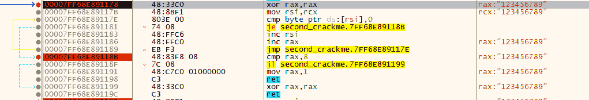

我们输入的字符长短为9，显然大于8

```
cmp rax,8
jl...
```

前面小于后面的就跳，我们的长短是9。不跳，所以执行把1给`rax`，退出去。

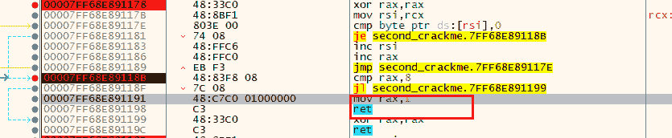

出来之后第一句，就是根据`test eax,eax`判断跳不跳

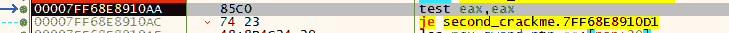

实际上就是就是做and运算，如果结果是：

```
test eax,eax

je
```

`eax`都是1，计算出来 将`ZF`置0，`je`就不跳

简单来讲就是`eax`为1的时候 不跳，为0就跳。

接着进入下一个函数

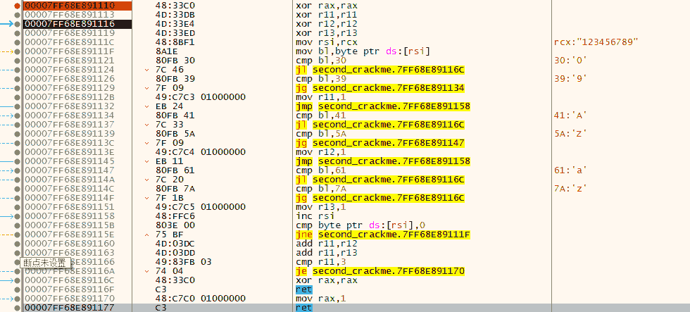

这个函数的作用：是不是大小写英文字母和数字。

另外一个重要的功能：下图里面可以看到在每个分支里面都尝试往`r11`、`r12`、`r13`赋值1。然后三者加一起等于3才正确。

换而言之就是大小写字母，数字都要出现才可以。

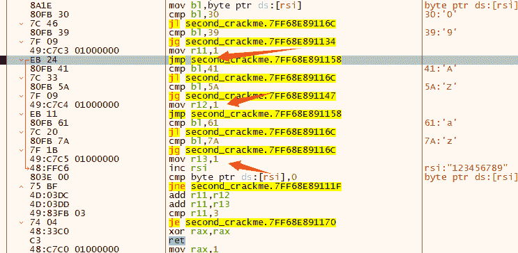

我们输入的只有数字，就手动修改一下


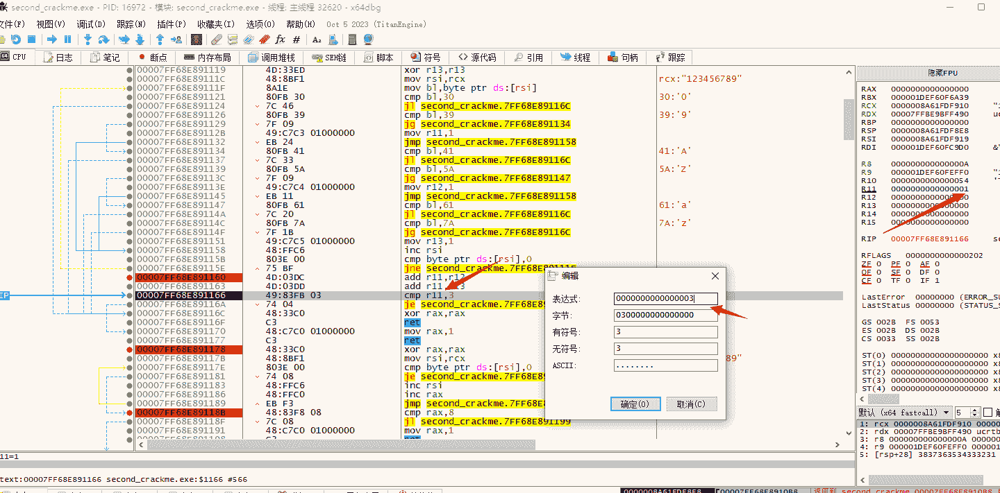

紧接着进入第三个函数，这个函数的内容复杂点。

一点点来看。

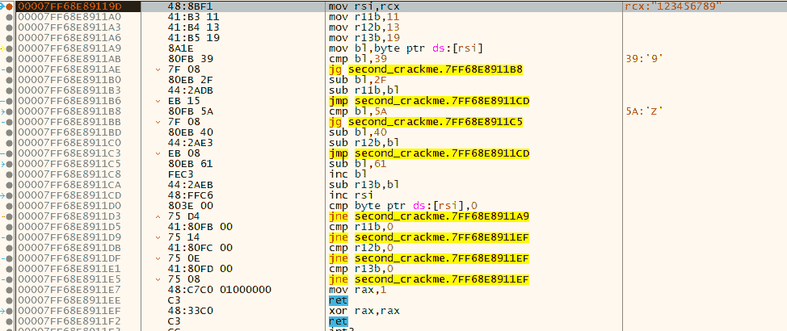

先给`r11`、`r12`、`r13`赋值十六进制的11 13 19，分别是17 19 25

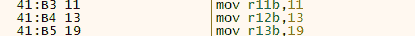

然后现在进来一个字符，如果它大于39，即大于`'9'`，就跳到大写字母的判断处，如果小于等于，就说明他是个数字，但它实际上就是ascii存储，要减去一个值，让他变成真正的数字。

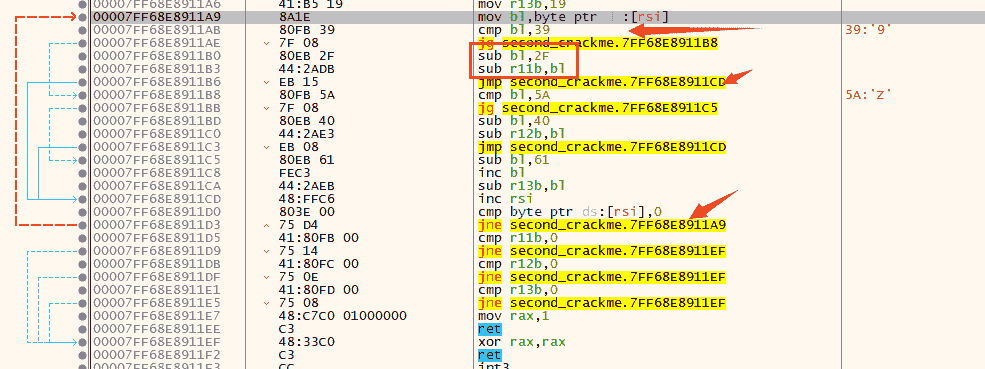

不过注意！这里有一个坑，他减去是47，常规的数字是48到57，也就是说就算是asii 0减去47也是1。

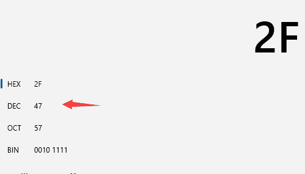

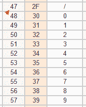

也就是说就算我们输入的1，程序出来的结果是2，这一点我们先记下。

然后执行框框里面的东西，`r11`也就是17减去这个值，再第三个箭头的跳转取下一个字符。


大写和小写的处理也类似，不过注意的是大写和数字一样是减去字符后一位

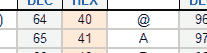

小写则是

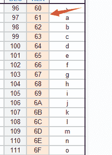

到后面就明白，需要的字符串是什么样子呢？

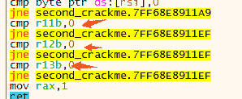

数字大写小写都要。并且所有数字加一处理之后的和为17，所有大写字母占顺序第`n+1`，这个位数之和为19，所有小写字母顺序位数加起来是25。

先爆破破解他吧

只需要让`jnz`进行就可以了。

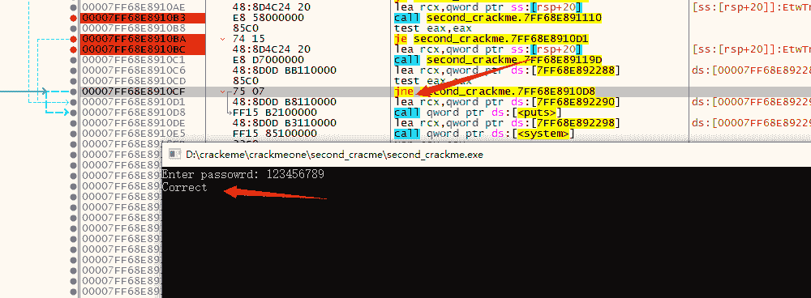

按照思路写脚本

```
sNum = ""
nNumCount = 4   #需要多少数字

nSum1 = 17  #数字区
nInit1 = nSum1 // nNumCount
for i in range(0, nNumCount):
    sNum+= chr(nInit1 + 47)
    print(sNum)
nInit2 = nSum1 % nNumCount
sNum+= chr(nInit2 + 47)
print(sNum)

nSum1 = 19  #大写字母区
nInit1 = nSum1 // nNumCount
for i in range(0, nNumCount):
    sNum+= chr(nInit1 + 64)
    print(sNum)
nInit2 = nSum1 % nNumCount
sNum+= chr(nInit2 + 64)
print(sNum)

nSum1 = 25  #小写字母区
nInit1 = nSum1 // nNumCount
print(nInit1)
for i in range(0, nNumCount):
    sNum+= chr(nInit1 + 96)
    print(sNum)
nInit2 = nSum1 % nNumCount
sNum+= chr(nInit2 + 96)
print(sNum)
```

这个脚本写的是简单的将整个数除以4，然后会生成`nNumCount+1`的字符

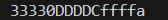

成功！

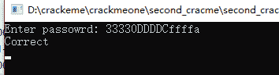
