# [原创] Crackme-《fty_crkme3》解析

- 原帖：https://www.52pojie.cn/forum.php?mod=viewthread&tid=1856799
- 抓取时间：2026-11-01T22:43:10

## fty_crkme3

这个是原160CM里面的一个，我看算法分析难度有三星，自己做出来之后还是挺有成就感的。

解压压缩包出来三个东西

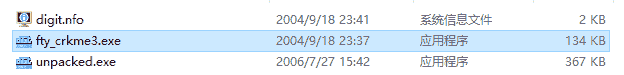

一个信息文件，一个未脱壳的`exe`，一个号称已脱壳的`exe`。

直接拿脱完壳的`exe`放`ida`里面看看

如脱，脱是脱了，但是不喜欢这个代码段字样。还是自己脱吧。

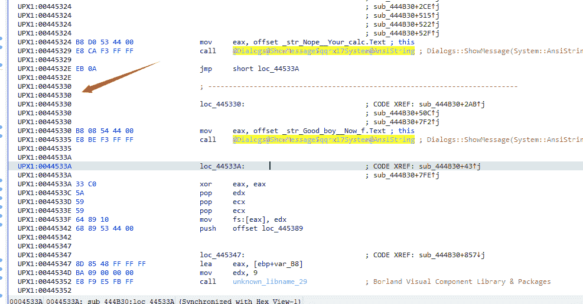

### 手工脱

`esp`平衡，在`esp`下个段

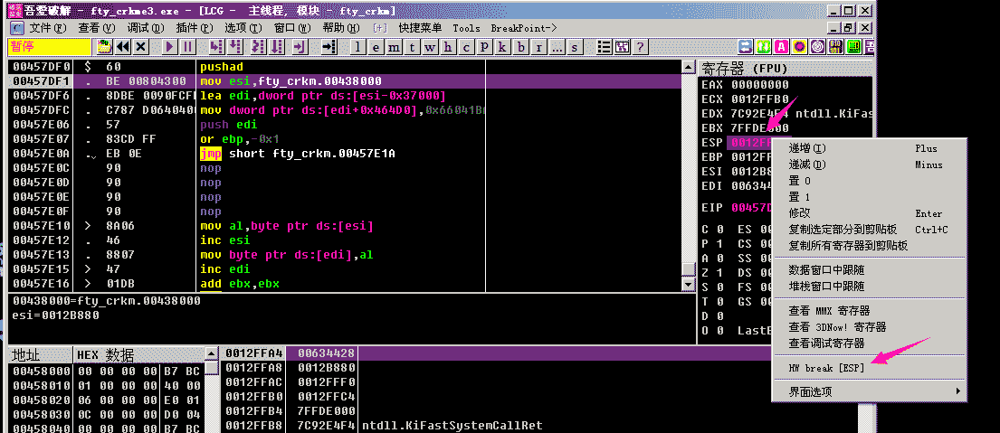

中转一下

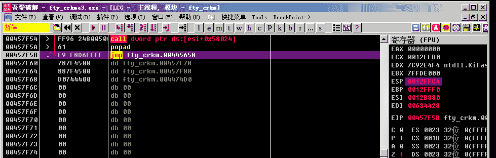

然后就来到`oep`了。

传统`upx`公式就能解决，但一些别的壳就不是了。。明天把`esp`平衡给再看看吧。

再`dump`下来

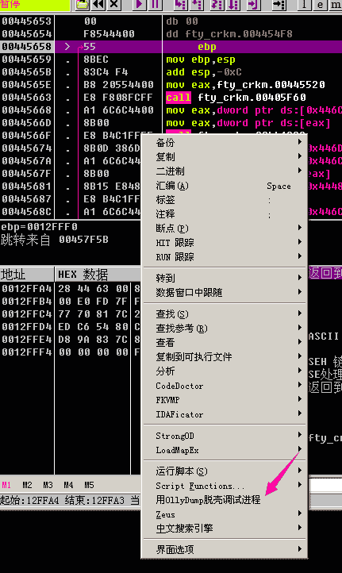

出来一个新程序，扔进`od`里面，已经成功了。

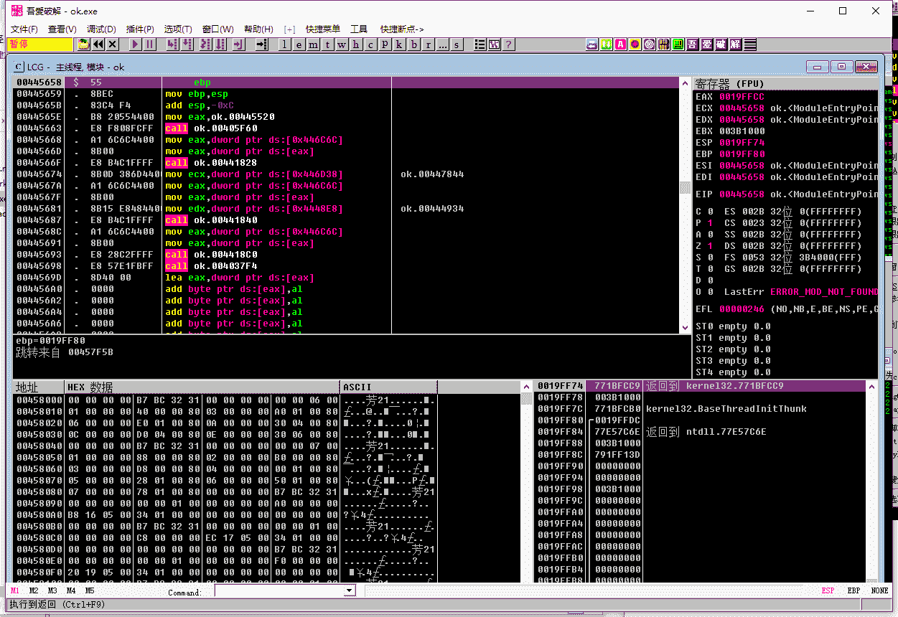

### 工具脱

`upx`最经典的`-d`大法。

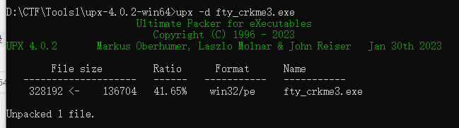

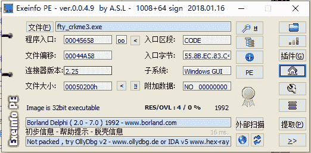

直接拿下。

### 爆破

开始接触到程序内部了。

这道CM字符串可以直接定位

定位进去之后可以看到，错误信息的跳转源多的一比。一个个改太慢了，干脆直接在错误信息处`jmp`

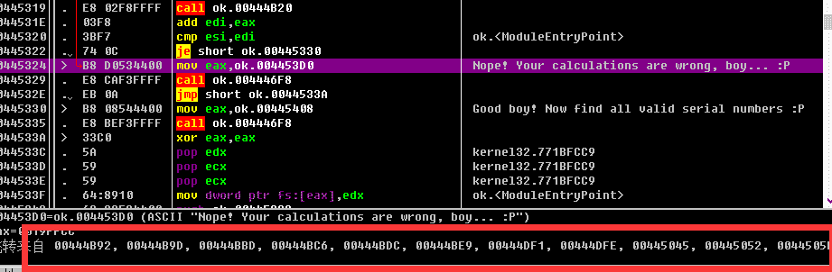

如下，不管输的什么，就算输错了，也会通过调用错误回显来跳转到正确回显

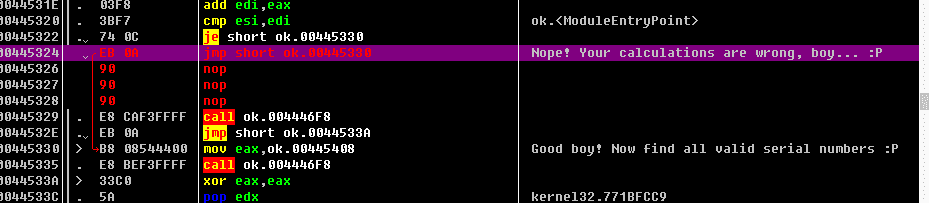

跑跑看，非常ok

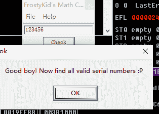

### 算法逆向

还是比较麻烦的，如上所述，题目的跳转非常之多。

但是还是得看，为了方便起见，我们给错误回显处起个标签

从第一个地方`444b92`看起

这段代码的作用就是逐位读入所写字符串，然后和`0`，`9`的ascii比较，意图就是要输入的就是`0`-`9`之间的数字

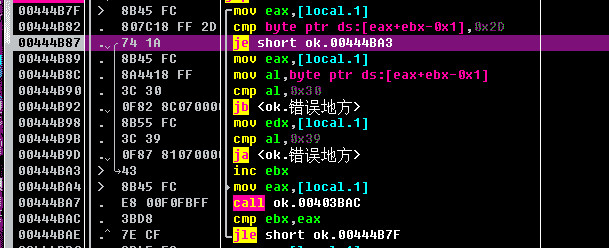

再接着这段，判断长短好像要9位-11位

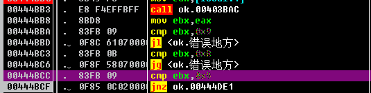

之后开始进入正式校验。首先是两个位置2和6，但从0开始嘛，就是第三位和第七位是不是“-”，就是说最后的`key`应该`xx-xxx-xx`的一个格式。现在我们的`123456789`显然不是，下个断再跑一趟。


然后经过一大长串 内存和栈内的处理，将我们输入的`12-345-67`变成十六进制形式的`1234567`存在`eax`里面

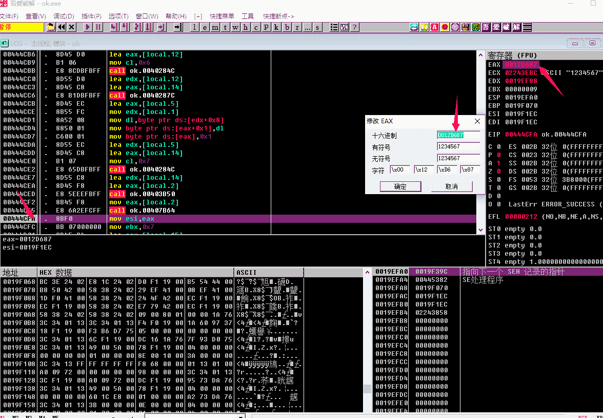

再把`7`给`ebx`

然后经过取第一个字符也就是`1`，经过三个函数的调用结果放进`edi`里面

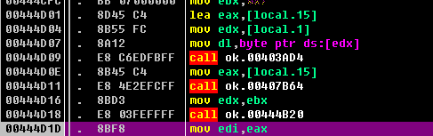

这个时候出来是`1`，目前我们对三个函数基本上一无所知，再跑

根据最后一句计算结果来看，我们需要的，关键的东西应该是存在`ex`里面，而`eax`用`444b20`跑出来，我们着重看一下。

应该是进行一个运算，参数是原本`ebx`当中的`7`和读到的数字，计算结果存在`eax`当中。

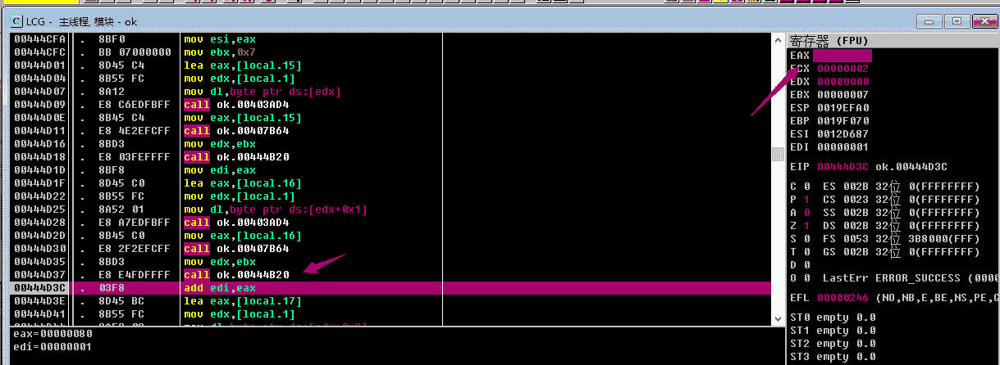

点进函数内部看一下，就长这个样子，作用也很清楚，`n`次幂，这里`n`是`7`。

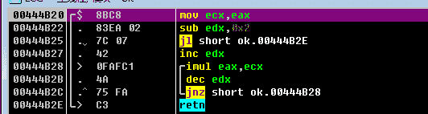

出函数，发现对每一位都这么处理

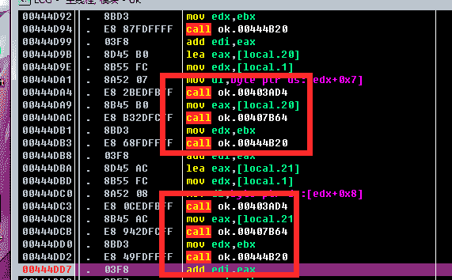

跑到最好的结果存在`edi`当中，我们输入的`1234567`是

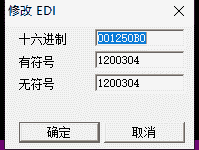

后面和`esi`也就是我们符号的数字存储作比较。


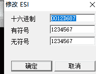

现在算法也算摸清楚了。

有一个7位数，每一位的7次方加在一块，等于原本的7位数。

写一个脚本（我写的这个效率比较低，大家尽情发挥）

```
nAns = [] #用来存储当前七位数的每一位
nSum = 0 #存储当前计算之和
for i in range(1000000,10000000):
    nNumber = i
    for _ in range(7):
        digit = nNumber % 10  # 获取个位数字
        nAns.insert(0, digit)  # 将数字插入数组最前面
        nNumber //= 10  # 去掉已经处理过的最后一位数字
    for m in nAns:
        nSum += m ** 7 #进行7次方
    if i == nSum:
        print(nSum)
    nSum = 0
    nAns.clear() #清空i的每一位数用作下一轮
```

跑出来四个数

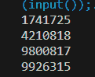

每一个都是能用的，我就演示一个，成了。

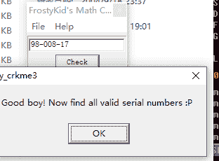
