# [Web逆向] 某牛`m3u8` `key`解密算法分析及实现

- 原帖：<https://www.52pojie.cn/forum.php?mod=viewthread&tid=1857670>
- 抓取时间：2026-11-01T22:43:08

## 目标

学习交流，就不放目标地址了。

## 分析过程

### 从`m3u8`请求入手

播放任意一个视频，`F12`找到`m3u8`的请求，发现其中没有`Key`的信息。

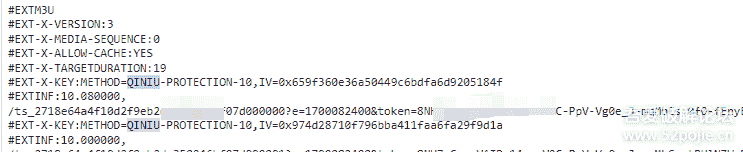

`图片1.png`（27.85 KB，下载次数：0）｜[附件链接](https://www.52pojie.cn/forum.php?mod=attachment&aid=MjY1NjY3NHxiYWQyNWNiYnwxNzkzNTcyOTg2fDE2ODA4NnwxODU3Njcw&nothumb=yes)｜2023-11-16 09:42 上传

这种我们从`ts`的启动器下手。

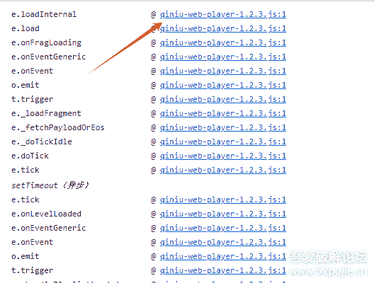

`图片2.png`（45.67 KB，下载次数：0）｜[附件链接](https://www.52pojie.cn/forum.php?mod=attachment&aid=MjY1NjY4MnxjOGY1NzIxOXwxNzkzNTcyOTg2fDE2ODA4NnwxODU3Njcw&nothumb=yes)｜2023-11-16 09:51 上传

### 搜索关键代码

点进去，然后搜`decryptdata.key`、`aes-128`、`buffer`等关键字。

搜`decryptdata.key`有5个结果，全部打断点，刷新。

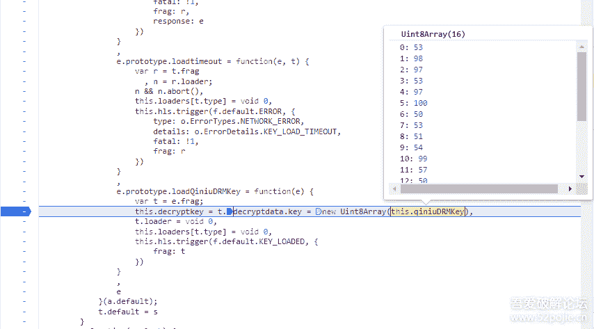

`图片3.png`（49.41 KB，下载次数：0）｜[附件链接](https://www.52pojie.cn/forum.php?mod=attachment&aid=MjY1NjY4M3xhYzJkNGQ3YXwxNzkzNTcyOTg2fDE2ODA4NnwxODU3Njcw&nothumb=yes)｜2023-11-16 09:51 上传

断住了，这个`this.decryptkey`非常像解密时用的`key`。

可以使用`m3u8`下载工具验证一下想法是不是对的。

首先将`this.decryptkey`转为十六进制字符串，代码如下：

```python
decryptkey = [53, 98, 97, 53, 97, 100, 50, 53, 51, 54, 99, 57, 50, 55, 100, 54]
hex_string = bytes(decryptkey).hex() # 35626135616432353336633932376436
```

使用工具下载（这里十六进制`key`会被自动`Base64`编码）。

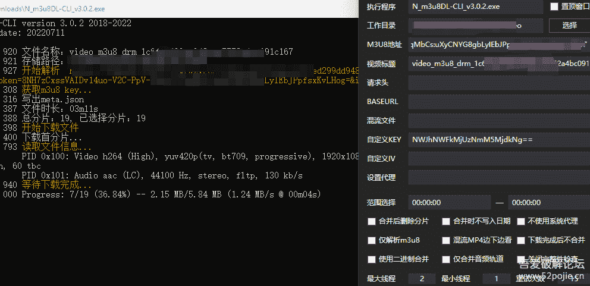

`图片4.png`（59.25 KB，下载次数：0）｜[附件链接](https://www.52pojie.cn/forum.php?mod=attachment&aid=MjY1NjY4NHw0YWFlYjc5MXwxNzkzNTcyOTg2fDE2ODA4NnwxODU3Njcw&nothumb=yes)｜2023-11-16 09:51 上传

结果可正常下载，正常播放。

至此，`key`已经找到，接下来需要找`key`生成的地方。

上面得知：`this.decryptkey = t.decryptdata.key = new Uint8Array(this.qiniuDRMKey)`。

文件内搜`qiniuDRMKey`，只有一个结果。

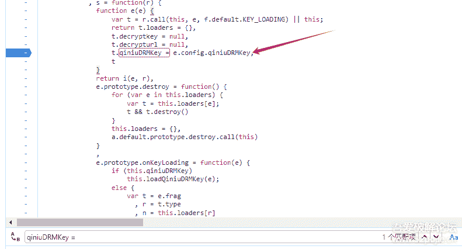

`图片5.png`（39.86 KB，下载次数：0）｜[附件链接](https://www.52pojie.cn/forum.php?mod=attachment&aid=MjY1NjY4NXw4ODAzZmNhOXwxNzkzNTcyOTg2fDE2ODA4NnwxODU3Njcw&nothumb=yes)｜2023-11-16 09:51 上传

### 追踪`Key`生成链路

往上跟，找`e.config`。

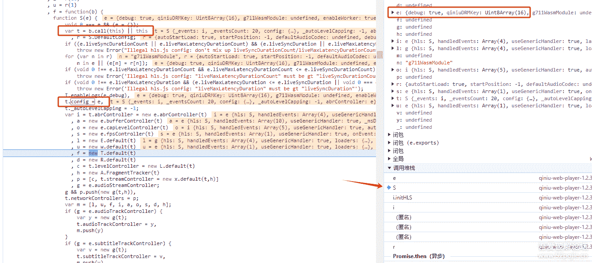

`图片6.png`（165.15 KB，下载次数：0）｜[附件链接](https://www.52pojie.cn/forum.php?mod=attachment&aid=MjY1NjY4Nnw5NTAzNzZlMXwxNzkzNTcyOTg2fDE2ODA4NnwxODU3Njcw&nothumb=yes)｜2023-11-16 09:51 上传

`t = this`，`t.config = e`，`e`里面有`qiniuDRMKey`。

往上跟，找`e`。

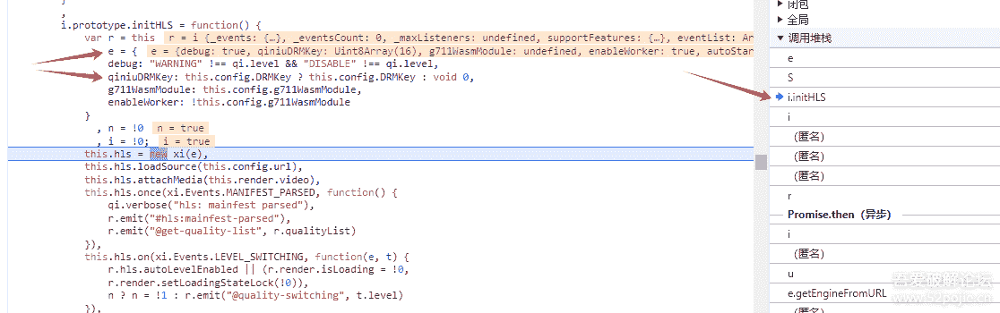

`图片7.png`（65.5 KB，下载次数：0）｜[附件链接](https://www.52pojie.cn/forum.php?mod=attachment&aid=MjY1NjY4N3w4NjY3YTIwZXwxNzkzNTcyOTg2fDE2ODA4NnwxODU3Njcw&nothumb=yes)｜2023-11-16 09:51 上传

又一个`this.config`，往上找`this.config.DRMKey`。

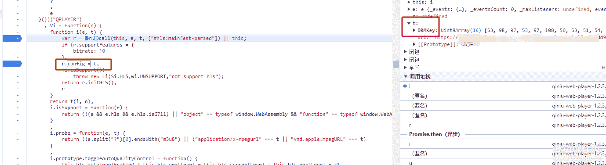

`图片8.png`（70.85 KB，下载次数：0）｜[附件链接](https://www.52pojie.cn/forum.php?mod=attachment&aid=MjY1NjY4OHwyNjA3ZDZjN3wxNzkzNTcyOTg2fDE2ODA4NnwxODU3Njcw&nothumb=yes)｜2023-11-16 09:51 上传

`r = this`，`r.config = t`，`t`里面有`DRMKey`，`t`是传过来的，继续往上跟……

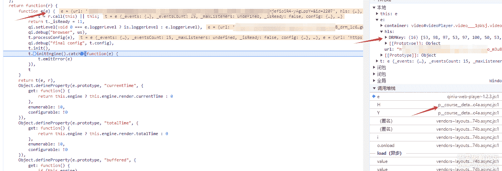

`图片9.png`（93.59 KB，下载次数：0）｜[附件链接](https://www.52pojie.cn/forum.php?mod=attachment&aid=MjY1NjY4OXw2MmFjZGJiY3wxNzkzNTcyOTg2fDE2ODA4NnwxODU3Njcw&nothumb=yes)｜2023-11-16 09:51 上传

一路跟，跟到这，这个`e`里面有两个关键字段，一个是`key`，一个`m3u8`的`url`（意外惊喜）。

继续往上跟，要换`js`文件了，不行了来感觉了。

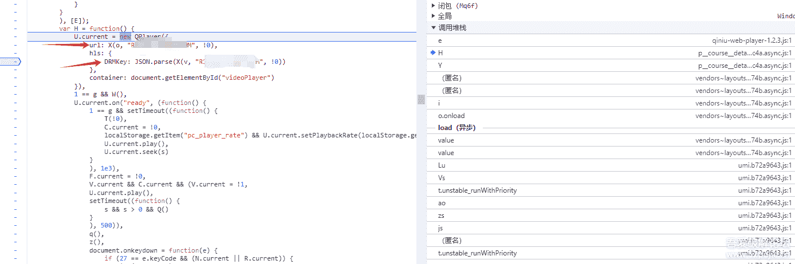

`图片10.png`（82.31 KB，下载次数：0）｜[附件链接](https://www.52pojie.cn/forum.php?mod=attachment&aid=MjY1NjY5MHw5NzcxY2EwMXwxNzkzNTcyOTg2fDE2ODA4NnwxODU3Njcw&nothumb=yes)｜2023-11-16 09:51 上传

成功找到了`key`、`url`的生成位置。

这里`o`和`v`分别是加密后的`url`和`key`。

进入关键函数`X`看一下，是个`AES`加解密函数。

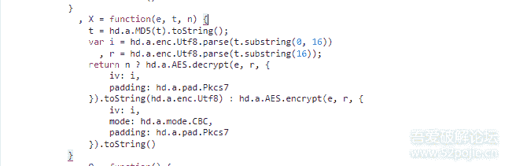

`图片11.png`（21.86 KB，下载次数：0）｜[附件链接](https://www.52pojie.cn/forum.php?mod=attachment&aid=MjY1NjY5MXw0MmNkNDgxZnwxNzkzNTcyOTg2fDE2ODA4NnwxODU3Njcw&nothumb=yes)｜2023-11-16 09:51 上传

`X`接收三个参数：`e`=要解密的内容，`t`=固定字符串，`n`控制加密还是解密。

### 定位加密参数

接下来就是找被加密的`url`和`key`字符串，也就是`o`和`v`。

一般这两个参数都是通过`api`返回的，可以用抓包工具搜索一下（这里用的`Charles`）。

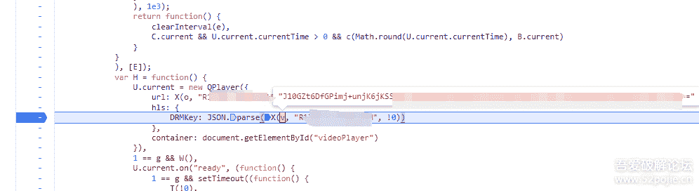

`图片12.png`（33.23 KB，下载次数：0）｜[附件链接](https://www.52pojie.cn/forum.php?mod=attachment&aid=MjY1NjY5MnxjYWM1NWUxZnwxNzkzNTcyOTg2fDE2ODA4NnwxODU3Njcw&nothumb=yes)｜2023-11-16 09:51 上传

这里`Search In`只勾选`Response Body`。

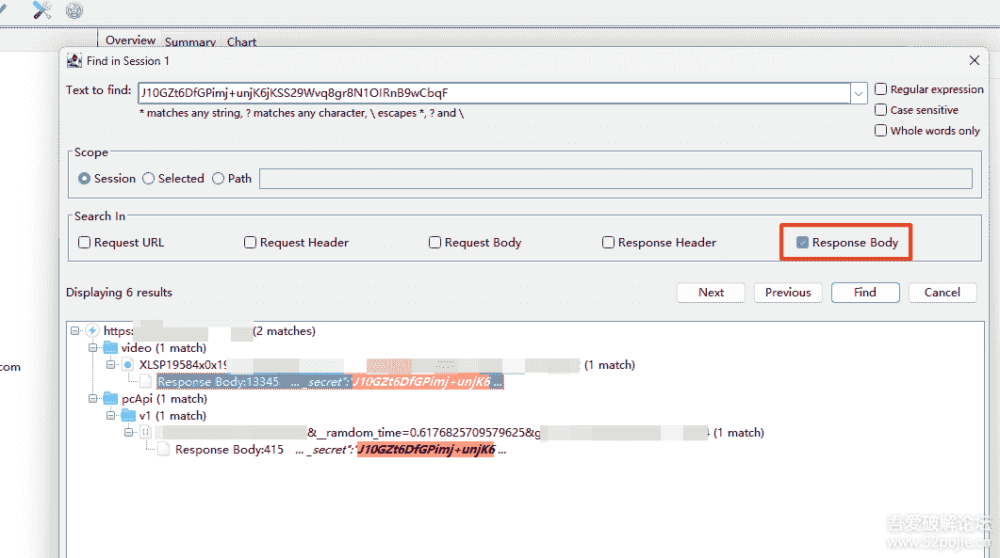

`图片13.png`（57.51 KB，下载次数：0）｜[附件链接](https://www.52pojie.cn/forum.php?mod=attachment&aid=MjY1NjY5M3w1YmJhZmJkNnwxNzkzNTcyOTg2fDE2ODA4NnwxODU3Njcw&nothumb=yes)｜2023-11-16 09:51 上传

这里有两个搜索结果，一个`html`，一个`api`，两个里面都包含加密内容。

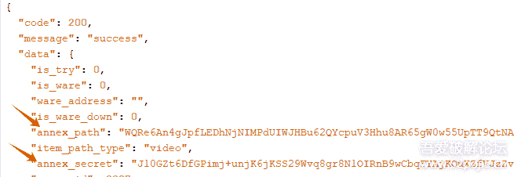

`图片14.png`（24.7 KB，下载次数：0）｜[附件链接](https://www.52pojie.cn/forum.php?mod=attachment&aid=MjY1NjY5NHw2Mzk4N2YzYXwxNzkzNTcyOTg2fDE2ODA4NnwxODU3Njcw&nothumb=yes)｜2023-11-16 09:51 上传

点开`api`的`Response Body`，可以看到`o`、`v`都是该`api`返回。

至此整个分析结束，接下来我们来实现一下解密算法。

## 解密算法实现

### `JS`实现

```javascript
const CryptoJS = require('crypto-js');

function decrypt(e) {
    var t = CryptoJS.MD5("固定字符串").toString();
    var i = CryptoJS.enc.Utf8.parse(t.substring(0, 16));
    var r = r = CryptoJS.enc.Utf8.parse(t.substring(16));
    return CryptoJS.AES.decrypt(e, r, {
        iv: i,
        padding: CryptoJS.pad.Pkcs7,
    }).toString(CryptoJS.enc.Utf8);
}

var annex_secret = '';
var key = JSON.parse(decrypt(annex_secret));
console.log(key)
```

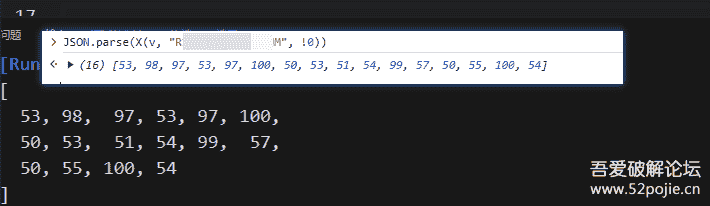

`图片15.png`（19.24 KB，下载次数：0）｜[附件链接](https://www.52pojie.cn/forum.php?mod=attachment&aid=MjY1NjY5NXw2NGZiYmFmOHwxNzkzNTcyOTg2fDE2ODA4NnwxODU3Njcw&nothumb=yes)｜2023-11-16 09:51 上传

对比控制台执行结果，完全一致。

### `Python`实现


```python
from utils import AESCrypto
import hashlib
import json

def get_md5_string(s: str):
    return hashlib.md5(s.encode('utf-8')).hexdigest()

def decrypt(e: str):
    t = get_md5_string("固定字符串")
    i, r = t[:16], t[16:]
    cipher = AESCrypto(key=r, mode='CBC', padding='Pkcs7')
    return cipher.decrypt(e, iv=i)

if __name__ == '__main__':
    annex_secret = ''
    key = json.loads(decrypt(annex_secret))
    print(key)
```

对比下结果也是一样的

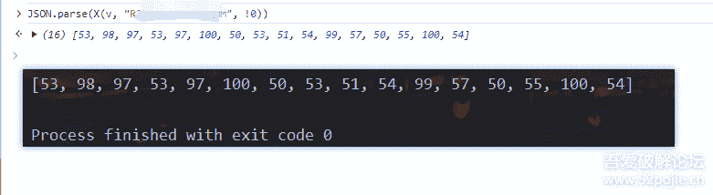

`图片16.png` (58.08 KB, 下载次数: 0)

[href="forum.php?mod=attachment&aid=MjY1NjY5NnxjNDhhMzI4OHwxNzkzNTcyOTg2fDE2ODA4NnwxODU3Njcw&nothumb=yes" target="_blank"](https://www.52pojie.cn/forum.php?mod=attachment&aid=MjY1NjY5NnxjNDhhMzI4OHwxNzkzNTcyOTg2fDE2ODA4NnwxODU3Njcw&nothumb=yes)

2023-11-16 09:51 上传

### 最后

其实刚开始的时候就发现了在控制台里面有`key`的log信息...

本着学习的态度 还是从头到尾撸了一遍...
