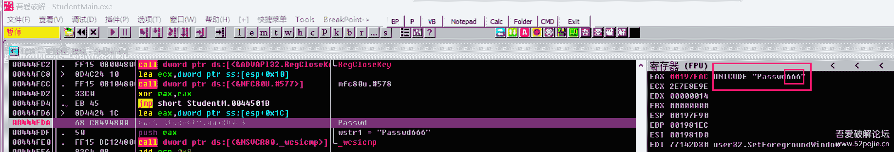
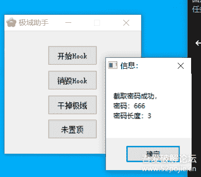

# [原创] 极域数字语音系统6.0 读密码

- 原帖：https://www.52pojie.cn/forum.php?mod=viewthread&tid=1858744
- 抓取时间：2026-11-01T22:43:02

## 方法1：`od`下断看寄存器

1. 打开`od`，附加到`studentmain.exe`。
2. `ctrl+g`跳到`00444FDA`，`F2`下断。
3. 打开极域输入密码的窗口，`od`断住，`EAX`中`Passwd`后即为密码明文。

`QQ截图20231118173627.png`（154.04 KB，下载次数：2）

[下载附件](https://www.52pojie.cn/forum.php?mod=attachment&aid=MjY1NzIzNHxhNDZhN2NlOHwxNzkzNTcyOTgwfDE2ODA4NnwxODU4NzQ0&nothumb=yes)

2023-11-18 17:36 上传

## 方法2：下载极域助手

[下载附件](https://www.52pojie.cn/forum.php?mod=attachment&aid=MjY1NzI0MHwzOTk4MDk3NHwxNzkzNTcyOTgwfDE2ODA4NnwxODU4NzQ0)

（386.41 KB，下载次数：67）

2023-11-18 17:38 上传

点击文件名下载附件；下载积分：吾爱币 -1 CB。

在确保极域启动的情况下点击开始hook。

打开极域输入密码的窗口，程序弹出信息框，提示获取到的密码。

`QQ截图20231118174103.png`（33.32 KB，下载次数：4）

[下载附件](https://www.52pojie.cn/forum.php?mod=attachment&aid=MjY1NzI0MXxmNGNmOGI3ZXwxNzkzNTcyOTgwfDE2ODA4NnwxODU4NzQ0&nothumb=yes)

2023-11-18 17:41 上传

点击确定后极域弹出输入密码的窗口，程序会自动将密码复制到剪辑版，`ctrl+v`粘贴即可。

Tip：程序采用易语言编写，调用了`NB模块`远程hook，杀毒软件可能会报毒，不信任的用`od`就行。
