# [原创] 文件搜索工具 FileLocator Pro 破解方法

- 原帖：[https://www.52pojie.cn/forum.php?mod=viewthread&tid=1858771](https://www.52pojie.cn/forum.php?mod=viewthread&tid=1858771)
- 抓取时间：2026-11-01T22:43:01

---

## 2023-11-27 更新补充

[52pojie](https://www.52pojie.cn/) 过程一波三折，也感谢 pojieit、云烟成雨等吾友的不断测试与反馈，最终破解是达到永久使用完整功能的目的了，也就是无限期试用。

由于该软件有三个程序都需要破解，并且破解主程序的方法不能简单的复制到其它两个程序上，尤其是 `flpidx.exe` 并没有采用与主程序完全一样的识别注册机制，所以破解思路几经改变，最终定格在破解试用时间上。按照与 `flpidx.exe` 相同的破解思路，对 `FileLocatorPro.exe`、`IndexManager.exe` 这两个程序进行了重新破解。破解掉了试用时间限制，软件可以无限期试用。具体破解的思路跟前两次又有一些区别，等以后有时间再发贴吧。

## 2023-11-27 更新补充 2

为防止遗漏，对这个软件的所有可执行程序再一次进行检查，发现 `flpsearch.exe` 也进行了保护，这是个很重要的搜索程序，按照其它三个程序同样的破解方法，破解掉了试用时间限制。这应该是最后一次更新了，对这个软件解除试用时间限制的破解方式，至此就全部完成了。

重新发布这次破解的全部四个程序补丁：

[下载附件](https://www.52pojie.cn/forum.php?mod=attachment&aid=MjY1OTc2MnxmZGE2NzJmZHwxNzkzNTcyOTc4fDE2ODA4NnwxODU4Nzcx)

（419 Bytes，下载次数: 2477）

2023-11-27 17:17 上传

点击文件名下载附件

下载积分: 吾爱币 -1 CB

## 2023-11-29 新增

根据吾友需要发布 32 位版本的补丁。我在 64 位系统下破解的，原理一样，请用 32 位系统自行测试：

[下载附件](https://www.52pojie.cn/forum.php?mod=attachment&aid=MjY2MDM5NHwwMGYzZjRhY3wxNzkzNTcyOTc4fDE2ODA4NnwxODU4Nzcx)

（556 Bytes，下载次数: 355）

2023-11-29 14:29 上传

点击文件名下载附件

下载积分: 吾爱币 -1 CB

---

## 2023-11-25 更新补充

列表卡住的问题已解决。`IndexManager.exe` 的破解本身没有问题，对 `flpidx.exe` 的破解已完成。这两个程序的补丁已放在首贴，请下载试用。

## 背景与破解思路

最近单位经常要在一堆文档中搜索关键字，主要是原来的 big boss，如今东窗事发成了 big badegg，然后要从历年的一堆文档中找出所有该人名字的文件进行删除。看到网上推荐这个软件，试了一下效果还不错。以最新版本：Version 2022 - Build 3416 为例，分享一下破解方法。

软件的注册方式是用户名+邮箱+注册码，注册成功后就是 Pro 版。软件有 30 天试用期，试用版 `TRIAL` 功能与 Pro 版相同。试用期后不想注册就只能选功能不全的精简版 `LITE`。那么这次破解的目的就是把软件变成永久 Pro 版。

软件为多语言版本，为破解方便，语言选项选为英文。破解以实用为原则，不追注册码（功力不够、时间不够），直接破解注册标志。破解有两种思路：一是找到 Pro 版注册标志，直接变成永久 Pro 版；二是找到试用期时间计算机制，变成永不过期版（功能与 Pro 版相同）。两种方法任选其一即可。软件为 64 位代码，调试工具为 `X64dbg`。

## 方法一：永久 Pro 版

首先查找不同版本的特征，试用版在标题栏中有“`TRIAL`”字样，精简版则有“`LITE`”字样，专业版没有上述标志。于是首先的思路就是在程序中搜索特征字符串，以搜索“`TRIAL`”为例：

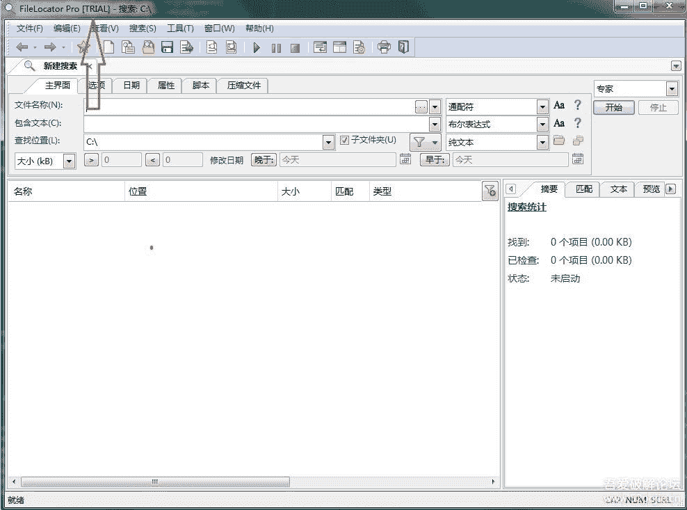

`01.JPG`（85.54 KB，下载次数: 3）

[下载附件](https://www.52pojie.cn/forum.php?mod=attachment&aid=MjY1NzMxMXxiOTVmYTU3MXwxNzkzNTcyOTc4fDE2ODA4NnwxODU4Nzcx&nothumb=yes)

2023-11-18 21:31 上传

非常顺利，找到唯一的字符串位置，精准定位：

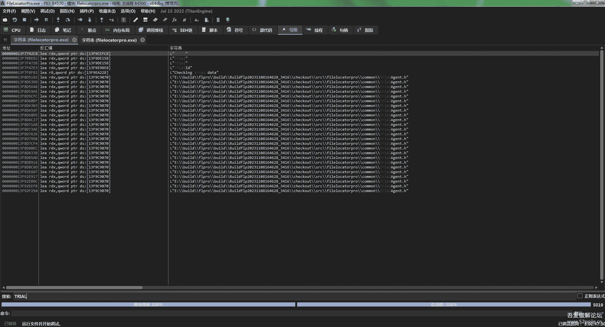

`02.JPG`（333.41 KB，下载次数: 2）

[下载附件](https://www.52pojie.cn/forum.php?mod=attachment&aid=MjY1NzMxMnw5NjIxMDEzMHwxNzkzNTcyOTc4fDE2ODA4NnwxODU4Nzcx&nothumb=yes)

2023-11-18 21:31 上传

找字符串上方最近的 `call filelocatorpro.13F7660A0`，简单分析一下 `CALL` 后面的几行代码不难发现，返回值 1 代表“`TRIAL`”，返加值 3 代表“`LITE`”，马上可以猜到 2 就代表“Pro”。

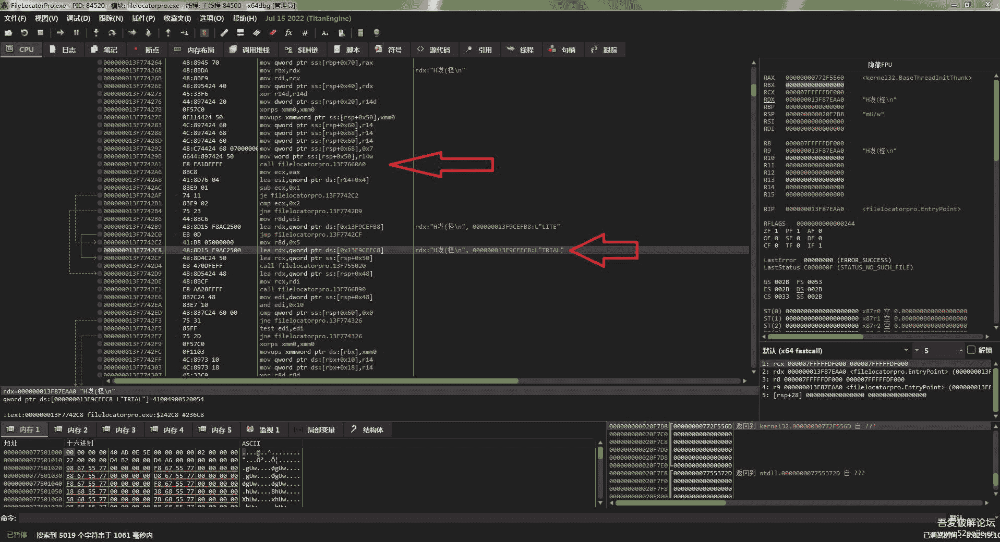

`03.JPG`（348.25 KB，下载次数: 3）

[下载附件](https://www.52pojie.cn/forum.php?mod=attachment&aid=MjY1NzMxM3w2NmVjMGViOHwxNzkzNTcyOTc4fDE2ODA4NnwxODU4Nzcx&nothumb=yes)

2023-11-18 21:31 上传

进入到这个 `CALL` 看看情况：

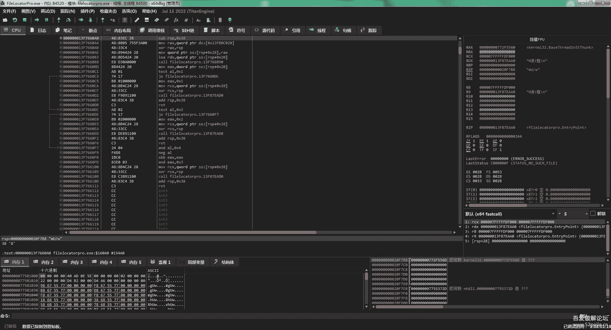

`04.JPG`（302.47 KB，下载次数: 3）

[下载附件](https://www.52pojie.cn/forum.php?mod=attachment&aid=MjY1NzMxNHwxMjNhM2ViYnwxNzkzNTcyOTc4fDE2ODA4NnwxODU4Nzcx&nothumb=yes)

2023-11-18 21:31 上传

非常简单的功能，就是返回 1、2、3 这三个不同的值。再看看有哪些地方调用它，选中第一条语句，右键选择“查找引用”，总共有 23 处要调用它，可以肯定这个 `CALL` 就是标记不同版本的：

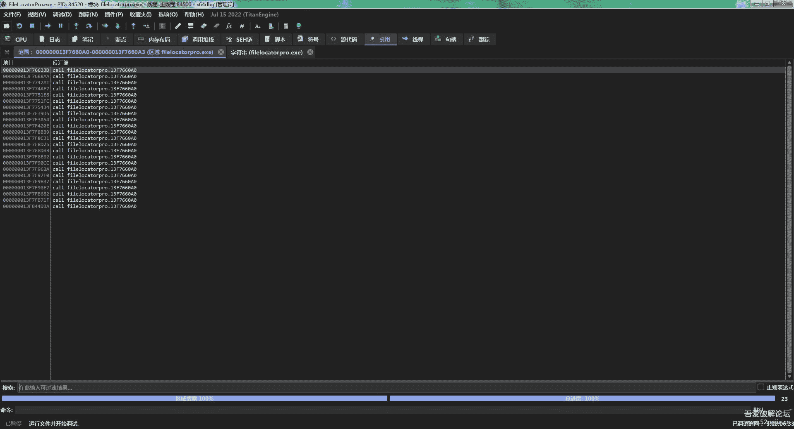

`05.JPG`（158.53 KB，下载次数: 3）

[下载附件](https://www.52pojie.cn/forum.php?mod=attachment&aid=MjY1NzMxNXw4NDNhNTA5MnwxNzkzNTcyOTc4fDE2ODA4NnwxODU4Nzcx&nothumb=yes)

2023-11-18 21:31 上传

修改这个子程序，让它始终返回 2，大功告成：

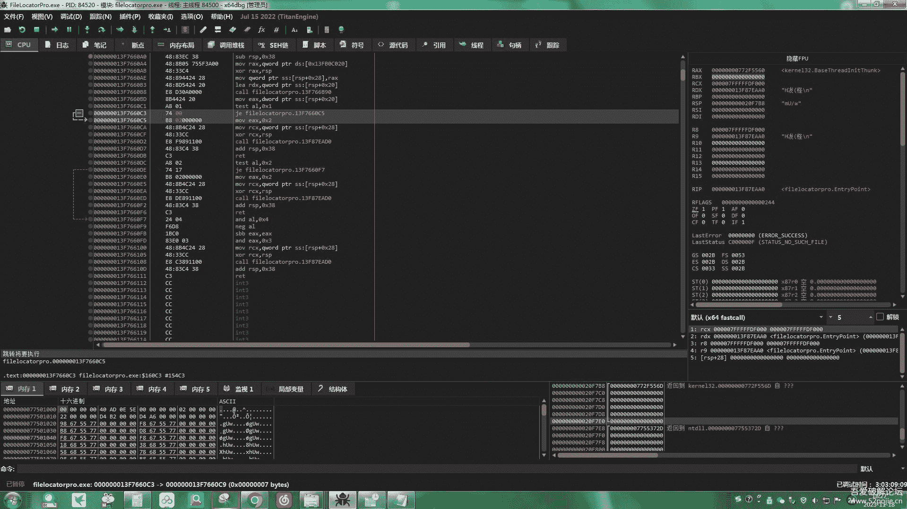

`06.JPG`（325.11 KB，下载次数: 3）

[下载附件](https://www.52pojie.cn/forum.php?mod=attachment&aid=MjY1NzMxNnxmNDAzNjZlNHwxNzkzNTcyOTc4fDE2ODA4NnwxODU4Nzcx&nothumb=yes)

2023-11-18 21:32 上传

## 方法二：永不过期版

试用期是与时间相关的，要找到计算试用期的 `CALL`，最直接的方法是通过与时间有关的 API 函数去查找线索。把电脑时间往后调 30 天以上，让软件过期，这样弹出的错误框有助于我们发现问题。

在模块中搜索“跨模块调用”，先输入“`time`”试试，果然发现 `GetLocalTime` 这个 API 函数。在搜索一栏输入它，只显示这一个函数，有 12 个，哪一个有用呢？先右键选择在所有命令上设断点：

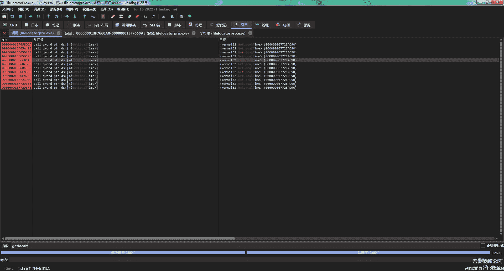

`07.JPG`（170.16 KB，下载次数: 3）

[下载附件](https://www.52pojie.cn/forum.php?mod=attachment&aid=MjY1NzMxN3xmYzhhMDBmMHwxNzkzNTcyOTc4fDE2ODA4NnwxODU4Nzcx&nothumb=yes)

2023-11-18 21:32 上传

按 `Ctrl+F9`，即忽略所有异常运行程序，然后在第一处 `GetLocalTime` 中断，查看函数前后文，没有头绪，也不知道它在程序什么位置，怎么办？按 `Ctrl+Shift+F9`，这个组合键是忽略异常运行到最近一个 `ret`，希望能发现是谁在调用它。然而事与愿违，并没有运行到 `ret`，而是在下一个 `GetLocalTime` 处中断了：

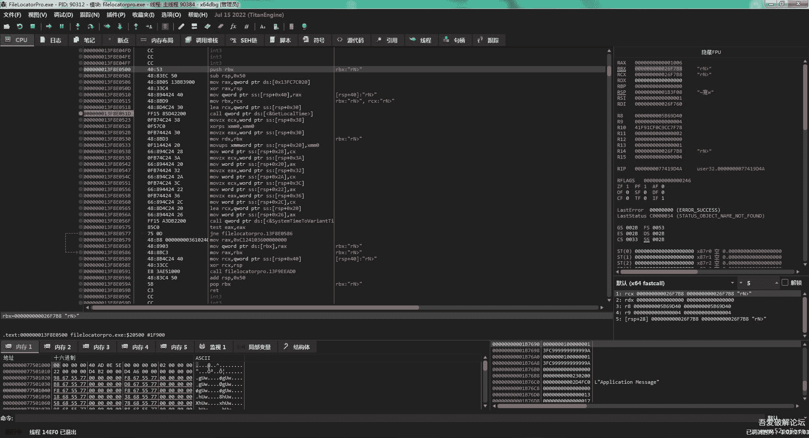

`08.JPG`（322.23 KB，下载次数: 2）

[下载附件](https://www.52pojie.cn/forum.php?mod=attachment&aid=MjY1NzMxOHxiNjQyZTRkM3wxNzkzNTcyOTc4fDE2ODA4NnwxODU4Nzcx&nothumb=yes)

2023-11-18 21:32 上传

如果还没有头绪的话，就继续按 `Ctrl+Shift+F9`，然而这次不用了，这是个很短的 `CALL`，功能一目了然，就是读取系统时间，转换成所需要的格式。选中 `CALL` 的第一条语句，右键选择“查找引用”，发现有两个地方调用它。第一处调用的地方看不出头绪，先不管它，看第二处，发现也是一个不大的 `CALL`，但功能并不能直观看出来，这时候要用流程图看看了。再按 `Ctrl+F9`，软件弹出过期对话框，OK，前面两个 `GetLocalTime` 已经完成了判断工作，而且第二处地方非常值得继续分析下去。

禁用前面所有断点，就在这个 `CALL` 的第一条语句处右键查看流程图：

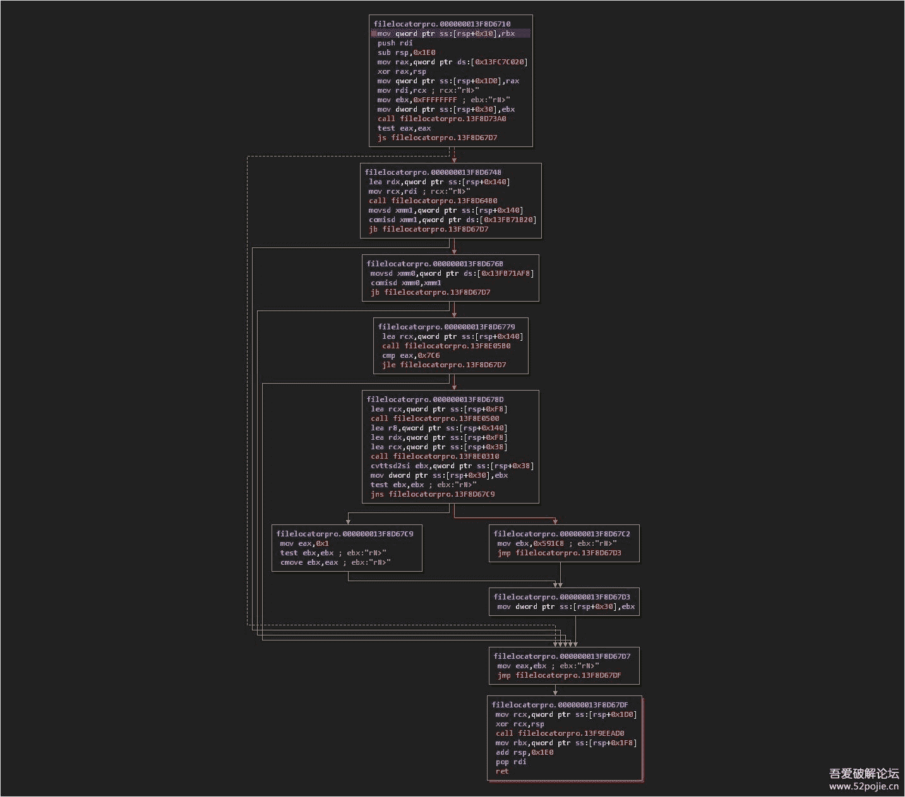

`09.JPG`（161.11 KB，下载次数: 2）

[下载附件](https://www.52pojie.cn/forum.php?mod=attachment&aid=MjY1NzMxOXwzMDZmYTdjZXwxNzkzNTcyOTc4fDE2ODA4NnwxODU4Nzcx&nothumb=yes)

2023-11-18 21:32 上传

通过流程图可以发现，这个子程序也是在计算什么东东，它的返回值 `EAX` 有三种情况：`FFFFFFFF`、`591C8` 和 `cmove ebx, eax`。如果这个 `CALL` 是计算试用期的话，哪个流向是正确的路径呢？显示试用期是在不断变化的，而只有第三个流向是个可变语句，前两个值似乎都不太靠谱，直接改第三句试一下。把 `cmove ebx, eax` 改为 `cmovns ebx, eax`，直接让 `ebx=eax=1`（条件永远成立，为什么呢，看流程图，前面的条件转移语句是什么），这样只需要改一个字节：

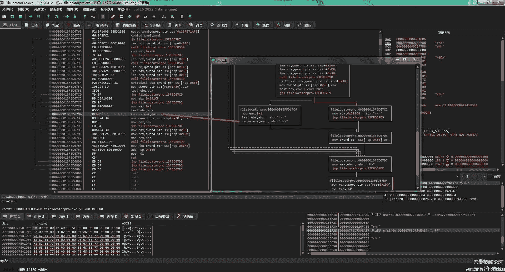

`10.JPG`（362.28 KB，下载次数: 3）

[下载附件](https://www.52pojie.cn/forum.php?mod=attachment&aid=MjY1NzMyMHw5M2NhMzE5YnwxNzkzNTcyOTc4fDE2ODA4NnwxODU4Nzcx&nothumb=yes)

2023-11-18 21:32 上传

打上补丁后运行一下，哈哈，不管日期改成哪天，试用期永远是 30 天！实际上再好好研究一下上面的 `CALL` 会发现，`ebx` 就是软件运行的天数，我们恰好把它设成了 1，设成 30 以内都没问题。

基本上就这样了，两种方法任选，效果一样，当然合起来也没问题。细心的人可能会发现一个问题：第一种方法修改后，软件“关于”对话框中仍然提示试用天数，但那只是显示的问题，对功能没有任何影响。当然你要觉得不爽，也可以把它改过来，这个与破解关系不大了，有兴趣就自己试试吧，就是下面的样子：

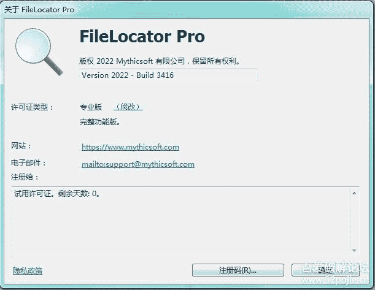

`11.JPG`（36.72 KB，下载次数: 4）

[下载附件](https://www.52pojie.cn/forum.php?mod=attachment&aid=MjY1NzMyMXxhNTEwMDBiMHwxNzkzNTcyOTc4fDE2ODA4NnwxODU4Nzcx&nothumb=yes)

2023-11-18 21:32 上传

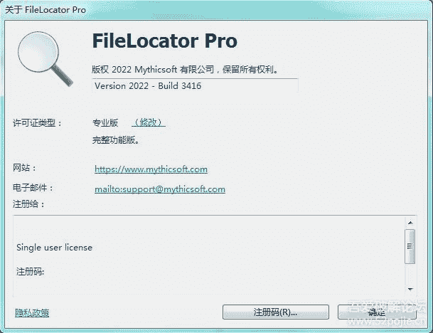

`12.JPG`（35.57 KB，下载次数: 3）

[下载附件](https://www.52pojie.cn/forum.php?mod=attachment&aid=MjY1NzMyMnwxYjBmMjgwY3wxNzkzNTcyOTc4fDE2ODA4NnwxODU4Nzcx&nothumb=yes)

2023-11-18 21:32 上传

## 大结局

# 补丁文件说明

压缩包里有三个补丁文件：方法一的补丁包 `patch1.1337`，方法二的补丁包 `patch2.1337`，`patch3.1337` 就是前两个补丁包合在一起，再加上完美显示修改补丁，有强迫症吾友就用这个吧。

[下载附件](https://www.52pojie.cn/forum.php?mod=attachment&aid=MjY1NzMyM3xmYThlNWRmNXwxNzkzNTcyOTc4fDE2ODA4NnwxODU4Nzcx)

- (384 Bytes, 下载次数: 1556)
- 2023-11-18 21:32 上传
- 点击文件名下载附件
- 下载积分: 吾爱币 -1 CB

## 2023-11-25 补充

### `IndexManager.exe` 的破解

之前没有注意到 `IndexManager.exe` 也需要破解，经过跟踪发现可以用上面的方式二进行破解。但破解完成后，新问题又出现了，有吾友反映，软件过了试用期后，用破解的程序在建立列表文件时卡住不动了，于是只得对破解过程做进一步分析。

利用我自己以前编写的一款切换系统时间的小程序，通过切换正确时间（试用期内）和错误时间（超过试用期），经过一系列跟踪，发现 `IndexManager.exe` 本身破解没什么问题，而是当它用 `CreateProcessW` 创建新进程调用 `flpidx.exe` 程序时，`flpidx.exe` 本身也有保护措施的。

### `flpidx.exe` 的破解

接来下就是对 `flpidx.exe` 进行破解了，破解本身难度也不太大，困难的是 `flpidx.exe` 是个命令行程序，命令行参数比较复杂，所以花了好几天在研究这个程序的正确使用方法了（工作之外业余时间，所以拖的比较久）。

### 破解原理

最终还是通过 API 的时间函数来破解的。原理是：`flpidx.exe` 从注册表中读取第一次运行的时间（一个加密的 `Double` 数值），然后用 `VariantTimeToSystemTime` 转换“年、月、星期、日……”格式（拦截这个 API 函数，可以知道注册时间的 `Double` 值）。然后用 `GetLocalTime` 函数读取系统时间，用 `SystemTimeToVariantTime` 转换成 `Double` 格式，与注册表中的注册时间进行比较，判断是否在 30 天以内。

### 破解方法

根据上述原理，破解方法是：在软件用 `GetLocalTime` 函数读取系统时间并用 `SystemTimeToVariantTime` 转换成 `Double` 格式后，把读取系统时间 `Double` 值的指令改成读取注册时间 `Double` 值，从而完成破解。

有时间再整理详细步骤吧，先把破解补丁放出来，提供大家测试，感谢吾友们的反馈，让我也学到了很多知识！

### 列表管理器补丁

[下载附件](https://www.52pojie.cn/forum.php?mod=attachment&aid=MjY1OTE4MXwzNDQ3NTQ1N3wxNzkzNTcyOTc4fDE2ODA4NnwxODU4Nzcx)

- (246 Bytes, 下载次数: 502)
- 2023-11-25 10:05 上传
- 点击文件名下载附件
- 下载积分: 吾爱币 -1 CB
