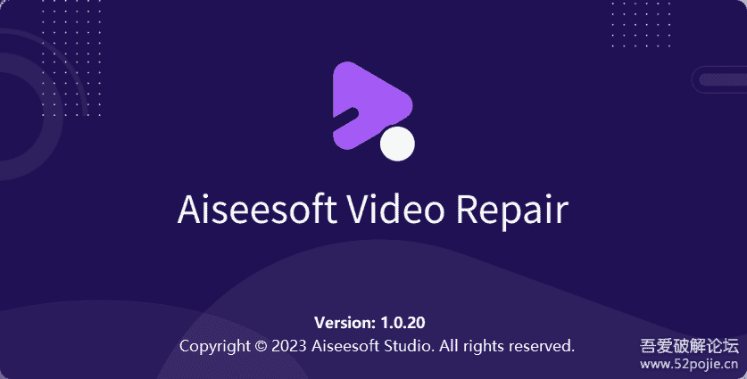

# [原创] Aiseesoft Video Repair v1.0.20 破解简单分析

- 原帖：<https://www.52pojie.cn/forum.php?mod=viewthread&tid=1858789>
- 抓取时间：2026-11-01T22:42:59

## 1、运行程序

首先运行程序，发现在窗口标题会显示“`Unregistered`”；

## 2、加载程序

退出程序，在 `X64DBG` 加载程序并运行，直到出现引导界面：



`2023-11-18_202856.png` (51.13 KB, 下载次数: 1)

[附件下载](https://www.52pojie.cn/forum.php?mod=attachment&aid=MjY1NzI5M3w5Mzk3NGRlYnwxNzkzNTcyOTc2fDE2ODA4NnwxODU4Nzg5&nothumb=yes)

2023-11-18 20:29 上传

## 3、搜索字符串

在反汇编区右键——搜索范围——所有用户模块——字符串应用，并查找`"Unregistered"`，得到一处，双击来到反汇编区：

```
00007FFC4479A62 | 40:53                  | PUSH RBX                                    | 》此为代码段首，在此 右键——查找引用——选定的地址，得到5处调用
00007FFC4479A62 | 48:83EC 30             | SUB RSP,0x30                                |
00007FFC4479A62 | 48:8BD9                | MOV RBX,RCX                                 |
00007FFC4479A62 | C74424 20 FFFFFFFF     | MOV DWORD PTR SS:[RSP+0x20],0xFFFFFFFF      |
00007FFC4479A63 | 45:33C9                | XOR R9D,R9D                                 |
00007FFC4479A63 | 48:8D0D 85BF1100       | LEA RCX,QWORD PTR DS:[（看关键代码注释，我都做出了分析）
```

## 4、查看调用

五处调用为：

```
00007FFC447864AB call
00007FFC447865A6 call
00007FFC447BA560 call
00007FFC447C0B30 call
00007FFC447D2760 call
```

选择第一个双击来到反汇编区：

```
00007FFC4478648 | E8 7BCD0000            | CALL （看关键代码注释，我都做出了分析）
```

## 5、修改关键 Call

进入关键 Call（`00007FFC4478648 CALL`，参考 [www.chinapyg.com](https://www.chinapyg.com/)）处 -1】

把 `MOV EAX,DWORD PTR DS:[RCX+0x2C]` 修改为：

```
MOV EAX,1
RET
```

## 6、注册码验证

在刚开始我们直接运行程序时提示我们输入邮箱和注册码进行注册，测试后会返回`"The registration code is invalid."`，接着搜索此字符串得到 7 处：

```
00007FFC424A2D73 lea r8,qword ptr ds:[7FFC4254F698] 00007FFC4254F698 "The registration code is invalid."
00007FFC424A3100 lea r8,qword ptr ds:[7FFC4254F698] 00007FFC4254F698 "The registration code is invalid."
00007FFC424A3941 lea r8,qword ptr ds:[7FFC4254F698] 00007FFC4254F698 "The registration code is invalid."
00007FFC424A3B09 lea r8,qword ptr ds:[7FFC4254F698] 00007FFC4254F698 "The registration code is invalid."
00007FFC424A7CEF lea r8,qword ptr ds:[7FFC4254F698] 00007FFC4254F698 "The registration code is invalid."
00007FFC424A7E2F lea r8,qword ptr ds:[7FFC4254F698] 00007FFC4254F698 "The registration code is invalid."
00007FFC424E0710 lea r8,qword ptr ds:[7FFC4254F698] 00007FFC4254F698 "The registration code is invalid."
```

## 7、分析反汇编代码

在第一个上双击来到反汇编区：（看关键代码注释，我都做出了分析）

```
00007FFC424A28C | 48:8BC4                | MOV RAX,RSP                                |
00007FFC424A28C | 55                     | PUSH RBP                                   |
00007FFC424A28C | 41:54                  | PUSH R12                                   |
00007FFC424A28C | 41:55                  | PUSH R13                                   |
00007FFC424A28C | 41:56                  | PUSH R14                                   |
00007FFC424A28C | 41:57                  | PUSH R15                                   |
00007FFC424A28C | 48:8D68 B1             | LEA RBP,QWORD PTR DS:[RAX-0x4F]            |
00007FFC424A28D | 48:81EC 90000000       | SUB RSP,0x90                               |
00007FFC424A28D | 48:C745 1F FEFFFFFF    | MOV QWORD PTR SS:[RBP+0x1F],0xFFFFFFFFFFFF |
00007FFC424A28D | 48:8958 08             | MOV QWORD PTR DS:[RAX+0x8],RBX             |
00007FFC424A28E | 48:8970 10             | MOV QWORD PTR DS:[RAX+0x10],RSI            |
00007FFC424A28E | 48:8978 18             | MOV QWORD PTR DS:[RAX+0x18],RDI            |
00007FFC424A28E | 4D:8BF1                | MOV R14,R9                                 |
00007FFC424A28E | 4D:8BE8                | MOV R13,R8                                 |
00007FFC424A28F | 48:8BDA                | MOV RBX,RDX                                |
00007FFC424A28F | 48:8BF9                | MOV RDI,RCX                                |
00007FFC424A28F | E8 C4380700            | CALL 书读百遍其义自见，仔细看呗！
```
