# [Web逆向] 记一次查询网站备案中滑块验证码的逆向分析

> 原帖：<https://www.52pojie.cn/forum.php?mod=viewthread&tid=1859105>
> 抓取时间：2026-11-01T22:42:55

近期闲来无事，正好拿这个滑块验证码练练手，顺便打发打发时间

## 一、抓包与参数分析

当我们进行网站查询时，会触发下面的验证码

`Snipaste_2023-11-19_21-18-57.jpg`（41.59 KB，下载次数：0），2023-11-19 21:53 上传 ｜ [附件链接](https://www.52pojie.cn/forum.php?mod=attachment&aid=MjY1NzUxNXxhNzQ3MmY0NnwxNzkzNTcyOTczfDE2ODA4NnwxODU5MTA1&nothumb=yes)

### 抓包查看请求参数

我们先进行 `F12` 抓包，看一下他的请求参数

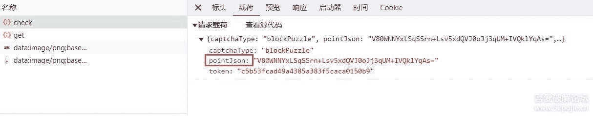
`Snipaste_2023-11-19_21-19-32.jpg`（38.5 KB，下载次数：0），2023-11-19 21:53 上传 ｜ [附件链接](https://www.52pojie.cn/forum.php?mod=attachment&aid=MjY1NzUxNnw0ODIxMDM0YnwxNzkzNTcyOTczfDE2ODA4NnwxODU5MTA1&nothumb=yes)

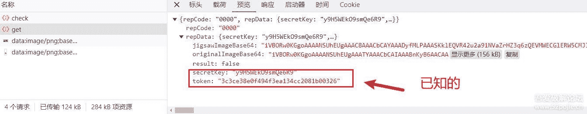
`Snipaste_2023-11-19_21-20-26.jpg`（64.2 KB，下载次数：0），2023-11-19 21:53 上传 ｜ [附件链接](https://www.52pojie.cn/forum.php?mod=attachment&aid=MjY1NzUxN3xjY2U4MGNiYnwxNzkzNTcyOTczfDE2ODA4NnwxODU5MTA1&nothumb=yes)

通过抓包发现，只有 `pointJson` 是一个未知的加密参数，我们对该参数进行 `base64` 解密，发现解码失败，这时我们可以确定这是一个加密参数。

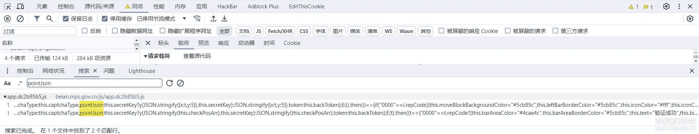
`Snipaste_2023-11-19_21-20-58.jpg`（128.4 KB，下载次数：0），2023-11-19 21:53 上传 ｜ [附件链接](https://www.52pojie.cn/forum.php?mod=attachment&aid=MjY1NzUxOHxlMjA2ZmNkOXwxNzkzNTcyOTczfDE2ODA4NnwxODU5MTA1&nothumb=yes)

### 全局搜索与断点定位

全局搜索关键字，找到两处结果，进去看一看，打上断点

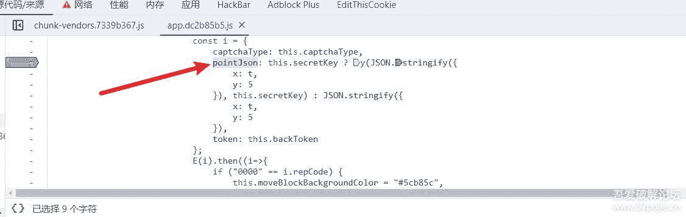
`Snipaste_2023-11-19_21-21-22.jpg`（46.87 KB，下载次数：0），2023-11-19 21:53 上传 ｜ [附件链接](https://www.52pojie.cn/forum.php?mod=attachment&aid=MjY1NzUxOXxkZDVkMmVkNnwxNzkzNTcyOTczfDE2ODA4NnwxODU5MTA1&nothumb=yes)

再次点击提交，嘿！您猜怎么着，断住了！

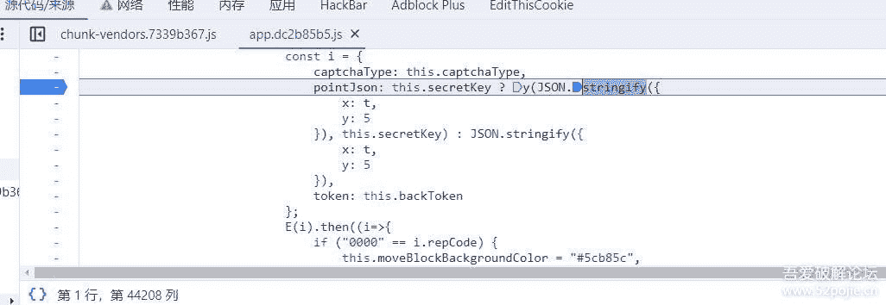
`Snipaste_2023-11-19_21-21-35.jpg`（46.43 KB，下载次数：0），2023-11-19 21:53 上传 ｜ [附件链接](https://www.52pojie.cn/forum.php?mod=attachment&aid=MjY1NzUyMHw1MTE2OThhMXwxNzkzNTcyOTczfDE2ODA4NnwxODU5MTA1&nothumb=yes)

### 追踪加密逻辑

这个地方是一个三元运算符，前面的 `secretKey` 我们确定这是已知的，所有直接看后面的内容就行，后面两个东西长得一样啊，那我们直接看前面的

直接把鼠标放上去，看看里面是个嘛

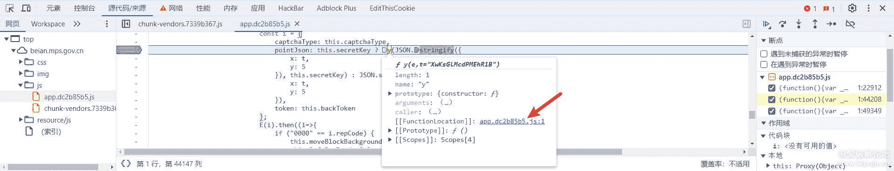
`Snipaste_2023-11-19_21-22-06.jpg`（109.45 KB，下载次数：0），2023-11-19 21:53 上传 ｜ [附件链接](https://www.52pojie.cn/forum.php?mod=attachment&aid=MjY1NzUyMXw0NTY2YWRlNXwxNzkzNTcyOTczfDE2ODA4NnwxODU5MTA1&nothumb=yes)

进去一看，是个很简短的加密。

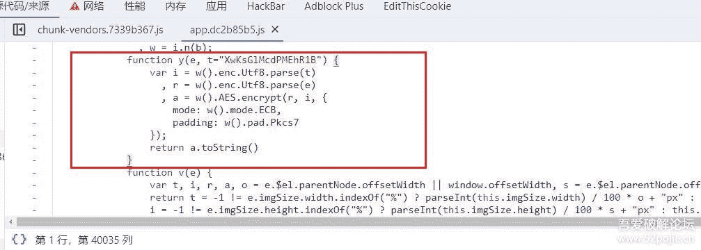
`Snipaste_2023-11-19_21-22-32.jpg`（65.05 KB，下载次数：0），2023-11-19 21:53 上传 ｜ [附件链接](https://www.52pojie.cn/forum.php?mod=attachment&aid=MjY1NzUyMnxjZmEzNTBlZHwxNzkzNTcyOTczfDE2ODA4NnwxODU5MTA1&nothumb=yes)

我们先打印一下看看这个 `y` 算出来是什么东西，顺便把里面的也打印一下

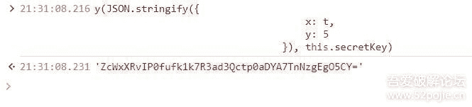
`Snipaste_2023-11-19_21-23-39.jpg`（13.95 KB，下载次数：0），2023-11-19 21:53 上传 ｜ [附件链接](https://www.52pojie.cn/forum.php?mod=attachment&aid=MjY1NzUyM3w1Zjk1ZDVhN3wxNzkzNTcyOTczfDE2ODA4NnwxODU5MTA1&nothumb=yes)

`Snipaste_2023-11-19_21-24-05.jpg`（10.13 KB，下载次数：0），2023-11-19 21:53 上传 ｜ [附件链接](https://www.52pojie.cn/forum.php?mod=attachment&aid=MjY1NzUyNHw2YWMyZDc1MHwxNzkzNTcyOTczfDE2ODA4NnwxODU5MTA1&nothumb=yes)

`x` 后面这个变量能在上面看到，是个计算后的值，说的是，获取移动坐标，然后去掉 `px`，下面的 `t` 是去掉 `px` 之后，乘除一下。

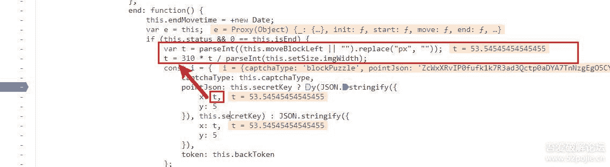
`Snipaste_2023-11-19_21-24-30.jpg`（57.09 KB，下载次数：0），2023-11-19 21:53 上传 ｜ [附件链接](https://www.52pojie.cn/forum.php?mod=attachment&aid=MjY1NzUyNXxlZDg0YzFjMnwxNzkzNTcyOTczfDE2ODA4NnwxODU5MTA1&nothumb=yes)

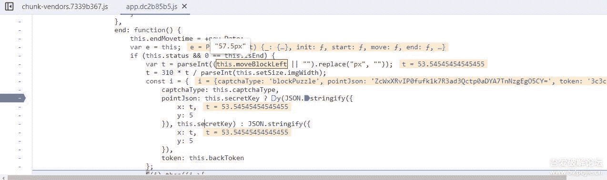
`Snipaste_2023-11-19_21-24-43.jpg`（66.85 KB，下载次数：0），2023-11-19 21:53 上传 ｜ [附件链接](https://www.52pojie.cn/forum.php?mod=attachment&aid=MjY1NzUyNnw3OTNlOGQzNXwxNzkzNTcyOTczfDE2ODA4NnwxODU5MTA1&nothumb=yes)

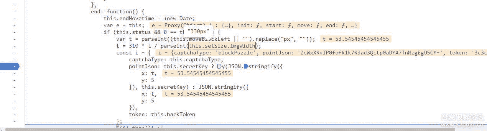
`Snipaste_2023-11-19_21-24-49.jpg`（60.65 KB，下载次数：0），2023-11-19 21:53 上传 ｜ [附件链接](https://www.52pojie.cn/forum.php?mod=attachment&aid=MjY1NzUyN3w2NzBhN2Y2YXwxNzkzNTcyOTczfDE2ODA4NnwxODU5MTA1&nothumb=yes)

## 二、扣取加密代码并验证

好了，现在我们知道 `y` 是怎么算的，也知道里面的参数是什么意思，咱直接给他抠出来看看怎么个事。

我这里直接把 `w()` 替换成 `crypot-js` 了，这里明眼人都知道，猜都不用猜，这地球还有别的加密函数长这样吗 {:1_918:}

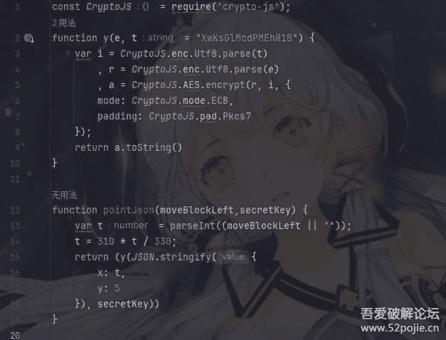
`Snipaste_2023-11-19_21-25-14.jpg`（42.24 KB，下载次数：0），2023-11-19 21:53 上传 ｜ [附件链接](https://www.52pojie.cn/forum.php?mod=attachment&aid=MjY1NzUyOHw5N2M4MTYxNXwxNzkzNTcyOTczfDE2ODA4NnwxODU5MTA1&nothumb=yes)

把刚才的参数放进去，打印一下看看对不对

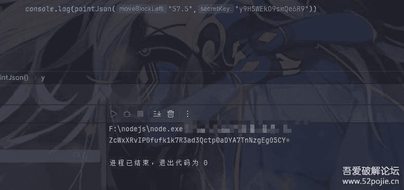
`Snipaste_2023-11-19_21-30-54.jpg`（35.22 KB，下载次数：0），2023-11-19 21:53 上传 ｜ [附件链接](https://www.52pojie.cn/forum.php?mod=attachment&aid=MjY1NzUyOXw2Njg5ODZiYnwxNzkzNTcyOTczfDE2ODA4NnwxODU5MTA1&nothumb=yes)

嘿，算对了，是不是一毛一样

## 三、模拟滑块验证

你以为到这里就完了吗，就光分析这个那也忒简单了。

连传的参数都分析出来了，这不模拟一下，不就浪费了吗

我们都知道滑块验证码需要把图片移动到对应的缺口上，通过刚才的分析，需要提交的参数只有 `x` 轴的坐标。

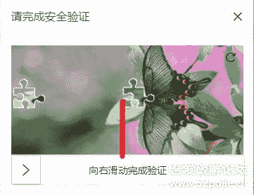
`Snipaste_2023-11-19_21-40-31.jpg`（18.5 KB，下载次数：0），2023-11-19 21:53 上传 ｜ [附件链接](https://www.52pojie.cn/forum.php?mod=attachment&aid=MjY1NzUzMXxhMDE4NzRhY3wxNzkzNTcyOTczfDE2ODA4NnwxODU5MTA1&nothumb=yes)

`F12` 看一下验证码图片，发现原图和接口传来的尺寸不一样，我们需要先对获取图片的接口进行 `base64` 解码，然后修改尺寸

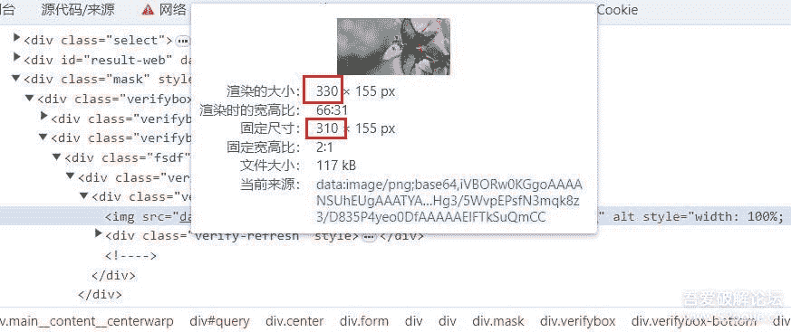
`Snipaste_2023-11-19_21-40-46.jpg`（60.01 KB，下载次数：1），2023-11-19 21:54 上传 ｜ [附件链接](https://www.52pojie.cn/forum.php?mod=attachment&aid=MjY1NzUzMnw0MDAwM2I2MXwxNzkzNTcyOTczfDE2ODA4NnwxODU5MTA1&nothumb=yes)

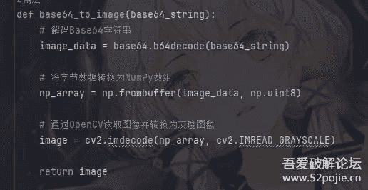
`Snipaste_2023-11-19_22-12-24.jpg`（25.61 KB，下载次数：0），2023-11-19 22:12 上传 ｜ [附件链接](https://www.52pojie.cn/forum.php?mod=attachment&aid=MjY1NzU0MnxhZmY5ZDk4NHwxNzkzNTcyOTczfDE2ODA4NnwxODU5MTA1&nothumb=yes)

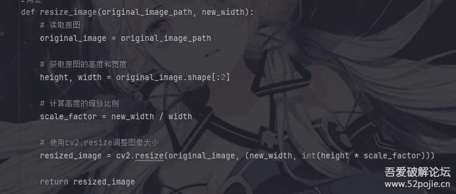

`Snipaste_2023-11-19_22-12-30.jpg` (37.38 KB, 下载次数: 0)

[href="forum.php?mod=attachment&aid=MjY1NzU0M3wwYzJiMTA3NHwxNzkzNTcyOTczfDE2ODA4NnwxODU5MTA1&nothumb=yes" target="_blank"](https://www.52pojie.cn/forum.php?mod=attachment&aid=MjY1NzU0M3wwYzJiMTA3NHwxNzkzNTcyOTczfDE2ODA4NnwxODU5MTA1&nothumb=yes)

2023-11-19 22:12 上传

然后我们使用`opencv`中的模板匹配来，确定缺口的位置

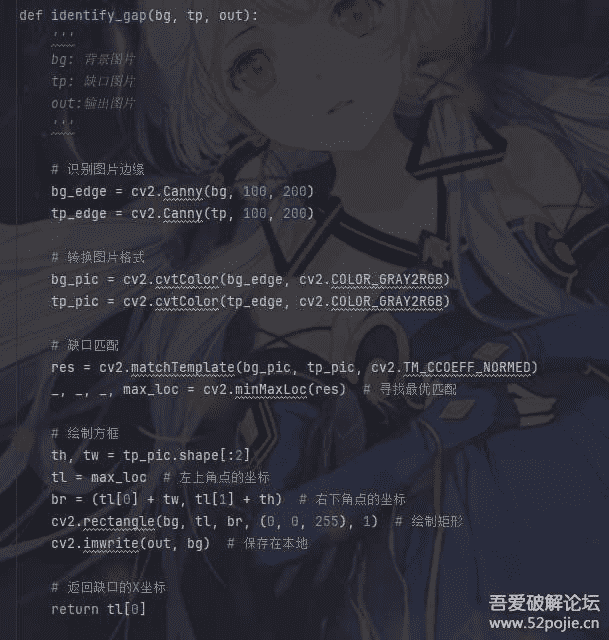

`Snipaste_2023-11-19_21-47-07.jpg` (61.33 KB, 下载次数: 0)

[href="forum.php?mod=attachment&aid=MjY1NzUzM3w3OTkzNWFkOXwxNzkzNTcyOTczfDE2ODA4NnwxODU5MTA1&nothumb=yes" target="_blank"](https://www.52pojie.cn/forum.php?mod=attachment&aid=MjY1NzUzM3w3OTkzNWFkOXwxNzkzNTcyOTczfDE2ODA4NnwxODU5MTA1&nothumb=yes)

2023-11-19 21:54 上传

然后运行一次看看

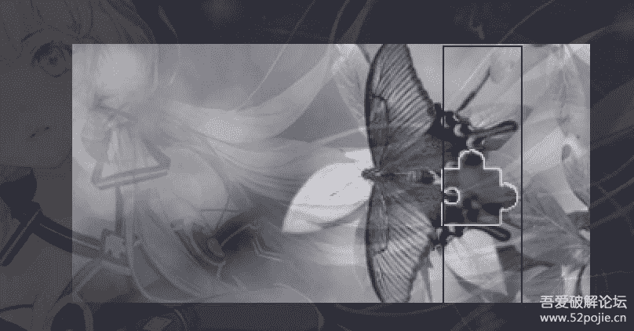

`Snipaste_2023-11-19_21-48-13.jpg` (37.05 KB, 下载次数: 0)

[href="forum.php?mod=attachment&aid=MjY1NzUzNXw4MTlkMDg3MnwxNzkzNTcyOTczfDE2ODA4NnwxODU5MTA1&nothumb=yes" target="_blank"](https://www.52pojie.cn/forum.php?mod=attachment&aid=MjY1NzUzNXw4MTlkMDg3MnwxNzkzNTcyOTczfDE2ODA4NnwxODU5MTA1&nothumb=yes)

2023-11-19 21:54 上传

嘿，匹配上了！

最后整合一下代码，查询一下阿里的域名

`Snipaste_2023-11-20_15-47-26.jpg` (22.7 KB, 下载次数: 0)

[href="forum.php?mod=attachment&aid=MjY1NzczNnw5NjU5NDkxN3wxNzkzNTcyOTczfDE2ODA4NnwxODU5MTA1&nothumb=yes" target="_blank"](https://www.52pojie.cn/forum.php?mod=attachment&aid=MjY1NzczNnw5NjU5NDkxN3wxNzkzNTcyOTczfDE2ODA4NnwxODU5MTA1&nothumb=yes)

2023-11-20 15:48 上传

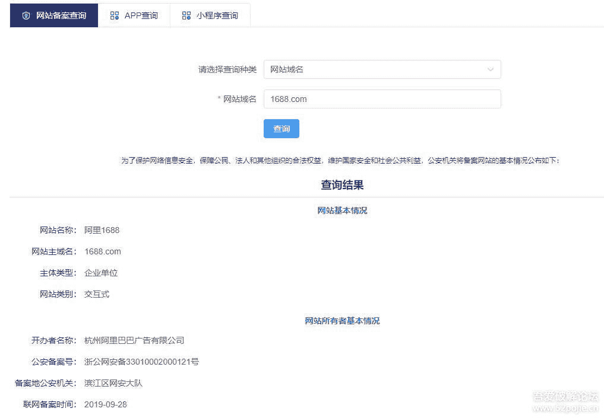

`Snipaste_2023-11-20_15-48-10.jpg` (53.38 KB, 下载次数: 0)

[href="forum.php?mod=attachment&aid=MjY1NzczN3w3MzFiZjk2YnwxNzkzNTcyOTczfDE2ODA4NnwxODU5MTA1&nothumb=yes" target="_blank"](https://www.52pojie.cn/forum.php?mod=attachment&aid=MjY1NzczN3w3MzFiZjk2YnwxNzkzNTcyOTczfDE2ODA4NnwxODU5MTA1&nothumb=yes)

2023-11-20 15:48 上传

嗯，只能说一毛一样。
