# [Web逆向] 【2023-11-26】分析 A+1 站的获取 UP 视频投稿接口变动

- 原帖: https://www.52pojie.cn/forum.php?mod=viewthread&tid=1862056
- 抓取时间: 2026-11-01T22:42:29

问：等等？？这 A+1 站 是什么意思？

答：这……（踱步靠近，又见四下无人，小声说）你对着英文字母表看一看，对！就这个，你看 A 后面是谁。

## 【2023-11-28】说明

具体见我在评论区的紧急补充……是我想的太复杂了，没有详细测试，咳咳……失误失误，思维惯性误导了。

不过文章还是有可取之处的吧……大概……。

## 风云又起：接口变化

今天修炼完成后准备看点好看的放松一下，结果我的 A+1 站 小脚本报错了。

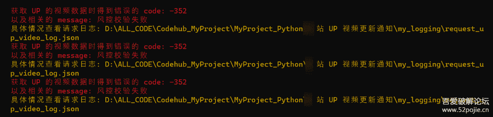
image-20231126201423437.png (124.36 KB, 下载次数: 2)
[附件链接](https://www.52pojie.cn/forum.php?mod=attachment&aid=MjY1OTYyMHw1N2IyMTRlYXwxNzkzNTcyOTQ3fDE2ODA4NnwxODYyMDU2&nothumb=yes)
2023-11-27 00:07 上传

猜测是请求的接口有了变化。

爬虫不能爬太狠，开发网站的人会掉头发，做爬虫的人也掉头发，最后大家都掉头发。

随便找一个 up 主页的链接：https://space.A+1站.com/up 的 `mid/video`，在无痕浏览器中打开，然后抓包、快速定位到相关请求。

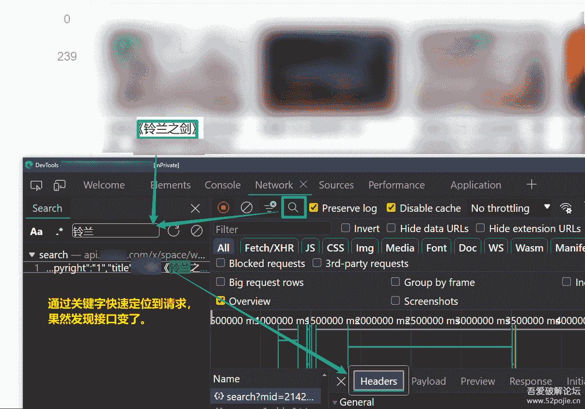
image-20231126201647206.png (317.01 KB, 下载次数: 1)
[附件链接](https://www.52pojie.cn/forum.php?mod=attachment&aid=MjY1OTYyMXw0YTEzNzgzMnwxNzkzNTcyOTQ3fDE2ODA4NnwxODYyMDU2&nothumb=yes)
2023-11-27 00:07 上传

发现接口的确变化了：多了 3 大天王。

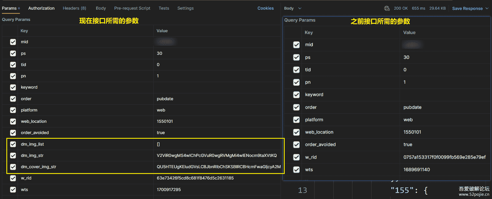
image-20231126151013211.png (160.23 KB, 下载次数: 1)
[附件链接](https://www.52pojie.cn/forum.php?mod=attachment&aid=MjY1OTYwMXw4MWI0MDVlZnwxNzkzNTcyOTQ3fDE2ODA4NnwxODYyMDU2&nothumb=yes)
2023-11-27 00:06 上传

为什么上面的 `dm_img_list` 为 `[]`，又为什么称它们为 3 大天王 呢？？

- 如果不是在无痕浏览器中直接打开网址测试，那么 `dm_img_list` 的值如下图，咳咳，没必要给自己找麻烦了，就默认 `dm_img_list` 这样吧。
- 至于另外的两大王，也不简单，具体见后文。

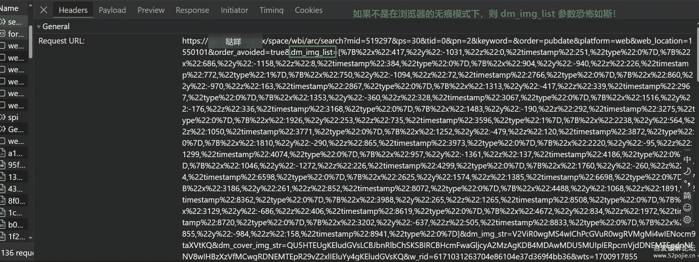
Snipaste_2023-11-27_00-17-27.jpg (417.78 KB, 下载次数: 2)
[附件链接](https://www.52pojie.cn/forum.php?mod=attachment&aid=MjY1OTYzNnw1NGNhOGNjOXwxNzkzNTcyOTQ3fDE2ODA4NnwxODYyMDU2&nothumb=yes)
2023-11-27 00:18 上传

当然啦，A+1站 又不是小网站，大佬肯定早已发现、解决了。

- 先去 A+1哩A+1哩-API收集整理 项目查看 [//socialsisteryi.github.io/bilibili-API-collect/docs/user/space.html#查询用户投稿视频明细](https://socialsisteryi.github.io/bilibili-API-collect/docs/user/space.html#查询用户投稿视频明细)，发现文档还没有更新，可能网站才刚刚更新那 3 大天王，文档稍微滞后一些。
- 在其 github 项目的 [//github.com/SocialSisterYi/bilibili-API-collect/issues/868](https://github.com/SocialSisterYi/bilibili-API-collect/issues/868) 中大家有所讨论。

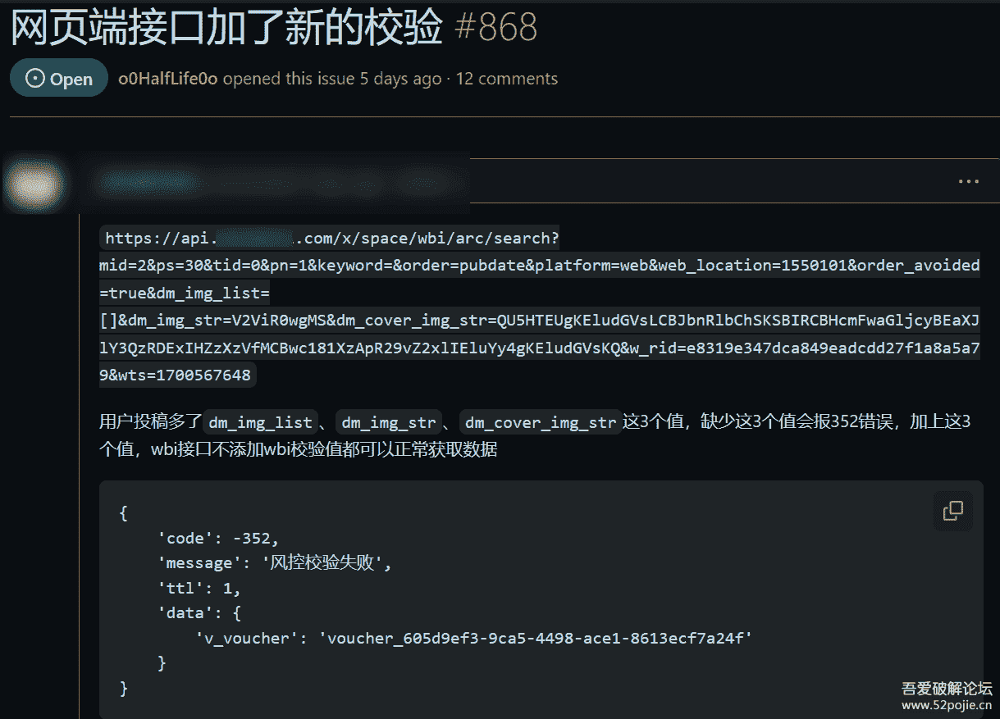
image-20231126201956927.png (151.99 KB, 下载次数: 0)
[附件链接](https://www.52pojie.cn/forum.php?mod=attachment&aid=MjY1OTYyMnw4NTk5MzQyMnwxNzkzNTcyOTQ3fDE2ODA4NnwxODYyMDU2&nothumb=yes)
2023-11-27 00:07 上传

为什么头像、用户名打码？

嗯……参考新闻联播，所以还是打码吧，不过内容是无法打码了。感兴趣可以去对应 issue 查看。

其中一个大佬给出了代码，并且经过测试得到了相同的信息……厉害呀！

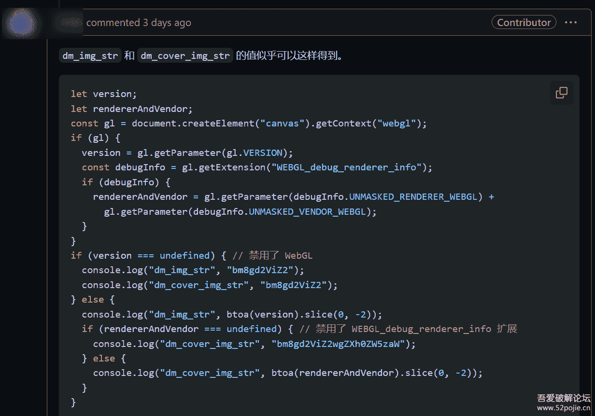
image-20231126152502323.png (156.64 KB, 下载次数: 0)
[附件链接](https://www.52pojie.cn/forum.php?mod=attachment&aid=MjY1OTYwM3w0YWI0OWE0MXwxNzkzNTcyOTQ3fDE2ODA4NnwxODYyMDU2&nothumb=yes)
2023-11-27 00:06 上传

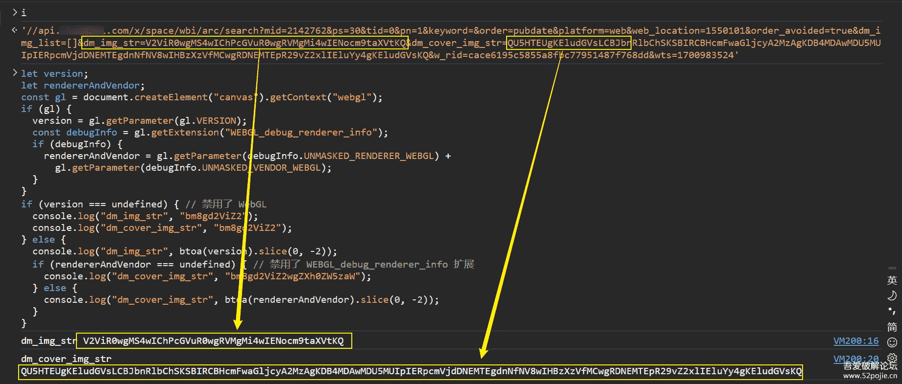
image-20231126202041312.png (241.34 KB, 下载次数: 1)
[附件链接](https://www.52pojie.cn/forum.php?mod=attachment&aid=MjY1OTYyM3w5YjU2ODQ2NHwxNzkzNTcyOTQ3fDE2ODA4NnwxODYyMDU2&nothumb=yes)
2023-11-27 00:07 上传

还有一位道友给出了本站的链接，不过不知道是什么原因，两天了这个帖子还打不开……（小声说）所以你会看到本文的图片对敏感信息已经打码了。


image-20231126153647251.png (36.13 KB, 下载次数: 1)
[附件链接](https://www.52pojie.cn/forum.php?mod=attachment&aid=MjY1OTYwNHwzZmJkNThlOXwxNzkzNTcyOTQ3fDE2ODA4NnwxODYyMDU2&nothumb=yes)
2023-11-27 00:06 上传

总之，问题其实已经解决了。不过——因为我自己在用这个接口，自然要了解它的一些变化以便将来应对它的其它变化啦。而在上面的 issues 中大家并没有说分析过程，所以我试着分析一下，发现其中弯弯绕绕 “有点意思”，才有了这篇文章。

## 诡异身法：找不到的它

直接搜索关键字并没有结果。

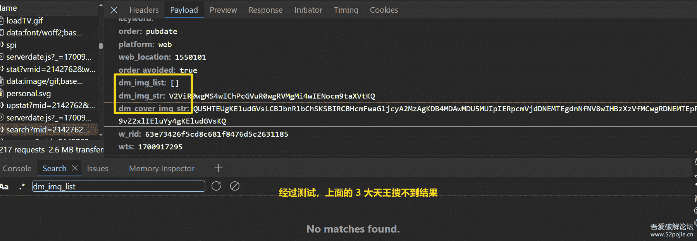
image-20231126154036371.png (149.24 KB, 下载次数: 1)
[附件链接](https://www.52pojie.cn/forum.php?mod=attachment&aid=MjY1OTYwNXw5Y2JhODkyYXwxNzkzNTcyOTQ3fDE2ODA4NnwxODYyMDU2&nothumb=yes)
2023-11-27 00:06 上传

如果使用 `xhr` 断点，哼哼，好长好长的调用栈，并且夹杂了很多异步操作…………我拒绝分析！！

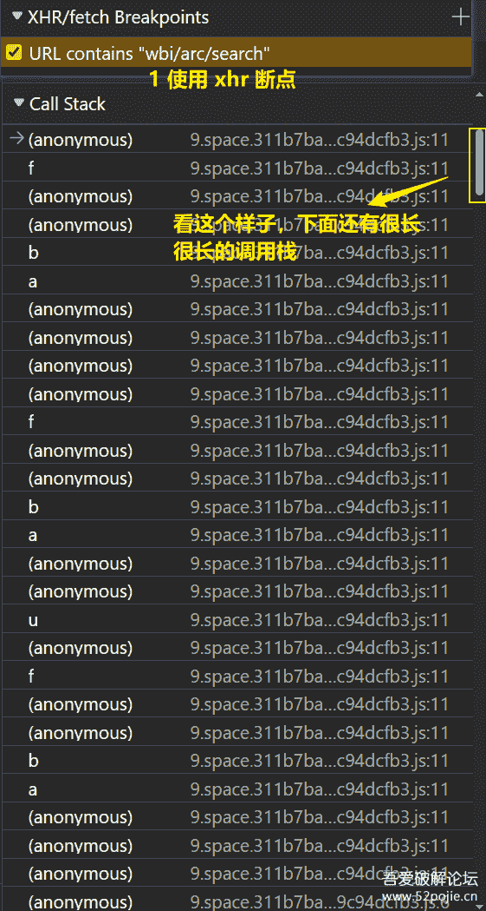
image-20231126154359787.png (210.33 KB, 下载次数: 1)
[附件链接](https://www.52pojie.cn/forum.php?mod=attachment&aid=MjY1OTYwNnxjMTJjNDYxZHwxNzkzNTcyOTQ3fDE2ODA4NnwxODYyMDU2&nothumb=yes)
2023-11-27 00:06 上传

当然，如果全局搜索请求的部分内容，如搜索字符串 `wbi/arc/search` 倒是能找到几个地方，但还需要分析很久。

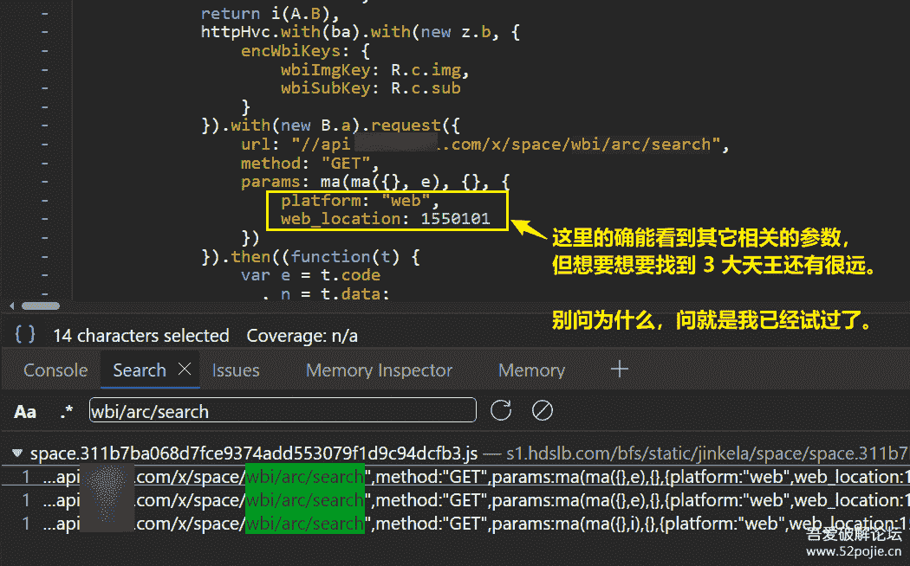
image-20231126202853880.png (166.17 KB, 下载次数: 0)
[附件链接](https://www.52pojie.cn/forum.php?mod=attachment&aid=MjY1OTYyNHw3YzgwNzJlNXwxNzkzNTcyOTQ3fDE2ODA4NnwxODYyMDU2&nothumb=yes)
2023-11-27 00:07 上传

以前碰到过这种情况，通常情况下 `xhr` 断点、搜索请求的 `url` 这两个方法基本能找到参数的位置，如今遭受到打击了。

经过在必应搜索关键词：`js` 逆向搜不到关键字，查看了一些文章，主要是在 [//blog.csdn.net/qq523176585/article/details/109508054](https://blog.csdn.net/qq523176585/article/details/109508054) 受到启发：使用浏览器的内存工具来分析。

### 仙器 chatGPT

如下，在 `xhr` 断点处生成内存快照，然后搜索 `dm_img_str` 参数的值，可以确定它是 `base64 encode` 的字符串。

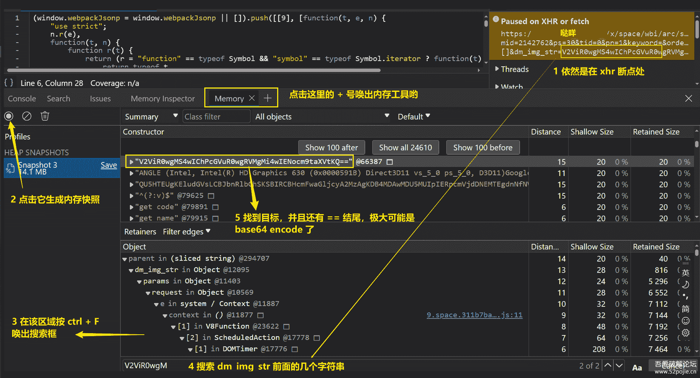
image-20231126232836227.png (370.9 KB, 下载次数: 1)
[附件链接](https://www.52pojie.cn/forum.php?mod=attachment&aid=MjY1OTYzNHxlOTUyYjIwYnwxNzkzNTcyOTQ3fDE2ODA4NnwxODYyMDU2&nothumb=yes)
2023-11-27 00:07 上传

进行 `base64 decode`，得到的是一个和 `webgl` 有关的、很像是版本号的字符串。

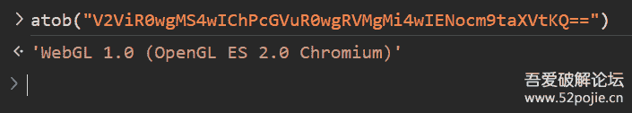
image-20231126160239200.png (21.7 KB, 下载次数: 0)
[附件链接](https://www.52pojie.cn/forum.php?mod=attachment&aid=MjY1OTYwN3w5MDg0MmEyMHwxNzkzNTcyOTQ3fDE2ODA4NnwxODYyMDU2&nothumb=yes)
2023-11-27 00:06 上传

通过一个名为 openAi 的神秘组织锻造的仙器 chatGPT，得知 `webgl` 获取其版本信息的相关函数，从而定位到 `dm_img_str` 的生成位置！

这比我去 MDN 看 `webgl` 文档、或者必应搜索好多了，不愧是仙器。

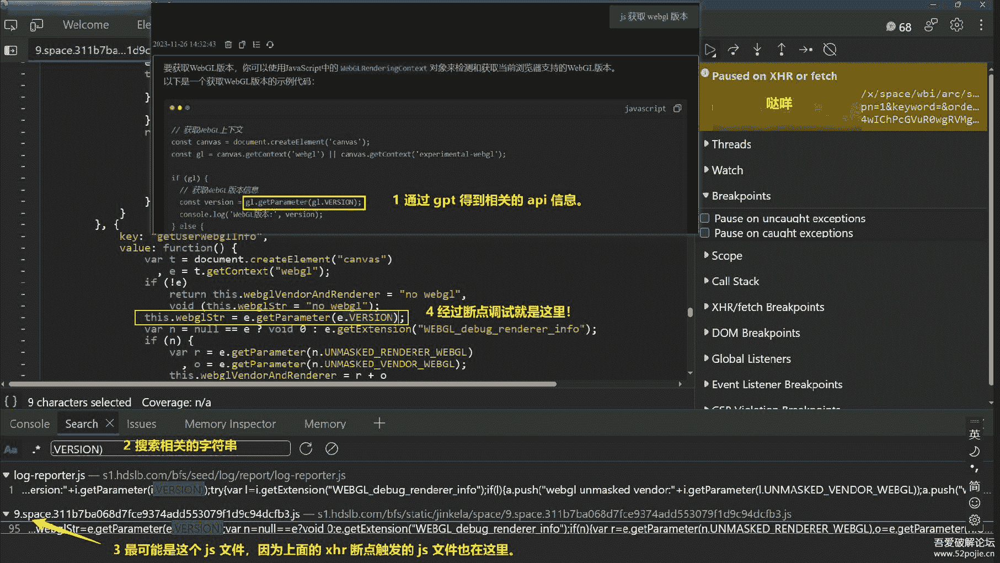
Snipaste_2023-11-27_00-56-45.jpg (286.91 KB, 下载次数: 1)
[附件链接](https://www.52pojie.cn/forum.php?mod=attachment&aid=MjY1OTYzN3wwMWM4ZWNiNHwxNzkzNTcyOTQ3fDE2ODA4NnwxODYyMDU2&nothumb=yes)
2023-11-27 00:58 上传

同理，也能定位到 `dm_cover_img_str` 参数的生成位置！

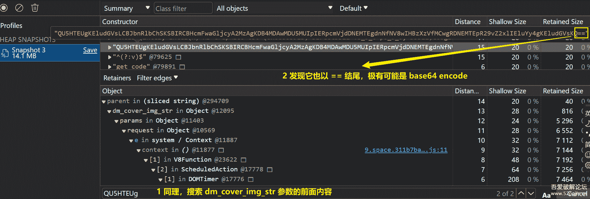
image-20231126161004336.png (216.16 KB, 下载次数: 1)


[附件](https://www.52pojie.cn/forum.php?mod=attachment&aid=MjY1OTYwOXwwYzkxMDU2NXwxNzkzNTcyOTQ3fDE2ODA4NnwxODYyMDU2&nothumb=yes)

2023-11-27 00:06 上传

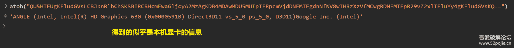

image-20231126161140788.png (48.31 KB, 下载次数: 1)

[附件](https://www.52pojie.cn/forum.php?mod=attachment&aid=MjY1OTYxMHw5MmEyMjJlN3wxNzkzNTcyOTQ3fDE2ODA4NnwxODYyMDU2&nothumb=yes)

2023-11-27 00:06 上传

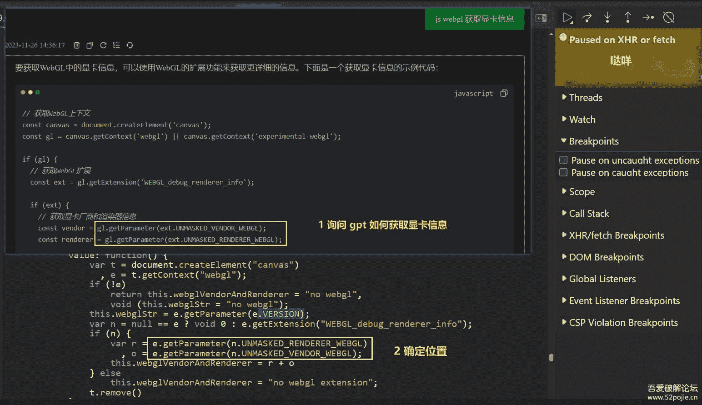

Snipaste_2023-11-27_00-30-02.jpg (180.69 KB, 下载次数: 1)

[附件](https://www.52pojie.cn/forum.php?mod=attachment&aid=MjY1OTYzOHxlMTA5MDRhNXwxNzkzNTcyOTQ3fDE2ODA4NnwxODYyMDU2&nothumb=yes)

2023-11-27 00:30 上传

### 运气也是实力嘛~

咳咳，上述情况只能说 “凑巧”，谁让它最后多了两个 `==` 号呢……不过这样的事情我也有点不满意，下次碰到了没有那两个 `==` 号让我辨认该怎么办？？而且这种内存分析方式我还是第一次见到，多试一试。

下面再说明一下这种内存分析的方式。

> 注意，如果关键字的名称很短，比如 `"d"`，那么这种方法也可能失效，就像平时全局搜索关键字时一样，关键字很短时效果就差很多啦。

在本文的番外篇中讨论这个问题。

在内存快照中搜索参数的名字 `dm_img_str`（名字越长效果越好，就像普通的全局搜索关键字一样），找到了它的马甲：`webglStr`。

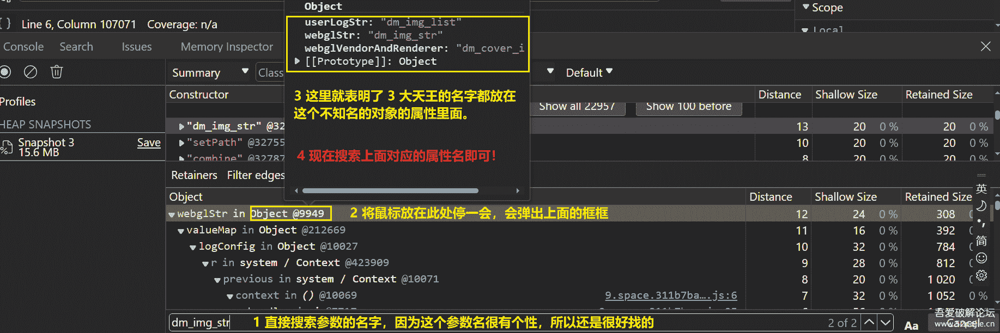

image-20231126205000392.png (237.93 KB, 下载次数: 1)

[附件](https://www.52pojie.cn/forum.php?mod=attachment&aid=MjY1OTYyNXw3YzRkMzMxOXwxNzkzNTcyOTQ3fDE2ODA4NnwxODYyMDU2&nothumb=yes)

2023-11-27 00:07 上传

然后全局搜索 `webglStr:` 或者 `webglStr=`，统统打上断点，因为我们需要找到对它赋值的地方，那里可能就是 `dm_img_str` 的来历。

> 其实打断点调试多处的 `webglStr` 时，就可以看到一些 `weglStr` 包含的就是 `dm_img_str` 的值。

大概是如下这种情况

- 曾经有某个 `x` 对象，`x = { webglStr: "dm_img_str" }`
- 然后有一个变量也名为 `webglStr`，它存储 `dm_img_str` 参数的值
- 另一个对象 `y` 有这种操作：`y[x.webglStr] = webglStr`

就是因为全部都用了同一个名字，导致全局搜索 `webglStr` 时顺便把真正的 `dm_img_src` 值给搜出来了。嘿~！真凑巧呢！

不过都到这地步了还是多多讲一些。

如下，见到了其来历。

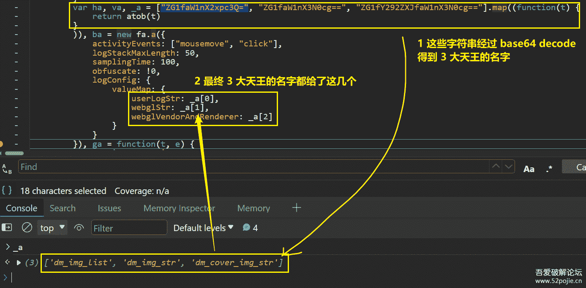

image-20231126210432516.png (139.5 KB, 下载次数: 1)

[附件](https://www.52pojie.cn/forum.php?mod=attachment&aid=MjY1OTYyNnwwMzhkYzhmNXwxNzkzNTcyOTQ3fDE2ODA4NnwxODYyMDU2&nothumb=yes)

2023-11-27 00:07 上传

可是，即便知道了 `dm_img_str` 名字的由来，那又如何根据这个名字找到 `dm_img_str` 参数值生成的地方呢，上述代码中也没见到和它参数值有关的代码呀。

下面就是重点了，仔细观察这个名为 `dm_img_str` 的字符串，它有几个非常重要的特点：

- 它是一个字符串。（废话，大家都看不出来吗？？）。
- 它是作为名称来使用的，也就是说它将来会作为请求中参数的名字。
- 正因为它会作为 “名字” 使用，反而对它的处理就会非常简单：通常只有取值操作而已，谁还能对一个本该作为名称使用的字符串做些奇奇怪怪的操作，计算机性能强也不是用在这里的嘛。
- 那么将该字符串替换成 `Proxy` 对象，找到取它的值的地方不就好了！并且那么所有关于该字符串赋值地方都会复制同一个 `Proxy`！

所以，准备如下 hook 函数！

```
// 快速根据字符串创建代{过}{滤}理，从而跟踪它的取值
window.create_str_proxy = function (str) {
    let temp = { "v": str };

    return new Proxy(temp, {
        get(target, property, receiver) {
            console.log("访问代{过}{滤}理字符串的属性: ", property);

            if (typeof temp["v"][property] === "function") {
                if (property === "toString" || property === "valueOf") {
                    // 到取值的地方就暂停！！！
                    debugger;
                }
                // 如果访问底层字符串方法还需要绑定 this 哟
                return temp["v"][property].bind(temp["v"]);
            }
            // 此时就是访问字符串的普通属性啦
            return temp["v"][property];
        }
    })
}
```

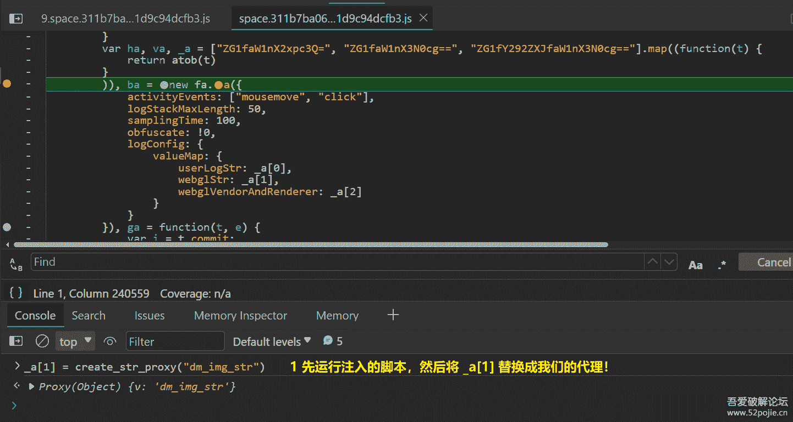

image-20231126222051143.png (140.03 KB, 下载次数: 1)

[附件](https://www.52pojie.cn/forum.php?mod=attachment&aid=MjY1OTYyN3xmYmY1ZmZhZXwxNzkzNTcyOTQ3fDE2ODA4NnwxODYyMDU2&nothumb=yes)

2023-11-27 00:07 上传

点击运行，找到了~~~！

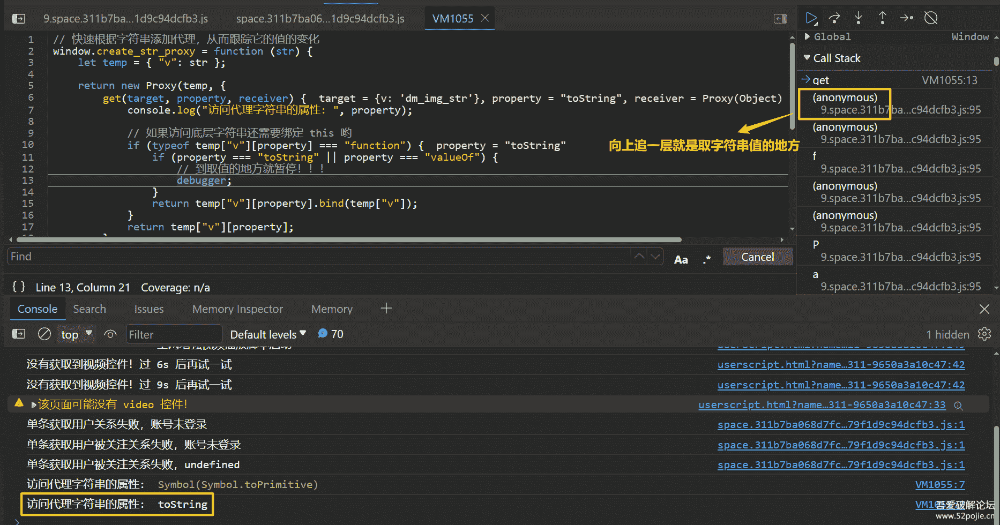

image-20231126222142818.png (308.33 KB, 下载次数: 2)

[附件](https://www.52pojie.cn/forum.php?mod=attachment&aid=MjY1OTYyOHxmYzEwOGM2ZnwxNzkzNTcyOTQ3fDE2ODA4NnwxODYyMDU2&nothumb=yes)

2023-11-27 00:07 上传

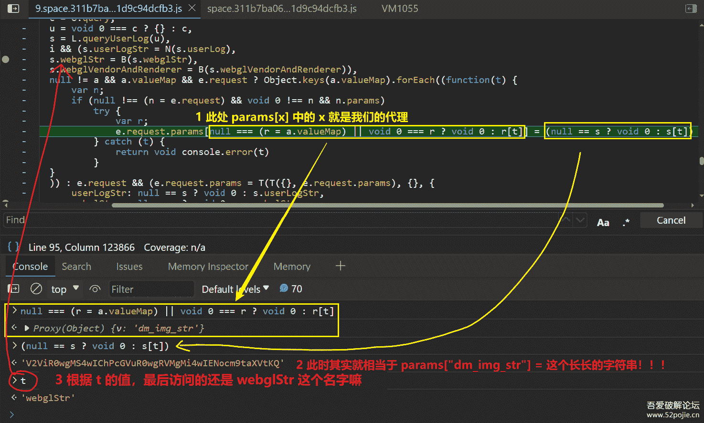

image-20231126225058484.png (226.87 KB, 下载次数: 0)

[附件](https://www.52pojie.cn/forum.php?mod=attachment&aid=MjY1OTYzMHxjZTBjMjdlMHwxNzkzNTcyOTQ3fDE2ODA4NnwxODYyMDU2&nothumb=yes)

2023-11-27 00:07 上传

而上图中 `s.webglStr = B(s.webglStr)` 的 `B` 函数如下，嘿！还真把末尾的两个等号去掉了。

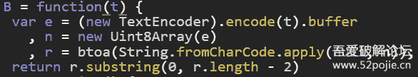

image-20231126230738422.png (32.85 KB, 下载次数: 2)

[附件](https://www.52pojie.cn/forum.php?mod=attachment&aid=MjY1OTYzMnxjYTBkMjRiMXwxNzkzNTcyOTQ3fDE2ODA4NnwxODYyMDU2&nothumb=yes)

2023-11-27 00:07 上传

根据上面的分析，只要继续找所有 `webglStr` 就可以找到了！

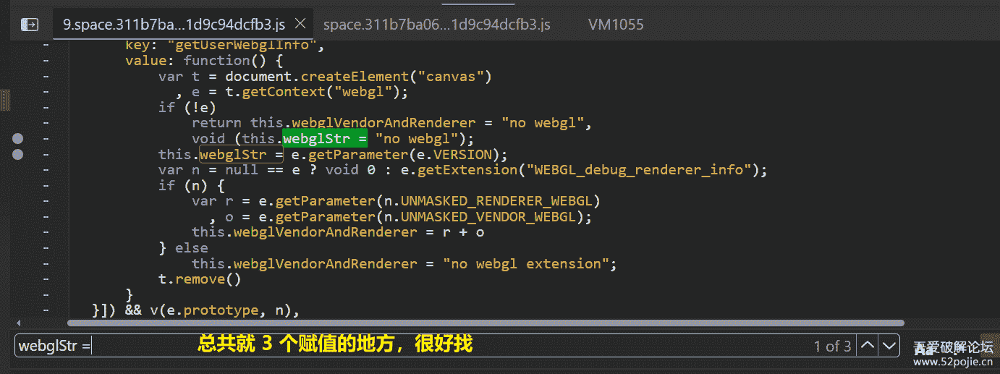

image-20231126222638766.png (134.79 KB, 下载次数: 1)

[附件](https://www.52pojie.cn/forum.php?mod=attachment&aid=MjY1OTYyOXwzM2Y1NzkxMXwxNzkzNTcyOTQ3fDE2ODA4NnwxODYyMDU2&nothumb=yes)

2023-11-27 00:07 上传

同理，利用上面的 `Proxy` 原理，也可以找到 `"dm_cover_img_str"` 的参数值啦！！

### 3. 结束了吗？？

也就是说：`dm_img_str` 是当前浏览器的 webgl 的版本（具体我也不清楚，没用过 webgl），`dm_cover_img_str` 是显卡的信息，这两个值几乎可以认为是固定的，所以直接把浏览器实际请求使用的这两个参数值拿过来添加到以前的代码中即可。

至于 `dm_img_list` 设置为空就行，它太长了，反正没有它照样可以请求。

另外，经过测试，`w_rid`（另一个重要的参数，不在本文讨论范围之类）的生成并没有依赖上面的 3 大天王。

至此，算是勉强解决了。

### 2. 试试看 `dm_img_list`

都到这里了，干脆也就试着分析它吧（虽然它的用处不大……）。

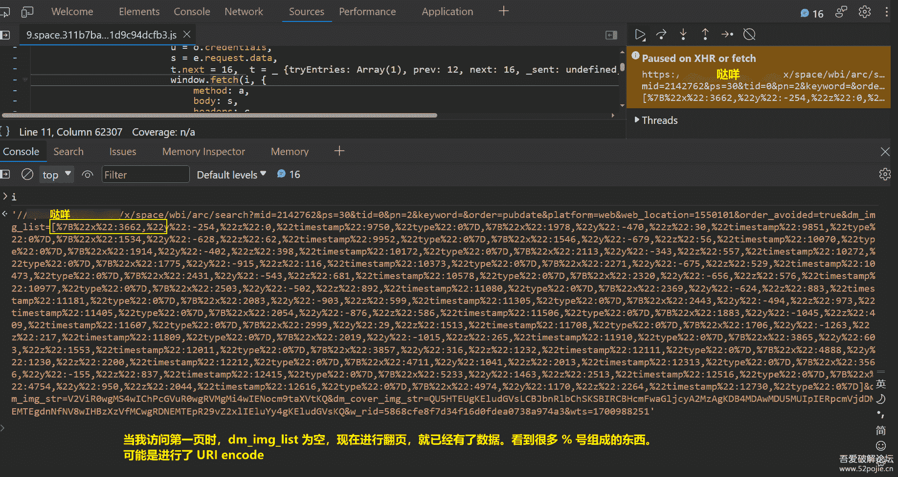

image-20231126235211151.png (397.19 KB, 下载次数: 2)

[附件](https://www.52pojie.cn/forum.php?mod=attachment&aid=MjY1OTYzNXwyZGEwNGMzNHwxNzkzNTcyOTQ3fDE2ODA4NnwxODYyMDU2&nothumb=yes)

2023-11-27 00:07 上传

如下，可以确定它是利用 `JSON.stringify` 转换而来。

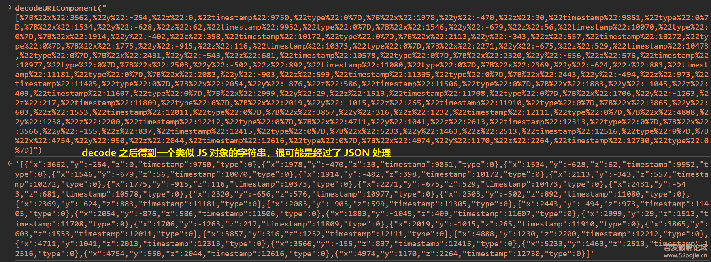

image-20231126165020104.png (345.62 KB, 下载次数: 2)

[附件](https://www.52pojie.cn/forum.php?mod=attachment&aid=MjY1OTYxMnxjNDAwNjY5MXwxNzkzNTcyOTQ3fDE2ODA4NnwxODYyMDU2&nothumb=yes)

2023-11-27 00:06 上传

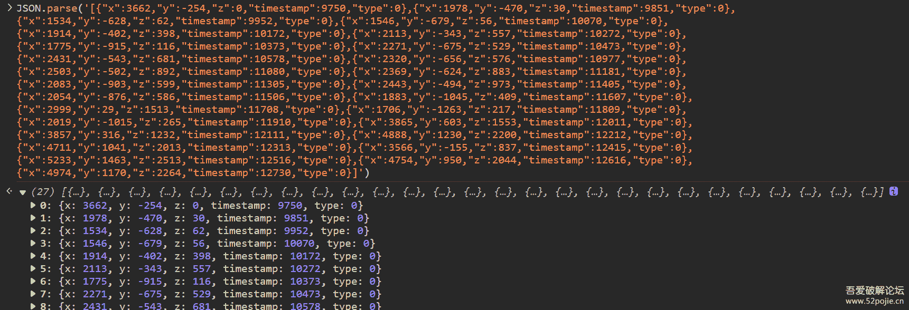

image-20231126165041861.png (232.83 KB, 下载次数: 1)

[附件](https://www.52pojie.cn/forum.php?mod=attachment&aid=MjY1OTYxM3xiZDE4MDZiNnwxNzkzNTcyOTQ3fDE2ODA4NnwxODYyMDU2&nothumb=yes)

2023-11-27 00:06 上传

全局搜索关键词 `JSON.stringify` 会有很多结果，这时候就需要通过 hook 了。

```
let my_json_stringify = JSON.stringify;

JSON.stringify = function (a) {

    console.log("========== JSON stringify Start ==========");

    // 根据上图的分析，传给 stringify 的是一个数组哟

    // 而数组的元素是一个对象，含有 x、y、z 等属性，根据这些特征进行详细地判断

    if (Array.isArray(a) && a[0]?.hasOwnProperty("x") && a[0]?.hasOwnProperty("y") && a[0]?.hasOwnProperty("z") && a[0]?.hasOwnProperty("timestamp")) {

        debugger;

    }

    console.log(a);

    console.log("========== JSON stringify End ==========");

    return my_json_stringify(a);

}
```

如下，在进行翻页时看到了目标！

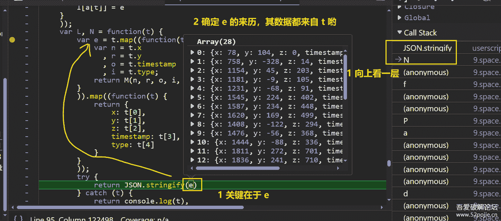

image-20231126171300953.png (216.61 KB, 下载次数: 1)


https://www.52pojie.cn/forum.php?mod=attachment&aid=MjY1OTYxNHw1YzA2ZjllMXwxNzkzNTcyOTQ3fDE2ODA4NnwxODYyMDU2&nothumb=yes

2023-11-27 00:07 上传

上述的 `t` 其实就是下图中的 `s.userLog`，并且意外的看到了其它 2 大王。

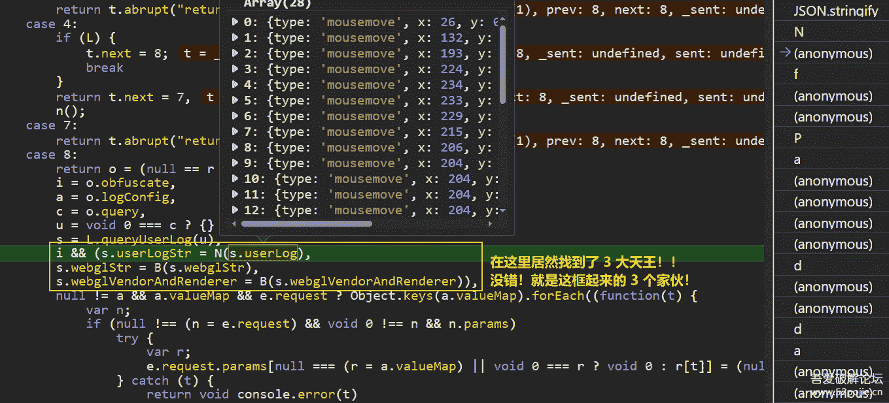

image-20231126171548339.png (248.79 KB, 下载次数: 2)

https://www.52pojie.cn/forum.php?mod=attachment&aid=MjY1OTYxNXxhMTFmMTE2NHwxNzkzNTcyOTQ3fDE2ODA4NnwxODYyMDU2&nothumb=yes

2023-11-27 00:07 上传

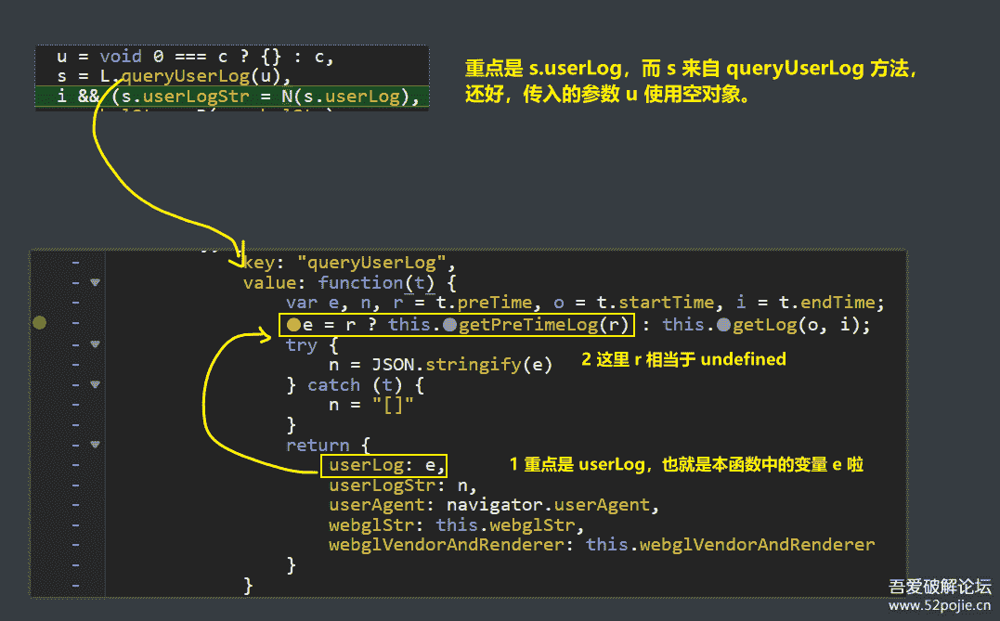

image-20231126172154649.png (121.89 KB, 下载次数: 1)

https://www.52pojie.cn/forum.php?mod=attachment&aid=MjY1OTYxNnwxZGFiN2ExNnwxNzkzNTcyOTQ3fDE2ODA4NnwxODYyMDU2&nothumb=yes

2023-11-27 00:07 上传

所以关键数据来自于上面的 `this.getLog(o, i)` 方法，最后经过查找，它取了 `this.logStack` 的值进行处理。

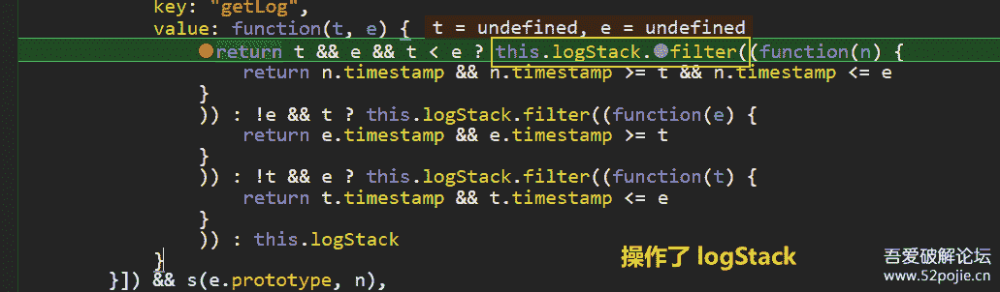

image-20231126172700424.png (70.87 KB, 下载次数: 1)

https://www.52pojie.cn/forum.php?mod=attachment&aid=MjY1OTYxN3w1N2NkOGMwMnwxNzkzNTcyOTQ3fDE2ODA4NnwxODYyMDU2&nothumb=yes

2023-11-27 00:07 上传


image-20231126172732557.png (38.82 KB, 下载次数: 2)

https://www.52pojie.cn/forum.php?mod=attachment&aid=MjY1OTYxOHxjNzQwNjQyMXwxNzkzNTcyOTQ3fDE2ODA4NnwxODYyMDU2&nothumb=yes

2023-11-27 00:07 上传

而要往数组添加数据有 `.push`、`unshift` 等等，找到了它的代码。此处并没有详细分析，只是看了个大概，毕竟没有它也能访问接口啦，只是好奇。

在翻页的时候会记录鼠标、键盘操作，然后发给服务器。

我也可以在浏览器中输入网址直接进入对应页数的网页，所以这个 `dm_img_list` 参数可以为空，直接默认它为 `[]` 即可。

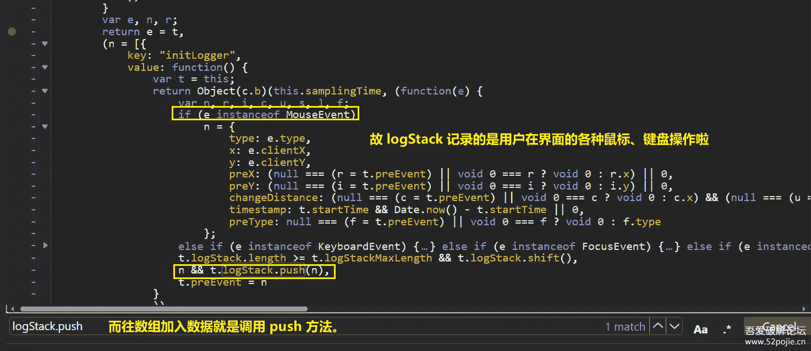

image-20231126172924154.png (161.01 KB, 下载次数: 1)

https://www.52pojie.cn/forum.php?mod=attachment&aid=MjY1OTYxOXxmODNiNjc5Y3wxNzkzNTcyOTQ3fDE2ODA4NnwxODYyMDU2&nothumb=yes

2023-11-27 00:07 上传

## 尾声

修为越高，斗法的对手也越强，就更需要好的灵器、并且熟练运用它们。

- 比如熟悉浏览器开发者工具的使用。
- 各种逆向工具（比如 `v_jstools`：https://github.com/cilame/v_jstools）。

其实，利用合适的灵器，今天的 3 大天王 能很快突破。

- 比如有写好的 hook 能直接将各种常用的解密函数的结果输出
- 只要将这些输出和 `dm_img_str` 的值稍微一对比就能知道其位置的了。

如下，在 `v_jstools` 中启动这些东西。

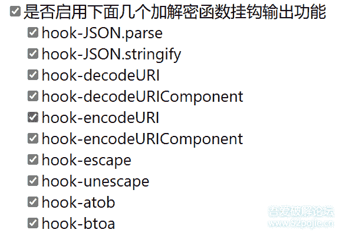

image-20231126230042632.png (56.49 KB, 下载次数: 1)

https://www.52pojie.cn/forum.php?mod=attachment&aid=MjY1OTYzMXxiM2UyNDg1ZHwxNzkzNTcyOTQ3fDE2ODA4NnwxODYyMDU2&nothumb=yes

2023-11-27 00:07 上传

然后在控制台搜索相关参数名字是能搜索到的，不过 A+1 站自己定义了 `btoa` 函数，导致插件没有将其 hook 掉，故无法直接搜索 `dm_img_str` 的参数值啦，不过知道了 hook 原理也能直接修改网站的 js 文件啦。

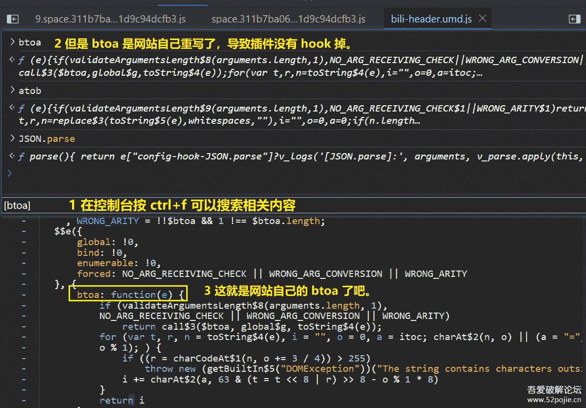

image-20231126231432436.png (216.3 KB, 下载次数: 1)

https://www.52pojie.cn/forum.php?mod=attachment&aid=MjY1OTYzM3wyODk1YWU2YnwxNzkzNTcyOTQ3fDE2ODA4NnwxODYyMDU2&nothumb=yes

2023-11-27 00:07 上传

## 番外：搜索的关键字太短

无论是以前的全局搜索关键字，还是今天的在内存分析界面中搜索关键字都有一个缺点：如果关键字太短则搜索结果太多。

此时可以试一试 浏览器内存漫游 的方法，可以理解为它是一种大型的 hook，据作者所说可以做到 “通杀”，具体见 https://github.com/JSREI/ast-hook-for-js-RE。

我并没有尝试，现有的灵器还用不顺手呢，也许当关键字隐藏太深时，可以一试。
