# [Web逆向] 绕过 AGE 动漫的 wasm 加密与解密函数

- 原帖：<https://www.52pojie.cn/forum.php?mod=viewthread&tid=1862975>
- 抓取时间：2026-11-01T22:42:27

## 前言

此次修炼一举突破到了练气三层初期！终于可以和日思夜想的三阶灵兽论道了（ヾ(≧▽≦*)o）。

注：所谓灵兽，便是纳天地日月精华修行（搜集各种资源），初通人意（无泛滥广告），后识文墨、知礼节（可以评论区求资源），修为渐深亦可化形（有 app），倘若臻至天阶更有一丝机缘激活血脉得远古神兽的传承（唉~远古神兽自然就是倒闭的网站了，再修炼下去，就要被不知名的神秘组织从修仙界抹除）。

此次论道的网站是 AGE 动漫：（base64 encode）`aHR0cHM6Ly93d3cuYWdlZG0ub3Jn`。

### 郑重声明

因为是与灵兽论道，为了保护灵兽，此次仅仅重点记录如何绕过最核心的 `WebAssembly` 加密与解密部分，其它部分将省略（其它的参数利用普通方法就能解决，只要花点耐心呐）。

当然，如何定位到加密的位置我依然会详细讲解的。

阅读本文时，如果有以下知识将更游刃有余：

- 了解 JavaScript 的 `Proxy` 对象
- 了解 JavaScript `WebAssembly` API。

如果大家对文中提到的一些概念都已经理解，但是文章看不懂，请一定要记住：这一定是我的问题，是我没有讲解清楚。毕竟每个人的经历、感悟不同，我在描述时难免不达意。

## 芳踪难觅

先启动浏览器无痕模式，打开某一集动漫的播放页（base64 encode）：`aHR0cHM6Ly93d3cuYWdlZG0ub3JnL3BsYXkvMjAyMzAyMTYvMS84`，等待视频加载出来。

按照我的习惯，先利用审查元素看看视频所在的网页标签，发现视频在一个 `iframe` 标签中。关于此标签的作用、含义具体见 [`iframe` 文档](https://developer.mozilla.org/zh-CN/docs/Web/HTML/Element/iframe)，简单来说是网页之中嵌套了另一个网页。

这个最初的视频播放页链接我取名为：`anime_paly_url`，即看动漫时所在的网页，以便后文讨论。

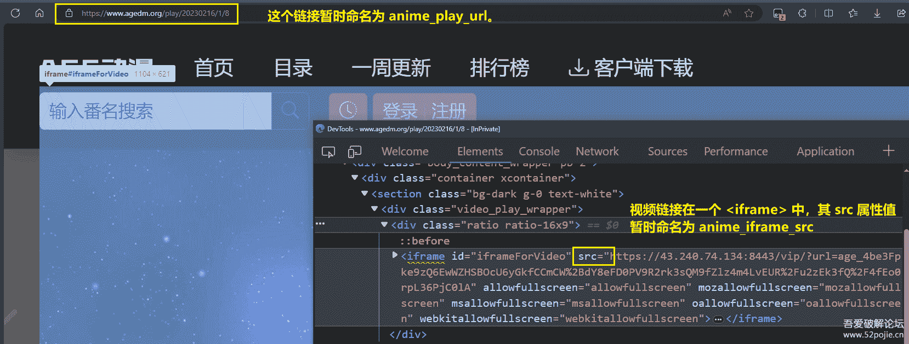

`image-20231128112642076.png`（281.2 KB，下载次数：3）

[附件下载](https://www.52pojie.cn/forum.php?mod=attachment&aid=MjY2MDExNHw1OWY2MzQ0NXwxNzkzNTcyOTQ1fDE2ODA4NnwxODYyOTc1&nothumb=yes)

2023-11-28 22:21 上传

所以我直接将上图中的 `iframe` 标签的 `src` 属性值复制出来。这里我又要取名了，将这个链接称之为 `anime_iframe_src`，即动漫播放页中的 `iframe` 标签的 `src` 值。

在无痕浏览器的新标签页中打开这个 `anime_iframe_src`！同样，等待视频加载出来，优先利用审查元素查看视频所在的标签。

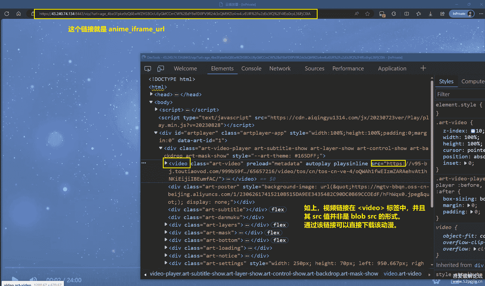

`image-20231128113109243.png`（699.08 KB，下载次数：4）

[附件下载](https://www.52pojie.cn/forum.php?mod=attachment&aid=MjY2MDEwNHxiY2FmMzZiM3wxNzkzNTcyOTQ1fDE2ODA4NnwxODYyOTc1&nothumb=yes)

2023-11-28 22:21 上传

这里我将上图中的动漫下载地址取名为 `anime_video_src`。

现在需要确定上图中的 `iframe` 的 `src` 属性值，也就是 `anime_video_src` 是否就存在于静态的 HTML 中，所以需要查看网页源代码……可是，这个网页已经被视频占据了，所以无法通过点击右键来选择“看网页源代码”的功能。

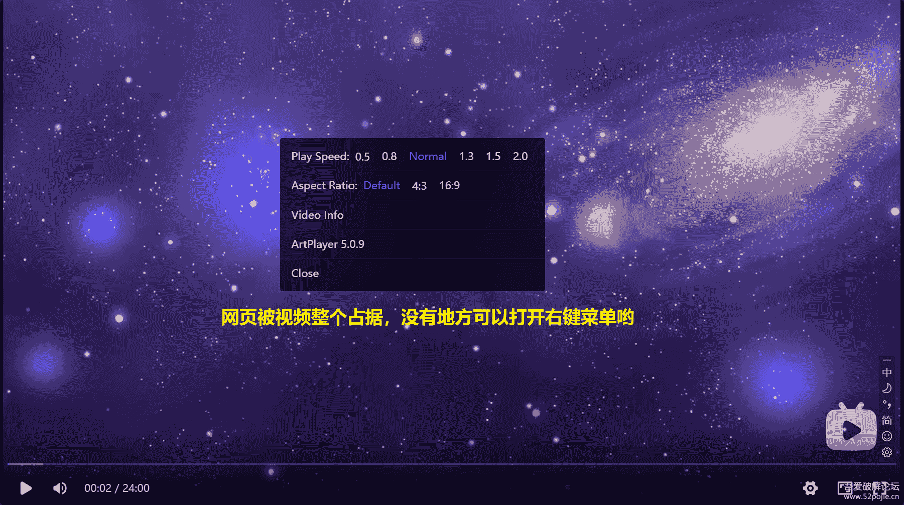

`image-20231128143629220.png`（1.2 MB，下载次数：4）

[附件下载](https://www.52pojie.cn/forum.php?mod=attachment&aid=MjY2MDEwMnw1MDM1NTRiMHwxNzkzNTcyOTQ1fDE2ODA4NnwxODYyOTc1&nothumb=yes)

2023-11-28 22:20 上传

这里手动添加前缀：


`view-source:这里是 anime_iframe_src 的值`

# 还记得 `anime_iframe_src` 这个名字吗

如下，可以看到网页的源代码了，并且确定视频的 `video` 标签、链接是动态生成的！

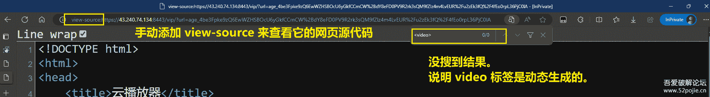

`image-20231128113620186.png` (91.59 KB, 下载次数: 4)

[附件下载](https://www.52pojie.cn/forum.php?mod=attachment&aid=MjY2MDEzM3xjYTMxMDg4NnwxNzkzNTcyOTQ1fDE2ODA4NnwxODYyOTc1&nothumb=yes)

2023-11-28 22:23 上传

问：为什么不通过浏览器抓包界面来查看网页的源代码呢？？

答：具体见后文的说明，这一步其实和后续的操作有关。

注意！现在这种情况是：

- 浏览器在某个时刻得到了视频的链接，它并没有用 JS 去请求。
- 是创建了 `video` 标签，然后把视频的链接写到了其 `src` 属性上！
- 所以抓包分析、查看该视频的请求时，其 `Initiator` 是看不到结果的。

## 此地无银三百两

按照我的习惯，现在需要快速浏览 HTML 源代码来查看可疑的内容。

在此之前我要说明一下为什么我要使用浏览器中的 "查看网页源代码" 功能，而不是在抓包工具中查看（之前的文章并没有提到这一点）。也算是我斗法的经验。

以西瓜视频为例，在抓包界面查看网页代码其实不利于快速定位数据。如下图所示：

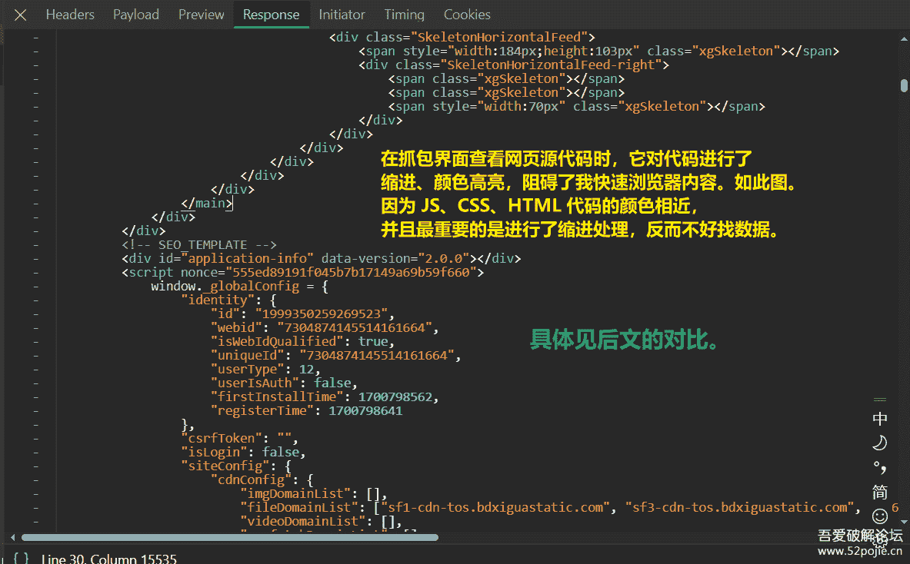

`image-20231128114014212.png` (166.58 KB, 下载次数: 5)

[附件下载](https://www.52pojie.cn/forum.php?mod=attachment&aid=MjY2MDEyN3xhYWE3YzkzNnwxNzkzNTcyOTQ1fDE2ODA4NnwxODYyOTc1&nothumb=yes)

2023-11-28 22:22 上传

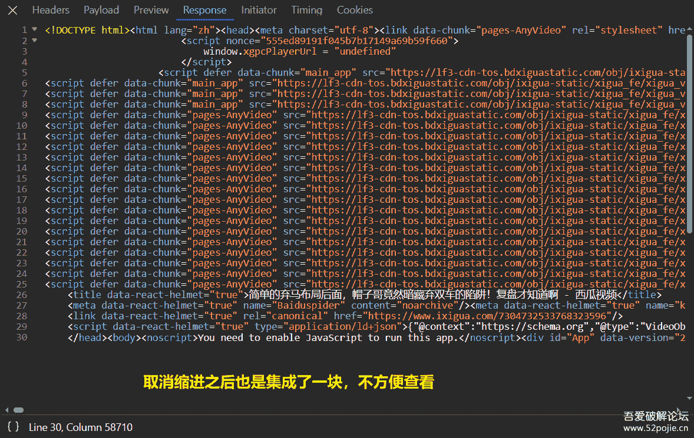

`image-20231128114051583.png` (231.39 KB, 下载次数: 2)

[附件下载](https://www.52pojie.cn/forum.php?mod=attachment&aid=MjY2MDEyMHxhNjA3Y2ZiMnwxNzkzNTcyOTQ1fDE2ODA4NnwxODYyOTc1&nothumb=yes)

2023-11-28 22:22 上传

但是在 “查看网页源代码” 中我可以大概、快速定位关键数据。

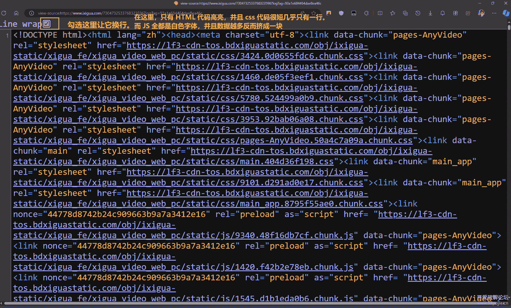

`image-20231128114113379.png` (585.65 KB, 下载次数: 2)

[附件下载](https://www.52pojie.cn/forum.php?mod=attachment&aid=MjY2MDEwN3w1OWYxMzQwM3wxNzkzNTcyOTQ1fDE2ODA4NnwxODYyOTc1&nothumb=yes)

2023-11-28 22:21 上传

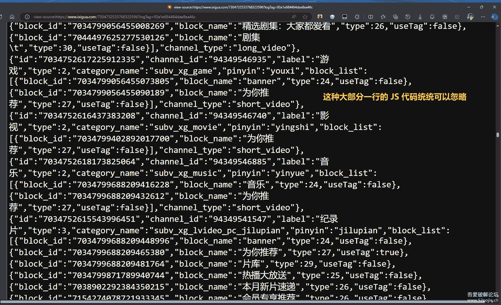

`image-20231128114140992.png` (468.35 KB, 下载次数: 3)

[附件下载](https://www.52pojie.cn/forum.php?mod=attachment&aid=MjY2MDExMHwzM2YzYzk3NXwxNzkzNTcyOTQ1fDE2ODA4NnwxODYyOTc1&nothumb=yes)

2023-11-28 22:21 上传

如下，像这种一大块白色字体挤在一起，中间的空白很少，并且由看不懂的数字、字母组成，那么极大概率就是关键的数据了。这就是 “此地无银三百两”，因为关键的数据经过处理之后通常都很长，需要多行显示，结果却挤在一起了。

当鼠标滚轮快速滚动或者利用鼠标中键快速浏览器网页源代码时，下图这种一大块白色的区域非常显眼，这样就可以快速定位到可能的关键位置啦。

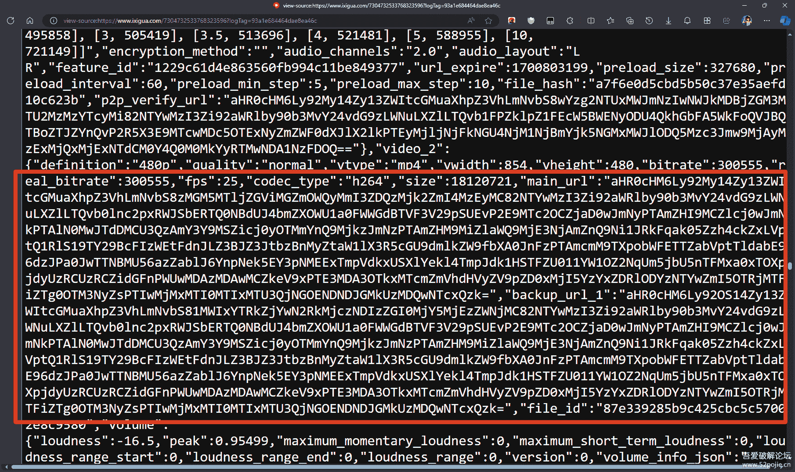

`image-20231128114206317.png` (566.37 KB, 下载次数: 4)

[附件下载](https://www.52pojie.cn/forum.php?mod=attachment&aid=MjY2MDEwOXxjMzczOTEzYnwxNzkzNTcyOTQ1fDE2ODA4NnwxODYyOTc1&nothumb=yes)

2023-11-28 22:21 上传

当然，找到可疑的位置后就可以在抓包页面查看缩进、美化之后的网页源代码来进行分析了。如果此种快速浏览的方法不行那就需要别的方法了。

好了，介绍了这个斗法经验，现在需要回到原来的事情上。

最终在 `anime_iframe_src` 的网页源代码中找到了可疑的信息：一个名为 `Vurl` 字符串（请记住这个名字，后文我将会多次提及到它）。

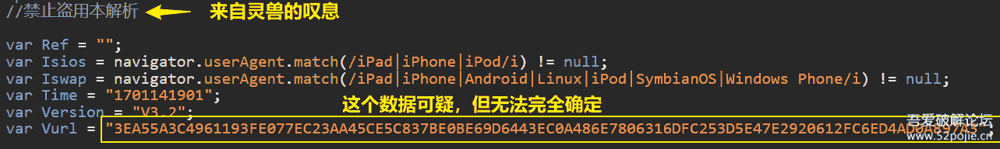

`image-20231128114631071.png` (72.52 KB, 下载次数: 2)

[附件下载](https://www.52pojie.cn/forum.php?mod=attachment&aid=MjY2MDEzNHw3NDI0NGU1MHwxNzkzNTcyOTQ1fDE2ODA4NnwxODYyOTc1&nothumb=yes)

2023-11-28 22:23 上传

## 露出小尾巴：`Vurl`

虽然 `Vurl` 最可疑，但还需要确定是不是它。如下是我的确认方式。

首先，在视频正常播放的情况下，确认了 `Vurl` 的值从出现开始就没有变化，只好继续分析。

因为遇到过一些情况：

- 加密的数据放在全局变量或属性 `x` 中
- 网站经过一段时间的运行，`x` 的值变成了解密后的数据

然后，手动修改 `Vurl` 的值看看结果。

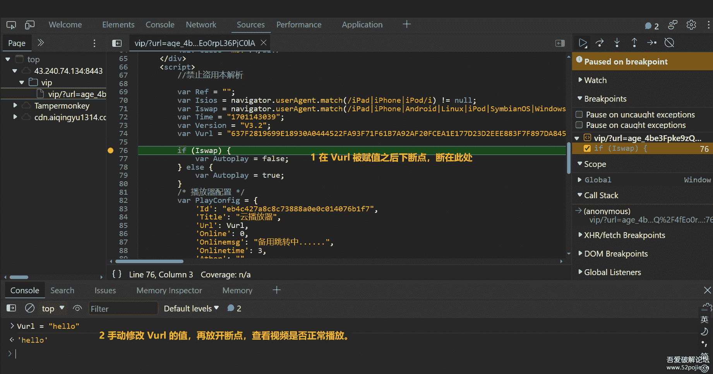

`image-20231128144141606.png` (268.52 KB, 下载次数: 3)

[附件下载](https://www.52pojie.cn/forum.php?mod=attachment&aid=MjY2MDExNXxlOTVhOTllY3wxNzkzNTcyOTQ1fDE2ODA4NnwxODYyOTc1&nothumb=yes)

2023-11-28 22:21 上传

最终，出现了下图！到了这里我可以大胆确定：哪怕动漫的链接不是从 `Vurl` 解密获取，那也和它脱不了干系，跟着它就能找到核心位置！


`image-20231128114949087.png` (596.39 KB, 下载次数: 3)

[附件下载](https://www.52pojie.cn/forum.php?mod=attachment&aid=MjY2MDEwOHwxMGRlZGU5Y3wxNzkzNTcyOTQ1fDE2ODA4NnwxODYyOTc1&nothumb=yes)

2023-11-28 22:21 上传

故，根据前面的分析，一定是把 `Vurl` 的值传到了某个地方。因为其名字很具有 “个性”，所以尝试全局搜索，最终定位到了关键位置。

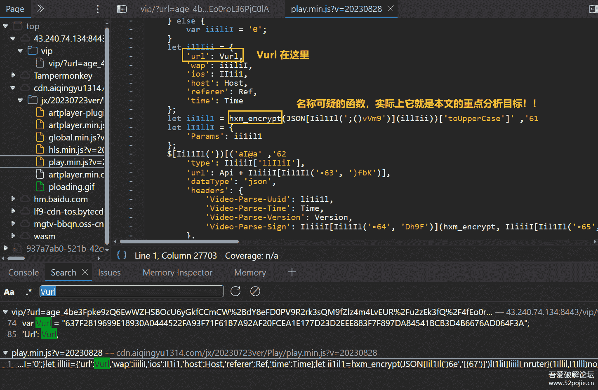

`image-20231128115153044.png` (248.82 KB, 下载次数: 4)

[附件下载](https://www.52pojie.cn/forum.php?mod=attachment&aid=MjY2MDExOXwxNzgzNjQ3NnwxNzkzNTcyOTQ1fDE2ODA4NnwxODYyOTc1&nothumb=yes)

2023-11-28 22:22 上传

观察其四周的代码，有大概的过程。

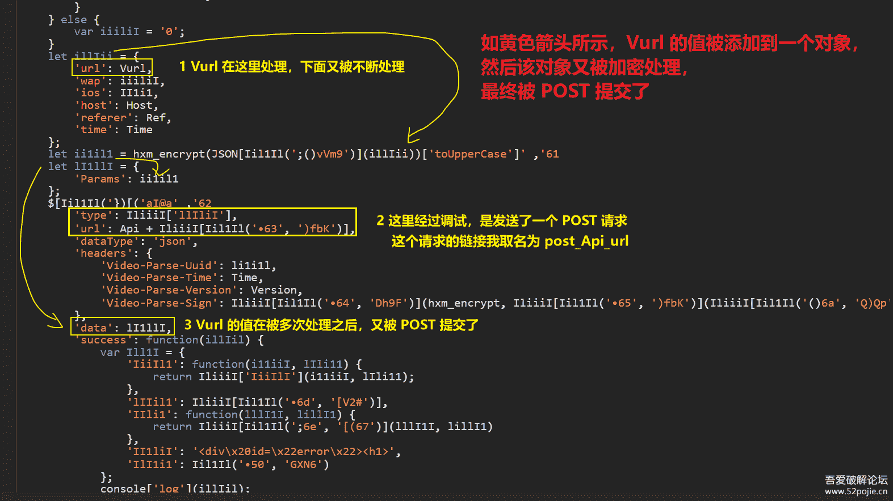

`image-20231128145539476.png` (215.9 KB, 下载次数: 3)

[附件下载](https://www.52pojie.cn/forum.php?mod=attachment&aid=MjY2MDEyM3w1NDU3ODM2MXwxNzkzNTcyOTQ1fDE2ODA4NnwxODYyOTc1&nothumb=yes)

2023-11-28 22:22 上传

## 迅猛一些？？

如果一开始无法找到 `Vurl`，其实也可以尝试全局搜索 `encrypt`、`decrypt` 等和加密、解密相关的关键词，或者监控 DOM 树的变化（也就是监控 `video` 标签的插入）等。

更有甚者，可以根据网站自己的控制台输出快速、迅猛地定位到核心位置。

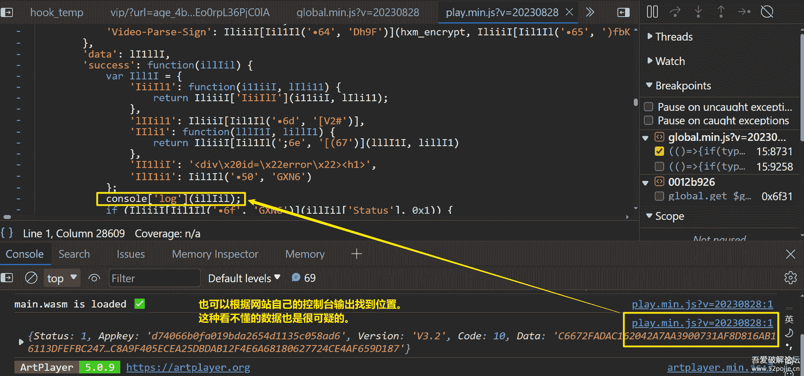

`image-20231128144736268.png` (304.13 KB, 下载次数: 4)

[附件下载](https://www.52pojie.cn/forum.php?mod=attachment&aid=MjY2MDExM3xkOTJlNzYwN3wxNzkzNTcyOTQ1fDE2ODA4NnwxODYyOTc1&nothumb=yes)

2023-11-28 22:21 上传

不过我会尽可能让思路连贯起来，除非走投无路才使用特殊关键词搜索，我知道的一些捷径会提，但不会在文中使用，大家在实际情况时可以更加迅猛一些。

## 整理思路

上文定位到核心的部分了，不过为了保护灵兽，我将整个过程简化如下，并且只会着重讨论如何避免分析 `hxm_encrypt`、`hxm_decrypt` 两个加密、解密的函数的逻辑。

上文中出现了很多我自定义的名字，这都是为了下面整理出思路，否则论述起来大家也摸不着头脑，不清楚我说的是哪些东西。

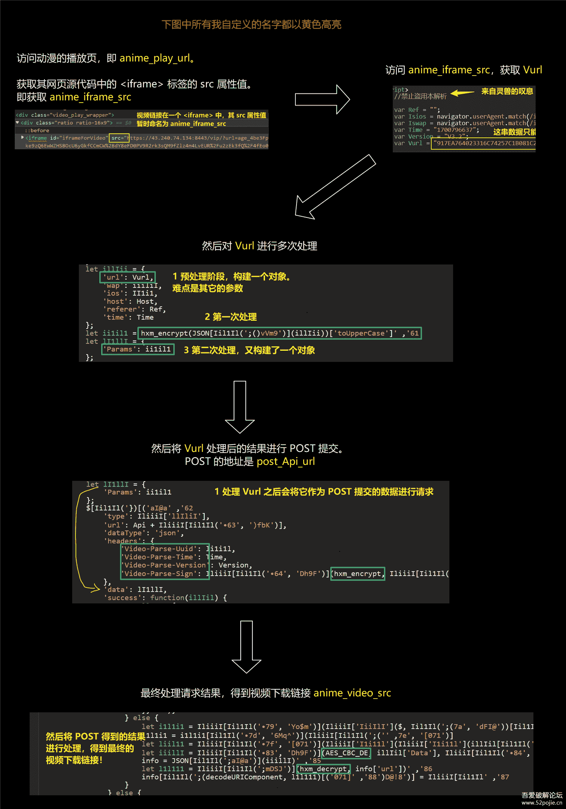

`image-20231128212823983.png` (919.94 KB, 下载次数: 2)

[附件下载](https://www.52pojie.cn/forum.php?mod=attachment&aid=MjY2MDEwM3xjNjEzNGRkNnwxNzkzNTcyOTQ1fDE2ODA4NnwxODYyOTc1&nothumb=yes)

2023-11-28 22:20 上传

## 键盘前论道：`hxm_encrypt`

如下图，在 `hxm_encrypt` 函数处下断点、不断跟进，最后来到了 `wasm` 代码。

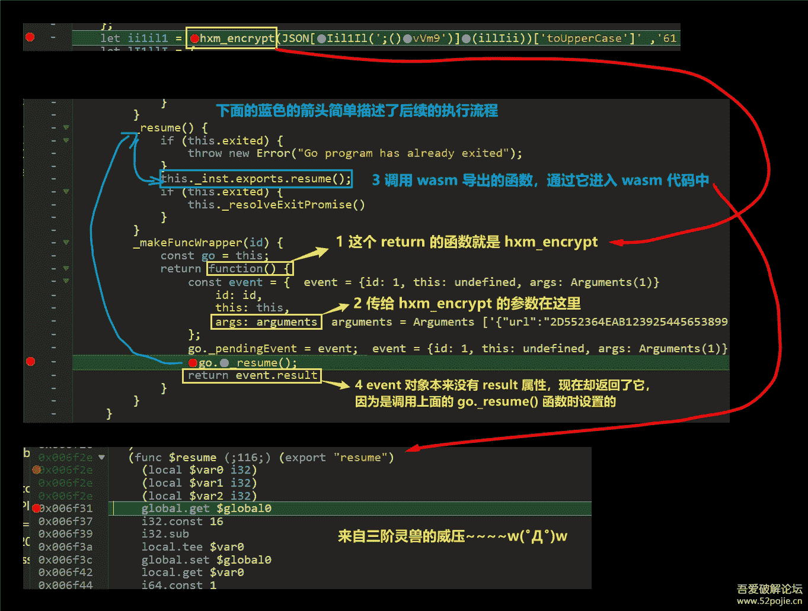

`image-20231128134319247.png` (614.6 KB, 下载次数: 3)

[附件下载](https://www.52pojie.cn/forum.php?mod=attachment&aid=MjY2MDEwNnwwYzhiNTFiY3wxNzkzNTcyOTQ1fDE2ODA4NnwxODYyOTc1&nothumb=yes)

2023-11-28 22:21 上传

并且这两个 `hxm` 函数都位于 `window` 对象中。

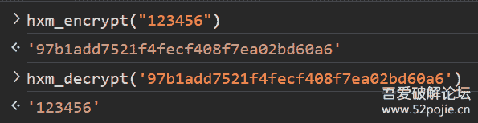

`image-20231128135806201.png` (26.63 KB, 下载次数: 4)

[附件下载](https://www.52pojie.cn/forum.php?mod=attachment&aid=MjY2MDEzOHw0OGUxZjZlNHwxNzkzNTcyOTQ1fDE2ODA4NnwxODYyOTc1&nothumb=yes)

2023-11-28 22:26 上传

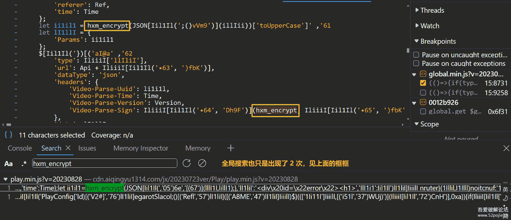

`image-20231128150025373.png` (235.08 KB, 下载次数: 5)

[附件下载](https://www.52pojie.cn/forum.php?mod=attachment&aid=MjY2MDEyMXw4NzNkNzUzNnwxNzkzNTcyOTQ1fDE2ODA4NnwxODYyOTc1&nothumb=yes)

2023-11-28 22:22 上传

### 三阶灵兽的威压

第一步：直接下载该 `wasm` 文件到本地，将来用 `nodejs` 执行它。这对 `nodejs` 有版本要求，我用的是 `node` v18.14.2。

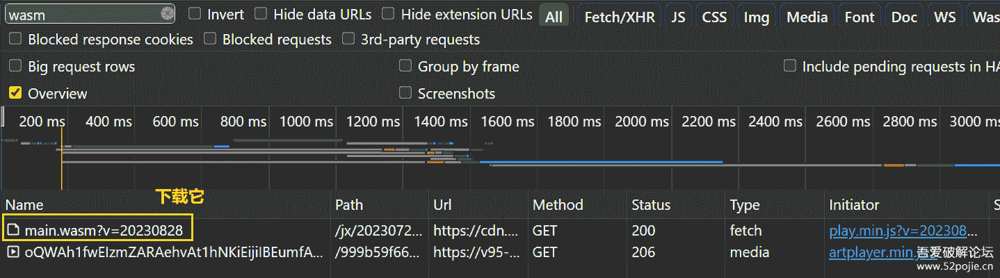

`image-20231128134612260.png` (99.25 KB, 下载次数: 4)

[附件下载](https://www.52pojie.cn/forum.php?mod=attachment&aid=MjY2MDEzMnw3ODAzZmI1NXwxNzkzNTcyOTQ1fDE2ODA4NnwxODYyOTc1&nothumb=yes)

2023-11-28 22:22 上传

第二步：找到 JS 加载 `wasm` 的相关代码。

因为这个网站的 `wasm` 是利用 go 语言编写、生成（因为在之前的图中可以见到 `Go program` 的字符串啦），所以会用到很多外部的函数，需要导入它们。

如下在 `wasm` 文本文件的顶部就指出了需要导入哪些东西。

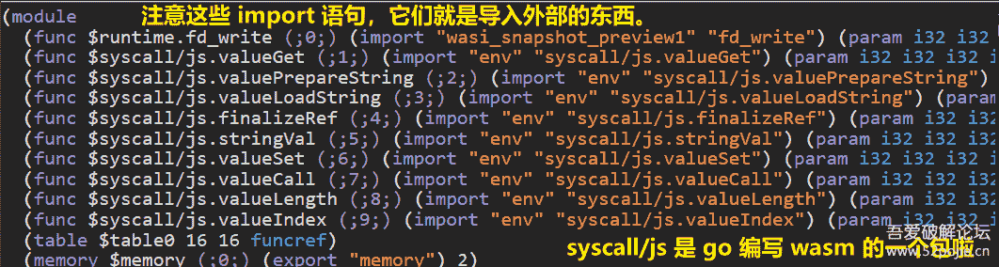

`image-20231128135149698.png` (171 KB, 下载次数: 3)

[附件下载](https://www.52pojie.cn/forum.php?mod=attachment&aid=MjY2MDEyNnw3ZjBlMzQ0YnwxNzkzNTcyOTQ1fDE2ODA4NnwxODYyOTc1&nothumb=yes)

2023-11-28 22:22 上传

这些导入函数就在下图中，因为内容很多，此处就不展示全部代码了，我将这个函数称之为 `go_js_wasm_exec`，请一定要记住这个名字，后面将多次提及到它。

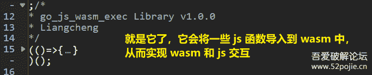

`image-20231124161711385.png` (35.74 KB, 下载次数: 4)

[附件下载](https://www.52pojie.cn/forum.php?mod=attachment&aid=MjY2MDEzN3w1Njc0YzQxOHwxNzkzNTcyOTQ1fDE2ODA4NnwxODYyOTc1&nothumb=yes)

2023-11-28 22:26 上传

第三步：找到实际加载 `wasm` 的 JS 代码。

上面的 `go_js_wasm_exec` 函数只是准备好了东西，还没有实际加载、运行 `wasm`，就像是创建了类但没有实例化对象一样。

如下，在获取 `wasm` 文件的请求中找到了调用者。

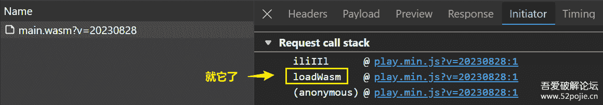

`image-20231128135319241.png` (45.92 KB, 下载次数: 4)

[附件下载](https://www.52pojie.cn/forum.php?mod=attachment&aid=MjY2MDEzNnwyYjNhNjFlMXwxNzkzNTcyOTQ1fDE2ODA4NnwxODYyOTc1&nothumb=yes)

2023-11-28 22:26 上传

此处 `loadWasm` 的分析将省略，后文将展示其相关的代码。

第四步：在 NodeJS 中执行该 `wasm` 文件。

请记住这里的 `const go = new Go();` 以及 `go.importObject`，这在后文非常重要，有个印象也好。


```
const fs = require('fs');

// 这个就是第二步中提到的 go_js_wasm_exec 啦
require('./go_js_wasm_exec')

// 涉及到 JS WebAssembly API
async function readAndInstantiate(file, importObject) {
    // 读取 Wasm 二进制文件
    const buffer = fs.readFileSync(file);

    // 创建 WebAssembly 模块
    const wasmModule = new WebAssembly.Module(buffer);

    // 创建 WebAssembly 实例
    return WebAssembly.instantiate(wasmModule, importObject);
}

// 这里就是第三步中 loadWasm 的逻辑
const go = new Go();
go["importObject"]["env"]["syscall/js.finalizeRef"] = () => { }

// main.wasm 是第一步中下载到本地的 wasm 文件
readAndInstantiate("main.wasm", go.importObject)
    .then(instance => {
        go.run(instance); // 这里开始运行 wasm

        // 这个 hxm_encrypt 函数是在 wasm 内部复制给全局对象的，所以可以访问
        console.log(hxm_encrypt("123456"));
    })
```

不出意外地，它报错了。

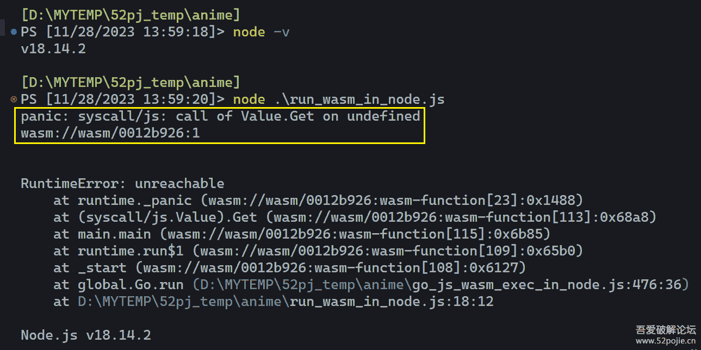

`image-20231128140049084.png` (123.94 KB, 下载次数: 2)

[附件链接](https://www.52pojie.cn/forum.php?mod=attachment&aid=MjY2MDEzMXwwMWUxMTI3M3wxNzkzNTcyOTQ1fDE2ODA4NnwxODYyOTc1&nothumb=yes)

2023-11-28 22:22 上传

3> 练气三层的实力

## 上述在本地运行 wasm 为什么会报错呢？？

目前（至少必应搜索到的资料）wasm 还无法和浏览器（DON、DOM 等浏览器 API）直接交互，需要经过 js 导入相关内容到 wasm 中才行。

简单而言，比如 js 可以直接通过 `window.location.href` 访问当前标签页的链接。

但是 wasm 中并没有相关的指令可以做到这一点，需要用 js 将它导入到 wasm 中，这样 wasm 才能访问。

从宏观上来看，如下图


`image-20231128141022882.png` (18.68 KB, 下载次数: 2)

[附件链接](https://www.52pojie.cn/forum.php?mod=attachment&aid=MjY2MDEzOXwyMDBmMjBmM3wxNzkzNTcyOTQ1fDE2ODA4NnwxODYyOTc1&nothumb=yes)

2023-11-28 22:27 上传

所以就目前而言 wasm 是可以在本地用 `nodejs` 运行的，在本地运行会报错是因为缺少了导入的东西（通常都是 `window` 对象的一些属性等），这个导入的入口处在 JS API 的 `WebAssembly.instantiate()` 方法的第二个参数。

所以这里的关键其实在于 `go_js_wasm_exec` 函数，因为是它起到了连接 wasm 和浏览器的作用。

如下可以确认是将 `window` 对象导入到了 wasm 中，所以在 wasm 中才能将两个 `hxm` 函数添加到 `window` 对象上。

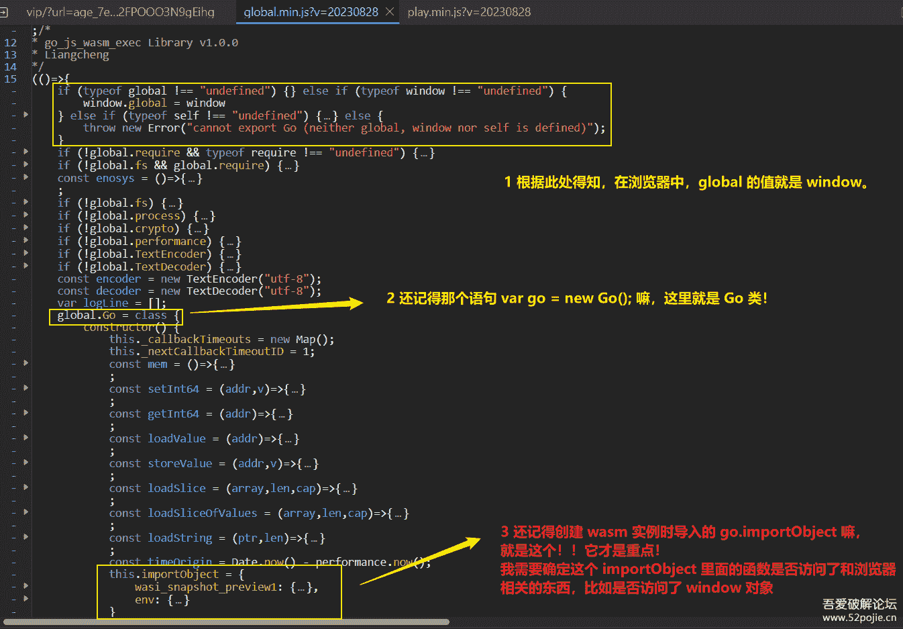

`image-20231128142157794.png` (190.52 KB, 下载次数: 3)

[附件链接](https://www.52pojie.cn/forum.php?mod=attachment&aid=MjY2MDEyNHwzYWJkZWU2NnwxNzkzNTcyOTQ1fDE2ODA4NnwxODYyOTc1&nothumb=yes)

2023-11-28 22:22 上传

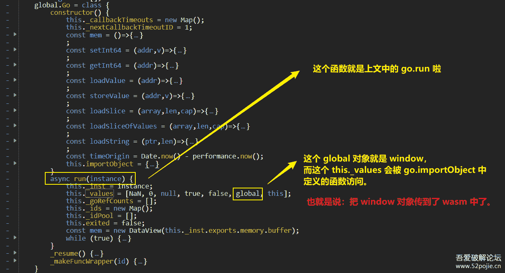

`image-20231128142207347.png` (128.77 KB, 下载次数: 4)

[附件链接](https://www.52pojie.cn/forum.php?mod=attachment&aid=MjY2MDEzMHxhMDNlODg2MnwxNzkzNTcyOTQ1fDE2ODA4NnwxODYyOTc1&nothumb=yes)

2023-11-28 22:22 上传

那么在 wasm 中到底访问了 `window` 的哪些属性、方法呢？？只要知道 wasm 中和浏览器做了怎样的交互，那么在 `nodejs` 中就可以还原出来。这里需要用到 `Proxy` 对象。

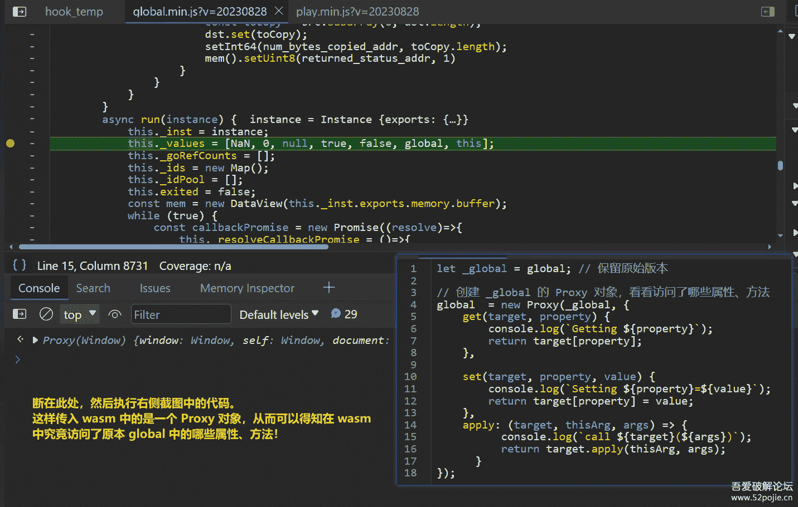

`image-20231128142252743.png` (259.29 KB, 下载次数: 5)

[附件链接](https://www.52pojie.cn/forum.php?mod=attachment&aid=MjY2MDExN3w0YzEyOTQxY3wxNzkzNTcyOTQ1fDE2ODA4NnwxODYyOTc1&nothumb=yes)

2023-11-28 22:21 上传

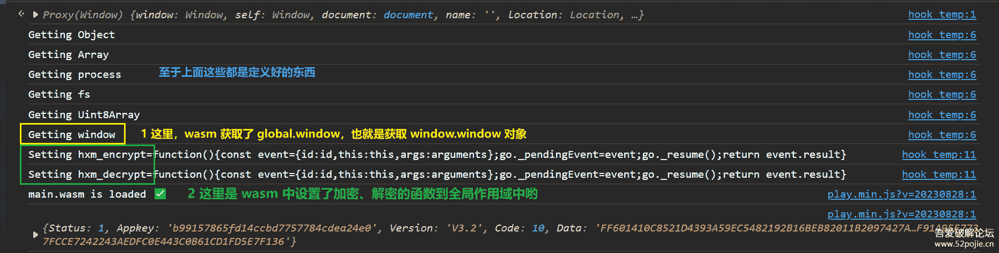

`image-20231128142312331.png` (175.6 KB, 下载次数: 3)

[附件链接](https://www.52pojie.cn/forum.php?mod=attachment&aid=MjY2MDEyNXxjZGUwNmVmYXwxNzkzNTcyOTQ1fDE2ODA4NnwxODYyOTc1&nothumb=yes)

2023-11-28 22:22 上传

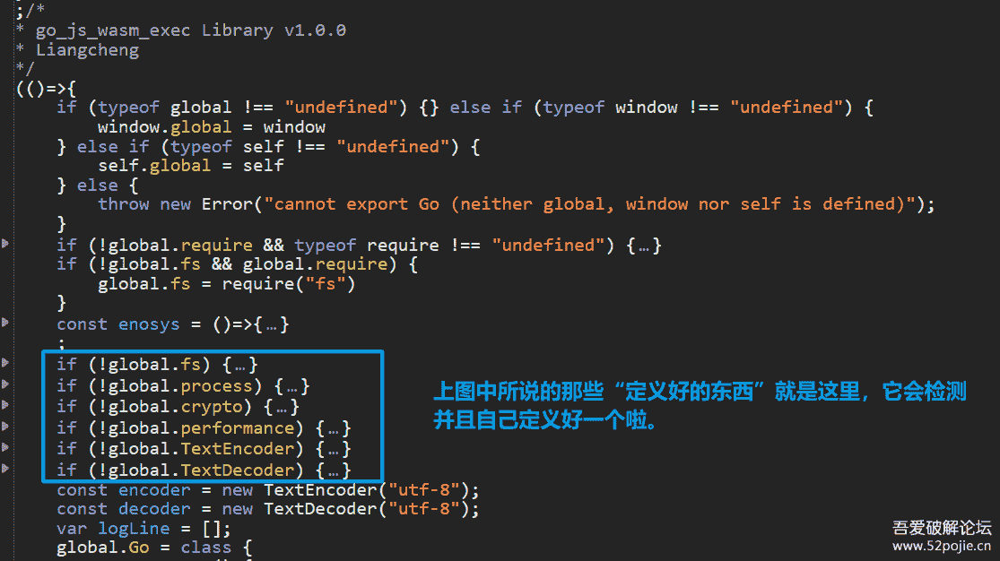

`image-20231128142343080.png` (141.81 KB, 下载次数: 4)

[附件链接](https://www.52pojie.cn/forum.php?mod=attachment&aid=MjY2MDEyOHw1MDMyOTUxYnwxNzkzNTcyOTQ1fDE2ODA4NnwxODYyOTc1&nothumb=yes)

2023-11-28 22:22 上传

现在我们知道 wasm 中会访问 `global.window`，也就是会访问全局对象 `window`，那么继续利用 `Proxy` 对象来看一看究竟在 wasm 中访问了 `window` 的哪些东西！

> 注意！此时不能使用 `global.window = xx` 的形式来修改 `global.window` 属性。因为 `global` 自身就是 `window`，哪有自己修改自己的？？就像 `window.window = 1` 是没有效果的。


```
// 这是一个对 window 进行代{过}{滤}理的 Proxy
let _window = new Proxy(window, {
    get(target, property) {
        console.log(`window Getting ${property}: ${target[property]}`);
        return target[property];
    },
    set(target, property, value) {
        console.log(`window Setting ${property}=${value}`);
        return target[property] = value;
    },
    apply: (target, thisArg, args) => {
        console.log(`window call ${target}(${args})`);
        return target.apply(thisArg, args);
    }
});

let _global = global;
// 创建 global 的 Proxy 对象，看看访问了哪些属性、方法
global = new Proxy(_global, {
    get(target, property) {
        // 当访问 global.window 时，返回一个对 window 的 Proxy 对象！！！
        if (property === 'window') {
            return _window;
        }
        console.log(`global Getting ${property}: ${target[property]}`);
        return target[property];
    }
});
```

最终确定了关键的东西 `window.Domain`！

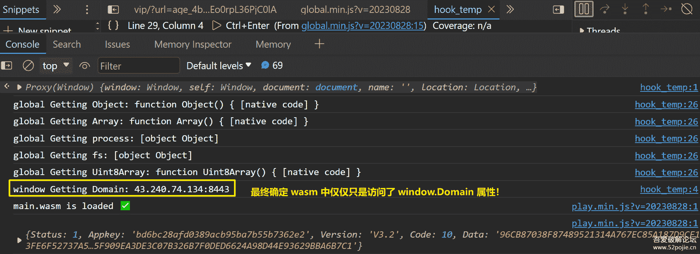

image-20231128142738306.png (232.16 KB, 下载次数: 3)

[href="forum.php?mod=attachment&aid=MjY2MDEyMnwxOTc3NjU3M3wxNzkzNTcyOTQ1fDE2ODA4NnwxODYyOTc1&nothumb=yes" target="_blank"](https://www.52pojie.cn/forum.php?mod=attachment&aid=MjY2MDEyMnwxOTc3NjU3M3wxNzkzNTcyOTQ1fDE2ODA4NnwxODYyOTc1&nothumb=yes)

2023-11-28 22:22 上传

至此！可以在 `nodejs` 中模拟并调用 `hxm_encrypt`、`hxm_decrypt` 这两个函数了，只需要在 `go_js_wasm_exec` 文件中添加如下代码！也就是补全 `wasm` 的运行环境。

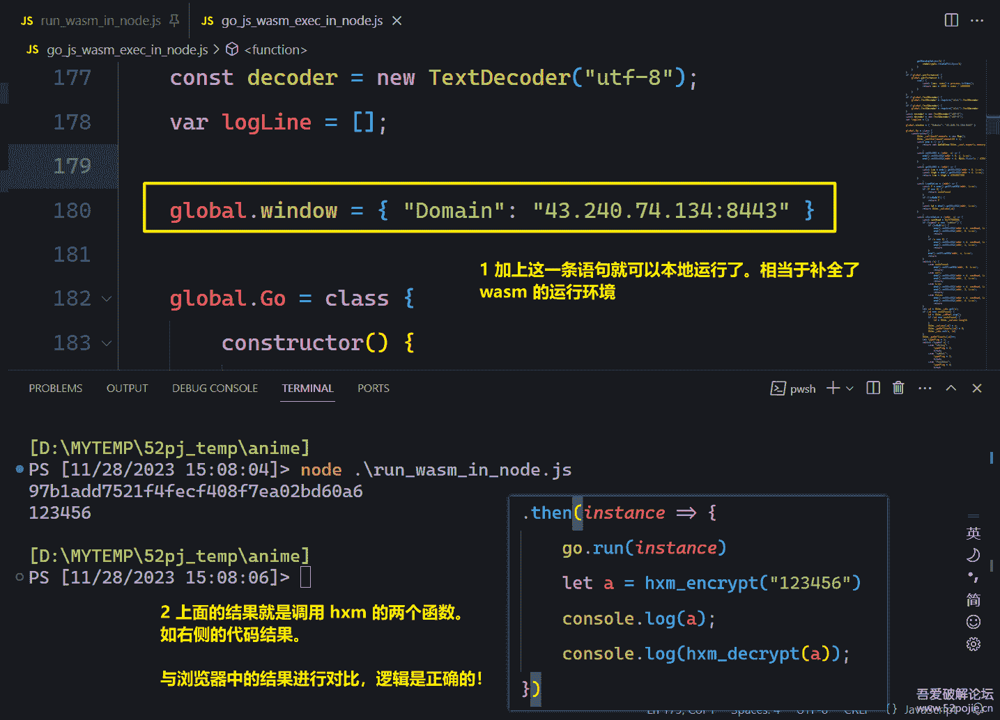

image-20231128151003136.png (253.05 KB, 下载次数: 3)

[href="forum.php?mod=attachment&aid=MjY2MDExOHw5ZTRhYTNmN3wxNzkzNTcyOTQ1fDE2ODA4NnwxODYyOTc1&nothumb=yes" target="_blank"](https://www.52pojie.cn/forum.php?mod=attachment&aid=MjY2MDExOHw5ZTRhYTNmN3wxNzkzNTcyOTQ1fDE2ODA4NnwxODYyOTc1&nothumb=yes)

2023-11-28 22:21 上传

## 尾声

虽然网站使用了 `wasm` 对数据进行加密与解密，但是该 `wasm` 运行的期间与浏览器、`JS` 的交互太浅（在本文中仅仅只是访问了 `window.Domain` 这一个属性），从而可以比较简单地在本地补全 `wasm` 的运行环境，姑且算是 “绕过了它的加密与解密部分”，我也不清楚 `wasm` 文件中到底做了什么。

不过该网站还有一个的陷阱！如果还采取 缺什么补什么 的思想，则可能陷入僵局。

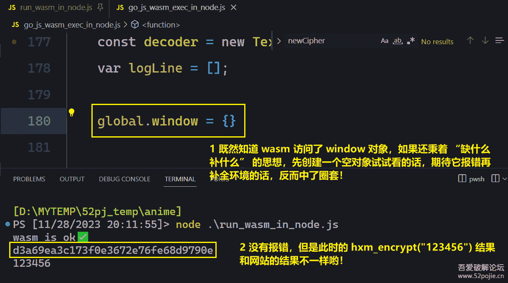

image-20231128201538820.png (141.16 KB, 下载次数: 5)

[href="forum.php?mod=attachment&aid=MjY2MDEyOXw4NDNmODY0YnwxNzkzNTcyOTQ1fDE2ODA4NnwxODYyOTc1&nothumb=yes" target="_blank"](https://www.52pojie.cn/forum.php?mod=attachment&aid=MjY2MDEyOXw4NDNmODY0YnwxNzkzNTcyOTQ1fDE2ODA4NnwxODYyOTc1&nothumb=yes)

2023-11-28 22:22 上传

另外，此次发文之后又会修炼一段时间……根骨不行，只能多修炼了。

## 番外篇：来自灵兽的彩蛋

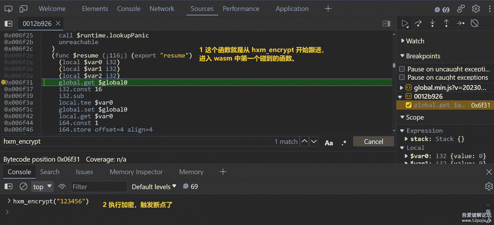

image-20231128151919261.png (266.03 KB, 下载次数: 3)

[href="forum.php?mod=attachment&aid=MjY2MDExNnxhNTZjMzhkZnwxNzkzNTcyOTQ1fDE2ODA4NnwxODYyOTc1&nothumb=yes" target="_blank"](https://www.52pojie.cn/forum.php?mod=attachment&aid=MjY2MDExNnxhNTZjMzhkZnwxNzkzNTcyOTQ1fDE2ODA4NnwxODYyOTc1&nothumb=yes)

2023-11-28 22:21 上传

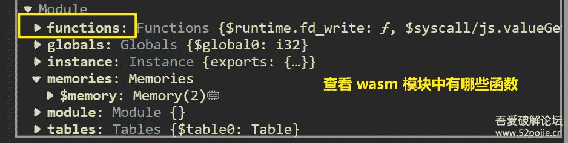

image-20231128152445916.png (65.96 KB, 下载次数: 5)

[href="forum.php?mod=attachment&aid=MjY2MDEzNXw0MWEwYTZhMXwxNzkzNTcyOTQ1fDE2ODA4NnwxODYyOTc1&nothumb=yes" target="_blank"](https://www.52pojie.cn/forum.php?mod=attachment&aid=MjY2MDEzNXw0MWEwYTZhMXwxNzkzNTcyOTQ1fDE2ODA4NnwxODYyOTc1&nothumb=yes)

2023-11-28 22:26 上传

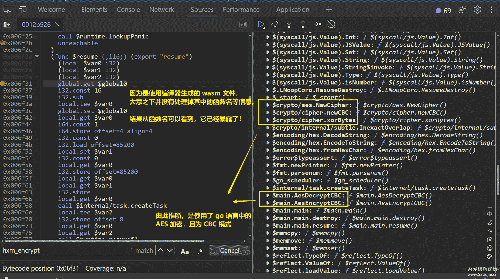

image-20231128152352553.png (667.82 KB, 下载次数: 4)

[href="forum.php?mod=attachment&aid=MjY2MDEwNXxhZDFjOTA3NHwxNzkzNTcyOTQ1fDE2ODA4NnwxODYyOTc1&nothumb=yes" target="_blank"](https://www.52pojie.cn/forum.php?mod=attachment&aid=MjY2MDEwNXxhZDFjOTA3NHwxNzkzNTcyOTQ1fDE2ODA4NnwxODYyOTc1&nothumb=yes)

2023-11-28 22:21 上传

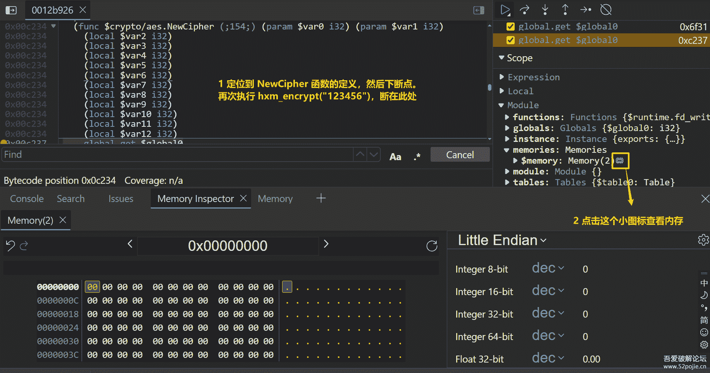

image-20231128155800191.png (332.92 KB, 下载次数: 2)

[href="forum.php?mod=attachment&aid=MjY2MDExMnw0ZDIyNzJkYXwxNzkzNTcyOTQ1fDE2ODA4NnwxODYyOTc1&nothumb=yes" target="_blank"](https://www.52pojie.cn/forum.php?mod=attachment&aid=MjY2MDExMnw0ZDIyNzJkYXwxNzkzNTcyOTQ1fDE2ODA4NnwxODYyOTc1&nothumb=yes)

2023-11-28 22:21 上传

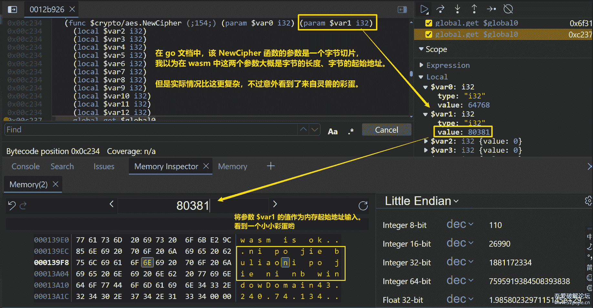

image-20231128213828127.png (411 KB, 下载次数: 3)

[href="forum.php?mod=attachment&aid=MjY2MDExMXxiZmQyOGE5MXwxNzkzNTcyOTQ1fDE2ODA4NnwxODYyOTc1&nothumb=yes" target="_blank"](https://www.52pojie.cn/forum.php?mod=attachment&aid=MjY2MDExMXxiZmQyOGE5MXwxNzkzNTcyOTQ1fDE2ODA4NnwxODYyOTc1&nothumb=yes)

2023-11-28 22:21 上传

事实上，我确实无法从 `wasm` 中找出 `aes` 加密、解密的 `key`，多出来的时间多看会动漫吧。

## 补充

网站有多个播放源，本文分析的是 VIP 西瓜 的播放源。其它的播放源似乎可以直接拿到 `m3u8` 链接……………

```
