# [原创] 滴水三期01-19中涉及的CreakMe

- 原帖: https://www.52pojie.cn/forum.php?mod=viewthread&tid=1863096
- 抓取时间: 2026-11-01T22:42:26

## 简介

时隔多年再次写东西，记录一下当前的学习过程（ps：本人太懒了，学了这么多年还在原地打转，勿喷，谢谢）

一直想要有个二进制相关的工作，但是奈何能力太差，只能继续学习了，看见有人推荐要会加壳、脱壳、基础逆向，所以最近在看滴水三期的视频，据说很经典。

感觉前几期偏基础，基本都学过，就当作是复习以前学的知识了，视频里是直接用`od`来讲汇编的，感觉利用`od`直接讲汇编是挺好的方法。挺适合初次接触汇编语言的朋友们，比当初我用`dosbox`来编写汇编要方便些，不过可能会缺乏些基础知识，例如：数据段、栈段、代码段的定义，并且也不能用`od`编写完整的汇编程序。总体来说通过`od`来学习汇编语句还是很方便的，毕竟现在使用汇编编程的人比较少了，只要知道大概意思就好，不用熟悉完整的编译过程了。

这篇文章记录下滴水三期01-19中涉及的CreakMe。

## 查看程序信息

下载地址：链接: https://pan.baidu.com/s/1ZwjT1xM67OQ0FKL8WbcXlA?pwd=rcwc 提取码: rcwc

先尝试运行一下，在`Help`下有个`Register`的功能可以使用，需要输入`Name`和`Serial`

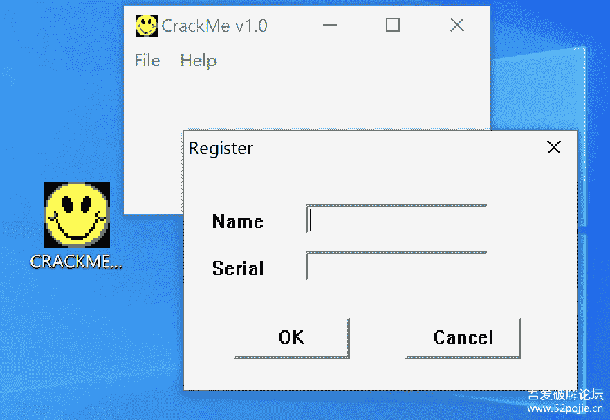

Pasted image 20230602150815.png (107.34 KB, 下载次数: 0)

[href="forum.php?mod=attachment&aid=MjY2MDIzMHw0NjZmNDUwNnwxNzkzNTcyOTQzfDE2ODA4NnwxODYzMDk2&nothumb=yes" target="_blank"](https://www.52pojie.cn/forum.php?mod=attachment&aid=MjY2MDIzMHw0NjZmNDUwNnwxNzkzNTcyOTQzfDE2ODA4NnwxODYzMDk2&nothumb=yes)

图片1

2023-11-29 10:10 上传

当然我们是不知道正确的输入的，所以就随便输入，结果弹出了一个新的窗口。后续根据视频了解到创建窗口使用`MessageBoxA`函数。

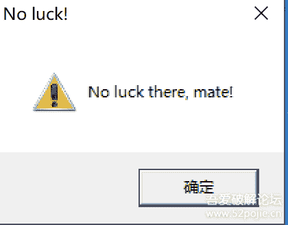

Pasted image 20230602151551.png (15.32 KB, 下载次数: 0)

[href="forum.php?mod=attachment&aid=MjY2MDIzN3wzNGVhM2ExMHwxNzkzNTcyOTQzfDE2ODA4NnwxODYzMDk2&nothumb=yes" target="_blank"](https://www.52pojie.cn/forum.php?mod=attachment&aid=MjY2MDIzN3wzNGVhM2ExMHwxNzkzNTcyOTQzfDE2ODA4NnwxODYzMDk2&nothumb=yes)

2023-11-29 10:13 上传

程序的基本功能就是有个类似登录的判断，查壳试一下，`MASM32` / `TASM32` \[Overlay\]，汇编的程序,可以直接用`od`查看

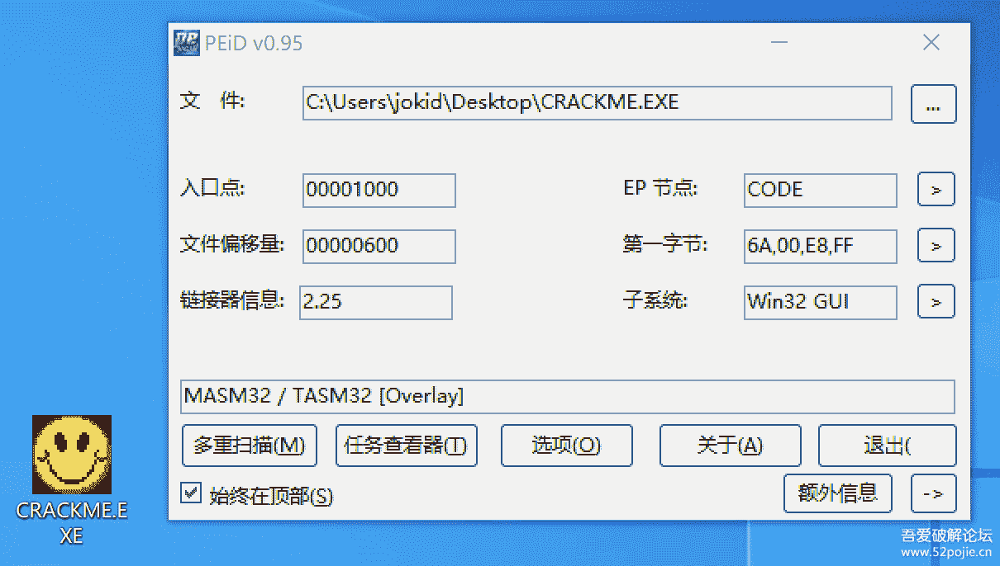

Pasted image 20230602101228.png (100.53 KB, 下载次数: 0)

[href="forum.php?mod=attachment&aid=MjY2MDIzOXw2N2U2Y2I3NnwxNzkzNTcyOTQzfDE2ODA4NnwxODYzMDk2&nothumb=yes" target="_blank"](https://www.52pojie.cn/forum.php?mod=attachment&aid=MjY2MDIzOXw2N2U2Y2I3NnwxNzkzNTcyOTQzfDE2ODA4NnwxODYzMDk2&nothumb=yes)

2023-11-29 10:14 上传

## OD调试

使用命令`bp MessageBoxA`设置断点在创建窗口的函数

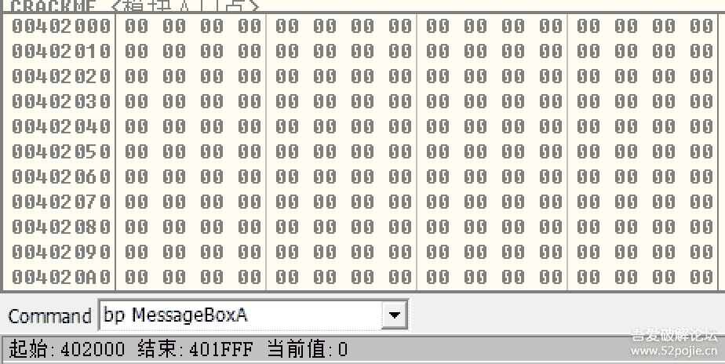

Pasted image 20230602152555.png (19.19 KB, 下载次数: 0)

[href="forum.php?mod=attachment&aid=MjY2MDI0N3w4ZTkyYWJhYXwxNzkzNTcyOTQzfDE2ODA4NnwxODYzMDk2&nothumb=yes" target="_blank"](https://www.52pojie.cn/forum.php?mod=attachment&aid=MjY2MDI0N3w4ZTkyYWJhYXwxNzkzNTcyOTQzfDE2ODA4NnwxODYzMDk2&nothumb=yes)

2023-11-29 10:15 上传

点击上方的


Pasted image 20230602153222.png (3.77 KB, 下载次数: 0)

[href="forum.php?mod=attachment&aid=MjY2MDI0OHw1N2FiOWFkNHwxNzkzNTcyOTQzfDE2ODA4NnwxODYzMDk2&nothumb=yes" target="_blank"](https://www.52pojie.cn/forum.php?mod=attachment&aid=MjY2MDI0OHw1N2FiOWFkNHwxNzkzNTcyOTQzfDE2ODA4NnwxODYzMDk2&nothumb=yes)

2023-11-29 10:15 上传

按钮或者选择上方工具栏中查看->断点，查看当前断点情况

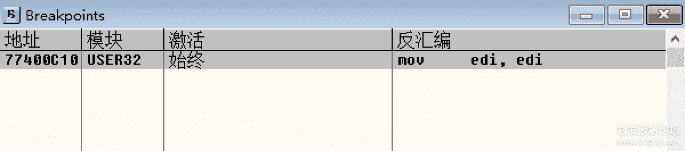

Pasted image 20230602153414.png (15.26 KB, 下载次数: 0)

[href="forum.php?mod=attachment&aid=MjY2MDI0OXw4OGI4MDlmYXwxNzkzNTcyOTQzfDE2ODA4NnwxODYzMDk2&nothumb=yes" target="_blank"](https://www.52pojie.cn/forum.php?mod=attachment&aid=MjY2MDI0OXw4OGI4MDlmYXwxNzkzNTcyOTQzfDE2ODA4NnwxODYzMDk2&nothumb=yes)

2023-11-29 10:16 上传

继续运行程序，在输入后触发断点

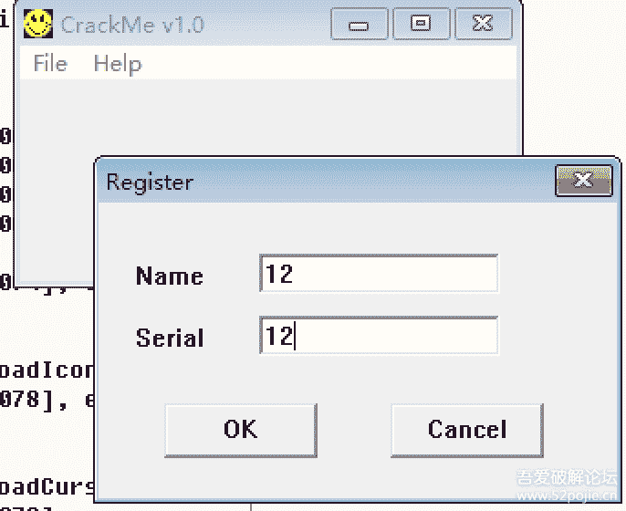

Pasted image 20230602154008.png (18.54 KB, 下载次数: 0)

[href="forum.php?mod=attachment&aid=MjY2MDI1MHwyYjk0ZWFjZXwxNzkzNTcyOTQzfDE2ODA4NnwxODYzMDk2&nothumb=yes" target="_blank"](https://www.52pojie.cn/forum.php?mod=attachment&aid=MjY2MDI1MHwyYjk0ZWFjZXwxNzkzNTcyOTQzfDE2ODA4NnwxODYzMDk2&nothumb=yes)

2023-11-29 10:16 上传

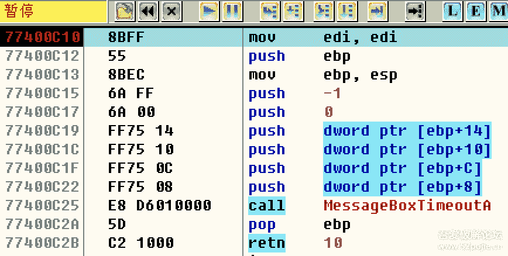

Pasted image 20230602154053.png (23.53 KB, 下载次数: 0)

[href="forum.php?mod=attachment&aid=MjY2MDI1MXxiZTJkMGQ2ZHwxNzkzNTcyOTQzfDE2ODA4NnwxODYzMDk2&nothumb=yes" target="_blank"](https://www.52pojie.cn/forum.php?mod=attachment&aid=MjY2MDI1MXxiZTJkMGQ2ZHwxNzkzNTcyOTQzfDE2ODA4NnwxODYzMDk2&nothumb=yes)

2023-11-29 10:16 上传

查看栈，根据函数调用栈，右键反追踪到`ret`点

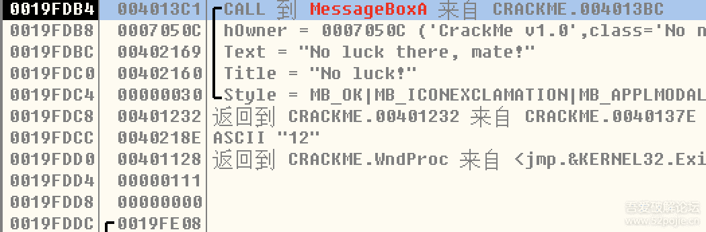

Pasted image 20230602154233.png (17.53 KB, 下载次数: 0)

[href="forum.php?mod=attachment&aid=MjY2MDI1Mnw1OWQ4NmM5NHwxNzkzNTcyOTQzfDE2ODA4NnwxODYzMDk2&nothumb=yes" target="_blank"](https://www.52pojie.cn/forum.php?mod=attachment&aid=MjY2MDI1Mnw1OWQ4NmM5NHwxNzkzNTcyOTQzfDE2ODA4NnwxODYzMDk2&nothumb=yes)

2023-11-29 10:17 上传

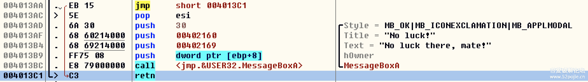

Pasted image 20230602154540.png (18.88 KB, 下载次数: 0)

[href="forum.php?mod=attachment&aid=MjY2MDI1M3w3MTBhY2U5N3wxNzkzNTcyOTQzfDE2ODA4NnwxODYzMDk2&nothumb=yes" target="_blank"](https://www.52pojie.cn/forum.php?mod=attachment&aid=MjY2MDI1M3w3MTBhY2U5N3wxNzkzNTcyOTQzfDE2ODA4NnwxODYzMDk2&nothumb=yes)

2023-11-29 10:17 上传

再次根据函数调用栈反追踪到`ret`点


Pasted image 20230602154916.png (10.9 KB, 下载次数: 0)

[href="forum.php?mod=attachment&aid=MjY2MDI1NXwzNmIwY2Q5ZnwxNzkzNTcyOTQzfDE2ODA4NnwxODYzMDk2&nothumb=yes" target="_blank"](https://www.52pojie.cn/forum.php?mod=attachment&aid=MjY2MDI1NXwzNmIwY2Q5ZnwxNzkzNTcyOTQzfDE2ODA4NnwxODYzMDk2&nothumb=yes)

2023-11-29 10:18 上传

发现此处将输入当作参数调用 `0x0040137e`函数，`F2`设置断点，查看该函数。

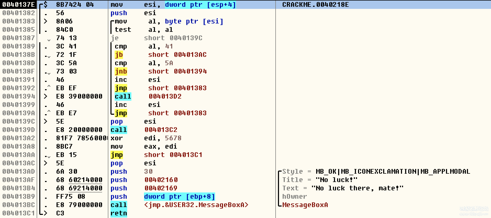

Pasted image 20230602155325.png (33.19 KB, 下载次数: 0)

[href="forum.php?mod=attachment&aid=MjY2MDI1NnxhMThjMThhMXwxNzkzNTcyOTQzfDE2ODA4NnwxODYzMDk2&nothumb=yes" target="_blank"](https://www.52pojie.cn/forum.php?mod=attachment&aid=MjY2MDI1NnxhMThjMThhMXwxNzkzNTcyOTQzfDE2ODA4NnwxODYzMDk2&nothumb=yes)

2023-11-29 10:18 上传

修改其中的判断将`je short 0040139c`，更改为`jmp short 0040139c`

继续执行，发现`00401243`有一个跳转,将`je short 0040124c`更改为`jmp short 0040124c`

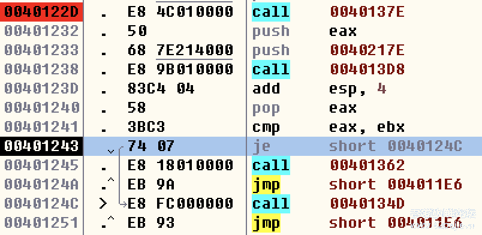

Pasted image 20230602160433.png (17.79 KB, 下载次数: 1)

[href="forum.php?mod=attachment&aid=MjY2MDI1OHwyZDBmN2YwYnwxNzkzNTcyOTQzfDE2ODA4NnwxODYzMDk2&nothumb=yes" target="_blank"](https://www.52pojie.cn/forum.php?mod=attachment&aid=MjY2MDI1OHwyZDBmN2YwYnwxNzkzNTcyOTQzfDE2ODA4NnwxODYzMDk2&nothumb=yes)

2023-11-29 10:19 上传

此时基本破解程序，无论输入什么都返回正确的结果


Pasted image 20230602160836.png (16.57 KB, 下载次数: 0)

[href="forum.php?mod=attachment&aid=MjY2MDI1OXxkMjUyOGE1NnwxNzkzNTcyOTQzfDE2ODA4NnwxODYzMDk2&nothumb=yes" target="_blank"](https://www.52pojie.cn/forum.php?mod=attachment&aid=MjY2MDI1OXxkMjUyOGE1NnwxNzkzNTcyOTQzfDE2ODA4NnwxODYzMDk2&nothumb=yes)

2023-11-29 10:19 上传

## 进阶调试

还可以通过调试来查看正确的`Name`和`Serial`

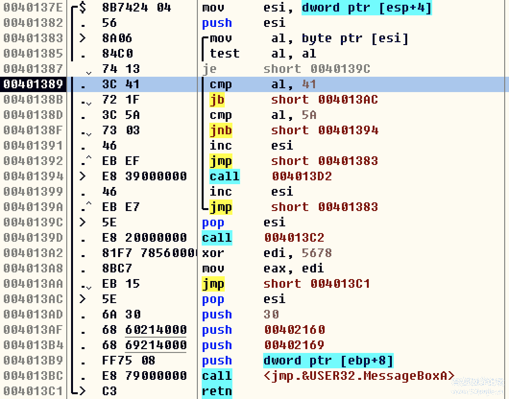

Pasted image 20230602161522.png (28.04 KB, 下载次数: 0)

[href="forum.php?mod=attachment&aid=MjY2MDI2MXwzNDBhMTNlZnwxNzkzNTcyOTQzfDE2ODA4NnwxODYzMDk2&nothumb=yes" target="_blank"](https://www.52pojie.cn/forum.php?mod=attachment&aid=MjY2MDI2MXwzNDBhMTNlZnwxNzkzNTcyOTQzfDE2ODA4NnwxODYzMDk2&nothumb=yes)

2023-11-29 10:19 上传

发现该函数会讲小写字母转成大写字母，`Name`只要是字母就正确，但返回结果为`xor edi,0x5678`，所以`0x0040137e`会将`Name`中每个字母对应的大写字母的`ascii`相加的和再与`0x5678`异或

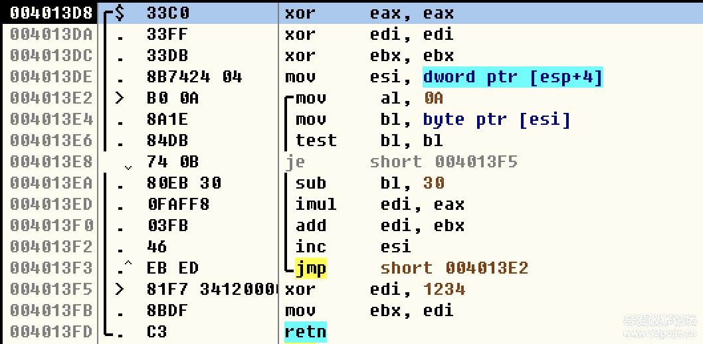

Pasted image 20230602164528.png (19.88 KB, 下载次数: 0)

[href="forum.php?mod=attachment&aid=MjY2MDI2MnxiOWRjMGMxYXwxNzkzNTcyOTQzfDE2ODA4NnwxODYzMDk2&nothumb=yes" target="_blank"](https://www.52pojie.cn/forum.php?mod=attachment&aid=MjY2MDI2MnxiOWRjMGMxYXwxNzkzNTcyOTQzfDE2ODA4NnwxODYzMDk2&nothumb=yes)

2023-11-29 10:20 上传

发现该函数将密码的每位字符`(ascii-0x30)*0x0A`，这个运算是为了方便纯数字的`Serial`进行运算，可以将`Serial`作为数字与`1234`异或

整理得出：`Name xor 0x5678 = Serial xor 0x1234`

==> `Name(ascii) xor 0x5678 xor 0x1234 = Serial`

==> `Name(ascii) xor 0x444c = Serial`

例如：a(`ascii`=0x41) xor 0x444c = 0x440d = 17421，故a对应的纯数字`Serial`为17421

## 副章

这里我发现程序没有对`Serial`进行类型限制，可能就是这么设计的，于是尝试编写脚本爆破正确密码，奈何人太菜了，花了很久才写了个脚本出来


```
# !/usr/bin/python3
# -*- coding:utf-8 -*-
# [//www.52pojie.cn/home.php?mod=space&uid=686208" target="_blank"](https://www.52pojie.cn/home.php?mod=space&uid=686208:href="https) : Jokid
# @Time : 2023-06-05
import string

#确认密码
name = 'a'
name = name.upper()
name_sum = 0
for i in name:
        name_sum += ord(i)
        a = name_sum ^ 0x444c
        #print(a)
        str_a = str(a)

#定义字符集
lower = string.ascii_lowercase
list_of_lowercase_letters = list(lower)
upper = string.ascii_uppercase
list_of_uppercase_letters = list(upper)
num_list = []
for i in range(0,10):
        num_list.append(str(i))
        pwd_list = list_of_lowercase_letters+list_of_uppercase_letters+num_list

#计算当前pwd的值
def pwd_ord(pwd):
        j=0
        for i in pwd:
                i_v = ord(i)-0x30
                j = j*10 + i_v
        return(j)

#递归获取正确密码
def get_pwd(index,pwd,demo):
        index+=1
        for i in pwd_list:
                l_pwd = pwd
                l_demo = demo
                l_demo = str(ord(i)-0x30+int(l_demo)*10)
                if(l_demo[:index]==str_a[:index]):
                        l_pwd +=i
                        tt = pwd_ord(l_pwd)
                        if(tt==a):
                                print('ok',l_pwd)
                        get_pwd(index,l_pwd,l_demo)

pwd = ''
demo = 0
index = 0
get_pwd(index,pwd,demo)
```

## 运行结果

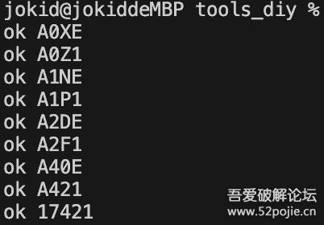

`Pasted image 20230605174924.png` (27.19 KB, 下载次数: 0)

[href="forum.php?mod=attachment&aid=MjY2MDI2NXw2ZjEwYjIxZXwxNzkzNTcyOTQzfDE2ODA4NnwxODYzMDk2&nothumb=yes" target="_blank"](https://www.52pojie.cn/forum.php?mod=attachment&aid=MjY2MDI2NXw2ZjEwYjIxZXwxNzkzNTcyOTQzfDE2ODA4NnwxODYzMDk2&nothumb=yes)

2023-11-29 10:22 上传
