# [Web逆向] 某巴巴文档网站加密文件逆向，wasm直接获取文本

- 原帖：`https://www.52pojie.cn/forum.php?mod=viewthread&tid=1863743`
- 抓取时间：2026-11-01T22:42:23

## 背景介绍

网址：`aHR0cHM6Ly93d3cuZG9jODguY29tLw==`

某文档网站使用加密的文件格式渲染文字，清晰度极高，且可以选中，故猜测数据包中含有文字信息。

可以看到当页面渲染完毕后是一个单纯的 canvas 画布

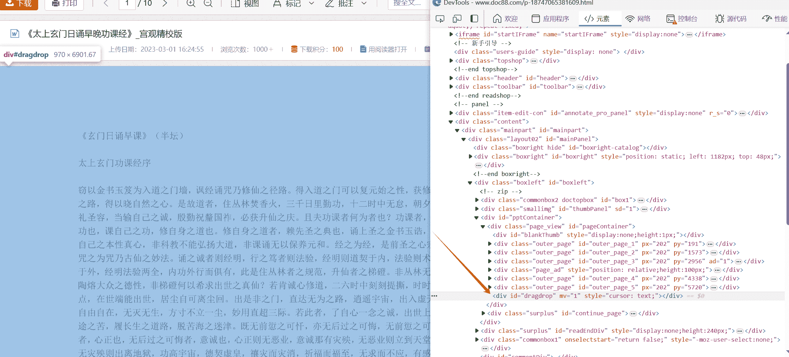

删除网络记录，进入下一个页面，查看调用的包，可以看到 ebt 格式的请求

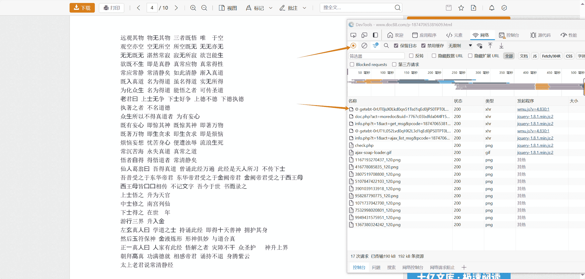

关键 js 为 `wmu.js`

## 调试过程

进入 `wmu.js`，共 5610 行，给发送 ebt 请求的位置下一个断点

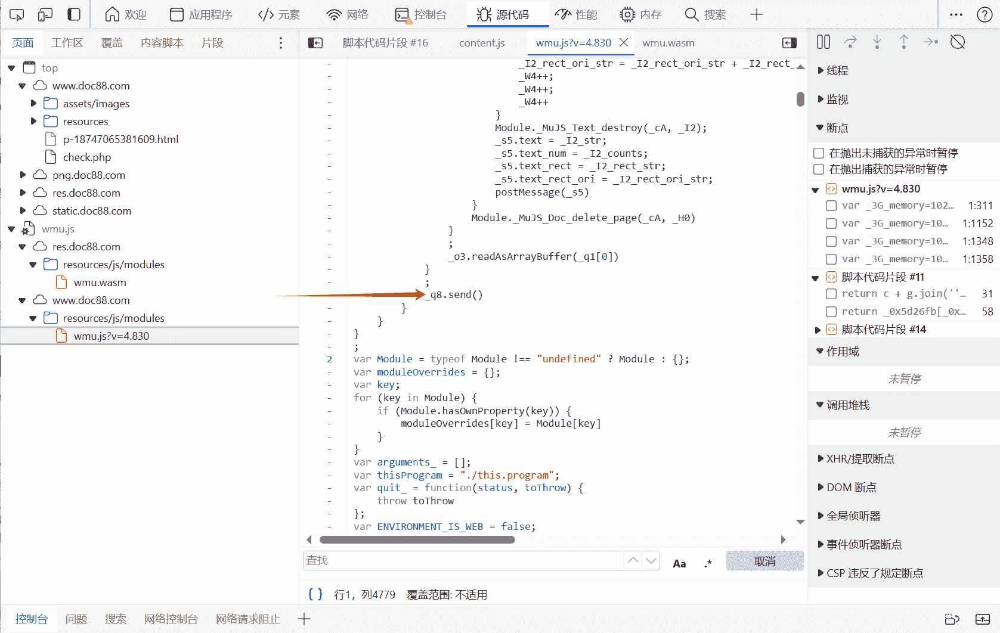

断住后可以看到作用域里 `_kY` 即是网址位置，搜索定位该位置，可以看到发送请求函数

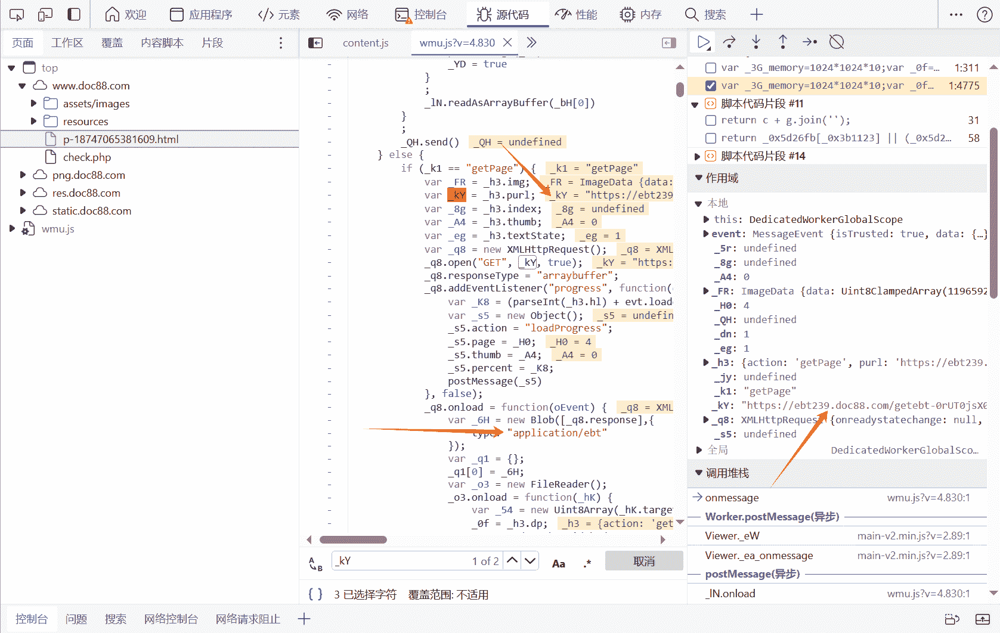

可以看到，接下来请求获取的 `response` 被扔进了一个二进制 object `Blob`，这一段在 node 里直接用 `fs` 库即可，`_6H` 又被放进了 `_q1[0]` 里，追 `_q1` 即可

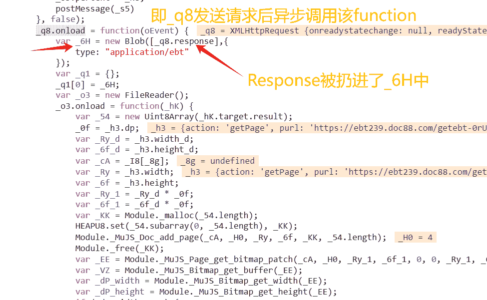

可以看到 new 了一个 `FileReader` 对象，`FileReader` 需要先 `readAsXXX` 才能 `onload`，所以继续往下搜索，可以看到就是 `_6H` 而已，赋值了个寂寞。

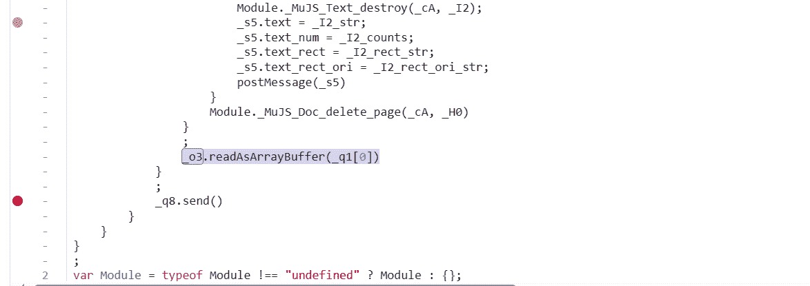

接下来是一段参数的赋值，但是 `_I8` 并未定义

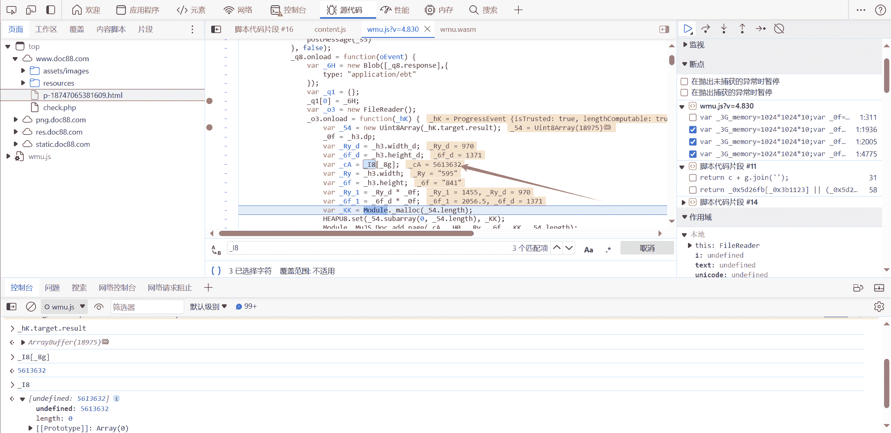

搜索发现是前面的 `_k1 == "initHeader"` 才会触发的一段初始代码，好吧，下断点，重新刷新页面。

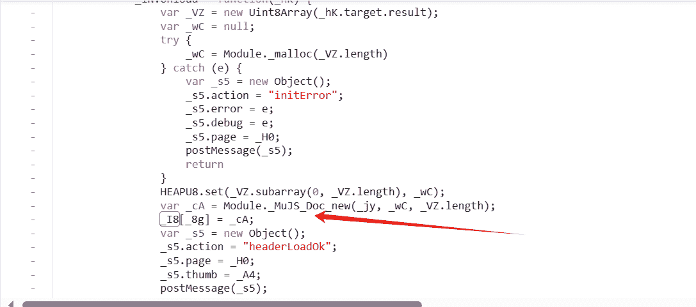

不难发现，其实这儿的代码差别不大，应该是一段初始时的代码，那我们先看这一段就可以了。

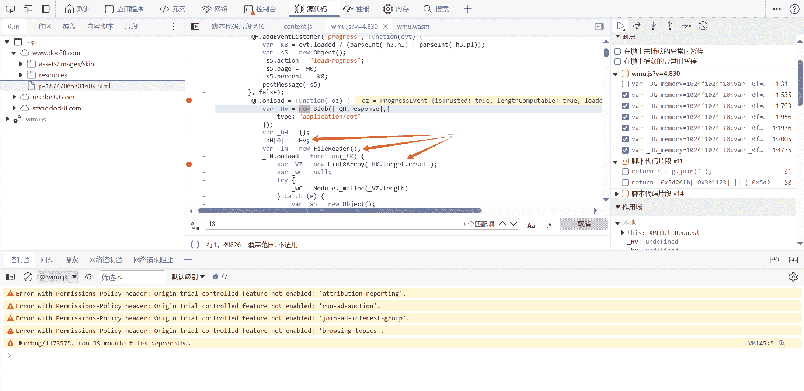

可以看到，这里需要 `Module._malloc`，我也不会 wasm，所以前面所有生成函数都给扣到 js 里了，1100 多行，还好。

载入 wasm 的地方看一下，后面全是。

那只能全扣进去了，最终还是把 5000 多行代码扔到了 js 里。不过 wasm 文件加载的地方肯定要换成自己的本地文件。

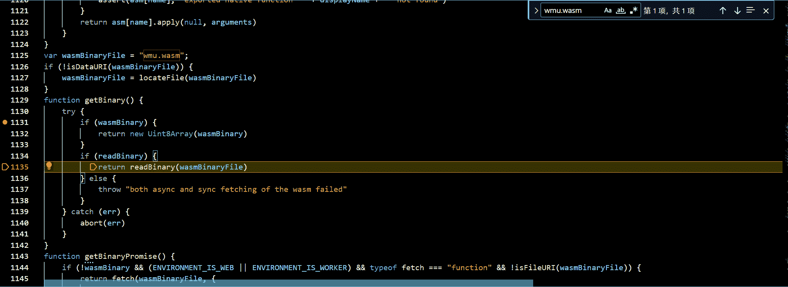

下个断点，看看他是如何载入 wasm 的，其实都是标准的 wasm 引入流程，自带 nodejs 环境的加载，那我直接把文件地址改成 `wmu.wasm` 即可

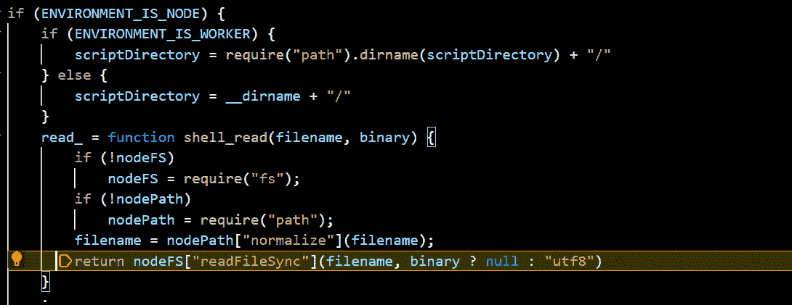

运行发现有一个 H5 的 API，`postMessage`，随便定义一个 `console.log` 先试试，发现成功运行初始化

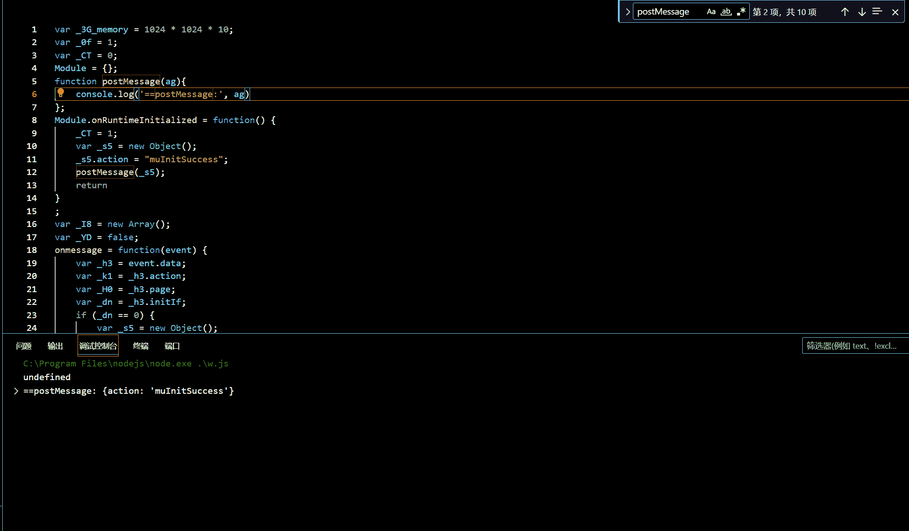

那么继续扣 `init` 里的代码，先看看能不能成功生成 `_wC`，发现没有什么问题

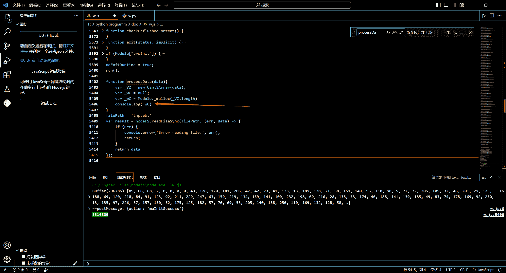

涉及到 `postmessage` 地方都不管，是 js 间通信用的，主要初始化数据就是这两个，扣进代码

[pir8ciq](https://imgse.com/i/pir8ciq)

[pir8hyF](https://imgse.com/i/pir8hyF)

我们来整体看看这段调用到底在做什么？

[pirBGPe](https://imgse.com/i/pirBGPe)

`initHeader` 和后续多个 `getPage` 对应的内容即为总的一个 ebt 后其他分页 ebt

[pirdyG9](https://imgse.com/i/pirdyG9)

[pirdD54](https://imgse.com/i/pirdD54)

## 代码编写

首先，构造 `initHeader` 函数，用于初始化初始 ebt

[pir0wh4](https://imgse.com/i/pir0wh4)

然后构造 `getPage` 函数，用于获取后续文字，其中 `_H0` 是当前页码

[pir0dNF](https://imgse.com/i/pir0dNF)

然后简单的合并以下看看。

[pir0B9J](https://imgse.com/i/pir0B9J)

成功获取当页文字。

## 油猴脚本

## 总结

其实没有什么混淆之内的，写的很清晰，主要是我不懂 wasm 这一类东西，之前几个网站涉及 wasm 都直接尝试找到 wasm 调用失败时的 js 加密代码（很有效）。

## 问题与展望

1. 这里面的函数都是异步，包括扣下来的 `createWasm`，套了不少异步 `.then` 来初始化 wasm。但是 python `execjs` 调用 js 似乎不能等待异步完成。如何解决这一问题呢？之前我写的都是在最后一个 `.then` 开一个端口，写了一个简单的网络接口来与 python 传递信息，虽然能用但不是什么好方法，如何做呢。
2. 现在的文字有些乱，因为网页生成画布同时利用了 ebt 中的文字和文字位置信息，是否可以利用生成的文字和文字位置，生成可复制 pdf。
