# [Web逆向] 某解析 wasm 逆向

- 原帖：`https://www.52pojie.cn/forum.php?mod=viewthread&tid=1864441`
- 抓取时间：2026-11-01T22:42:16

## 目标网址

- `aHR0cHM6Ly92aXAueWV5dWxpbmdmZW5nLmNvbS8=`
- `aHR0cHM6Ly8xMTAuNDIuMi4yNDc6OTA5MC94cGxheWVyL2FwaS5waHA=`

## 分析过程

1. 首先打开 `f12` 抓包并按下播放。


`image.png`（21.96 KB，下载次数：0）

[`href="forum.php?mod=attachment&aid=MjY2MTAyOXw0NzlmNGFhNHwxNzkzNTcyOTM0fDE2ODA4NnwxODY0NDQx&nothumb=yes" target="_blank"`](https://www.52pojie.cn/forum.php?mod=attachment&aid=MjY2MTAyOXw0NzlmNGFhNHwxNzkzNTcyOTM0fDE2ODA4NnwxODY0NDQx&nothumb=yes)

2023-12-2 14:18 上传

注意：这之前要先过掉下面的检测。


```
Date.prototype.valueOf = () => 1701318661525
```

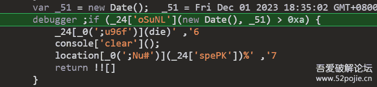

`image-1.png` (39.59 KB, 下载次数: 0)

[href="forum.php?mod=attachment&aid=MjY2MTAzMHwzN2RmNTRjMnwxNzkzNTcyOTM0fDE2ODA4NnwxODY0NDQx&nothumb=yes" target="_blank"](https://www.52pojie.cn/forum.php?mod=attachment&aid=MjY2MTAzMHwzN2RmNTRjMnwxNzkzNTcyOTM0fDE2ODA4NnwxODY0NDQx&nothumb=yes)

2023-12-2 14:18 上传

## 2、发现视频地址如下

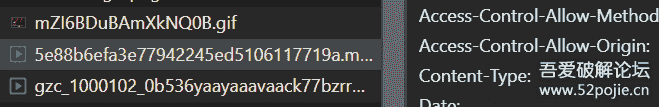

`image-2.png` (22.38 KB, 下载次数: 0)

[href="forum.php?mod=attachment&aid=MjY2MTAzMXwxZmMzNDY0MXwxNzkzNTcyOTM0fDE2ODA4NnwxODY0NDQx&nothumb=yes" target="_blank"](https://www.52pojie.cn/forum.php?mod=attachment&aid=MjY2MTAzMXwxZmMzNDY0MXwxNzkzNTcyOTM0fDE2ODA4NnwxODY0NDQx&nothumb=yes)

2023-12-2 14:19 上传

继续往上找 `api.php` 很可疑

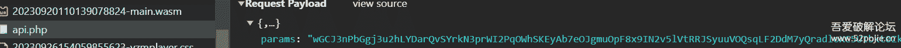

`image-3.png` (27.17 KB, 下载次数: 0)

[href="forum.php?mod=attachment&aid=MjY2MTAzMnxkZWNjZWM5YXwxNzkzNTcyOTM0fDE2ODA4NnwxODY0NDQx&nothumb=yes" target="_blank"](https://www.52pojie.cn/forum.php?mod=attachment&aid=MjY2MTAzMnxkZWNjZWM5YXwxNzkzNTcyOTM0fDE2ODA4NnwxODY0NDQx&nothumb=yes)

2023-12-2 14:19 上传

用通过调用堆栈发现下面很可疑、但是代码太难看了

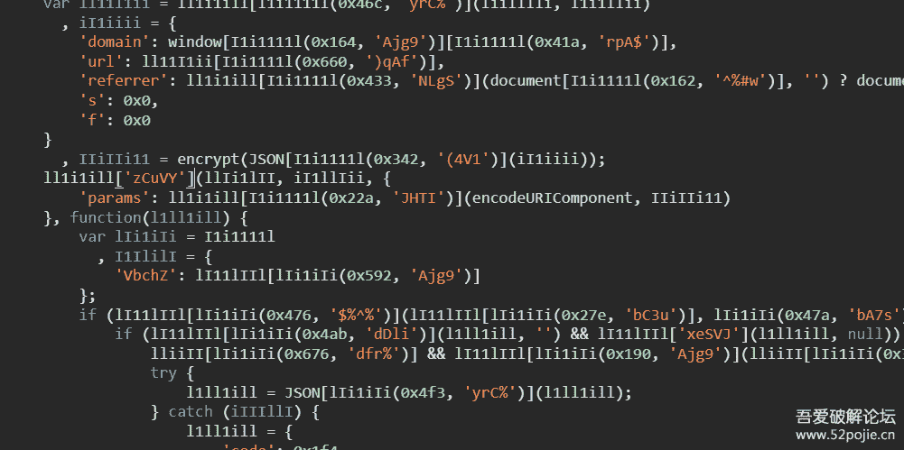

`image-4.png` (76.27 KB, 下载次数: 0)

[href="forum.php?mod=attachment&aid=MjY2MTAzM3wwMDI4ZjAxYXwxNzkzNTcyOTM0fDE2ODA4NnwxODY0NDQx&nothumb=yes" target="_blank"](https://www.52pojie.cn/forum.php?mod=attachment&aid=MjY2MTAzM3wwMDI4ZjAxYXwxNzkzNTcyOTM0fDE2ODA4NnwxODY0NDQx&nothumb=yes)

2023-12-2 14:20 上传

解混淆后看一下

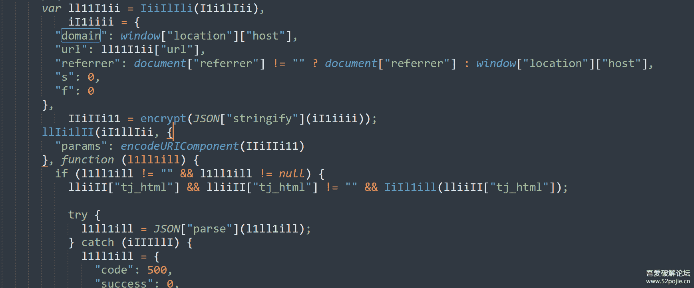

`image-5.png` (123.37 KB, 下载次数: 0)

[href="forum.php?mod=attachment&aid=MjY2MTAzNHwxZjU2MDAxZXwxNzkzNTcyOTM0fDE2ODA4NnwxODY0NDQx&nothumb=yes" target="_blank"](https://www.52pojie.cn/forum.php?mod=attachment&aid=MjY2MTAzNHwxZjU2MDAxZXwxNzkzNTcyOTM0fDE2ODA4NnwxODY0NDQx&nothumb=yes)

2023-12-2 14:20 上传

可以看出 `params` 参数就是下面这行代码生成的

`IIiIIi11 = encrypt(JSON["stringify"](iI1iiii));`

控制台打印一下 `encrypt`

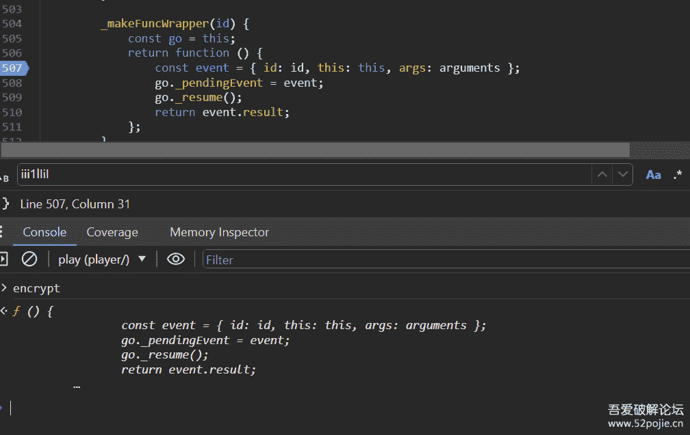

`image-6.png` (53.97 KB, 下载次数: 0)

[href="forum.php?mod=attachment&aid=MjY2MTAzNXxiYjM4YWM3MHwxNzkzNTcyOTM0fDE2ODA4NnwxODY0NDQx&nothumb=yes" target="_blank"](https://www.52pojie.cn/forum.php?mod=attachment&aid=MjY2MTAzNXxiYjM4YWM3MHwxNzkzNTcyOTM0fDE2ODA4NnwxODY0NDQx&nothumb=yes)

2023-12-2 14:21 上传

然后在如图所示的位置下一个断点、并点击播放

打印一下 `argument`、继续单步进入

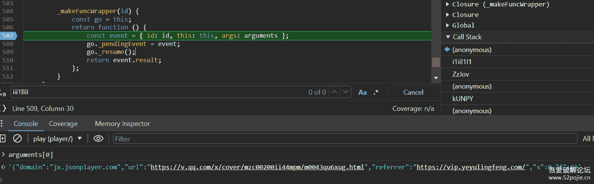

`image-7.png` (70.78 KB, 下载次数: 0)

[href="forum.php?mod=attachment&aid=MjY2MTAzNnw3MDEwNzU3ZXwxNzkzNTcyOTM0fDE2ODA4NnwxODY0NDQx&nothumb=yes" target="_blank"](https://www.52pojie.cn/forum.php?mod=attachment&aid=MjY2MTAzNnw3MDEwNzU3ZXwxNzkzNTcyOTM0fDE2ODA4NnwxODY0NDQx&nothumb=yes)

2023-12-2 14:21 上传

然后就进入了 `wasm` 中

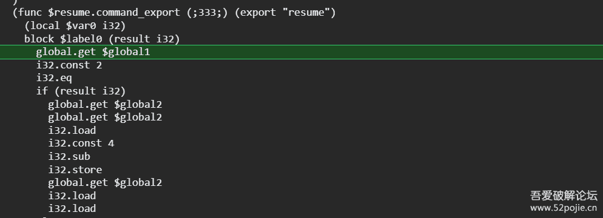

`image-8.png` (33.3 KB, 下载次数: 0)

[href="forum.php?mod=attachment&aid=MjY2MTAzN3wyYzdkOGFkZHwxNzkzNTcyOTM0fDE2ODA4NnwxODY0NDQx&nothumb=yes" target="_blank"](https://www.52pojie.cn/forum.php?mod=attachment&aid=MjY2MTAzN3wyYzdkOGFkZHwxNzkzNTcyOTM0fDE2ODA4NnwxODY0NDQx&nothumb=yes)

2023-12-2 14:21 上传

在 `wasm` 中搜索一下 `md5`,`aes` 之类的关键词并下断点

最后在 `$crypto/cipher.newCBC` 和 `$crypto/aes.NewCipher` 这两个地方下断点

为什么呢？因为这玩意是 `Go` 编译的，看前面使用了 `Go` 对象就知道

在网上搜索了一下

[//cloud.tencent.com/developer/article/2062891" target="_blank" rel="noopener noreferrer nofollow"](https://cloud.tencent.com/developer/article/2062891:rel="nofollow noopener" href="https)

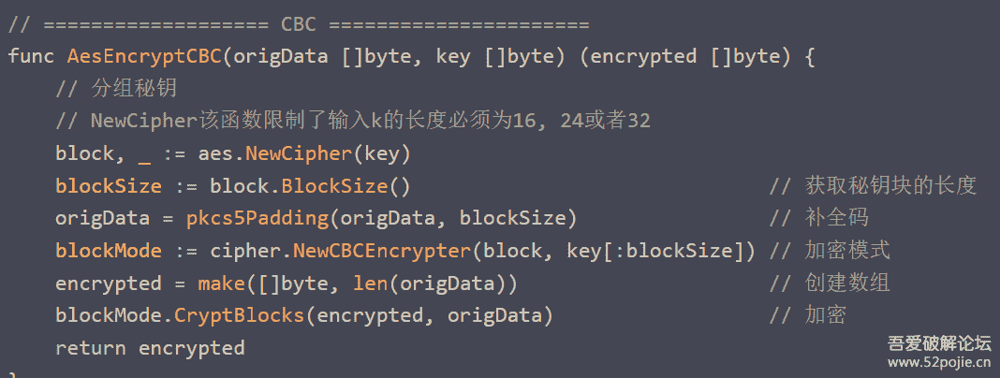

`image-9.png` (100.56 KB, 下载次数: 0)

[href="forum.php?mod=attachment&aid=MjY2MTAzOHxkMWUwMjlmOXwxNzkzNTcyOTM0fDE2ODA4NnwxODY0NDQx&nothumb=yes" target="_blank"](https://www.52pojie.cn/forum.php?mod=attachment&aid=MjY2MTAzOHxkMWUwMjlmOXwxNzkzNTcyOTM0fDE2ODA4NnwxODY0NDQx&nothumb=yes)

2023-12-2 14:22 上传

是不是很相似、接下来就是就是找 `key` 和 `iv` 了

`encrypt` 函数就一个参数是代加密的明文 很显然 `key` 和 `iv` 是在程序运行时获取的

根据上面的 `Go` 的 `AES` 实现我们可以知道 `key` 是 `NewCipher` 时传入的，`iv` 是 `newCBC` 时传入的(图中 `key` 和 `iv` 一样所以没有)

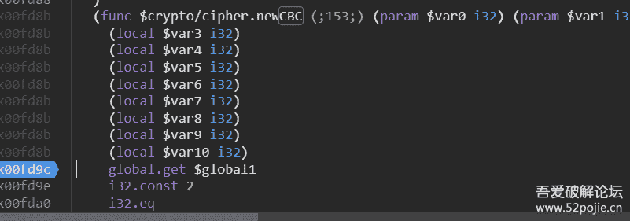

`image-10.png` (45.77 KB, 下载次数: 0)

[href="forum.php?mod=attachment&aid=MjY2MTAzOXw5N2M1NjY1MHwxNzkzNTcyOTM0fDE2ODA4NnwxODY0NDQx&nothumb=yes" target="_blank"](https://www.52pojie.cn/forum.php?mod=attachment&aid=MjY2MTAzOXw5N2M1NjY1MHwxNzkzNTcyOTM0fDE2ODA4NnwxODY0NDQx&nothumb=yes)

2023-12-2 14:22 上传

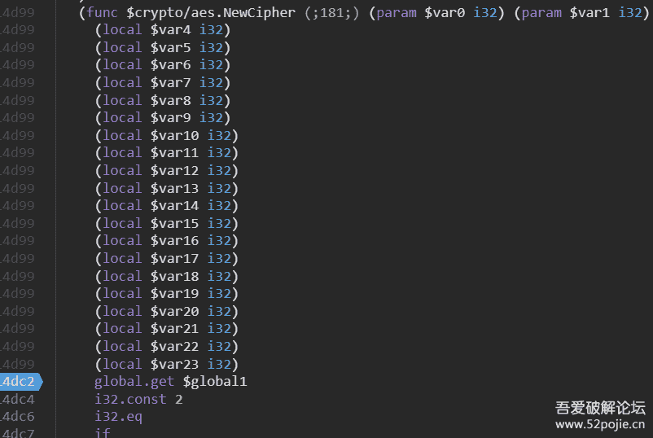

`image-11.png` (79.44 KB, 下载次数: 0)

[href="forum.php?mod=attachment&aid=MjY2MTA0MHwwNGE3ZDA3YnwxNzkzNTcyOTM0fDE2ODA4NnwxODY0NDQx&nothumb=yes" target="_blank"](https://www.52pojie.cn/forum.php?mod=attachment&aid=MjY2MTA0MHwwNGE3ZDA3YnwxNzkzNTcyOTM0fDE2ODA4NnwxODY0NDQx&nothumb=yes)

2023-12-2 14:22 上传

打上断点后 运行

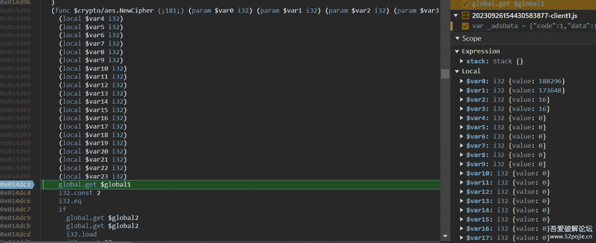

`image-12.png` (182.22 KB, 下载次数: 0)

[href="forum.php?mod=attachment&aid=MjY2MTA0MXw5Yzk4YTJjYnwxNzkzNTcyOTM0fDE2ODA4NnwxODY0NDQx&nothumb=yes" target="_blank"](https://www.52pojie.cn/forum.php?mod=attachment&aid=MjY2MTA0MXw5Yzk4YTJjYnwxNzkzNTcyOTM0fDE2ODA4NnwxODY0NDQx&nothumb=yes)

2023-12-2 14:23 上传

可以看到成功在 `NewCipher` 处断住了 查看一下值

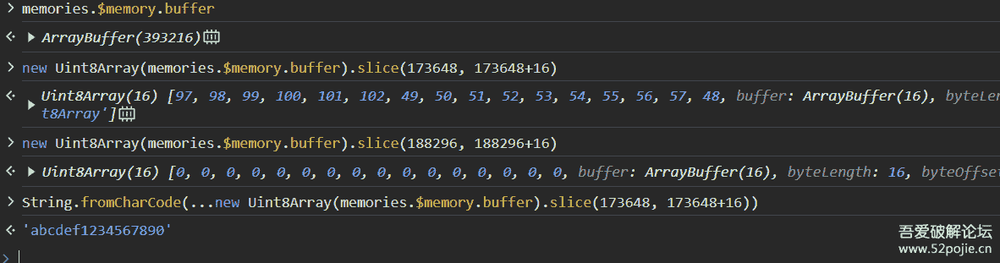

`image-13.png` (53.88 KB, 下载次数: 0)

[href="forum.php?mod=attachment&aid=MjY2MTA0MnxkNGFjOGExNnwxNzkzNTcyOTM0fDE2ODA4NnwxODY0NDQx&nothumb=yes" target="_blank"](https://www.52pojie.cn/forum.php?mod=attachment&aid=MjY2MTA0MnxkNGFjOGExNnwxNzkzNTcyOTM0fDE2ODA4NnwxODY0NDQx&nothumb=yes)

2023-12-2 14:23 上传

可以看到173648位置的'abcdef1234567890'很可疑

继续运行到 `newCBC`

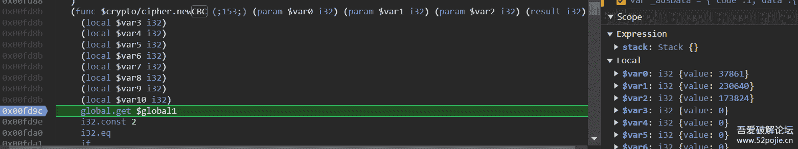

`image-14.png` (84.11 KB, 下载次数: 0)

[href="forum.php?mod=attachment&aid=MjY2MTA0M3xkNmU4MDEzN3wxNzkzNTcyOTM0fDE2ODA4NnwxODY0NDQx&nothumb=yes" target="_blank"](https://www.52pojie.cn/forum.php?mod=attachment&aid=MjY2MTA0M3xkNmU4MDEzN3wxNzkzNTcyOTM0fDE2ODA4NnwxODY0NDQx&nothumb=yes)

2023-12-2 14:23 上传

同样打印一下173824位置处有个'1234567890abcdef'

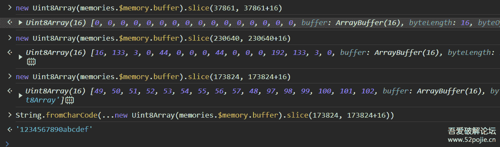

`image-15.png` (62.17 KB, 下载次数: 0)

[href="forum.php?mod=attachment&aid=MjY2MTA0NHw5MWI3MWI5YXwxNzkzNTcyOTM0fDE2ODA4NnwxODY0NDQx&nothumb=yes" target="_blank"](https://www.52pojie.cn/forum.php?mod=attachment&aid=MjY2MTA0NHw5MWI3MWI5YXwxNzkzNTcyOTM0fDE2ODA4NnwxODY0NDQx&nothumb=yes)

2023-12-2 14:23 上传

验证一下上面的猜测

先看 `encrypt('1')` 的值

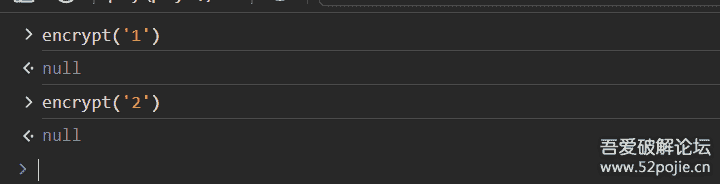

`image-16.png` (11.56 KB, 下载次数: 0)

[href="forum.php?mod=attachment&aid=MjY2MTA0NXw4NjcxYTJhYnwxNzkzNTcyOTM0fDE2ODA4NnwxODY0NDQx&nothumb=yes" target="_blank"](https://www.52pojie.cn/forum.php?mod=attachment&aid=MjY2MTA0NXw4NjcxYTJhYnwxNzkzNTcyOTM0fDE2ODA4NnwxODY0NDQx&nothumb=yes)

2023-12-2 14:24 上传

很不对劲 为什么是null呢？

调试发现 `encrypt` 和 `decrypt` 都只能使用一次，使用了之后应该是修改了某些东西，反正就是不能用了

点击播放按钮刷新，断住查看

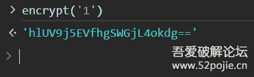

`image-17.png` (9.89 KB, 下载次数: 0)

[href="forum.php?mod=attachment&aid=MjY2MTA0Nnw2ZTM5Y2RiMnwxNzkzNTcyOTM0fDE2ODA4NnwxODY0NDQx&nothumb=yes" target="_blank"](https://www.52pojie.cn/forum.php?mod=attachment&aid=MjY2MTA0Nnw2ZTM5Y2RiMnwxNzkzNTcyOTM0fDE2ODA4NnwxODY0NDQx&nothumb=yes)

2023-12-2 14:24 上传

`encrypt('1')` 的值是'hlUV9j5EVfhgSWGjL4okdg=='

先用JS复现、代码如下

```
t = '1';
key = CryptoJS.enc.Utf8.parse('abcdef1234567890');
iv = CryptoJS.enc.Utf8.parse('1234567890abcdef');
result = CryptoJS.AES.encrypt(t, key, {
  iv: iv,
  mode: CryptoJS.mode.CBC,
  padding: CryptoJS.pad.Pkcs7
}).toString();
```

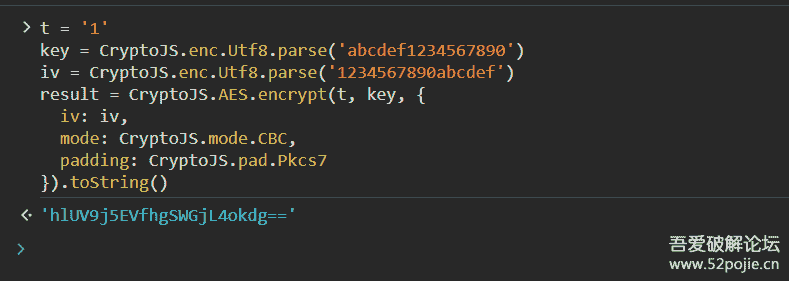

`image-18.png` (29.67 KB, 下载次数: 0)

[href="forum.php?mod=attachment&aid=MjY2MTA0N3w3NTljOGY3NXwxNzkzNTcyOTM0fDE2ODA4NnwxODY0NDQx&nothumb=yes" target="_blank"](https://www.52pojie.cn/forum.php?mod=attachment&aid=MjY2MTA0N3w3NTljOGY3NXwxNzkzNTcyOTM0fDE2ODA4NnwxODY0NDQx&nothumb=yes)

2023-12-2 14:24 上传


# `AES_CBC` 加密分析

发现结果一毛一样，就是标准的 `AES_CBC` 加密。

但是到这还没完，我们实际使用的时候会发现和 `CryptoJS` 的结果不完全对得上。

## `encrypt(s)` 的结果

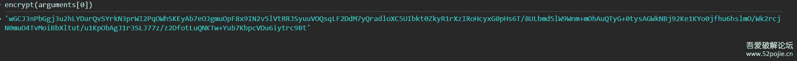

`image-19.png`（26.81 KB，下载次数：0），2023-12-2 14:25 上传。

[附件原图](https://www.52pojie.cn/forum.php?mod=attachment&aid=MjY2MTA0OHxmNzJjYjM1NXwxNzkzNTcyOTM0fDE2ODA4NnwxODY0NDQx&nothumb=yes)

## `CryptoJS` 的结果

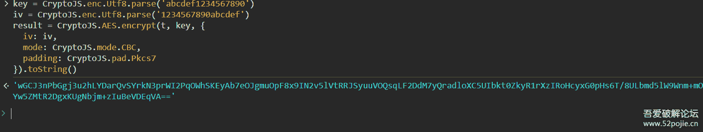

`image-20.png`（41 KB，下载次数：0），2023-12-2 14:25 上传。

[附件原图](https://www.52pojie.cn/forum.php?mod=attachment&aid=MjY2MTA0OXxkNDVlYWMzMHwxNzkzNTcyOTM0fDE2ODA4NnwxODY0NDQx&nothumb=yes)

就是后面的有点对不上，而且 `encrypt(s)` 同样的 `s` 每次结果都不太一样。

一看就是在 `wasm` 中加盐了，因为有 `decrypt`，直接使用 `decrypt` 输出一下结果看看。

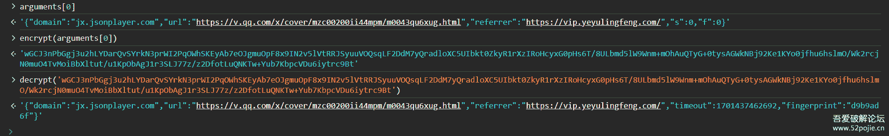

`image-21.png`（69.99 KB，下载次数：0），2023-12-2 14:25 上传。

[附件原图](https://www.52pojie.cn/forum.php?mod=attachment&aid=MjY2MTA1MHxlMTZkNjRlOHwxNzkzNTcyOTM0fDE2ODA4NnwxODY0NDQx&nothumb=yes)

果然多了个 `timeout` 和 `fingerprint`，每次都有变化就是因为 `timeout` 这个时间戳在变。

`fingerprint` 很好找（PS：好像随便的填都行，`''.padEnd(8,0)`）。

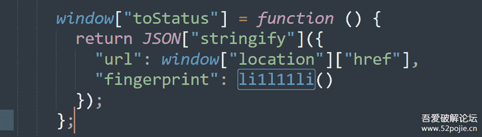

`image-22.png`（48.29 KB，下载次数：0），2023-12-2 14:25 上传。

[附件原图](https://www.52pojie.cn/forum.php?mod=attachment&aid=MjY2MTA1MXwyY2EwNjk2N3wxNzkzNTcyOTM0fDE2ODA4NnwxODY0NDQx&nothumb=yes)

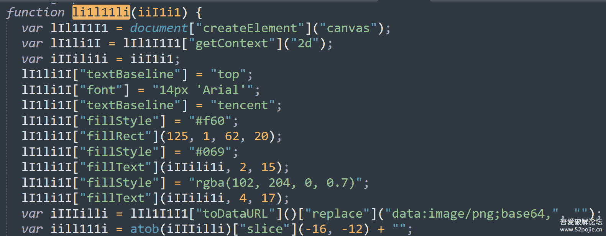

`image-23.png`（149.88 KB，下载次数：0），2023-12-2 14:26 上传。

[附件原图](https://www.52pojie.cn/forum.php?mod=attachment&aid=MjY2MTA1MnxiM2FmNDVmYnwxNzkzNTcyOTM0fDE2ODA4NnwxODY0NDQx&nothumb=yes)

## 对应的 Python 代码

```python
from Crypto.Cipher import AES
from Crypto.Util.Padding import pad, unpad
def add_to_16(value):
    while len(value) % 16 != 0:
        value += '\0'
    return str.encode(value)
def AesEncryptCBC(origData):
        iv = '1234567890abcdef'
        key = 'abcdef1234567890'
        cipher = AES.new(add_to_16(key), AES.MODE_CBC, add_to_16(iv))
        paddedData = pad(origData.encode('utf-8'), AES.block_size)
        encryptedData = cipher.encrypt(paddedData)
        return base64.b64encode(encryptedData).decode()

def AesDecryptCBC(t):
        iv = '1234567890abcdef'
        key = 'abcdef1234567890'
        cipher = AES.new(add_to_16(key), AES.MODE_CBC, add_to_16(iv))
        decryptedData = cipher.decrypt(base64.b64decode(t))
        decrypted_text = unpad(decryptedData, AES.block_size).decode('utf-8')
        return decrypted_text
```

## 成功请求

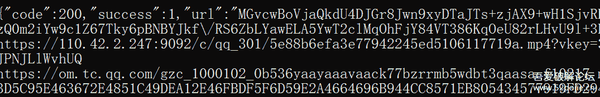

`image-24.png`（45.45 KB，下载次数：0），2023-12-2 14:30 上传。

[附件原图](https://www.52pojie.cn/forum.php?mod=attachment&aid=MjY2MTA1NHxlNzYyNTQ0ZnwxNzkzNTcyOTM0fDE2ODA4NnwxODY0NDQx&nothumb=yes)

## 最后

- 这样分析只是基于这是标准的 AES、魔改或函数名改了都会很

- `wasm` 里面还有一个比较值得一看的函数 `$runtime.stringFromBytes`，当时没想到用 `decrypt` 解密时就是看这个的。

  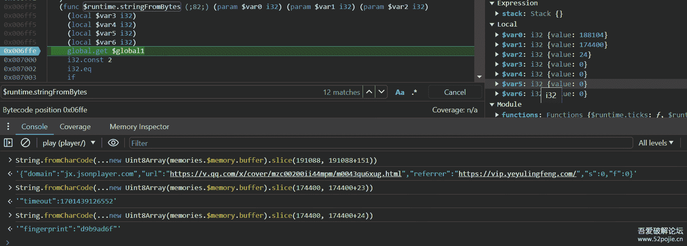

  `image-25.png`（128.28 KB，下载次数：0），2023-12-2 14:30 上传。

  [附件原图](https://www.52pojie.cn/forum.php?mod=attachment&aid=MjY2MTA1NXw4ZmY5YTg2ZXwxNzkzNTcyOTM0fDE2ODA4NnwxODY0NDQx&nothumb=yes)

  在 JS 中是靠下面这两个函数写入 `wasm` 中的：

  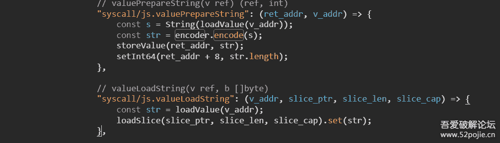

  `image-26.png`（44.61 KB，下载次数：0），2023-12-2 14:30 上传。

  [附件原图](https://www.52pojie.cn/forum.php?mod=attachment&aid=MjY2MTA1NnxkYTM5MDVlMXwxNzkzNTcyOTM0fDE2ODA4NnwxODY0NDQx&nothumb=yes)

- 最后还有一点就是 Python 模拟请求的时候要注意一下，JS 中请求是下面这样的：

  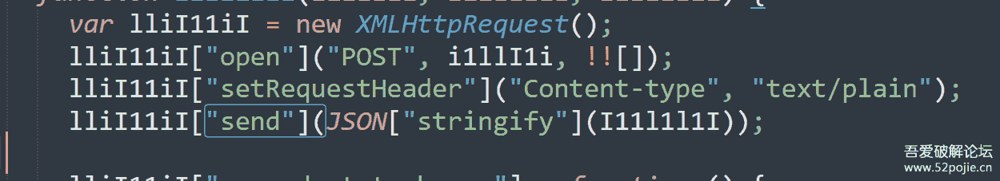

  `image-27.png`（58.48 KB，下载次数：0），2023-12-2 14:31 上传。

  [附件原图](https://www.52pojie.cn/forum.php?mod=attachment&aid=MjY2MTA1N3wyNDc4YWFlNHwxNzkzNTcyOTM0fDE2ODA4NnwxODY0NDQx&nothumb=yes)

  Python 中就要使用 `json`，不能是 `params` 或 `data`。

  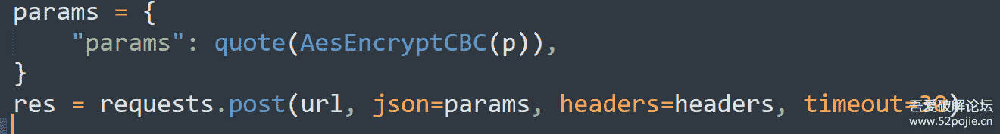

  `image-28.png`（41.04 KB，下载次数：0），2023-12-2 14:31 上传。

  [附件原图](https://www.52pojie.cn/forum.php?mod=attachment&aid=MjY2MTA1OXxmOTJiNTBjZHwxNzkzNTcyOTM0fDE2ODA4NnwxODY0NDQx&nothumb=yes)

- 因水平有限，若有错误之处、还请指出😄
